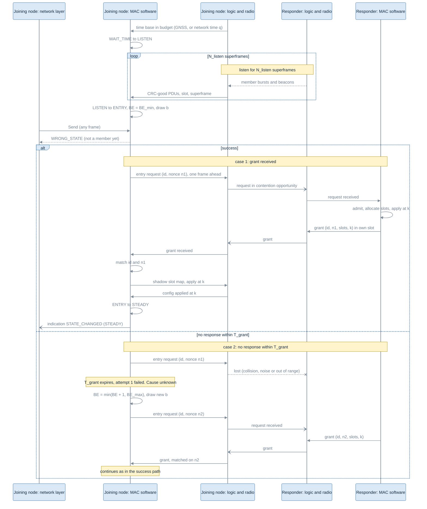
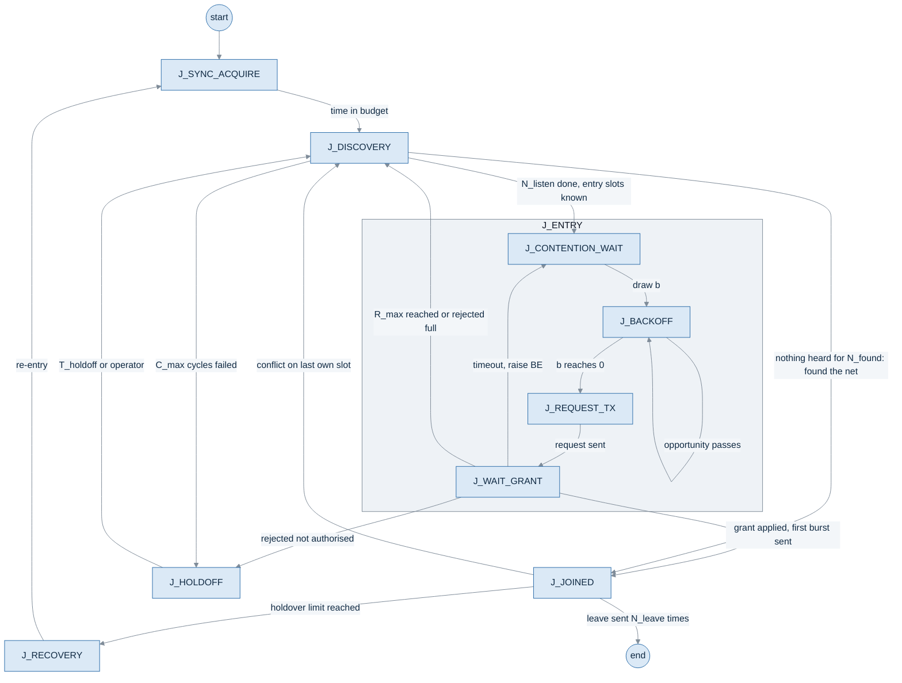
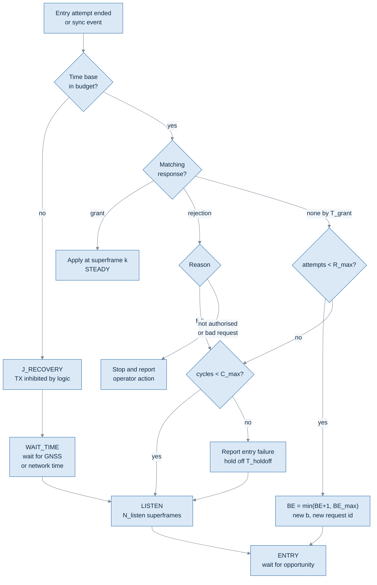

# MAC-03: Contention Access, Collision Avoidance and Network Entry

## 1. Document control and status

| Item | Value |
|---|---|
| Title | MAC-03: Contention access, collision avoidance and network entry. Design note |
| Plan | OSL-396 (vehicular) |
| Task | F02-AK-3 |
| Zoho task | AC2O-T1648 |
| Work package | MAC-03: Contention access, collision avoidance and network entry |
| Priority | P2 |
| Objective | Define how a node enters the network, and how contention-based access reduces collisions when several nodes try to join or transmit at once |
| Status | **Proposed, pending design review** |
| Version | 0.2 (draft) |
| Date | 2026-10-16 |
| Applies to | Vehicular and handheld radios |
| Based on | HH-SDR Medium Access (MAC) Architecture, version 1.2 (issued for review, not signed off). HH-SDR MAC ↔ Network Layer Interface Specification, version 1.1, F01-AK-3 (draft for review) |
| Intended reviewers | Logic (FPGA) owner, MAC software owner, network owner, system architect |
| Author | Akhil |
| Reviewer | Niyam Patel |
| Approver | Niyam Patel |

**Revision history**

| Version | Date | Change |
|---|---|---|
| 0.1 | 2026-10-14 | First draft |
| 0.2 | 2026-10-16 | Updated after the review of 14 Oct 2026: master-less screening of the entry model and a founding rule for cold start. Re-formation and merge. Security preconditions for entry. Sulk, break-in and zeroise. Grant arbitration. Range and guard. Slot length as a parameter. Entry time against node count from a slot-level model. Event-log record. Simulation model. Scripts in Appendix A. Owners as role titles. Alignment with the MAC-network interface version 1.1 |

**Contents**

- [1. Document control and status](#1-document-control-and-status)
- [2. Executive summary](#2-executive-summary)
- [3. Scope and boundaries](#3-scope-and-boundaries)
- [4. Reference architectures and design choice](#4-reference-architectures-and-design-choice)
- [5. Assumptions and terminology](#5-assumptions-and-terminology)
- [6. Proposed network-entry procedure](#6-proposed-network-entry-procedure)
- [7. Contention-slot and back-off rules](#7-contention-slot-and-back-off-rules)
- [8. Collision estimate and model](#8-collision-estimate-and-model)
- [9. Failure, timeout and recovery](#9-failure-timeout-and-recovery)
- [10. Simultaneous restart and hidden-node mitigation](#10-simultaneous-restart-and-hidden-node-mitigation)
- [11. Leave, slot reclamation and age-out](#11-leave-slot-reclamation-and-age-out)
- [12. Integration interfaces and ownership](#12-integration-interfaces-and-ownership)
- [13. Open decisions, dependencies, risks and review checklist](#13-open-decisions-dependencies-risks-and-review-checklist)
- [14. Validation plan](#14-validation-plan)
- [15. References](#15-references)
- [Appendix A. Scripts](#appendix-a-scripts)

### 1.1 Scope

In scope:

- the ordered network-entry procedure for a node that is not yet a member
- how entry requests share contention opportunities, and the random back-off
  that spreads them
- a collision estimate for several nodes joining at once
- failure, timeout and recovery behaviour
- leaving the net, slot reclamation and age-out of silent nodes
- cold start with no member present, and re-formation and merge of nets
- the security preconditions for entry, and how sulk, break-in and zeroise
  affect entry
- entry time against node count, and the simulation model that checks it
- the events and information the MAC needs from the logic and radio, and the
  indications it gives the network layer
- the decisions that must be taken before implementation.

Out of scope:

- source code, HDL and register layouts
- the agreed slot structure, timer values and radio capabilities. These are
  not yet decided, and this note does not decide them. Slot length is
  treated as a parameter (A-2)
- routing, neighbour discovery and topology, which belong to the routing
  protocol in the network layer: OLSRv2 (OLSRd2) for now, with other
  protocols planned later (section 3.2).

This note describes **behaviour and decisions, not an implementation**.

Numeric values are marked "example for analysis" unless a source backs them.
**TBD: requires engineering decision** marks a value that must not be
guessed. Open decisions are numbered D-1 to D-20 and listed in section 13.
"Base design" means the documents in the "Based on" row above. Sources
are listed in section 15.

### 1.2 Acronyms

| Acronym | Meaning |
|---|---|
| ACK | Acknowledgement |
| ASN | Absolute Slot Number (TSCH) |
| BE | Back-off Exponent |
| CCA | Clear Channel Assessment |
| CRC | Cyclic Redundancy Check |
| CSMA-CA | Carrier Sense Multiple Access with Collision Avoidance |
| EB | Enhanced Beacon (IEEE 802.15.4e) |
| FPGA | Field-Programmable Gate Array (the "logic" in this note) |
| GNSS | Global Navigation Satellite System |
| IE | Information Element (IEEE 802.15.4e) |
| LO | Local Oscillator |
| MAC | Medium Access Control |
| NHDP | MANET Neighborhood Discovery Protocol (RFC 6130) |
| AODV | Ad hoc On-Demand Distance Vector routing |
| BATMAN-adv | Better Approach To Mobile Ad-hoc Networking, advanced: a layer-2 mesh routing protocol in the Linux kernel |
| OLSRv2 | Optimized Link State Routing Protocol version 2 (RFC 7181). OLSRd2 is its implementation. The routing protocol in use now |
| PDU | Protocol Data Unit, one MAC unit carried in one slot |
| PHY | Physical layer |
| 1PPS | One pulse per second, from the GNSS receiver |
| RSSI | Received Signal Strength Indicator |
| RTC | Real-Time Clock |
| SNR | Signal-to-Noise Ratio |
| TDMA | Time Division Multiple Access |
| TSCH | Time-Slotted Channel Hopping (IEEE 802.15.4e) |
| 6TiSCH | IPv6 over the TSCH mode of IEEE 802.15.4e (IETF working group) |

## 2. Executive summary

A node joins in four steps:

1. Acquire time.
2. Listen.
3. Contend for entry.
4. Wait for a grant.

The base design already fixes the overall sequence: a node passes through
the MAC states WAIT_TIME, LISTEN, ENTRY and then STEADY. What happens inside
ENTRY is open. Filling that gap is the purpose of this note.

Each node keeps time in a local time base in the logic. It is disciplined by
GNSS 1PPS when GNSS is available, otherwise by an external GNSS feed, and
otherwise by network time taken from a member whose time quality is better
than its own (section 5.5). Each node will also have a real-time clock (RTC).
Its role is not decided (D-13).

**Proposed entry flow:**

1. **Acquire time.** In WAIT_TIME the node waits until its time base is in
   budget, from GNSS or from network time with a known quality. It cannot
   follow the hop pattern before then, because the pattern is keyed to net
   time.
2. **Listen.** In LISTEN it receives for a set number of superframes and
   learns two things: which nodes and slots are in use, and where the
   contention opportunities are. The opportunities are either advertised in
   beacons or known in advance (D-2).
3. **Contend.** In ENTRY it picks one contention opportunity at random from
   a window of W opportunities, and sends one entry request there.
4. **Wait for a grant.** It waits a bounded time for an entry grant that
   echoes its request.
   - **Grant received:** the node applies the granted slots at the
     superframe named in the grant, then moves to STEADY.
   - **Nothing received:** it doubles the window, up to a maximum, and tries
     again.
   - **Retries exhausted:** it goes back to LISTEN.
   - **Retries exhausted several times in a row:** it reports entry failure
     and holds off for a long time.

**Contention-slot strategy:** a small number of slots per frame are
marked "shared entry". Only nodes in ENTRY may transmit in them. Members keep
their own dedicated slots. The back-off is counted in contention
opportunities, not in time, so it does not depend on the slot timing, which
is still open. TSCH counts its shared-cell back-off the same way, in shared
slots.

**Collision estimate.** The example uses the first window of the proposed
scheme: 16 opportunities (BE_min = 4, section 7.1),
with no carrier sense and no capture.

| Joining nodes | Chance that a given node's request collides |
|---|---|
| 2 | 6.3 % |
| 8 | 36 % |
| 16 | 62 % |
| 32 | 86 % |

These are calculated estimates, not measurements (section 8). They show
that one fixed window is not enough after a whole-network restart. Window
growth and an initial random hold-off are needed.

**Leaving.** A node that leaves announces it and gives its slots back. A
node that is switched off silently is aged out by the others after a set
number of superframes, and its slots are reused after a short quarantine. A
grant is only confirmed when the joiner sends its first burst in the granted
slot. An unused grant lapses (section 11).

**Starting a net and merging nets.** There is no master. Any member in
STEADY may answer an entry request. A node that hears nothing on its net
preset for N_found superframes, plus a random jitter, founds the net: it
claims an own slot at random and starts sending beacons (section 10.1). When
two nets meet, nodes detect it from the net identity in beacons, and the
losing side moves only its clashing slots, one node at a time (section
10.3). Which side keeps its slots is open (D-20).

**Security, sulk and break-in.** A node attempts entry only with its net
preset and key loaded, keys not zeroised and the operator authenticated.
Requests and grants carry an authentication tag and a freshness value. Entry
is suspended in sulk and during break-in (section 9.3).

**Entry time.** A slot-level model with the example values gives a median
time until all K nodes hold a grant of about 0.8 s for K = 8, 1.6 s for
K = 16 and 2.7 s for K = 32 (section 8.6).

**Decisions needed before implementation (section 13).** The biggest are:

- **D-1, entry model:** any member grants, or a distributed slot claim.
  A single coordinator and a fixed slot map fail the master-less
  requirement. A fixed map is kept only as a December-demonstration
  deviation.
- **D-2:** how a node learns where the contention opportunities are.
- **D-3:** how many shared entry slots there are.
- **D-5:** the request and grant formats, and duplicate handling.
- **D-9:** whether the radio can do any clear-channel assessment.
- **D-11:** what the logic can support on day one.
- **D-18, D-19, D-20:** two RF heads, the entry hopset, and which net keeps
  its slots in a merge.

## 3. Scope and boundaries

### 3.1 Who does what

| Layer | Owns | Does not own |
|---|---|---|
| PHY, radio and logic (`mac_pl`, time base, `fh_controller`, `rf_ctrl_fsm`) | Slot timing to the microsecond, hop retune, transmit only in permitted slots, PDU CRC, burst metrics, TX inhibit on sync loss | Deciding which slot to use, entry policy, back-off |
| MAC software (`mac_ps`, `hh_mac`) | Entry policy, slot map, back-off, request and grant handling, retry limits, reporting state to the network layer | Microsecond timing, routing |
| Network layer (Linux IP, the routing protocol, `hh_netif`) | Neighbour discovery, routing and forwarding. Routing protocol now OLSRv2 (OLSRd2). Others planned | Slot access, entry, synchronisation |

The network layer row assumes Linux on the processor. Linux or a real-time
operating system is not yet decided. If it changes, that row changes, not
the entry design.

### 3.2 The routing protocol does not do MAC entry

**Routing protocol: OLSRv2, run by OLSRd2, for now** (decided 2026-10-15).
BATMAN-adv and AODV are planned to be added later (D-15). Where OLSRd is
named in the list of MANET protocols, the implementation meant is OLSRd2. The
MAC must therefore stay independent of the routing protocol, so that each of
them can run on it without change.

Whichever protocol is chosen, the boundary is the same:

- **No synchronisation.** The routing protocol does not acquire time or a
  hop pattern.
- **No medium access.** It does not decide when a radio may transmit.
- **No entry.** It does not admit a node to the slot structure.

All three candidates need a working link layer underneath, and none of them
replaces the MAC.

The design must not copy routing work into the MAC. In particular,
"neighbour" in the MAC sense means "a node whose bursts I receive". It is
**not** the routing protocol's neighbour set, and the MAC must not keep its
own copy of the routing protocol's link tracking.

What changes with each protocol:

| Candidate | Where it runs | Effect on this note |
|---|---|---|
| OLSRv2 (OLSRd2), in use now | Over IP. Its neighbour discovery (NHDP) sends HELLO messages over IP | Section 3.3 as written |
| AODV, planned | Over IP. Finds routes on demand rather than in advance | No periodic HELLO is needed for routing, so "routes follow entry" depends on traffic, not a timer |
| BATMAN-adv, planned | **At layer 2**, below IP, inside the Linux kernel. It sends its own originator messages, not HELLO messages | The "over IP" wording and the HELLO timing in section 3.3 would change. It also sits directly on top of the MAC, so how it sees MAC neighbours must be checked against this boundary |

### 3.3 Two separate events

| Event | Meaning | Who reports it |
|---|---|---|
| MAC entry success | The node owns at least one slot and may transmit. MAC state STEADY | MAC, through Status (interface note, sections 19 and 21) |
| Route convergence | The routing protocol has found its neighbours and routes | The routing protocol (now: OLSRd2) |

Entry success comes first, because Send is refused in ENTRY. The routing
protocol therefore cannot send anything until the MAC is in STEADY
(interface note, section 21). Route convergence follows later. With
OLSRv2, HELLO messages go out every HELLO_INTERVAL, with a proposed
value of 2 s. With the protocols planned later, the timing is that protocol's own
(section 3.2). Route convergence must not be read as proof of entry, and
entry success must not be read as proof of routes.

## 4. Reference architectures and design choice

The project has **not** adopted IEEE 802.15.4, TSCH or 6TiSCH. Those
references are used only for mechanisms. Their PHY, timing and frame formats
do not carry over.

### 4.1 What each reference offers

**IEEE 802.15.4 association and CSMA-CA (Carrier Sense Multiple Access with
Collision Avoidance),** as implemented in ns-3 and OpenThread.

- **Back-off.** Before transmitting, a device waits a random number of
  back-off periods, from $0$ to $2^{BE}-1$. One back-off period is 20 symbols. It
  then checks the channel (CCA, clear-channel assessment).
  - **Busy channel:** BE grows by 1, up to macMaxBE, and the device tries
    again.
  - **Too many busy checks:** after macMaxCSMABackoffs busy checks it gives
    up.
  - **Defaults:** macMinBE 3, macMaxBE 5, macMaxCSMABackoffs 4, macMaxFrameRetries 3.
- **Association.** A device sends an Association Request, and the
  coordinator acknowledges it. After macResponseWaitTime, the device polls
  with a Data Request. The coordinator then sends an Association Response,
  and that response is what admits the device. A timeout ends in "no data".
- **The useful lesson:** the ACK only says the request arrived. The
  Association Response is the grant. Section 6 keeps the same separation.

**TSCH (Time-Slotted Channel Hopping) and 6TiSCH.**

- **Time structure.** Time is divided into timeslots, grouped into
  repeating slotframes. A cell is one slot offset on one channel offset.
  Frequency = F[(ASN + channelOffset) mod nFreq], where ASN is the absolute
  slot number.
- **Dedicated and shared cells.** A cell is dedicated by default. In a
  shared cell several nodes may transmit, and "TSCH defines a backoff
  algorithm for shared cells". Such a cell gives "slotted-Aloha behavior".
- **Back-off in Contiki-NG.** The back-off is applied only after failures
  on shared links. It is counted in shared slots, drawn from $0$ to $2^{BE}-1$,
  with BE from `TSCH_MAC_MIN_BE` = 1 to `TSCH_MAC_MAX_BE` = 5. Failures on
  dedicated links leave it unchanged.
- **Joining.** A node scans channels at random until it hears an
  Enhanced Beacon. The EB carries the timeslot size, the ASN, slotframe and link
  information, and a join priority.
- **6TiSCH minimal.** One scheduled cell, marked shared and timekeeping,
  is used by all nodes. The slotframe length is "tunable". 101 is only an example. At most 3 retransmissions.
- **Time sync.** Nodes take time from their time source's
  acknowledgements or frames. How a node picks its
  time source is implementation specific.

**OpenThread SubMac (sub-MAC layer).**

- **CSMA back-off.** kCsmaMinBe 3, kCsmaMaxBe 5, kUnitBackoffPeriod 20
  symbols, kAckTimeout 16 ms. BE grows with each busy CCA. Default maximum CSMA back-offs 4, and maximum direct frame
  retries 15.
- **Radio interface.** The radio declares what it can do itself through
  capability flags, for example `OT_RADIO_CAPS_CSMA_BACKOFF`,
  `OT_RADIO_CAPS_TRANSMIT_RETRIES` and `OT_RADIO_CAPS_ACK_TIMEOUT`.
  Whatever the radio cannot do, SubMac does in software (`radio.h`,
  `sub_mac.cpp`, `ShouldHandle()`).
- **Transmit result.** The radio reports back through
  `otPlatRadioTxDone`, with `OT_ERROR_NO_ACK` or
  `OT_ERROR_CHANNEL_ACCESS_FAILURE`.
- **The useful lesson:** a capability-flag split between timing-critical
  radio work and software policy. This matches the project's logic and
  software split.

**ns-3 LR-WPAN.**

- **What it covers.** It models slotted and unslotted CSMA-CA,
  beacon and non-beacon modes, scanning, and the classic association
  procedure.
- **Limits:**
  - "Interference is modeled as AWGN but this is currently not thoroughly
    tested"
  - only the 250 kbit/s O-QPSK PHY
  - no GTS (guaranteed time slots) (section 18.1)
  - reception uses an SINR (signal to interference plus noise ratio)
    preamble-lock check and an error-rate model, with no separate capture
    model (section 18.2).
- **The useful lesson:** it can compare back-off policies under contention.
  It cannot predict this radio.

### 4.2 Comparison

| Reference | Mechanism | Useful concept | Fit to this task | Limitations | What must be adapted |
|---|---|---|---|---|---|
| IEEE 802.15.4 association | Request, ACK, poll, response | ACK and grant are separate messages. Bounded response wait | Good for the request and grant split | Needs a fixed coordinator and indirect (polled) delivery. Assumes a CSMA channel, not TDMA | No poll: the grant goes in the responder's own slot. Entry PDUs are not acknowledged (A-12) |
| IEEE 802.15.4 CSMA-CA | Random back-off in time, then CCA | Exponential window, retry limits | Partial. The window idea fits | Depends on CCA in microseconds. This radio retunes every 1 ms and CCA is unknown (D-9) | Back-off counted in contention opportunities, not in symbol periods. CCA only if D-9 confirms it |
| TSCH and 6TiSCH | Slotted, hopping, shared cells with back-off. EBs for joining | Shared cells inside a dedicated schedule. Back-off counted in shared slots. Beacon-advertised join info | **Closest** to this project's slotted, hopping MAC | Time comes from neighbours, not GNSS. ACK-based. Join and security rely on further 6TiSCH work. Timing set for 802.15.4 PHYs | Time from GNSS. No ACK. Shared entry slots instead of a shared cell for all traffic. Grant instead of a link-layer join |
| OpenThread SubMac | Software MAC over a radio abstraction with capability flags | Clean split: the radio does what it can, software the rest | Good model for the logic and software split | 802.15.4 only. Not slotted | Capability idea only. The interface is the project's own (section 12) |
| ns-3 LR-WPAN | Simulation of association and CSMA-CA | Ready-made model for contention studies | Useful for comparing policies | AWGN interference "not thoroughly tested". One PHY. No TDMA, no hopping, no capture model | Use for relative comparisons only. A custom slot-level model is needed for this design (section 14) |

### 4.3 Recommendation

Use **TSCH shared-cell behaviour as the main reference**: dedicated slots
for members, a small number of shared slots for entry, and back-off counted
in shared slots. Take **request and grant separation** from IEEE 802.15.4
association.

This depends on three things:

- **Shared slots must be allowed.** D-1 (entry model) and D-3 (slot
  structure) must allow shared entry slots. If the network owner picks a
  fixed slot map (D-1 option C), contention for entry largely disappears,
  and most of this note is not needed.
- **The logic must support them.** It must be able to transmit in a shared
  slot (D-11).
- **The standards are references only.** This recommendation does not
  adopt TSCH, 6TiSCH or IEEE 802.15.4. No open-source code above can be
  dropped into the logic design. All of it targets 802.15.4 radios on
  microcontrollers.

## 5. Assumptions and terminology

### 5.1 Terms

| Term | Meaning in this note |
|---|---|
| Coordinator | A node that answers entry requests with a grant or a rejection. There is no fixed coordinator: any member in STEADY may answer (D-1). This note uses **responder** for "whichever member answers" |
| Founder | The first node of a net, which started it under the founding rule (section 10.1) |
| Net identity | The founding superframe and the founder's node id, carried in beacons. Tells two nets apart (section 10.3) |
| d_max | The largest one-way distance to a neighbour that the guard must cover (section 7.2) |
| Joining node | A node in WAIT_TIME, LISTEN or ENTRY that does not own a slot yet |
| Member | A node in STEADY or HOLDOVER that owns at least one slot |
| Beacon | Here, a MAC-level broadcast from a member that carries what a joining node needs (D-2). Not the network-layer frame kind "beacon", which carries routing traffic |
| Synchronisation | The node's time base is within the budget for its time quality, from GNSS or from network time, and the node knows the hop pattern |
| Time quality (q) | A value each node keeps for its own time: the source class (GNSS, external GNSS, network time, holdover) and the estimated error. The scale is open (D-16) |
| Net time | The one time all members use for superframe numbers and the hop pattern. Its scale and epoch are open (D-17) |
| Contention opportunity | One slot in which a joining node may send an entry request. It is shared, unlike an own slot |
| Eligible contention opportunity | A contention opportunity the node may use now: it is in ENTRY, its time base is in budget, and the opportunity is not inside a back-off |
| Contention window (W) | The number of eligible opportunities from which the node picks one at random |
| Back-off | The number of eligible opportunities the node lets pass before it transmits |
| Back-off exponent (BE) | $W = 2^{BE}$. BE grows after each failed attempt, up to BE_max |
| Entry request | The PDU a joining node sends in a contention opportunity to ask for a slot |
| Grant | A responder's answer that admits the node and names its slots and the superframe they apply from |
| Rejection | A responder's answer that refuses the request, with a reason |
| Link-layer ACK | An acknowledgement that a PDU was received. The interface note proposes one only for unicast data-class frames (interface note, section 17). Entry PDUs are never acknowledged. **A grant is not an ACK.** |
| Attempt | One entry request sent |
| Retry | A later attempt after a timeout |
| Timeout | No grant or rejection matched the request within T_grant |
| Collision | Two or more bursts overlap in one slot at a receiver, so none is received. The sender cannot observe this directly (section 7.5) |
| Hidden node | Two joining nodes that cannot hear each other but reach the same responder |
| Entry success | A grant matched to this node's request, applied at its superframe, and the node in STEADY |

### 5.2 Contention slots versus dedicated slots

| | Dedicated (own) slot | Contention opportunity |
|---|---|---|
| Who may transmit | Exactly one node, by allocation | Any node in ENTRY |
| Collision | Not expected. A collision means an allocation conflict | Expected sometimes. Reduced by random choice and back-off |
| Used for | All member traffic | Entry requests only |
| In today's slot map | Yes: "own TX" | **No.** The slot map knows only own TX, RX and idle. A "shared entry" slot type would be new (D-11) |

### 5.3 How a joining node learns where the opportunities are

The node knows net time from WAIT_TIME, so it knows superframe, frame and
slot numbers. What it does not know is which
slots are contention opportunities. Two options exist. The choice is D-2.

| Option | How | For | Against |
|---|---|---|---|
| Predefined bootstrap | The positions of the entry slots (for example "slot s_e of every frame") are part of the node's configuration | Works with no beacon heard. Simple | Fixed overhead, the same in every network. Changing it needs every node reconfigured |
| Beacon-advertised | Members' beacons carry the entry-slot positions and the current window advice | Can be adapted to load | The node must hear a beacon first, so entry is slower. Beacon fields must be defined |

TSCH uses the beacon-advertised approach. Enhanced Beacons carry the timeslot
size, the absolute slot number, slotframe and link information, and a join
priority. In 6TiSCH minimal they should
carry the TSCH Synchronization, Timeslot, Channel Hopping, and Slotframe and
Link IEs. TSCH also takes time from those beacons. This project takes time from
beacons only when a node has no GNSS and the beacon's time quality is better
than its own (section 5.5).

### 5.4 Assumptions

| Id | Assumption | Status |
|---|---|---|
| A-1 | A node takes time from GNSS (IRNSS by default, user selectable) or from an external GNSS feed. Without either, it takes network time from a member with better time quality (section 5.5) | Required by the RFI synchronisation clause (Non-negotiable). Mechanism proposed here. Details open (D-16) |
| A-1a | Each node also has an RTC | Stated by the project team, 2026-10-14. A text search of the Rev3 main board schematic finds no RTC, no GNSS receiver and no 1PPS net, only a 40 MHz TCXO with an external 10 MHz input. This must be confirmed on the drawing. Which card carries the RTC and the 1PPS input, the parts and their frequency tolerance are TBD (D-13). It is not the path for entry without GNSS. That is network time (section 5.5) |
| A-2 | Slot length is one hop and is a parameter: 1 ms at the 1000 hops/s achieved, 0.667 ms at the 1500 hops/s target | Hop rates are programme figures. Slot length is not fixed. 0.667 ms tightens A-4, the guard (section 7.2) and any CCA timing. Whether the V/UHF and L-band heads use the same hop rate is not yet confirmed, so slot length may differ per head (D-18) |
| A-3 | Frame of 20 slots, 20 ms, superframe of 1 s | **Unconfirmed.** A candidate only |
| A-4 | An entry request fits one slot | **Unconfirmed.** Maximum PDU and burst rate are TBD |
| A-5 | A responder's grant can be sent within its own slots, inside T_grant | **Unconfirmed.** Depends on D-1 and on the slot map |
| A-6 | Every joining node hears at least one member | **Unconfirmed.** Coverage is not known |
| A-7 | A responder exists and is available | **Unconfirmed.** Any member in STEADY may respond. With no member present, the founding rule applies (section 10.1) |
| A-8 | Nodes have unique node ids before entry | **Unconfirmed.** The network layer uses node ids, but how they are assigned is not stated. On the vehicular radio each RF head has its own node id (given 2026-10-16) |
| A-9 | The radio has no clear-channel assessment usable inside a 1 ms hop slot | **Unconfirmed.** Not known either way (D-9). The design must work without it |
| A-10 | Each node's random generator is seeded independently, for example from node id and a hardware source | **Unconfirmed.** Proposed requirement (D-7) |
| A-11 | No capture effect: two overlapping bursts are both lost | Unconfirmed. **Used only for the analysis** in section 8. A real receiver may capture the stronger burst |
| A-12 | Entry PDUs are never acknowledged | The interface note proposes an acknowledgement for unicast data-class frames only (interface note, section 17). Entry requests, grants and leave messages are MAC management PDUs and have none |
| A-13 | Largest net size N_net | **Unknown.** Not stated in either customer requirement. Raised for the requirements clarification register. Design value meanwhile: analysed up to 32 nodes. BE_max, S_e and the storm analysis depend on it |
| A-14 | Range | Handheld: 4 km or more on one hop. Vehicular: more than 30 km. Sets d_max and the guard (section 7.2) |

### 5.5 Time sources and network time

A net must keep running, and nodes must still be able to join, when GNSS is
jammed or denied. So time distribution is part of this design.

**Sources, in order of preference:**

| Order | Source | Note |
|---|---|---|
| 1 | Own GNSS receiver | IRNSS by default. The user selects the service and may block any service |
| 2 | External GNSS feed | For when the built-in receiver fails or is denied. The input is new (section 12.1) |
| 3 | Network time from a member | Taken from members' beacons, rules below |
| 4 | Own time base in holdover | Only for as long as the holdover limit allows |

**Time quality.** Every node keeps a time quality q for its own time: the
source class and the estimated error. Members carry the superframe number,
the time of day and their q in their beacons. The q scale and the beacon
fields are open (D-16, D-2).

**Rules for network time:**

1. A node without GNSS or an external feed takes time only from a member
   whose q is strictly better than its own. Never from an equal or worse one,
   so time cannot loop between nodes.
2. q gets worse with each hop of network time. A limit on hops is open
   (D-16).
3. Time is taken only from an authenticated member. How beacons are
   authenticated is open (D-7).
4. A node on network time uses a wider guard in its slots. The guard for each
   q is open (D-8).
5. A node that gets GNSS back goes back to GNSS time. The hand-back must not
   move its slot edges by more than the guard (D-16).
6. A member that loses GNSS stays a member: holdover first, then network time
   from a better member if one is heard, and LOST only if neither is
   available.

WAIT_TIME therefore has two exits: GNSS (or external feed) in budget, and
network time in budget with quality q.

**Net time scale.** Nodes in one net may track different GNSS services,
because the user selects the service. Their 1PPS edges agree, but each
service numbers its seconds and weeks on its own time scale, and UTC differs
from GNSS system time by leap seconds. So the superframe count and the hop
pattern are keyed to one defined net time scale and epoch, and every node on
GNSS converts its time to it. A node on network time copies net time from
its member, so it needs no conversion. Which scale and epoch to use (IRNSS
system time, UTC, or an epoch defined for the net) is open (D-17). The IRNSS
time-scale details must be checked against the receiver documentation.

**Not solved here:**

- **Finding the net with no usable time.** A node without time cannot follow
  the hop pattern, so it cannot hear a beacon in the normal way. It needs a
  known entry channel set and an acquisition procedure (D-19).
- **A net where no node has GNSS.** The founder starts net time from its own
  time base, with the lowest time quality class (section 10.1). When a node
  with GNSS later joins, the others move to its better time. How large a
  step that hand-over may make is open (D-16).
- **Finding the net with no usable time** depends on which frequencies the
  entry slots use (D-19).

## 6. Proposed network-entry procedure

### 6.1 Ordered procedure

The order here differs from beacon-synchronised systems such as TSCH.
This project acquires time **first** and listens **second**. Time comes from
GNSS when it is available. Without GNSS it comes from a member's beacon
(section 5.5), so only that part of WAIT_TIME needs reception.

| Step | Action | Owner | MAC state |
|---|---|---|---|
| 0 | **Check entry preconditions.** Net preset and transmission key loaded, keys not zeroised, operator authenticated, node not in sulk (section 9.3). With crypto-controlled hopping the hop pattern depends on the key as well as on time. If any precondition fails, the node does not attempt entry | MAC software, with the security module | OFF to WAIT_TIME |
| 1 | **Acquire time.** Wait until the time base is in budget: from GNSS or an external feed, or else from network time taken from an authenticated member with better time quality (section 5.5). Normal RX on the hop pattern is not possible before this | Logic reports. MAC software decides | WAIT_TIME |
| 2 | **Discover and listen.** Receive for N_listen superframes. Record which slots carry bursts and from which node ids | Logic receives and passes up every CRC-good PDU. MAC software keeps the record | LISTEN |
| 3 | **Detect and validate beacons.** Accept a beacon only with a good CRC and a known format version. A node on GNSS time also checks that the beacon's superframe number matches its own time within a tolerance. A node on network time keeps following the best authenticated member (section 5.5). If D-2 picks beacons, take the entry-slot positions and window advice from them | Logic checks the CRC. MAC software validates the content | LISTEN |
| 4 | **Keep sync.** Synchronisation here means the time base within budget for its time quality. If the time source is lost in LISTEN or ENTRY and no better member is heard, stop the entry attempt and return to WAIT_TIME | Logic | any |
| 5 | **Select an eligible contention opportunity.** Enter ENTRY. Draw a random back-off b from 0 to W−1. Count b eligible opportunities, then use the next one | MAC software | ENTRY |
| 6 | **Optional channel check.** Only if D-9 confirms the radio can do it inside the slot: skip a busy opportunity and count it as used | Logic, if supported | ENTRY |
| 7 | **Send the entry request.** One PDU: node id, a fresh request id that cannot be predicted (it is also the freshness value), attempt number, what is asked for, the slots this node heard free during LISTEN, and an authentication tag (D-5, D-7). Bytes for the tag and the freshness value are reserved now, because A-4 depends on them. Placed in the TX buffer one frame ahead, like any PDU | MAC software prepares. Logic transmits in the opportunity | ENTRY |
| 8 | **Responder processes.** Only an authenticated member in STEADY with its time quality in budget may answer. A member in HOLDOVER does not. Check the authentication tag and freshness. Same node id and request id as one already answered: send the same answer again, do not allocate twice. Same node id with a new request id: treat it as a new request and release any earlier unconfirmed grant. **Arbitration:** of the members that decoded the request, the one whose own slot comes first after it answers. The others stay silent once they hear that grant. Admission rules: D-7 | Responder MAC software | Responder in STEADY |
| 9 | **Grant or rejection.** Send it in the responder's own slot, addressed to the joining node's id, echoing the request id, with an authentication tag. A grant names the slots and the superframe k they apply from. It grants only slots that are free both in the responder's view and in the list the joiner sent. It also returns the arrival offset of the request, which gives the joiner a range estimate and flags a node beyond d_max | Responder MAC software prepares. Logic transmits | Responder in STEADY |
| 10 | **Match the response.** Accept only a response whose node id **and** request id match the outstanding request. Ignore any other | Joining MAC software | ENTRY |
| 11 | **Apply and confirm.** Write the granted slots to the shadow configuration with apply-at superframe k. Send the first burst in the granted slot by superframe k + T_confirm. That burst is the confirmation. Then move to STEADY. A grant not used in time lapses (section 11.4) | MAC software, then logic | ENTRY → STEADY |
| 12 | **Notify the network layer.** The MAC raises the indication STATE_CHANGED (STEADY), and Send is accepted from then on (interface note, sections 6.8 and 21) | MAC software | STEADY |
| 13 | **Timeout and retry.** No matching response within T_grant: count a failed attempt, raise BE up to BE_max, go back to step 5. After R_max attempts: go back to LISTEN (step 2), keeping BE (rule 4). After C_max such cycles: raise ENTRY_FAILED and hold off for T_holdoff (section 7) | MAC software | ENTRY → LISTEN |
| 14 | **Rejection.** Do not retry at once. Act on the reason: full, not authorised, or bad request (section 9) | MAC software | ENTRY → LISTEN or terminal |

Three rules apply throughout:

- **A grant is not an acknowledgement.** Entry PDUs are not acknowledged
  (A-12). An acknowledgement would only say that the request arrived. It
  would not admit the node.
- **A missing grant does not prove a collision.** It can mean any of these:
  a collision, a request lost to noise, no responder in range, a responder
  that dropped or rejected it, a grant that was lost, or a grant that is late.
  The node treats all of them the same way: as an entry timeout (section 7.5).
- **Entry frames are the MAC's own.** The interface note lets the MAC
  retransmit only unicast data-class network frames. Entry requests are MAC
  management PDUs, not network frames, so their retry rule is set here
  (D-5).

### 6.2 Sequence: success, then a timeout and retry



### 6.3 Joining-node state machine

The `J_` names are **proposed sub-states**. They exist only inside this
note. They are not TSCH or IEEE 802.15.4 names, and not new top-level MAC
states. Each one sits inside an existing MAC state:

| Proposed sub-state | Inside MAC state |
|---|---|
| J_SYNC_ACQUIRE | WAIT_TIME |
| J_DISCOVERY | LISTEN |
| J_ENTRY, containing J_CONTENTION_WAIT, J_BACKOFF, J_REQUEST_TX, J_WAIT_GRANT | ENTRY |
| J_JOINED | STEADY |
| J_RECOVERY | LOST, then WAIT_TIME |
| J_HOLDOFF | LISTEN, with entry suspended |



Points to check against the existing MAC state machine:

- **LOST never returns straight to STEADY.** J_RECOVERY therefore always goes
  back through J_SYNC_ACQUIRE.
- **Fault goes to SAFE from every state**. It is left out above so the
  diagram stays readable.
- **HOLDOVER (GNSS lost while a member)** stays inside J_JOINED. If a
  member with better time quality is heard, the node moves to network time
  and stays a member (section 5.5). Otherwise it stays in HOLDOVER until its
  limit is reached.
- **Founding** (section 10.1) is the only way into J_JOINED without a grant.
- **Left out of the diagram so it stays readable:** from J_DISCOVERY or any
  J_ENTRY sub-state, loss of the time source goes to J_RECOVERY. Sulk or
  break-in sends J_ENTRY back to J_DISCOVERY, where a node in sulk only
  receives (section 9.3).
- **Time source lost before entry.** The diagram goes to J_RECOVERY at once, because
  a joining node owns no slots to protect. Whether a joining node
  should get a short holdover is part of D-8.

## 7. Contention-slot and back-off rules

### 7.1 Parameters

None of the values below is agreed. The "Example for analysis" column exists
only so that section 8 and the validation plan can be computed.

| Parameter | Meaning | Reference value from a standard or implementation | Example for analysis | Status |
|---|---|---|---|---|
| S_e | Shared entry slots per frame | 6TiSCH minimal: a single scheduled cell, shared, per slotframe | 1 per frame | TBD: requires engineering decision (D-3). Takes capacity from own slots |
| Opportunity cadence | How often an eligible opportunity occurs | None | 1 per 20 ms frame (with S_e = 1 and A-3) | TBD: depends on D-3 and the frame length |
| $W = 2^{BE}$ | Contention window in opportunities | IEEE 802.15.4 CSMA-CA draws from $0$ to $2^{BE}-1$ back-off periods. Contiki-NG TSCH draws from $0$ to $2^{BE}-1$ shared slots | 16 (BE = BE_min = 4), the first window. Also used in section 8 | TBD (D-4) |
| BE_min | Starting exponent | 3 in IEEE 802.15.4 CSMA-CA. 1 in Contiki-NG TSCH | 4, so the first window is 16 | TBD (D-4) |
| BE_max | Largest exponent | 5 in ns-3, OpenThread and Contiki-NG TSCH | 6 | TBD (D-4). Must suit the largest net size N_net (A-13) |
| Selection method | How b is drawn | Uniform random integer in $0$ to $2^{BE}-1$ (as for $W$) | Uniform | Proposed |
| Selection instant | When b is drawn | None | On entering J_CONTENTION_WAIT, before the frame in which the request would be prepared | Proposed. Software prepares one frame ahead |
| T_grant | Time from request to giving up on a response | IEEE 802.15.4 association waits macResponseWaitTime, which ns-3 sets to aBaseSuperframeDuration × 32. The value belongs to that PHY and does not carry over | 3 frames | **TBD: requires engineering decision** (D-6). Depends on the responder's slot position, its preparation lead time and the grant format |
| R_max | Attempts per entry cycle | Frame retries: 3 in ns-3 and in 6TiSCH minimal. 7 in Contiki-NG TSCH. 15 in OpenThread (direct). These count retries of one data frame, not entry attempts | 5 | TBD (D-6) |
| C_max | Entry cycles (LISTEN → ENTRY → R_max attempts) before giving up | None | 3 | TBD (D-6) |
| T_holdoff | Wait after C_max failed cycles | None | Set from the time-to-net-ready budget (section 8.6) | TBD (D-6). A fixed 60 s is too long for a tactical net. Operator may cut it short |
| N_listen | Superframes heard before ENTRY | None | 2 | TBD |
| W_init | Initial random hold-off window after LISTEN, before the first attempt | None | Same as W at BE_min | Proposed (section 10) |
| N_found | Superframes with nothing heard on the net preset before a node founds the net, plus a random jitter of 0 to J superframes | None | TBD | TBD (D-6). Must be longer than N_listen so that a node joins a net it can hear before it founds one |
| CCA | Whether a busy opportunity is skipped | IEEE 802.15.4 CSMA-CA depends on CCA. A busy channel ends in OT_ERROR_CHANNEL_ACCESS_FAILURE in OpenThread. A TSCH shared cell behaves as slotted Aloha | Not used | TBD (D-9). Assumed not available (A-9) |

### 7.2 Timing values that depend on hardware

None of these can be fixed in this note. Each needs the listed inputs.

| Value | Needs |
|---|---|
| Whether an entry request fits one slot | Burst rate, entry PDU size, LO settle time, TX ramp, guard |
| T_grant lower bound | Responder's software preparation lead (one frame), the position of the responder's own slot, logic transmit lead time |
| Guard in every slot, own and shared | Covers the delay to the farthest neighbour, d_max, plus the time error for the node's time quality. Propagation is about 3.3 µs per km: about 13 µs at 4 km and about 100 µs at 30 km, which is 10 % of a 1 ms slot and 15 % of a 0.667 ms slot. d_max is a slot-structure value, not only an entry value. d_max for the V/UHF and the L-band head is TBD (D-8, D-18). A node on network time needs a wider guard (D-16) |
| CCA timing, if any | Whether the receiver can sense energy after the hop retune and before the burst, inside the 1 ms dwell (D-9) |
| Holdover for a joining node | Oscillator drift |

### 7.3 Rules

1. **Eligibility.** A node may transmit in a shared entry slot only in
   ENTRY, only with its time base in budget, and only with the slot not
   inside its current back-off. Members never transmit in shared entry slots.
2. **One request per attempt.** One PDU, in one opportunity. No repeat
   inside the same attempt.
3. **Fresh request id per attempt.** This lets the responder spot
   duplicates, and lets the joining node ignore a late grant for an older
   attempt.
4. **Window growth.** After a timeout, $BE \leftarrow \min(BE + 1,\ BE_{\max})$.
   BE is kept across entry cycles within one entry episode, so a node is not
   put back into the smallest window in the middle of a storm. A new episode
   (after a grant or after T_holdoff) starts at BE_min.
5. **Busy opportunity.** Only if CCA exists (D-9): a busy opportunity
   counts as one passed opportunity, and b is **not** reset. If CCA does not
   exist, no opportunity is ever judged busy.
6. **Rejection.** "Full": go back to LISTEN and start a new entry cycle,
   counting it toward C_max. "Not authorised": stop and report (terminal
   until the operator acts). "Bad request": report a software fault and do
   not retry with the same content.
7. **After repeated failure.** After C_max cycles: raise ENTRY_FAILED,
   then wait T_holdoff in LISTEN, then start again at BE_min. The node keeps
   listening during the wait, so diagnostics still see the channel.
8. **Fairness.** All joining nodes use the same BE_min, BE_max and R_max.
   A node that has failed more is not given priority. That would need a
   field in the request and responder logic to honour it (D-6).
9. **Random source.** Seed from the node id and a hardware entropy source
   (A-10, D-7). Never seed only from net time, because every node would then
   draw the same sequence after a common restart. The node id alone
   separates the nodes but is predictable, and the request id is also the
   freshness value, so it must not be predictable. The Zynq-7000 processor
   has no user-accessible hardware random generator as far as known. This
   must be checked in the Zynq-7000 technical reference manual. Candidate
   sources: a ring-oscillator entropy source in the logic, or the random
   generator of the security module if it exposes one.
10. **Sulk and break-in.** No entry request is sent in sulk or while
    break-in is set (section 9.3).
11. **Who may answer.** Only authenticated members in STEADY with their
    time quality in budget answer requests (step 8).

### 7.4 Pseudocode (conceptual only)

```text
on start of entry episode:                 # after power-on, a grant lapse or T_holdoff
    BE = BE_min
    cycles = 0

on enter ENTRY:                            # BE is kept from the last cycle (rule 4)
    attempts = 0
    start_attempt()

start_attempt():
    b = uniform_int(0, 2^BE - 1)           # drawn at selection instant
    nonce = unpredictable_random()         # request id, also the freshness value

on each eligible contention opportunity:   # counted, not timed
    if sulk or break_in: continue          # entry suspended (rule 10)
    if CCA_supported and channel_busy():   # only if D-9 confirms CCA
        b = max(b - 1, 0); continue        # busy counts as passed
    if b > 0:
        b = b - 1; continue
    attempts = attempts + 1                # first request carries 1
    send EntryRequest(node_id, nonce, attempts, free_slots, auth_tag)
    start timer T_grant

on response(r):
    if r.node_id != node_id or r.nonce != nonce or not authentic(r): ignore
    stop timer T_grant
    if r is Grant: apply r.slots at superframe r.k;
                   send first burst by k + T_confirm; go STEADY
    if r is Reject: follow rule 6

on T_grant expiry:                         # cause unknown, not "collision"
    if attempts < R_max:
        BE = min(BE + 1, BE_max); start_attempt()
    else:
        cycles = cycles + 1
        if cycles < C_max: go LISTEN       # BE kept
        else: raise ENTRY_FAILED; hold off T_holdoff; start of entry episode; go LISTEN

on time source lost:                       # 6.1 step 4
    stop timer T_grant; go WAIT_TIME

on TX inhibit (sulk, zeroise) or break-in set:
    stop timer T_grant; go LISTEN with entry suspended
```

### 7.5 Why random, growing back-off helps, and when it fails

**How it helps.** If K nodes draw from W opportunities, a node's request
collides only if another node drew the same one. Growing W after a failure
spreads the remaining nodes over more opportunities. Fewer nodes then compete
in each opportunity, and some succeed in each round. Those leave the
contention, which helps the rest.

**When it fails.**

- **W stays small against K.** If BE_max is too small for the number of
  nodes that may join at once, most attempts keep colliding. Section 8 shows
  that K = 16 in W = 16 still loses 62 % of requests per window.
- **Correlated choices.** Identical random seeds, or seeds from shared net
  time, make nodes pick the same slots again and again.
- **Hidden nodes.** Back-off spreads requests in time, but cannot stop two
  nodes that can't hear each other from both reaching one responder in the
  same slot.
- **Cause is unknown.** The node backs off even when the real cause was no
  responder or a lost grant. Back-off then only adds delay.

**Collision avoidance versus detection.**

- **Back-off is avoidance:** it lowers the chance of a collision.
- **Detection would need evidence.** This half-duplex radio cannot hear its
  own burst collide, and entry PDUs are not acknowledged (A-12). The joining node can never
  say "my request collided", only "no matching response arrived".
- **What a responder might observe** is a burst with a bad CRC in a shared
  entry slot. That can mean a collision, but also noise or a weak signal.
  Whether the logic even reports bad-CRC bursts with a slot number belongs
  to D-11.

## 8. Collision estimate and model

### 8.1 Baseline model

These are **calculated estimates, not measurements**.

- One contention window has M equal-probability contention opportunities.
- K nodes each pick one opportunity independently and uniformly.
- A collision occurs when two or more requests share an opportunity.
- No capture, no carrier sensing, no hidden nodes, no channel diversity, and
  no retries inside the window.
- M = 16 is an **example for analysis** only. It is the first window of the
  proposed scheme with the example BE_min = 4 (section 7.1). The project's window size is
  not decided (D-4).

### 8.2 Formulas

With $M$ contention opportunities in one window and $K$ joining nodes:

**Per-node collision probability.** For one given node, the chance its
request collides:

$$
P_{\text{node}} = 1 - \left(1 - \frac{1}{M}\right)^{K-1}
$$

**Probability of at least one collision.** For the whole window, the chance
that any two requests collide:

$$
P_{\text{any}} =
\begin{cases}
1 - \dfrac{M(M-1)\cdots(M-K+1)}{M^{K}} = 1 - \displaystyle\prod_{i=0}^{K-1}\frac{M-i}{M}, & K \le M \\[2ex]
1, & K > M
\end{cases}
$$

**Expected singleton (successful) requests.** On average, how many requests
are alone in their opportunity:

$$
E_{\text{succ}} = K\left(1 - \frac{1}{M}\right)^{K-1}
$$

**The difference.** $P_{\text{node}}$ is about one node. $P_{\text{any}}$ is about the whole
window. With 8 nodes in 16 opportunities, each node's request is lost
36 % of the time, but some collision happens in 88 % of windows. The two
measures must not be mixed.

### 8.3 Results for M = 16 (example)

| $K$ joining | $P_{\text{node}}$ | $P_{\text{any}}$ | $E_{\text{succ}}$ (of $K$) |
|---|---|---|---|
| 2 | 0.0625 | 0.0625 | 1.88 |
| 4 | 0.1760 | 0.3335 | 3.30 |
| 8 | 0.3635 | 0.8792 | 5.09 |
| 16 | 0.6202 | 0.999999 (1 − 1.1×10⁻⁶) | 6.08 |
| 32 | 0.8648 | 1 (K > M) | 4.33 |

Sensitivity to the window size ($P_{\text{node}}$, then $E_{\text{succ}}$):

| $K$ | $M = 8$ | $M = 16$ | $M = 32$ |
|---|---|---|---|
| 2 | 0.125, 1.75 | 0.063, 1.88 | 0.031, 1.94 |
| 4 | 0.330, 2.68 | 0.176, 3.30 | 0.091, 3.64 |
| 8 | 0.607, 3.14 | 0.364, 5.09 | 0.199, 6.41 |
| 16 | 0.865, 2.16 | 0.620, 6.08 | 0.379, 9.94 |
| 32 | 0.984, 0.51 | 0.865, 4.33 | 0.626, 11.96 |

**How these were checked.** Each value was computed twice:

1. **Exact:** the formulas evaluated with exact rational arithmetic.
2. **Independent:** a Monte Carlo run of 200 000 windows per row, drawing
   slots and counting collisions directly.

Every Monte Carlo value agrees with the exact value to within 0.003 for
probabilities and 0.01 for $E_{\text{succ}}$. The script is in Appendix A.1.

The exact values use the three formulas above. The Monte Carlo check: in
each trial, each of the $K$ nodes picks a slot uniformly from $M$. Count the
trials where node 0 shares its slot ($P_{\text{node}}$), the trials where any
slot holds two or more nodes ($P_{\text{any}}$), and the number of slots
holding exactly one node ($E_{\text{succ}}$).

**What the numbers say.**

- **$E_{\text{succ}}$ is greatest when $K$ is close to $M$.** For M = 16 it peaks near
  K = 16, at about 6 successes, and falls once K exceeds M. Too many joiners
  for the window makes it worse for everyone.
- **A window of 32 serves 32 joiners about as well as a window of 16 serves
  16.** The fraction of each group that gets through in one window
  ($E_{\text{succ}}/K$) is about 0.37 to 0.38 in both cases.
- **This is the reason for growing back-off.** A whole-network restart,
  where K could equal the node count, needs W to grow toward K.

### 8.4 Limits of the model

- **One window only.** Retries and back-off change the process **over
  several windows**: nodes that succeed leave, the rest draw from larger
  windows. They do not change $P_{\text{node}}$ within one window. The number of
  windows until all K have joined needs a multi-window model or a
  simulation (section 14).
- **No capture.** A real receiver may decode the stronger of two bursts. That
  would improve on these numbers, but by an amount that depends on the
  modem.
- **Uniform choice.** A biased or correlated random source breaks the model.
- **Collision is not the only loss.** Noise, lost grants and missing
  responders add losses the model ignores.

### 8.5 Effects outside the model

| Effect | What it does | Notes |
|---|---|---|
| Hidden nodes | Two joining nodes that cannot hear each other both reach one responder. The model already assumes nobody hears anyone (no CCA), so hidden nodes make no difference to it. They matter once CCA exists, because CCA cannot sense a hidden node | Section 10.2 |
| Correlated or broken random generator | Nodes pick the same slot repeatedly. $P_{\text{node}}$ can approach 1 for the affected nodes | Rule 9, D-7 |
| Inconsistent synchronisation | A node out of its time budget sends at the wrong time or on the wrong hop frequency, and may hit a member's slot instead of the entry slot | Prevented by the logic transmit gate |
| Lost grants | The request succeeded, but the node times out and retries. It wastes an opportunity and may get a duplicate grant | Duplicate rule in step 8 |
| Responder overload | Many requests arrive faster than grants can be sent from the responder's own slots. The responder then becomes the bottleneck, not the contention | D-1, D-6 |
| Restart storm | All nodes reach ENTRY at about the same time. K equals the node count | Section 10.1 |

### 8.6 Entry time against node count

The one-window model cannot say how long it takes until every node has
joined. A slot-level model does (script in Appendix A.2).

**Model.** One entry opportunity per 20 ms frame. All K nodes start together.
Example values from section 7.1: BE_min 4, BE_max 6, R_max 5, T_grant 3
frames, N_listen 2 superframes between cycles, BE kept across cycles (rule
4). A responder is always in range, no grant is lost, a lone request always
succeeds and its grant arrives one frame later. 20 000 runs per row.

| K | Median time until all K hold a grant | 95th percentile |
|---|---|---|
| 2 | 0.24 s | 0.54 s |
| 4 | 0.30 s | 0.90 s |
| 8 | 0.76 s | 1.62 s |
| 16 | 1.60 s | 2.22 s |
| 32 | 2.74 s | 4.98 s |

These are calculated estimates, not measurements. Noise, lost grants,
responder capacity, hidden nodes and cold start all add to them. As a check,
the same model with BE_min 3 and BE reset at every cycle gives medians of
0.54 s, 1.58 s and 3.60 s for K = 8, 16 and 32, which agrees with an
independent estimate of about 0.6 s, 1.6 s and 3.6 s for those values.

**Time to net ready.** Both customer requirements ask the vendor to state
the booting time. Entry is only the last part of it:

| Part | Value | Status |
|---|---|---|
| Boot, up to MAC enabled | TBD | To be measured on the board |
| Time acquisition (WAIT_TIME) | GNSS: receiver time to fix. Without GNSS: until a member's beacon is heard (D-19) | TBD |
| Listen (N_listen) | 2 superframes, 2 s | Example (section 7.1) |
| Entry | Table above, for the expected K | Calculated estimate |

T_holdoff and N_found are set from this budget (D-6). These figures are
the targets the network entry tests start from (section 14).

## 9. Failure, timeout and recovery

### 9.1 Failure table

All actions are proposed. "Report" means a state change visible
through Status plus a counter, unless D-10 adds an event.

| Case | Observable symptom | What the node can infer | Immediate action | Retry and back-off | Resync action | Terminal behaviour | Diagnostics |
|---|---|---|---|---|---|---|---|
| No beacon or network found | Nothing received in LISTEN for N_listen superframes | No member in range on this hopset, or none exists yet | Stay in LISTEN | None | After N_found superframes plus jitter with nothing heard: found the net (section 10.1) | None | Counter of superframes with nothing heard. Founding event |
| Beacon heard, sync not acquired | Beacon CRC good, but its superframe number disagrees with local time beyond tolerance | One side's time is wrong. Compare time quality | Adopt the beacon's time only if it is authenticated and its q is strictly better than own. Otherwise ignore it | None | Stay in WAIT_TIME or LISTEN until time is in budget (section 5.5) | Report a time mismatch if it persists | Counter of rejected beacons, with the offset |
| Sync lost after acquired | Time source lost, or the logic reports time out of budget | Own time base no longer trusted | Logic inhibits TX. Abandon the entry attempt | None | J_RECOVERY → WAIT_TIME | None | Sync change event. State change |
| GNSS lost while a member | 1PPS lost. HOLDOVER | Own time drifts from now on | Stay a member in HOLDOVER | None | Take network time from an authenticated member with better q, if heard (section 5.5). LOST only if none is heard before the holdover limit | None | Sync change event. Time source and q |
| Opportunity missed or channel busy | Request not prepared before the lead time. Or CCA busy if supported | Own software was late. Or the slot was in use | Slot stays silent (a late PDU is not sent, interface note, section 23) | Count it as a passed opportunity, with b unchanged | None | None | tx_underrun counter. CCA busy counter, if supported |
| Request collided or not received | No response by T_grant | **Only** "no matching response". The cause cannot be told apart | Count a failed attempt | BE + 1 up to BE_max, new b, new request id | None | After R_max: LISTEN | Attempts counter |
| Request received, grant lost | No response by T_grant (the joining node cannot tell this from the case above) | As above | As above | As above. The responder resends the same grant on the duplicate (step 8) | None | As above | Responder: duplicate-request counter |
| Grant late | Grant arrives after T_grant, with an older request id | It answers an earlier attempt | Ignore it (rule 3) | Continue the current attempt | None | None | Late-grant counter |
| Grant duplicated | Same grant received twice | Retransmission or a second responder | Use the first one. Ignore exact duplicates | None | None | If two **different** grants arrive despite arbitration (step 8): use the first. The other lapses unused (section 11.4) | Duplicate-grant counter |
| Entry timeout (overall) | R_max attempts used | No grant in this cycle | Go to LISTEN | Next cycle keeps BE (rule 4) | Fresh LISTEN of N_listen superframes | After C_max cycles: hold off | Cycle counter |
| Hidden-node interference | Requests keep timing out while the node clearly hears members | Possibly a hidden node. Cannot be proven | Same as a timeout | Larger W helps a little | None | As a timeout | Pattern visible only across several nodes' logs, aligned by superframe |
| Responder unavailable | Members are heard, but nothing ever answers | No responder in range, or responder down | Same as a timeout | As a timeout | Fresh LISTEN. Any member in STEADY may answer. There is no special responder. If nothing at all is heard, the founding rule applies | Hold off after C_max | State LISTEN/ENTRY. Counters |
| Restart and entry storm | Many requests per window. Many timeouts | Cannot be known locally | Initial hold-off W_init | Window growth | None | As a timeout | Responder: count of requests per window |
| Retry limit reached, repeatedly | C_max cycles failed | Entry not possible now | Raise ENTRY_FAILED | Wait T_holdoff, then a new episode at BE_min | LISTEN continues | Repeats until the operator stops it | ENTRY_FAILED indication with reason (D-10) |
| TX or RX error in logic, or LO retune or settle failure | Fault event from logic | Hardware problem | Faults that can retry: logic re-initialises and MAC software retries, up to a set count. Latched faults: SAFE | Retry count per fault | None | Only latched faults, or a retry fault that exceeds its count, end in SAFE. The 72 h unattended run needs automatic recovery, not an operator reset for every fault | Fault event with its built-in-test code. Retry counter. Fault list split into latched and retry faults (D-12) |
| Request rejected: full | Rejection with reason "full" | The network has no free slot for this node now | Go to LISTEN | New cycle. Counts toward C_max | None | Hold off after C_max | Rejection counter by reason |
| Request rejected: not authorised | Rejection with reason "not authorised" | Admission refused (D-7) | Stop entry | None | None | J_HOLDOFF until operator action | Operator indication |
| Request invalid | Rejection with reason "bad request" | Own software built a bad request | Stop entry. Report a software fault | Do not resend the same content | None | Report | Fault log |
| Grant applied too late | Own apply happens after k + T_confirm | The grant has lapsed and the slot may be reused | Do not use the slot | New entry attempt | None | As a timeout | Lapsed-grant counter |
| Neighbour left (announced) | Leave message heard | The node is gone. Its slots are released from superframe r | Mark slots released | None | None | None | Leave counter, with node id |
| Neighbour silent (age-out) | Owner not heard in its slot for T_age superframes | Probably switched off or out of range. Cannot tell which | Mark slot aged out. Quarantine | None | None | None | Age-out counter, with node id and slot |
| Own slot taken after own age-out | Another node's burst or grant in own slot | Others aged this node out, for example during a long fade | Give up that slot. Stay in STEADY on any other own slots | Claim another slot through normal entry. Join again from LISTEN only if it was the last own slot | LISTEN only if it was the last own slot | None | Slot-conflict counter |
| Second net heard | Beacon with a different net identity | Two nets have met (section 10.3) | Keep running | Losing side moves clashing slots one node at a time | None | None | Merge event, with both net identities |
| Sulk while joining | Sulk selected | No transmission allowed | Stop entry. Stay in LISTEN, receive only | None | None | Entry starts from LISTEN when sulk ends | TX inhibit indication, reason sulk |
| Sulk while a member | Sulk selected | No transmission allowed | Keep the slot record. Neighbours age the node out normally | None | On leaving sulk, listen one superframe: own slots still free, resume STEADY. Otherwise slot-conflict rule | None | TX inhibit indication, reason sulk |
| Break-in heard | Break-in flag in MAC control fields | All transmissions except emergency traffic are stalled | Joining nodes suspend contention. Members keep their grants | None | Resume when break-in ends | None | Break-in indication |
| Zeroise or tamper | Inhibit line, reason zeroise | Keys and preset are gone | Stop entry. No further attempts | None | None | No entry until keyed and configured again. Operator indication | TX inhibit indication, reason zeroise |

### 9.2 Recovery flow



### 9.3 Sulk, break-in and zeroise

Both customer requirements ask for sulk. The vehicular requirement also
asks for break-in, and both ask for emergency erasure with tamper response.
Entry is directly affected. All proposed:

- **A node switched on in sulk** never sends an entry request. It may still
  take time (receiving only), pass LISTEN and receive the net, and frames it
  receives are delivered to the network layer. It starts entry from LISTEN
  when sulk ends.
- **A member that goes into sulk** keeps its slot record. It cannot tell its
  neighbours, because no transmission is allowed, so they age it out
  normally after T_age (section 11.3). When sulk ends it listens for one
  superframe. If its own slots are still free it resumes in STEADY. If any
  has been granted to another node, the slot-conflict rule applies.
- **During break-in** joining nodes suspend contention, and members keep
  their grants. Entry resumes when break-in ends.
- **After zeroise or tamper** the node makes no entry attempt until it is
  keyed and configured again, and the operator is told.

## 10. Simultaneous restart and hidden-node mitigation

### 10.1 Restart storm

**The problem.** All nodes share one net time. If they power up together,
they reach LISTEN within a short time of each other. Each then waits
N_listen superframes, so with the same N_listen they reach ENTRY in
the same superframe. Section 8 shows what K = 16 does to a window of 16.

**What helps.**

| Measure | How it helps | Trade-off and failure mode |
|---|---|---|
| Initial random hold-off (W_init) | Spreads the **first** attempt instead of only retries, which is where the worst collisions are | Adds delay to a lone node joining a quiet network. Must use a per-node random seed (rule 9) |
| Window growth to BE_max | Spreads the remaining nodes over more opportunities each round | Larger BE_max means longer worst-case entry. Too small a BE_max cannot absorb K close to the node count |
| Random jitter on N_listen (for example N_listen plus 0 or 1 superframes) | Separates nodes by whole superframes before they contend | Slower entry. A small gain if the opportunity cadence is already high |
| Window advice in beacons (only if D-2 picks beacons) | Members tell joining nodes to start at a higher BE when they see many requests | Needs a beacon field and a responder load measure. Advice may arrive too late in a true cold start, when no members exist yet |
| Responder rate limit | Responder grants at most G per frame and rejects the rest with "full, retry later" | Turns a collision storm into an orderly queue, but only if rejections get through. Needs D-5 and D-6 |

**Cold start: the founding rule.** A cold start of the whole network has
no members, so nobody can answer a request. There is no designated first
node and no fixed bootstrap map, because both bring a master back in. Rule
(proposed):

1. A node that hears nothing on its net preset for N_found superframes, plus
   a per-node random jitter, **founds the net**.
2. It becomes a member, claims an own slot at random, and starts sending
   beacons with its net identity: the founding superframe and its node id.
3. If it has no GNSS, it starts net time from its own time base, with the
   lowest time quality class (section 5.5).
4. Every other node then joins it through normal entry.
5. Two nodes that found at about the same time create two nets. That is a
   merge case (section 10.3). The jitter makes it unlikely, not impossible.

N_found must be longer than N_listen, so that a node joins a net it can hear
before it founds one. Its value is D-6.

### 10.2 Hidden nodes

**The problem.** Joining nodes A and C cannot hear each other, but both reach
responder B.

| Mitigation | Helps? | Why |
|---|---|---|
| Random back-off | Partly | It still spreads the requests over time. It treats hidden and visible nodes alike, because no node senses the channel in this design |
| CCA | No, for hidden nodes | A cannot sense C's burst, by definition. CCA does not exist here anyway (A-9) |
| RTS/CTS | Not proposed | Needs an extra exchange and slot space. Whether this radio and slot design could support it has not been checked. It is not available until D-9 and D-11 are answered |
| Separate entry slots per responder or per area | Possibly | Lowers the number of joiners per opportunity. Needs D-2 and D-3 |

**A worse case: two-hop slot conflicts.** A distributed slot claim (D-1
option B) causes a second hidden-node problem. Two nodes two hops apart
can claim the same own slot, and the conflict appears only at the node in
the middle. The base design gives up only the conflicting slot, on positive
evidence, claims another slot through normal entry while keeping its other
slots, and goes to LISTEN only when that was the node's last own slot. Detecting the conflict needs neighbours to report which
slots they hear in use. That needs a beacon field (D-2). Such reports are
MAC slot occupancy, not network-layer topology. They must not duplicate the
neighbour and two-hop information that the routing protocol already keeps
(section 3.2).

### 10.3 Re-formation and merge

**Loss of a granting node.** There is no special node. Any member in STEADY
answers requests, so losing one member changes nothing for entry.

**Two nets meet.** This happens when a net splits into partitions that later
come back into range, or when two nets were founded separately on the same
preset. Both sides own slots, and some clash. Without a rule, the
slot-conflict rule would fire on many nodes at once, and they would all drop
to LISTEN together. Proposed:

1. **Detect.** Beacons carry the net identity. A node that hears a beacon
   with a different net identity knows a second net is present, and raises
   a merge event.
2. **Decide which side keeps its slots.** Every node must reach the same
   answer without talking. Options: the older net, by founding superframe,
   keeps its slots. Or the larger net keeps them, which needs a member count
   in beacons and a tie-break. Open (D-20).
3. **Move the losing side one node at a time.** Nodes on the losing side give
   up only their clashing slots and claim new ones through normal entry,
   with random back-off. They keep their other slots, and they never all
   drop to LISTEN at once.
4. **One net identity afterwards.** Nodes that moved take the winning net
   identity.

## 11. Leave, slot reclamation and age-out

Nodes must be able to join and leave the net freely. A node that leaves must
give its slots back. If a node is switched off without warning, the others
must notice and reclaim its slots. Without this, a slot leaks every time a
node is switched off, and the net fills up.

This section covers four cases:

| Case | What happens | How the slot comes back |
|---|---|---|
| Announced leave | The node says it is leaving, then stops | Released at once, at a named superframe |
| Silent power-off | The node stops without a word | Aged out after it has been silent for too long |
| Granted slot never used | A joiner gets a grant but never sends in the slot | Released when the confirmation does not arrive in time |
| Node returns | A node that left or aged out comes back | It joins again from the start. It never reclaims its old slot |

All timers are counted in superframes. Every node counts superframes from
net time, so a timer of "5 superframes" means the same thing on every node.
All values below are **examples for analysis**, not agreed values (D-14).

### 11.1 Timers

| Timer | Meaning | Example | Rule |
|---|---|---|---|
| T_keepalive | A member must send at least one burst in an own slot this often, even with no traffic. A MAC beacon counts | 1 superframe | Must be shorter than T_age |
| T_age | A slot owner not heard in its slot for this long is treated as gone | 5 superframes | Allows several lost bursts in a row before a live node is aged out by mistake |
| T_quarantine | After release or age-out, the slot stays unused for this long before it may be granted again | 3 superframes | Gives every neighbour time to agree the slot is free, and stops a late burst from the old owner hitting the new one |
| N_leave | How many times a leaving node repeats its leave message | 3 | There is no acknowledgement, so repetition is the only protection against loss |
| T_confirm | Time a joiner has, from the apply-at superframe k, to send its first burst in the granted slot | 2 superframes | Must allow for the joiner's one-frame preparation lead |

How they fit together for a silent power-off, with the example values:

```text
superframe:  n     n+1   n+2   n+3   n+4   n+5   n+6   n+7   n+8
owner X:     sent  off   -     -     -     -
neighbours:        silent ............... aged out at n+5
slot:                                     quarantine n+5..n+7   free from n+8
```

The worst-case time from power-off to the slot being reusable is
T_age + T_quarantine superframes, 8 s with the example values.

### 11.2 Announced leave

1. The leaving node sends a **leave message** in its own slot, in each of
   N_leave consecutive superframes. The message carries its node id, the
   slots it is releasing, and the superframe r from which they are free.
2. It then stops transmitting. In MAC state terms it goes to OFF.
3. Each neighbour that hears the leave message marks those slots released
   from superframe r, then holds them in quarantine for T_quarantine.
4. A neighbour that missed all N_leave messages still recovers the slots by
   age-out (section 11.3). Leave only makes it faster.

The network layer is told nothing by the MAC about the neighbour leaving.
Removing the node from routing is the routing protocol's job, through its
own timeouts.
The MAC only reclaims the slot.

### 11.3 Silent power-off and age-out

1. Every member keeps, for each slot it hears in use, the owner's node id and
   the last superframe in which it heard that owner in that slot.
2. Because every member sends at least once per T_keepalive, silence means
   something. If the owner has not been heard in its slot for T_age
   superframes, the slot is **aged out**.
3. The aged-out slot is held in quarantine for T_quarantine, then becomes
   free for granting.
4. The node whose silence caused the age-out is not told. If it was not
   really gone (for example it was in a long fade), it learns when it sees
   its slot granted to another node. It then follows the slot-conflict rule:
   it gives up that slot and, if it was its last own slot, goes back to
   LISTEN and joins again.

A member in sulk is silent too, and is aged out the same way. It checks its
slots when sulk ends (section 9.3).

Hidden-node risk: one neighbour may stop hearing the owner while another still
hears it. If only that one neighbour decides, it may grant a slot that is
still in use further away. The safer rule is that a slot may be granted again
only if no neighbour reports it as in use. That needs the "slots heard in
use" field in the MAC beacon (D-2). Without that field, age-out decisions are
local, and a clash is caught later by the slot-conflict rule.

### 11.4 Granted slot never used: confirmation by first burst

A grant is **provisional** until the joiner uses it.

1. The grant names the slot and the apply-at superframe k.
2. The joiner's **first burst in the granted slot is its confirmation.** No
   separate confirmation message is needed. The first burst may carry normal
   traffic or a MAC beacon.
3. The responder, and any member that heard the grant, watches the slot from
   superframe k.
   - **Burst heard by superframe k + T_confirm:** the grant is confirmed and
     the joiner is a normal owner.
   - **No burst by then:** the grant lapses. The slot goes into quarantine,
     then becomes free.
4. A joiner that applies the grant late, after k + T_confirm, must not use
   the slot. It joins again from the start.

This also limits the damage from a double grant (C and D given the same slot
by two members). Both joiners send in the slot and their first bursts
collide, and the slot-conflict rule sends both back to join again, since
it is their only slot. Avoiding
the double grant in the first place is part of D-1 and D-5.

### 11.5 Node returns

A node that left, aged out, or lost its grant always joins again through the
full entry procedure (section 6). It never assumes its old slot is still its
own, because that slot may already have been granted to someone else.

### 11.6 State machine additions

| From | Event | To |
|---|---|---|
| STEADY | Operator or software disables the node | Sends the leave message N_leave times, then OFF |
| ENTRY | Grant received and applied at k, first burst sent in the granted slot | STEADY |
| ENTRY | Grant applied late, after k + T_confirm | LISTEN, join again |
| STEADY | Own slot seen granted to another node | Give up that slot. LISTEN and join again only if it was the last own slot (slot-conflict rule) |

### 11.7 What the logic and the MAC software must provide

| Need | Provided by | Status |
|---|---|---|
| Per-slot record of owner id and last superframe heard | MAC software, from received bursts with slot and superframe numbers | Received bursts already carry slot and superframe numbers in the base design |
| Keep-alive burst when there is no traffic | MAC software places a MAC beacon or empty burst in an own slot | New rule |
| Leave message | MAC software | New message type (D-5) |
| Slot map change at a named superframe | Logic | In the base design |

## 12. Integration interfaces and ownership

### 12.1 MAC software ↔ logic and radio (candidate dependencies)

These are **candidate dependencies, not confirmed hardware capabilities**.
Items that already exist in the logic control interface of the base design
are marked "Listed" in the status column. The rest would be new.

| Action or event | Producer | Consumer | Information needed | Known status | Open question |
|---|---|---|---|---|---|
| Superframe tick | Logic | MAC software | Superframe number | Listed | None |
| Sync change | Logic | MAC software | 1PPS lost or back, holdover started, holdover limit reached, time source changed | Listed, except time source changed | Lock criteria, budget |
| Time quality | Logic | MAC software | Current time source and estimated error | Not listed. **Required** by section 5.5 | D-8, D-16 |
| Time of day and time quality in beacons | MAC software | Logic | Values to send, and values received with each beacon | **New** | D-2, D-16 |
| Network time correction | MAC software | Logic | Offset to apply to the time base, taken from a better member | **New** | D-16 |
| External GNSS feed | Platform | Logic | Time from an external receiver when the built-in one fails or is denied | **New.** Not in the base design | D-16 |
| Slot map with a "shared entry" slot type | MAC software | Logic | For each slot: own TX, RX, idle, **or shared entry** | **New.** The slot map has own TX, RX, idle only | D-11 |
| Transmit a PDU in a given shared entry slot | MAC software | Logic | PDU, target slot and frame | **New.** Today's TX buffer fills own slots | D-11 |
| TX done or failed | Logic | MAC software | Per slot: sent, or not sent and why (underrun, inhibit) | Partial: tx_underrun counter and TX inhibited event | Per-slot TX status, D-11 |
| RX PDU indication | Logic | MAC software | PDU, CRC result, slot, superframe, arrival offset, burst metrics | Listed | Whether bad-CRC bursts are passed up with their slot (D-11) |
| RSSI, SNR per burst | Logic | MAC software | Values with valid flags | Listed. Feasibility and units TBD | Whether logic can measure them, and units |
| CCA, channel busy | Logic | MAC software | Busy or idle for an opportunity | **Not known to exist** | D-9 |
| Retune, LO settle | Logic (`fh_controller`) | Logic | Hop instant, settle done | Done in logic, autonomously. Settle time TBD | Whether settle leaves room for a request in the slot |
| Apply configuration at superframe k | MAC software | Logic | Shadow config, version, apply-at | Listed | How k is agreed between nodes. This note proposes the grant carries it |
| Config applied | Logic | MAC software | Version | Listed | None |
| Fault | Logic | MAC software | Reason | Listed | Fault list |
| MAC timers (T_grant, T_holdoff) | MAC software | MAC software | Counted in superframe ticks and frames, never wall clock | Project rule: injected clock, no direct wall clock | None |
| Random source | Platform: a ring-oscillator source in the logic, or the security module | MAC software | Per-node seed and unpredictable request ids | Unknown. The processor has no user-accessible hardware generator as far as known. To be checked | D-7 |
| Key and zeroise state | Security module | MAC software | Net preset and key loaded, keys zeroised or not | **New** | D-7 |
| Authentication tag | Security module | MAC software | Tag for outgoing requests, grants and beacons. Check of incoming ones | **New** | D-7 |
| TX inhibit lines | Logic | MAC software | Inhibit active and reason: sulk, zeroise, fault | Inhibit reason is in the interface note, version 1.1 | None |
| Break-in flag | MAC software and logic | MAC software | Break-in set or clear, carried in MAC control fields | **New** | D-18 for two heads |
| RTC time | Platform | MAC software, logic | Date and time at power-on, and its accuracy | **New.** Not in the base design. Not found on the Rev3 main board schematic. Card and part TBD | D-13 |

### 12.2 MAC software → network layer

The MAC-network interface note, version 1.1, is the contract. The MAC
pushes indications to the network layer together with received frames, and
Send is refused with `WRONG_STATE` outside STEADY and HOLDOVER and with
`TX_INHIBITED` while transmit is inhibited (interface note, sections 6.8, 16
and 21).

| Indication needed by this design | Available in interface version 1.1 | Gap |
|---|---|---|
| Entry success | STATE_CHANGED (STEADY) | None |
| Entry in progress | STATE_CHANGED (ENTRY) | None |
| Entry failure after C_max cycles, retry exhaustion | No | ENTRY_FAILED with reason, proposed for the interface note (D-10) |
| Rejection "not authorised" | No | ENTRY_FAILED with reason "not authorised" (D-10) |
| Sync loss | STATE_CHANGED (HOLDOVER, LOST) | None |
| Sulk, zeroise | TX_INHIBIT_ON and TX_INHIBIT_OFF, with the reason | None |
| Break-in | BREAK_IN_ON and BREAK_IN_OFF | None |
| Slot given up after a conflict | OWN_SLOTS_CHANGED | None |
| Per-frame transmission status | No. Send success means only "queued" | Not needed for entry |

## 13. Open decisions, dependencies, risks and review checklist

### 13.1 Decision log

Owners are given by role. Names are to be assigned. The customer requirement
column shows the clause each decision must satisfy.

| Id | Decision or question | Options | Impact | Proposed default | Customer requirement | Owner (role, name to be assigned) | Status |
|---|---|---|---|---|---|---|---|
| D-1 | Entry model and agreed MAC slot structure | (A1) request and grant from any member in STEADY. (A2) one coordinator grants all entries. (B) distributed claim of a free slot with conflict detection. (C) fixed map from node id | Whether an entry protocol, a contention slot and grant messages exist at all | (A1), with arbitration (step 8) and the founding rule for cold start (section 10.1), if the slot structure allows shared entry slots. (A2) is a master and fails the master-less requirement: dropped. (C) is not adaptive allocation: allowed only as a recorded December-demonstration deviation. (B) passes and stays the alternative. Conditional on D-3 and D-11 | MANET: adaptive bandwidth allocation, master-less (Non-negotiable) | Network owner with system architect | Open |
| D-2 | How a joining node learns the entry slots. Beacon fields | Predefined bootstrap. Beacon-advertised. Both | Entry speed, beacon format. Beacons are needed for network time and the net identity in any case, so this choice is only about the entry-slot positions | Predefined entry slot position as a configuration value, with optional beacon window advice later | None | Network owner with logic owner | Open |
| D-3 | Contention-slot cadence and eligibility | S_e per frame. Which slots | Capacity taken from own slots versus entry speed | 1 per frame for analysis only | MANET: adaptive bandwidth allocation | Network owner | Open |
| D-4 | Window size and back-off policy | BE_min, BE_max, initial hold-off. BE kept or reset across cycles | Entry delay against collision rate (sections 8.3, 8.6) | Binary exponential, counted in opportunities, BE kept across cycles within an episode. Values from the slot-level model for N_net (A-13) | None | MAC software owner with network owner | Open |
| D-5 | Request, grant and leave messages. Duplicate rules | Fields, including authentication tag, freshness value and the list of slots heard free. Handling two different grants. Leave message content | Message format. MAC header. Whether a request fits one slot (A-4) | Request id echoed in every response. Responder resends the same grant on a duplicate. Bytes for tag and freshness reserved now. First burst in the granted slot is the confirmation (section 11.4) | Security (Non-negotiable, vehicular) | MAC software owner | Open |
| D-6 | Timeouts, retry limits, founding and responder rate limit | T_grant, R_max, C_max, T_holdoff, N_found and its jitter, grants per frame | Worst-case entry time. Storm behaviour. Time to net ready | Values in section 7.1 are examples only. T_holdoff and N_found are set from the time-to-net-ready budget (section 8.6) | Booting time to be stated by the vendor | MAC software owner with network owner | Open |
| D-7 | Identity, admission and security | Who may join. How node ids are assigned. Authentication of requests, grants and beacons. Entry preconditions | Without it, any transmitter can take a slot, deny entry or pull the net's time | Minimum proposed: preconditions in step 0. Authentication tag and freshness value on every request and grant. No entry after zeroise or tamper. Only authenticated members answer. Detail with the security authority | Security: crypto-controlled hopping, security module that cannot be bypassed. Emergency erasure with tamper response (Non-negotiable) | System architect with the security authority | Open |
| D-8 | Time base accuracy, guard, radio timing | ε, guard, d_max for each RF head, LO settle, turnaround. Holdover for a joining node. Guard for each time quality | Whether requests fit a slot. T_grant lower bound. Payload per slot | Guard covers d_max in every slot: about 13 µs at 4 km, about 100 µs at 30 km. ε to be given as a number once this closes | Range: 4 km handheld, more than 30 km vehicular | Logic owner with hardware owner | Open |
| D-9 | CCA availability inside a hop slot | None. Energy detect. Preamble detect | Whether rule 5 applies | Design assumes none | None | Logic owner | Open |
| D-10 | Interface indications for entry | Status counter only. A state. An indication | How the network layer learns entry failure | ENTRY_FAILED with reason (retries exhausted, not authorised), added to the interface note's indication list. Success is STATE_CHANGED (STEADY) | None | Network owner with MAC software owner | Proposed |
| D-11 | Logic support on day one | Shared entry slot type. Transmit in a named shared slot. Per-slot TX status. Bad-CRC bursts with slot number | Whether any contention scheme can run on the first logic build | None | None | Logic owner | Open |
| D-12 | Diagnostics, telemetry and fault handling | Which counters and states. The event-log record. Latched versus retry faults. Built-in-test codes | Fault finding in trials. The 72 h unattended run | Event-log record in section 14.2. Counters as in section 9.1, stamped with the superframe. Fault list split into latched and retry faults, each with a built-in-test code | Reliability: 72 h continuous, built-in test, diagnostics (Non-negotiable) | System architect with test owner | Open |
| D-13 | Role of the RTC | (a) power-on time only. (b) longer holdover only. (c) coarse start time that helps a node find the net. It is not the path for entry without GNSS. Network time is that path (section 5.5). Also: which card carries the RTC and the 1PPS input, the parts and their tolerance | (c) changes the WAIT_TIME exit and the time budget ε. An RTC alone is unlikely to hold microsecond slot timing. Its accuracy must be known first | None | Synchronisation: internal timing source and GNSS (Non-negotiable) | System architect with logic owner and hardware owner | Open |
| D-14 | Leave, reclamation and age-out timers | T_keepalive, T_age, T_quarantine, N_leave, T_confirm. Whether age-out needs agreement from all neighbours | How fast slots come back. Risk of ageing out a live node. Risk of reusing a slot still in use further away | Values in section 11.1 are examples only. Grant again only if no neighbour reports the slot in use, once the beacon field exists | MANET: nodes join and leave freely | Network owner with MAC software owner | Open |
| D-15 | Routing protocols to support | OLSRv2 (OLSRd2) now. BATMAN-adv and AODV later | BATMAN-adv runs at layer 2 and changes section 3.3 and how it sees MAC neighbours. The MAC boundary in section 3.2 holds for all | None | None | Network owner | Decided 2026-10-15: OLSRd2 now. Order and timing of the others open |
| D-16 | Network time distribution | Time quality scale. Beacon fields for time of day and quality. Hop limit. Guard for each quality. Hand-back to GNSS, including the step allowed when a net founded without GNSS meets GNSS time. External GNSS feed input | Whether nodes can start, join and stay members without GNSS | Mechanism in section 5.5. Values open | Synchronisation: internal timing source and GNSS (Non-negotiable) | System architect with logic owner | Open |
| D-17 | Net time scale and epoch | IRNSS system time. UTC. An epoch defined for the net | All nodes must agree on superframe numbers and the hop pattern, even when they track different GNSS services. UTC brings leap seconds into the hop pattern | None | GNSS with IRNSS as default, user selectable (Non-negotiable) | System architect | Open |
| D-18 | Two RF heads in entry | (a) each head runs its own net, with its own entry slots and slot map. (b) one net across both heads. Given 2026-10-16: each RF head has its own node id. Still to settle: whether both heads can transmit at the same time | Entry slots, slot maps, d_max for each head, how a vehicle that is a member on one head joins on the other, for example as a cross-band relay. With one node id per head, each head joins as a separate node, and the network layer must know which two ids belong to one vehicle | Follows the interface note's decision on how two RF heads appear at the MAC | Two RF heads, V/UHF and L-band (Non-negotiable, vehicular) | System architect with network owner | Open |
| D-19 | Entry hopset and acquisition with coarse time | (a) entry slots hop on the traffic hopset of the net preset. (b) a smaller acquisition set per net preset, on which members send beacons in a known slot | Whether a node whose time error is larger than ε (no GNSS, RTC only) can find the net, and how long it takes. (a) needs time within ε before anything is heard. (b) lets a coarse-time node dwell on one acquisition frequency until it hears a beacon, take time, then follow the traffic hopset, at the cost of the acquisition set's own slots | None | Synchronisation (Non-negotiable). Frequency hopping | Logic owner with network owner | Open |
| D-20 | Which net keeps its slots in a merge | (a) the older net, by founding superframe. (b) the larger net, by member count, with a tie-break | Merge behaviour (section 10.3). Beacon fields | None | MANET: master-less | Network owner | Open |

### 13.2 Dependency checklist

- [ ] Slot structure agreed
- [ ] Burst-mode air interface, maximum PDU, LO settle, turnaround
- [ ] Entry and slot allocation model (D-1)
- [ ] Time base budget and holdover
- [ ] Role and accuracy of the RTC (D-13)
- [ ] Network time: quality scale, beacon fields, hop limit, guard per quality, external feed (D-16)
- [ ] Net time scale and epoch. IRNSS time-scale details checked against the receiver documentation (D-17)
- [ ] Entry channel set and acquisition for a node with no usable time
- [ ] Leave, reclamation and age-out timers (D-14)
- [ ] Check the MAC boundary against BATMAN-adv before it is added (D-15)
- [ ] Fault list for SAFE
- [ ] F01 interface note signed off, with D-10 answered
- [ ] Base design signed off
- [ ] Logic features for shared slots (D-11) and CCA (D-9)
- [ ] Identity and admission, with the security authority (D-7)
- [ ] Founding rule values N_found and jitter (D-6)
- [ ] Merge rule: which net keeps its slots (D-20)
- [ ] Entry hopset and acquisition with coarse time (D-19)
- [x] Two RF heads: one node id per head (given 2026-10-16)
- [ ] Two RF heads: whether both heads can transmit at the same time (D-18)
- [ ] Largest net size N_net raised for the requirements clarification register (A-13)
- [ ] Card, part and tolerance for the RTC and the 1PPS input (D-13)
- [ ] Hardware random source checked in the Zynq-7000 technical reference manual (rule 9)
- [ ] ENTRY_FAILED added to the interface note (D-10)

### 13.3 Risks to close before implementation

| Risk | Effect | Closure |
|---|---|---|
| D-1 decided as fixed map late, after a contention scheme is built | Wasted work | Decide D-1 first |
| Logic cannot transmit in a shared slot on day one | No contention entry possible | D-11. Fall back to fixed map for first trials |
| Entry request does not fit one slot | Scheme fails as written | Get the air-interface numbers. Fragment or shorten the request |
| No admission control | Any transmitter can take or block slots | D-7 |
| BE_max too small for a whole-network restart | Long or failed cold start | Multi-window simulation (section 14) before fixing values |
| Random seeds correlated across nodes | Persistent collisions | D-7 and rule 9 |
| False or looping network time | Members follow a wrong time and lose the net | Authenticated beacons (D-7). Take time only from strictly better q (section 5.5) |
| Two nets founded at once | Overlapping slot maps when they meet | Founding jitter. Merge rule (section 10.3, D-20) |
| Slot of a member in sulk granted to another node | Clash when sulk ends | Listen one superframe on leaving sulk. Slot-conflict rule (section 9.3) |
| Late burst from beyond d_max read as a conflict | Healthy node gives up a slot | Conflict only on positive evidence. Guard sized for d_max (section 7.2) |

### 13.4 Confirmed versus pending

| Confirmed (as project input, not signed off) | Pending |
|---|---|
| Hop rate: 1000 hops/s achieved, 1500 hops/s target. Slot length is a parameter | Time from GNSS or from a better-quality member (D-16). Net time scale and epoch (D-17). Role of the RTC (D-13). Frame length and slots per frame |
| MAC states and their Send behaviour | Entry model, entry slots, back-off values |
| Changes apply at a named superframe | Request and grant format |
| Entry PDUs are not acknowledged | CCA, shared slot support in logic |
| No single coordinator. Cold start by the founding rule | Admission and security. Leave and age-out timers |
| | Merge rule (D-20). Entry hopset (D-19). Two RF heads (D-18) |

## 14. Validation plan

Design-level tests only. "Analytical" means a calculation in this note or a
short script. "Simulated" means ns-3 or a custom slot-level model. "Hardware"
means the target radios.

| Test | What it shows | Method | Success criterion |
|---|---|---|---|
| Normal entry | One node joins a running network | Simulated, then hardware | Node reaches STEADY. Status shows STEADY. Send accepted afterward. Routing protocol messages follow |
| Multiple simultaneous joiners | K = 2, 4, 8, 16, 32 joining at once | Analytical (section 8) for one window. Simulated for several windows with growth | Simulated per-window collision rate matches section 8 within statistical error. All K join within the bound the review sets |
| Lost beacon | Joining node misses beacons | Simulated | Node stays in LISTEN, does not transmit, joins once beacons return (if D-2 uses beacons) |
| Lost grant | Grant dropped | Simulated | Node times out, retries with a new request id. Responder resends the same grant. One slot allocated, not two |
| Duplicate request | Responder receives the same request twice | Simulated | Same grant returned. No double allocation |
| Hidden nodes | A and C hidden from each other, both reach B | Simulated (topology with blocked links) | Both join eventually. Collision rate higher than the visible case and recorded |
| Restart storm | All nodes start in the same superframe | Simulated. Hardware with the available node count | All nodes join. Time to full entry recorded. No node stuck in J_HOLDOFF unless its cause is real |
| Entry without GNSS | Joining node has no GNSS. Members with GNSS or better network time are in range | Simulated, then hardware with GNSS blocked | Node takes time only from a better authenticated member, joins, and reaches STEADY |
| GNSS lost while a member | Member loses GNSS. A better member is in range | Simulated, then hardware | Node moves to network time and stays a member. No LOST |
| No time loops | Several nodes without GNSS | Simulated | No node takes time from an equal or worse node |
| Sync drift | Time base leaves budget | Hardware (needs the real time base) | Logic inhibits TX within one slot. Node goes through WAIT_TIME and LISTEN again. No transmission on a stale schedule |
| Retry exhaustion | No responder present | Simulated | After R_max attempts and C_max cycles: entry failure reported, hold-off honoured, listening continues |
| Responder unavailable | Responder powered off mid-entry | Simulated | Joining nodes time out and recover. Another member in STEADY answers |
| Cold start, one node alone then a second | No member present at power-on | Simulated, then hardware | First node founds the net after N_found plus jitter. Second node joins it through normal entry |
| Two founders | Two nodes found at the same time | Simulated | Two nets form. Merge rule leaves one net, with only clashing slots moved, one node at a time |
| Merge of two nets | Two running nets come into range | Simulated, then hardware | Merge detected from net identity. No mass drop to LISTEN |
| Sulk while joining and while a member | Sulk selected and cleared | Simulated, then hardware | No transmission in sulk. Reception continues. On exit the member resumes if its slots are free, else follows the slot-conflict rule. The joining node starts entry from LISTEN |
| Break-in during entry | Break-in set while nodes are joining | Simulated | Joining nodes suspend contention. Members keep their grants. Entry resumes after break-in |
| Zeroise during entry | Zeroise while joining | Simulated | No further entry attempt. Operator indication |
| Unauthenticated responder or replayed grant | A grant with a bad tag, or an old grant replayed | Simulated | Ignored. No slot applied |
| Entry near d_max | Joiner at the range limit | Simulated, then hardware | Grant returns the arrival offset. A node beyond d_max is flagged |
| Entry time against K | K = 2, 4, 8, 16, 32 starting together | Simulated | Within the figures of section 8.6 for the same assumptions. Losses added scenario by scenario |
| Random back-off behaviour | Draws are uniform and independent across nodes | Analytical test of the generator. Simulated across nodes with a common restart | No correlation between nodes' draws |
| Announced leave | A member leaves with a leave message | Simulated, then hardware | Neighbours release its slots from superframe r. Slots granted again only after quarantine |
| Silent power-off and age-out | A member is switched off without warning | Simulated, then hardware | Remaining nodes age it out after T_age superframes. Slot free after T_age + T_quarantine. No slot leak over repeated power cycles |
| Unused grant | A joiner gets a grant and never sends in the slot | Simulated | Grant lapses after k + T_confirm. Slot free after quarantine |
| Live node aged out by mistake | A member misses T_age superframes in a fade, then returns | Simulated | Returning node detects the slot conflict and joins again. No lasting double ownership |

Notes on tools:

- **ns-3 LR-WPAN** can model CSMA-CA and association. It does not model this
  project's slot-timed, hopping TDMA, so it is useful for **comparing**
  back-off policies, not for predicting this radio (section 4).
- **A custom slot-level model** is closer to this design: discrete frames,
  shared entry slots, no CSMA. It can reuse the project's virtual-clock test
  approach.

Section 8.6 gives the predicted entry times. The tests start from them. The
review sets the pass bound once D-1 to D-6 are answered.

### 14.1 Slot-level simulation model

The model the implementation tests are built against:

- **Time:** discrete frames and superframes, on the project's virtual clock.
- **Nodes:** a joining state machine as in section 6.3. Members answer
  requests as in step 8.
- **Channel:** one entry opportunity per frame (S_e = 1). A request is lost if
  another request shares its opportunity (no capture), or at a set loss rate.
- **Topology:** full mesh, plus blocked links for hidden-node and partition
  scenarios.
- **Parameters:** all values in section 7.1 and N_found. Each scenario states
  the values it uses.
- **Scenarios:** the simulated rows of the test table above.
- **Outputs:** time until each node holds a grant, attempts and back-off
  values per attempt, and collisions counted from the event log (section
  14.2).
- **Pass criteria:** one-window collision rates within statistical error of
  section 8.3. Entry time within the section 8.6 figures for the same
  assumptions.

Appendix A.2 is the first version of this model, for the entry-time figures.

### 14.2 Event-log record

A joining node cannot observe a collision, so collisions are counted offline
from logs. The same record is used in simulation and on the radio, so the
two sets of numbers can be compared.

| Who | When | Fields |
|---|---|---|
| Joining node | Per attempt | Superframe and frame number, BE, b, opportunity index, request id, outcome (grant, rejection with reason, timeout) |
| Responder | Per shared entry slot | Superframe and frame number, result: decoded (with node id and request id), bad CRC, or energy without decode (needs D-11) |

**Counting a collision:** align the logs on superframe and frame. A
collision is an opportunity in which two or more joining nodes sent a
request and no responder decoded any of them.

## 15. References

All external sources accessed 2026-10-14. File line numbers in source code
change with upstream commits, so identifiers are given instead.

| Id | Title | Organisation or project | URL | Supports |
|---|---|---|---|---|
| R1 | RFC 7554, Using IEEE 802.15.4e Time-Slotted Channel Hopping (TSCH) in the Internet of Things (IoT): Problem Statement | IETF | https://www.rfc-editor.org/rfc/rfc7554.html | Timeslot, slotframe, cell, ASN (Appendices A.1, A.2, A.4, A.6). Channel hopping (A.7). Shared cells and back-off, slotted Aloha (A.5). Time sync from ACK or frames (A.8). Enhanced Beacons for joining (A.11). Gives no back-off window values |
| R2 | RFC 8180, Minimal IPv6 over the TSCH Mode of IEEE 802.15.4e (6TiSCH) Configuration | IETF | https://www.rfc-editor.org/rfc/rfc8180.html | One shared scheduled cell. Tunable slotframe length (section 4.1). Back-off after missing ACK (4.2). At most 3 retransmissions (4.3). EB contents (4.5.2). Time source selection (6.2). Gives no BE values |
| R3 | TSCH and 6TiSCH | Contiki-NG | https://docs.contiki-ng.org/en/master/doc/programming/TSCH-and-6TiSCH.html | Join by channel scan for EB ("Configuring the association process"). 10 ms default timeslot |
| R4 | `os/net/mac/tsch/tsch-conf.h`, `tsch-queue.c` (develop branch) | Contiki-NG | https://github.com/contiki-ng/contiki-ng/tree/develop/os/net/mac/tsch | `TSCH_MAC_MIN_BE` 1, `TSCH_MAC_MAX_BE` 5, `TSCH_MAC_MAX_FRAME_RETRIES` 7, EB period, keepalive and desync defaults. Back-off only on shared links, counted in shared slots |
| R5 | IEEE 802.15.4: Low-Rate Wireless Personal Area Network (LR-WPAN) | ns-3 | https://www.nsnam.org/docs/models/html/lr-wpan.html | Supported CSMA-CA modes, scan and association (overview, 18.3.2). Limitations including AWGN interference "not thoroughly tested" (18.1). Reception model (18.2) |
| R6 | `src/lr-wpan/model/lr-wpan-csmaca.cc`, `lr-wpan-mac.cc`, `lr-wpan-constants.h` | ns-3 | https://gitlab.com/nsnam/ns-3-dev/-/tree/master/src/lr-wpan | macMinBE 3, macMaxBE 5, macMaxCSMABackoffs 4, macMaxFrameRetries 3, aUnitBackoffPeriod 20. Back-off draw and BE growth. Association request, ACK, data request, response, timeout |
| R7 | `src/core/mac/sub_mac.hpp`, `sub_mac.cpp`, `src/core/config/mac.h` | OpenThread | https://github.com/openthread/openthread/blob/main/src/core/mac/sub_mac.hpp | kCsmaMinBe 3, kCsmaMaxBe 5, kUnitBackoffPeriod 20, kAckTimeout 16 ms. Back-off computation. Software fallback when the radio lacks a capability. Max CSMA back-offs 4, direct frame retries 15 |
| R8 | `include/openthread/platform/radio.h` | OpenThread | https://github.com/openthread/openthread/blob/main/include/openthread/platform/radio.h | Radio capability flags. `otPlatRadioTransmit`, `otPlatRadioTxDone`, `otPlatRadioReceiveDone`, `otPlatRadioGetCaps`. `OT_ERROR_NO_ACK`, `OT_ERROR_CHANNEL_ACCESS_FAILURE` |
| R9 | RFC 6130, Mobile Ad Hoc Network (MANET) Neighborhood Discovery Protocol (NHDP) | IETF | https://www.rfc-editor.org/rfc/rfc6130.html | Link-layer assumption (section 1). RFC 5444 format (3). Manet port or protocol (5.1). HELLO not forwarded (10.1). Link set updates (12.5, 13). HELLO_INTERVAL 2 s (15.1) |
| R10 | RFC 7181, The Optimized Link State Routing Protocol Version 2 | IETF | https://www.rfc-editor.org/rfc/rfc7181.html | Proactive MANET routing (section 3). Uses NHDP for symmetric 1- and 2-hop neighbours (4). Manet port or protocol (5.1). TC messages (16). TC_INTERVAL 5 s (20) |
| R11 | RFC 5498, IANA Allocations for Mobile Ad Hoc Network (MANET) Protocols | IETF | https://www.rfc-editor.org/rfc/rfc5498.txt | UDP port 269, IP protocol 138 |
| R12 | IEEE Std 802.15.4 | IEEE | https://standards.ieee.org/ieee/802.15.4/ | **Not read: paywalled.** CSMA-CA and association behaviour in this note is taken from R6 and R7, not from the standard |

Project documents (internal, not signed off):

| Id | Document | Path | Supports |
|---|---|---|---|
| P1 | Vehicular RFI, Annexure I, RFI/46258/SDR(Veh)/Sigs 5(a), 11 Nov 2024 | Not in the repository | Synchronisation clause: internal timing source and GNSS including IRNSS (Non-negotiable) |
| P2 | HH-SDR MAC ↔ Network Layer Interface Specification, version 1.1, F01-AK-3, draft for review | `docs/MAC-NETWORK-INTERFACE.md` | MAC states seen by the network layer, Send behaviour per state, indications, retransmission of data-class frames only, sulk and break-in |
| P4 | Rev3 main board schematic | Not in the repository | Clock sources found in the text layer. No RTC, GNSS receiver or 1PPS net found |
| P3 | Handheld RFI, Annexure I, RFI/46258/HH SDR/Sigs 5(a), Aug 2025 | Not in the repository | Synchronisation clause. External GNSS feed when the built-in receiver fails or is denied |

## Appendix A. Scripts

Both scripts use the Python standard library only.

### A.1 One-window collision figures (section 8.3)

Run: `python3 collision.py`. Prints the exact values and the Monte Carlo values for M = 8, 16 and 32.

```python
"""Exact and Monte Carlo check of the one-window collision figures."""
from fractions import Fraction as F
import random

def exact(K, M):
    p_node = 1 - (1 - F(1, M)) ** (K - 1)
    prod = F(1)
    for i in range(K):
        prod *= F(M - i, M)
    p_any = 1 - prod if K <= M else F(1)
    e_succ = K * (1 - F(1, M)) ** (K - 1)
    return float(p_node), float(p_any), float(e_succ)

def monte_carlo(K, M, trials=200_000, rng=random.Random(1)):
    node = anyc = succ = 0
    for _ in range(trials):
        picks = [rng.randrange(M) for _ in range(K)]
        counts = [0] * M
        for p in picks:
            counts[p] += 1
        node += counts[picks[0]] > 1
        anyc += max(counts) > 1
        succ += counts.count(1)
    return node / trials, anyc / trials, succ / trials

for M in (8, 16, 32):
    for K in (2, 4, 8, 16, 32):
        e, m = exact(K, M), monte_carlo(K, M)
        print(f"M={M:2d} K={K:2d}  exact {e[0]:.4f} {e[1]:.7f} {e[2]:.2f}   MC {m[0]:.4f} {m[1]:.4f} {m[2]:.2f}")
```

### A.2 Entry time against node count (section 8.6)

Run: `python3 entry_sim.py 4 6 20000 keep` for the section 8.6 table, and `python3 entry_sim.py 3 6 4000 reset` for the check with BE_min 3.

```python
"""Slot-level model of MAC-03 entry: time until all K nodes hold a grant."""
import random, statistics, sys

def run(K, be_min, be_max, r_max=5, t_grant=3, n_listen=100, keep_be=True, rng=random):
    # one entry opportunity per frame; time in frames (20 ms)
    state = []
    for _ in range(K):
        state.append({"be": be_min, "att": 0, "next": rng.randrange(2 ** be_min)})
    joined = [None] * K
    frame = 0
    while None in joined:
        senders = [n for n in range(K) if joined[n] is None and state[n]["next"] == frame]
        for n in senders:
            st = state[n]
            st["att"] += 1
            if len(senders) == 1:
                joined[n] = frame + 1          # grant in the responder's next own slot
                continue
            wait = t_grant                     # no grant: timeout after T_grant frames
            if st["att"] >= r_max:             # cycle exhausted: back to LISTEN
                st["att"] = 0
                wait += n_listen
                if not keep_be:
                    st["be"] = be_min - 1
            st["be"] = min(st["be"] + 1, be_max)
            st["next"] = frame + wait + 1 + rng.randrange(2 ** st["be"])
        frame += 1
    return max(joined)

def pct(xs, p):
    xs = sorted(xs); return xs[min(len(xs) - 1, int(p * len(xs)))]

if __name__ == "__main__":
    be_min, be_max, trials = int(sys.argv[1]), int(sys.argv[2]), int(sys.argv[3])
    keep = sys.argv[4] == "keep" if len(sys.argv) > 4 else True
    rng = random.Random(1)
    for K in (2, 4, 8, 16, 32):
        t = [run(K, be_min, be_max, keep_be=keep, rng=rng) * 0.02 for _ in range(trials)]
        print(f"K={K:2d}  median {statistics.median(t):5.2f} s   p95 {pct(t, 0.95):5.2f} s")
```
