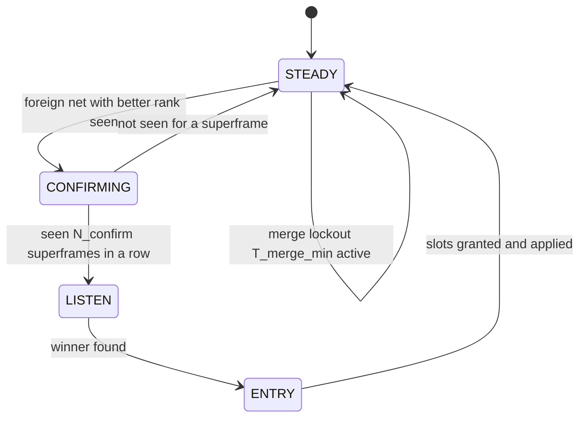

# Network merge architecture

Status: PROPOSED design for review. Nothing here is implemented. Version 0.1, 2026-11-13.

Scope: what happens when two nets that were formed apart come into radio range of each other. Single node entry into one running net is already implemented for the host simulation (src/mac/entry.c) and is not repeated here.

Labels used: IMPLEMENTED, VERIFIED DESIGN, PROPOSED, UNKNOWN / OPEN. Every rule in sections 3 to 8 is PROPOSED unless it says otherwise.

## 1. The problem

Network entry assumes one net: one time base, one slot map, one set of node addresses. Nothing in the code or in the architecture documents says what to do when a node hears a second net. The cases that make this real:

- Two groups form in different places, then move together.
- A net splits because a slot map change was applied at different times (see MAC-ARCHITECTURE, applying a change at a boundary), then the halves meet again.
- A group starts without GNSS time and a second group starts with it.

If nothing is done, two nets that overlap in range will transmit in the same slots, destroy each other's bursts, and keep going indefinitely. The aim of this design is that the nets become one net, or one yields to the other, within a bounded time and without repeated switching back and forth.

What already exists and is reused (VERIFIED DESIGN, from MAC-ARCHITECTURE section 8.5 and the slot engine specification):
- A time quality value q, carried in beacons and in the MAC control block. It records the time source class (GNSS, network time, holdover) and the estimated error.
- A schedule version and a hopset id, held by each node and reported in status.
- Beacons, sent every 200 ms during acquisition and every 1000 ms in steady state.
- The entry procedure: listen, back-off request, grant, apply at a named superframe, leave command.

What does not exist (UNKNOWN / OPEN): a net identity, a rule for which net wins, a detection procedure, and a way to move a whole group.

## 2. What open standards and implementations do

A survey was made from public sources. Most primary standard texts (IEEE 802.11, 802.15.4, ETSI TETRA, MIL-STD) are paywalled or unreadable by the tools used, so statements about them come from secondary sources and are marked. The code-level facts come from reading the source of the projects named.

| System | How a second net is detected | Which net wins | What the loser does | Protection against flapping |
|---|---|---|---|---|
| 802.11 IBSS, Linux mac80211 | Beacon with the same name from another net id; merge scan only after 30 s with no active peer | The larger timer value at reception, strict compare | Resets its timer, leaves its net id, joins the winner | 30 s merge interval, 2 s scan interval. No margin on the compare. One driver gave wrong receive stamps and merged on every beacon |
| 802.11s mesh | Not a merge. Nodes follow the neighbour clock with the largest positive drift | None | Slews gradually, ignores drift below 10 us, resets above 800 us | Step limit per call, peers that are adjusting are excluded |
| IEEE 802.15.4 TSCH and 6TiSCH (Contiki-NG, OpenWSN) | Enhanced beacon with PAN id, absolute slot number and join metric | No net against net rule. A joiner picks the neighbour with the lowest join metric | Node that loses its time source disassociates and rescans | Switch threshold of 640 for time source and parent. Joined nodes ignore beacons that try to change their parameters |
| 802.15.4 and Zigbee PAN id conflict | Conflict notification or network report | No merge. One side picks a new PAN id | Coordinator broadcasts the change with a delay; stranded nodes rejoin | Error threshold before acting; automatic resolution off by default in some stacks |
| Wi-Fi Aware cluster merge (from patent text only) | Cluster beacon | Higher anchor master rank (preference, random factor, address), then lower hop count | Adopts the winner's time base | Hop count limit; random factor spreads ties |
| Thread, OpenThread | Advertisement from another partition | Partition comparison on leader weight and partition id (exact order not verified) | Detaches and reattaches, gets new addresses | Timer on the previous partition id |
| OLSRv2 and NHDP | HELLO and TC messages | None needed, merge is implicit | Not applicable | Link accept and reject quality thresholds and hold times |
| Link 16, public sources | Not applicable | One network time reference, set by planning | Not applicable | Avoided by planning: one plan, one time reference |
| Bluetooth mesh | Secure network beacon carries an IV index | Higher IV index | Recovers state | At most one recovery per 192 hours |

What the survey shows, in the form of reasoning, not source claims:

1. Nobody merges two live time-slotted nets by negotiation. The common pattern is a single total order that decides the winner, and the loser leaves and re-enters as a new node (Contiki-NG disassociates and rescans, Thread reattaches, Zigbee rejoins).
2. The weakest winner rule is "larger timer wins" (IBSS), because it rewards the node that has been up longest and depends on a reliable receive timestamp. The strongest public example is Wi-Fi Aware: an explicit rank built from a preference, a random tie-break and a unique id.
3. Every system that works well has a dwell time or a margin before acting. The ones without it flap.
4. Where one side changes an identifier, the change is announced with a countdown and stragglers have a recovery path.
5. The routing layer heals itself once the MAC is one net, so OLSRv2 needs no merge logic of its own. It does need unique addresses.

Code that can be adapted: Contiki-NG TSCH and OpenThread are under BSD-3 licences, so ideas or code can be reused with the notice kept. The Linux mac80211 code is GPL-2.0 and tied to that stack, so only the ideas are usable. Wi-Fi Aware material came from patent descriptions, so any copied scheme needs a patent check first.

Not verified, and to be read from primary documents before this design is finalised: 802.11 and 802.15.4 text, the OpenThread partition compare order, the Wi-Fi Aware specification, TETRA DMO synchronisation, and the Link 16 documents.

## 3. Design principles

PROPOSED:

1. One net wins and the other yields. There is no negotiated blend of two slot maps.
2. The decision is a strict order on a small set of fields carried in the periodic beacon, so every node reaches the same answer from the same data.
3. Detection is passive. A node learns of a foreign net from beacons it already receives, not from a new probing procedure.
4. The loser re-enters the winner like a new node, using the entry procedure that already exists. Its old slots and addresses are discarded.
5. No action on a single sighting. A foreign net must be confirmed over several superframes, and a node never moves toward a net of lower or equal rank.
6. A merge limit in time stops repeated switching.
7. The control, data and time planes stay separate. Merge decisions are made in MAC software. The time base itself is owned by the logic, as in the existing split.

## 4. Net identity and rank

PROPOSED. These fields do not exist yet. Their encoding is not defined here, because it is a frame contract and must come from the frame specification owner.

Net identity: a value that all members of one net carry and that differs between nets formed apart. It must not collide by accident. A random value chosen by the node that starts a net is the natural choice. A configured value would let an operator force two groups to stay apart. Which one is used is decision M-1.

Net rank, compared in this order. The first difference decides.

| Order | Field | Higher or lower wins | Reason |
|---|---|---|---|
| 1 | Time source class of the net's time anchor: GNSS before network time before holdover | Better class wins | A net on GNSS keeps true time and every other net can join it without losing accuracy |
| 2 | Time quality q of the anchor | Smaller error wins | Prefer the more accurate time base |
| 3 | Configured net priority | Higher wins | Lets an operator decide a case the other fields cannot |
| 4 | Member count seen by the anchor | Larger wins | Fewer nodes need to move |
| 5 | Net identity value | Larger wins | Final tie-break so that two nodes never both think they win |

Notes:
- Field 1 and 2 already exist in the form of q. The order is chosen so that a net on GNSS never gives way to one in holdover.
- Field 3 is optional. If it is not wanted, the design works without it.
- Field 4 is a count the nodes already hold in their neighbour tables. It will be approximate. It is only a tie-break above the identity value, so an error cannot flip a decision that fields 1 and 2 already made.
- Because both nets can see each other's rank in beacons, both sides compute the same order. No message from one net to the other is needed for the decision.

The rank is carried in the beacon with a small change counter so that a node can tell a changed rank from a repeated one.

## 5. Detection

PROPOSED.

A node in STEADY state already listens in its own receive slots. A foreign net shows up as a beacon whose net identity differs from the node's own, or as bursts in slots that the node's own schedule says are unused.

Two situations:

1. The nets share the same time base, for example both on GNSS. Beacons of the other net land in expected slots. The node sees a different net identity. Detection is simple.
2. The nets have different time bases. The other net's bursts arrive at an offset and cannot be decoded in the node's slots. Detection needs a scan window.

For case 2 a node cannot decode frames from the other net without moving its receiver timing. This design therefore adds a bounded scan: a node that sees repeated failed receives in slots it believes are empty, or has had no active neighbour for a period, enters a short scan window in which it listens for foreign beacons. The scan must be rate limited, as the Linux IBSS merge scan is. Whether the radio can receive off-grid for a whole slot is a hardware question (decision M-3).

Who reports: any node. The report goes to the other members through the existing control path. A single node's sighting is not enough to act on (section 6).

## 6. Decision and dwell

PROPOSED.

A node that has seen a foreign net does the following.

1. Record the foreign net's identity and rank, and the superframe of each sighting.
2. Compare the foreign rank with its own. If the foreign rank is lower or equal, do nothing except report the sighting. Nodes of the better net do not move.
3. If the foreign rank is better, count consecutive superframes in which the foreign net was heard. Act only when the count reaches N_confirm.
4. After a merge, do not act on a new foreign net before T_merge_min has passed.

The values of N_confirm and T_merge_min are open. Starting values for the first simulation only, to be settled by the owner: N_confirm 3 superframes, T_merge_min 30 s (the same order as the Linux IBSS interval).

A node that is in the middle of the entry procedure or has just joined counts as a member of the net it joined. Entry itself is not changed by this design. A node that listens at startup and hears two nets chooses the one with the better rank, which is the same rule applied at the start.

## 7. How the losing net moves

This is the part with real design choice. Two options.

Option 1, each node re-enters on its own (recommended for a first version). Every node of the losing net applies section 6. When its count reaches N_confirm, it leaves its net and runs the existing entry procedure against the winner. Slots and addresses of the loser are dropped. The winner grants fresh slots through the normal procedure. Properties:
- No new command is needed except possibly a leave notice already covered by the existing leave command.
- Entry has only one entry slot per frame, so many nodes arriving at once are slow. The existing simulation measured 28 simultaneous joiners on one entry slot taking up to 20 s with 27 collision slots. A merge of two groups of that size would take similar time.
- Nodes do not move at the same moment, so the losing net dissolves gradually and its remaining members lose neighbours during that time.

Option 2, the losing net moves as a group on a countdown. A node of the losing net, once it decides, announces a switch at a named superframe, as Zigbee does with its network update. All members of the loser apply it at that superframe and enter the winner together. Properties:
- Faster for the group and fewer nodes stranded in a half dissolved net.
- Needs a new command to carry the countdown, new frame contract work, and a rule for who may announce. A node that misses the announcement is stranded and must fall back to option 1.

Recommendation: build option 1 first, with the stranded node fallback being the same procedure. Add the countdown of option 2 later as an optimisation if the measured merge time is too long. This is decision M-2.

For both options:
- The re-entering node asks for slots as a new node. The winner's responder grants only slots free in its own view. The existing duplicate request rule applies.
- Addresses: node addresses are 16 bit. Two nets formed apart may contain the same address. At grant time, the winner checks the joiner's address against its members. If it is already in use by another member, the winner rejects the request with the bad request reason and reports the conflict. The resolution (renumbering or operator action) is open (decision M-4). This follows the NHDP idea of detecting and rejecting a duplicate, not resolving it silently.
- The routing layer then rebuilds its tables from the new neighbours without help from the MAC.

## 8. State and timing summary

PROPOSED. A new sub-state is added to STEADY, and the existing states are reused for the rest.

CONFIRMING is a software state on top of STEADY. It does not change what the logic does with the slots. LISTEN and ENTRY are the existing MAC states, so the loser's re-entry uses the code that already exists.

## 9. What changes in the code

PROPOSED, and none of it is started.

- The beacon body gains a net identity and rank field. This needs a change to the frame specification and the slot engine specification, owned by those documents.
- A new module for merge decisions (detection record, rank compare, dwell counters) sits beside entry.c in src/mac. It has no knowledge of the radio.
- The slot scheduler gets a hook to call the decision module on each received beacon and to start entry when the decision says leave.
- The slot test network gets a second net: two groups with their own time base and slot map that are brought into range, so a merge can be tested.
- Tests: rank order including every tie-break; no action on a worse net; confirmation counting; lockout; losing group re-enters and every member ends with a unique slot; address clash is rejected; a lone sighting by one node does not move the net.

## 10. Test plan for the simulation

PROPOSED.

| Scenario | Expected result |
|---|---|
| Two nets of 4 nodes each, both with time from GNSS, different net identities | One net remains, all 8 nodes with unique slots, merge time recorded |
| Two nets, one on GNSS and one on network time | The GNSS net wins regardless of size |
| Equal rank except identity | The larger identity wins on both sides, no switching back |
| Foreign net seen once, then never | No node moves |
| Foreign net of lower rank is next to a stable net | No node moves, sighting reported |
| Winner heard through a lossy link | Dwell counter restarts and the merge is late, not wrong |
| Address clash between nets | The clashing node is rejected, the rest merge |
| Net of 28 nodes merges into a net of 4 nodes | All nodes end in unique slots, merge time and collision count recorded |
| Merge, then the loser's old net appears again | Lockout stops a second merge |

Measures recorded: time from first sighting to last node in a unique slot, collision count in the entry slot, count of nodes that were stranded, count of merge decisions that were reversed (must be zero).

## 11. Decisions and open items

                            None is decided here.

| Id | Question | Options | Proposed |
|---|---|---|---|
| M-1 | Where does the net identity come from | Random value chosen by the node that starts the net; configured by the operator; both, with a configured value overriding | Both |
| M-2 | How does the loser move | Each node re-enters alone; the group moves on a countdown | Re-enter alone first |
| M-3 | Can the radio scan off the slot grid | Yes, for a short window; no, only in-grid detection | Unknown, needs the logic owner. Without it only case 1 of section 5 is detected |
| M-4 | Address clash between nets | Reject and report; renumber the joiner; operator action | Reject and report |
| M-5 | Rank fields and order | The five fields in section 4; drop the configured priority; add others | The five fields |
| M-6 | N_confirm and T_merge_min | 3 superframes and 30 s as starting values | Settle after the first simulation |
| M-7 | Does a GNSS net always beat a larger net on network time | Yes; no, member count first | Yes |

Open contracts that this design depends on and cannot fix itself:
- The beacon fields for net identity and rank (a frame contract, see OI-9 for the related time quality fields).
- Whether the logic can report foreign activity off the slot grid (the hand-off between MAC software and logic, U-02).
- Authentication. Without it any node can claim a high rank and pull a net toward it. The entry procedure has the same gap. A merge rule that can be forced by a false beacon is a security weakness, so this must be settled before any real use.
- The time base step. When the loser enters the winner, its time base changes by a step. How the logic applies that step is not defined.

## 12. Not covered

- Merging three or more nets at once. The rank order makes the result consistent, but the time to settle was not analysed.
- A net that is split by a failure and must put itself back together without a better net to follow. That is partition healing inside one net and relies on the entry and time rules already in place.
- Interference or jamming that imitates a foreign net.
- Hopset differences between nets. If the two nets use different hop sets, detection depends on the hop plan, which is not designed here.
- Hardware measurement. All timing figures would come from the host simulation until the hardware path exists.
