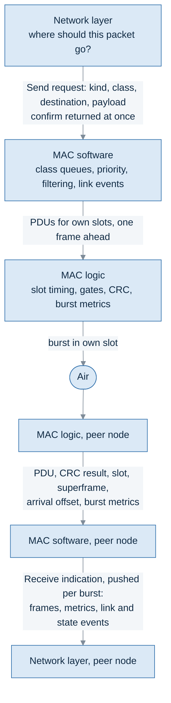
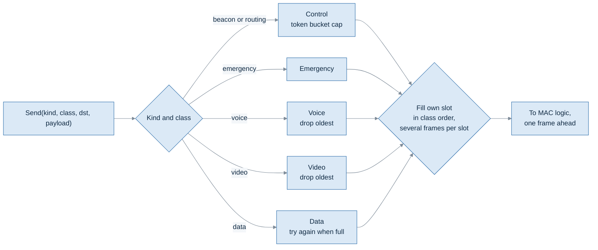
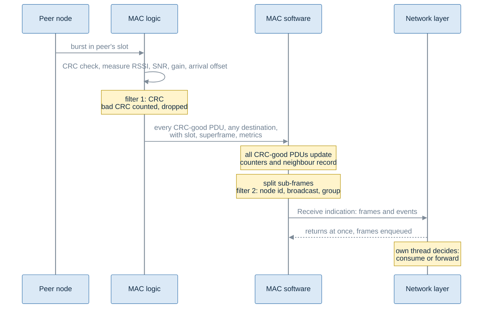
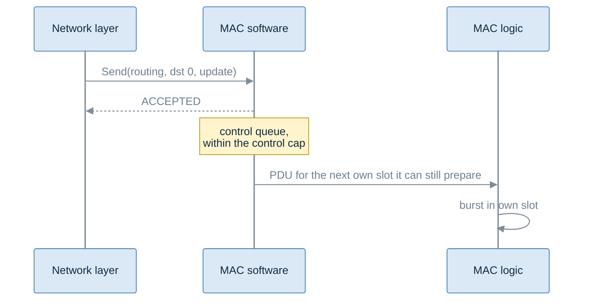

# HH-SDR MAC ↔ Network Layer Interface Specification

| Item | Value |
|---|---|
| Version | 1.1 |
| Date | 2026-10-15 |
| Plan | OSL-396 (vehicular) |
| Task | F01-AK-3 |
| Zoho task | AC2O-T1657 |
| Status | Draft for review |
| Applies to | Handheld and vehicular radios |
| Based on | HH-SDR Medium Access (MAC) Architecture, version 1.1 (draft, not yet approved) |

## Revision history

| Version | Date | Change |
|---|---|---|
| 1.0 | 2026-10-06 | First issue, draft for review |
| 1.1 | 2026-10-15 | Updated after the review of 15 Oct 2026. Covers handheld and vehicular. Fixed now means traced to a requirement or an approved programme decision. Everything else is Proposed, with a Source column in section 24. Added: network time. Five traffic classes with a class field in Send and several frames per slot. TX inhibit, sulk and break-in. Security boundary. Two RF heads (decision pending). SCA component map and the two bindings. Primitives in request, confirm and indication form. Indications for neighbour and link events. Push delivery instead of collection every 10 ms. Field widths and byte order. Relay obligations. Multicast. Per-hop latency budget. Per-hop retransmission for data. Automatic fault recovery. Slot conflict handled per slot. Minimum link MTU of 1280 bytes with IP above. Acceptance matrix against the task text. Owners and closing evidence in the decision matrix. 2026-10-16: entry-failed indication and the end-of-sulk slot check added, to match the network entry design note |

## Contents

- [1. Purpose](#1-purpose)
- [2. Scope](#2-scope)
- [3. Conventions](#3-conventions)
- [4. Layer responsibilities](#4-layer-responsibilities)
- [5. Interface model](#5-interface-model)
- [6. MAC service primitives](#6-mac-service-primitives)
- [7. Transmit request](#7-transmit-request)
- [8. Received frame](#8-received-frame)
- [9. Queue model](#9-queue-model)
- [10. Priority handling](#10-priority-handling)
- [11. Slot and scheduling interaction](#11-slot-and-scheduling-interaction)
- [12. Link quality interface](#12-link-quality-interface)
- [13. Link metric reporting model](#13-link-metric-reporting-model)
- [14. Receive model](#14-receive-model)
- [15. Broadcast and multicast](#15-broadcast-and-multicast)
- [16. Error model](#16-error-model)
- [17. Retransmission](#17-retransmission)
- [18. Fragmentation and maximum payload](#18-fragmentation-and-maximum-payload)
- [19. Status interface](#19-status-interface)
- [20. Net preset select](#20-net-preset-select)
- [21. State-dependent behaviour](#21-state-dependent-behaviour)
- [22. Ownership boundaries](#22-ownership-boundaries)
- [23. Timing contract](#23-timing-contract)
- [24. Fixed and TBD items](#24-fixed-and-tbd-items)
- [25. Example scenarios](#25-example-scenarios)
- [26. Interface contract summary](#26-interface-contract-summary)
- [27. Inherited open items](#27-inherited-open-items)
- [28. F01 acceptance matrix](#28-f01-acceptance-matrix)
- [29. Decision pending matrix](#29-decision-pending-matrix)

## 1. Purpose

The radio splits the job of moving a packet between two layers.

| Layer | Question it answers |
|---|---|
| Network layer | **Where** should this packet go? |
| MAC | **How and when** can this packet use the radio? |

The network layer runs neighbour discovery, routing, relaying and
self-healing. It chooses the next hop. The MAC owns access to the shared
radio channel: it queues frames by traffic class, applies priority, and
transmits them in the slots the node is allowed to use. It also measures each
received burst and reports what it measured.

The two layers have different owners. The MAC is built by the logic and
software owners. The network layer is built by the network owner. This
document is the contract between them. It states what crosses the boundary,
what each side may assume about the other, and what is still open.

This contract covers both the handheld and the vehicular radio, which share
one software effort (Fixed, programme decision). The vehicular radio has two
RF heads, V/UHF and L-band (Fixed, requirement). How the two heads appear at
this interface is still to be decided (section 5.3, DP-17).

This document freezes the **software-visible contract** only. It does not
freeze anything at register or buffer level in logic. Those depend on open
items of the base design that are not yet answered (section 27).

## 2. Scope

**Included:**

- the MAC service primitives, in request, confirm and indication form
- the logical content of a transmit request, a received frame and an
  indication, with field widths and byte order
- traffic classes, queues, drop policy and priority
- status and link metrics, and how and how often they are reported
- error and result cases, and fault recovery
- ownership boundaries between the network layer, MAC software and MAC logic
- the SCA component type of each part and the two candidate bindings
- broadcast, multicast and what a relay must do
- how the interface behaves in each MAC state, including transmit inhibit,
  sulk and break-in
- the questions the security boundary must answer at this interface
- what crosses between MAC software and MAC logic, as a list of contents.

**Not included:**

- logic register map
- buffer layout and transfer mechanism between processor and logic
- modem, waveform and PHY details
- the final on-air MAC header and MAC control PDU encoding
- the final slot allocation algorithm and network entry protocol
- the final fragmentation format
- retransmission timers and window details
- GNSS, network time, time base and holdover implementation
- the security module design and key management
- the routing protocol itself.

## 3. Conventions

| Word | Meaning in this document |
|---|---|
| **MUST** | Part of the contract. In a Proposed statement it becomes binding once the statement is agreed |
| **SHOULD** | An engineering recommendation |
| **MAY** | Permitted, not required |
| **TBD** | Not decided. Every TBD names an open item (OI-n) or a pending decision (DP-n) |

Open items:

- **OI-1 to OI-9** are open items inherited from the base design named in
  "Based on". Their numbers and meaning are unchanged. They are listed in
  section 27.
- **DP-1 to DP-19** are decisions about the MAC to network boundary. Each
  place in the text that depends on one says so. All of them are collected,
  with options, owner, need-by point and closing evidence, in the decision
  pending matrix (section 29).

Each statement carries one of these markers:

| Marker | Meaning |
|---|---|
| Fixed | Traced to a customer requirement or an approved programme decision. Section 24 gives the source |
| Consequence | Follows directly from what is stated. Where it still needs a decision, the DP number is given |
| Proposed | Proposed by this document, or taken from the base design, which is a draft. Not yet agreed |
| TBD | Open. OI or DP number given |

Names written in capitals such as `ACCEPTED` or `TRY_AGAIN` are logical
names. They show meaning, not final spelling or language binding (DP-13).
Numeric encodings are in section 8.5.

Terms used:

| Term | Meaning |
|---|---|
| Frame | The unit the network layer gives to and gets from the MAC: kind, traffic class, source, destination, payload |
| PDU | The MAC unit carried in one slot. It can hold several frames (section 10.3) |
| Burst | One transmission in one slot |
| MAC control fields | Fields the MAC itself sends in every own slot: time quality, slot claims, break-in flag, acknowledgements (section 15.3) |
| Traffic class | Control, emergency, voice, video or data (section 7.1) |
| Indication | A report the MAC sends up without being asked: a received frame, or a link or state event |
| Node id | This node's identifier, shared by the network layer and the MAC |
| RF head | One radio front end. The handheld has one. The vehicular radio has two |
| Net preset | A hopset, a TRANSEC key slot reference and frame parameters, selected together |
| Resource | An SCA application component, deployed and connected by the Core Framework |
| Device | An SCA platform component that stands for a piece of hardware |
| AEP | Application Environment Profile: the operating system calls an SCA application component may make |

## 4. Layer responsibilities

"MAC software" is the MAC policy running on the processor. "MAC logic" is the
timing engine in the programmable logic.

| Responsibility | Network layer | MAC software | MAC logic |
|--------------------|--------------|----------------|--------------|
| Route computation (Proposed) | Owns | None | None |
| Next-hop selection (Proposed) | Owns | None | None |
| Relay: forwarding, hop limit, duplicate removal (Proposed) | Owns | None | None |
| Neighbour table and its interpretation (Proposed) | Owns | Keeps a MAC-level neighbour record and reports neighbour heard and silent | None |
| Generating beacon, routing and data frames (Proposed) | Owns | None | None |
| Choosing the frame kind and traffic class (Proposed) | Owns | Forces control class for beacon and routing kinds | None |
| Queueing accepted frames by class (Proposed) | None | Owns | None |
| Priority between classes and the control cap (Proposed) | None | Owns | None |
| Which slots this node owns (Proposed. Algorithm TBD, OI-3) | Gives demand hints | Owns | Carries it out |
| MAC control fields: time quality, slot claims, break-in, acknowledgements (Proposed) | None | Owns the content | Inserts at transmit time |
| Slot timing, guard, hop instant (Proposed) | None | None | Owns |
| Transmit gating (Proposed) | None | None | Owns |
| TX inhibit: sulk, zeroise, sync loss, holdover limit, fault (Fixed for sulk through the hardware inhibit, programme decision, Proposed for the rest) | None | Reports the reason | Owns |
| RF state and T/R switching (Proposed) | None | None | Owns, through STROBE |
| PDU CRC (Proposed) | None | None | Owns |
| Per-burst RSSI, SNR, RX gain, arrival offset (Proposed. Feasibility and units TBD, OI-5) | None | None | Measures |
| Address filtering of received frames (Proposed) | Group filtering for multicast | Owns for node id and broadcast | Passes every CRC-good PDU up |
| Link metric averaging and the periodic link report (Proposed) | None | Owns | None |
| Interpreting link quality for routing (Proposed) | Owns | None | None |
| Per-hop retransmission of data frames (Proposed) | None | Owns | Sends the acknowledgement fields |
| Fragmentation (Proposed. Format TBD, OI-2) | None | Owns | None |
| Broadcast transmission and acceptance (Proposed) | Decides network meaning | Accepts and queues | Transmits in own slot |
| MAC state machine and fault recovery (Proposed) | Observes through indications and Status | Owns most transitions | Owns sync-loss and holdover transitions |

What crosses between MAC software and MAC logic (Proposed, layout and
mechanism not specified here):

- PDUs and their descriptors for the next frame, one frame ahead
- per received burst: PDU, CRC result, slot, superframe, arrival offset,
  RSSI, SNR, RX gain
- MAC control field content to insert at transmit time
- a software heartbeat and a "schedule valid" flag, which the logic uses as
  transmit gates
- the state of the inhibit lines, counters and logic events.

### 4.1 SCA component map

SCA compliance is judged per component, so each part is mapped to an SCA
2.2.2 component type (Proposed). Both customer requirements ask for an
architecture per SCA 2.2.2 or later (Fixed, requirement).

| Part | SCA type | Runs on | Owns | Ports and interfaces |
|---|---|---|---|---|
| Network layer | Depends on where it runs (DP-16). Inside the waveform: application Resource, AEP calls only. As Linux processes: not an SCA component, a platform service | Processor | Routing, neighbour table, relay, end-to-end addressing | Inside the waveform: uses the MAC transmit port, provides the MAC receive port, PropertySet, data port to the IP edge. As Linux processes: a Linux network interface (section 5.2) |
| MAC software | Application Resource, AEP calls only | Processor | Queues, priority, slot ownership policy, address filter, metric averaging, link events, retransmission, fragmentation | Provides the MAC transmit port. Uses the MAC receive port. Uses the MAC logic port. PropertySet, TestableObject |
| MAC logic | Not a CORBA component: a platform FPGA Device, or an OpenCPI HDL worker (DP-19) | Programmable logic | Slot timing, guard, hop instant, gates, STROBE, CRC, per-burst metrics, heartbeat watchdog | Processor-to-logic message set. Not specified here |
| Transceiver and RF front end | Platform Devices | Processor and logic | RF configuration, gain table, hop frequencies | Configured by the platform. Driven in real time by MAC logic |
| GNSS and time | Platform Device | Processor and logic | 1PPS, time of day, GNSS service selection | Time to MAC software. 1PPS to MAC logic |
| Security module | Platform Device on the red/black boundary | Separate module | Crypto, TRANSEC keys, zeroise | TBD (DP-18) |
| IP edge | Platform Device | Processor | Application traffic in and out | Data port to the network layer |

Rules (Proposed):

- Ports between Resources are IDL-typed, their direction is stated, and the
  Core Framework connects them from the SAD.
- No CORBA in the programmable logic or on the link between processor and
  logic.
- No call across a component boundary ever waits on radio timing.

## 5. Interface model



This is a logical model. It shows what crosses each boundary and in which
direction. It is not a binary ABI. Two bindings are described in section 5.2.
Whatever binding is used MUST keep this behaviour (Proposed):

- Send never blocks. Its confirm is the immediate result.
- The MAC pushes each received burst up as soon as it has it. The receiving
  side only enqueues and returns. It never processes inside the delivery.

The two halves are independent:

- Transmit path: the network layer hands a frame down. The call returns at
  once. Everything after that happens on the MAC's own schedule.
- Receive path: the MAC hands up the frames of each received burst for this
  node, together with any link or state events, in one delivery.

### 5.1 Where the network layer runs

Where the network layer runs is a decision for the programme lead and the
OpenCPI lead (DP-16). This document is written so that the logical contract is
the same either way. Only the binding in section 5.2 changes.

| | Inside the waveform, as an SCA Resource | As Linux processes on a network interface |
|---|---|---|
| Routing code | Written or ported to run with AEP calls only. Off-the-shelf daemons that need sockets and netlink are expected not to run unchanged. To be checked against the AEP text in SCA 2.2.2 Appendix B | Off-the-shelf routing daemons run unchanged |
| IP forwarding | Done by the waveform, which hands packets to the IP edge | Done by Linux |
| SCA position | Routing is part of the portable waveform | Routing is a platform service outside the waveform |
| Class, metrics and events | Passed directly over the IDL ports | Class from DSCP or socket priority. Metrics and events need an extra path to the daemon |
| Fit | Product | December demonstration. Product only if DP-16 decides so |

### 5.2 Bindings

**SCA binding (inside the waveform)** (Proposed):

- One IDL module for this contract, with a version constant. Any change to it
  goes through the same review as this document.
- Exactly two data ports: **send**, provided by the MAC and used by the
  network layer. **deliver**, provided by the network layer and used by the
  MAC. Both are two-way calls, and both servants only enqueue and return.
- No Event Service, no asynchronous method invocation and no CORBA Any on the
  data path.
- Send returns its result as an enumeration. CORBA exceptions are kept for
  programming errors only (not open, invalid argument). Enumeration members
  carry a prefix, because IDL puts them in the module scope.
- Everything else uses the standard CF interfaces:

| Primitive | SCA 2.2.2 mapping |
|---|---|
| Open | CF Resource start(), after initialize() and configure(). Returns once WAIT_TIME is entered, never after synchronisation |
| Close | CF Resource stop(). At teardown, releaseObject() |
| Send | send() on the MAC provides port |
| Receive indication | deliver(frames, events) on the network provides port |
| Status, Link metrics | query() on read-only properties. Management rate only, never on the data path |
| Net preset select | configure() of the net preset property, applied at a superframe boundary |
| Configuration | configure() while stopped: node id, slot length, frame length, range profile, class table |
| Initiated BIT | TestableObject runTest(). Test ids map to fault codes (section 16.5) |
| Fault recovery | stop() then start() on the MAC Resource, then application restart |

Port and type names, and whether the PRF allows a sequence of structs for the
per-neighbour metrics, are TBD (DP-13). The IDL is compiled with the chosen
ORB as part of the evidence for this binding.

**Linux binding (network layer as Linux processes)** (Proposed). It applies
only if the processor runs Linux. Linux or a real-time operating system for
the processor is not yet decided.

- MAC software appears as a Linux network interface. Its MTU is the current
  maximum payload (section 18).
- A layer-3 TUN interface carries no next hop. Unicast to a next hop
  therefore needs an Ethernet-style interface (TAP or a kernel netdev), with
  a mapping from link-layer address to node id. The mapping is TBD (DP-13).
- Traffic class comes from DSCP or socket priority (section 7.1).
- Kind is always data at this binding. Routing daemons send their control as
  ordinary packets, marked with the control DSCP. The MAC's own entry and
  time signalling uses MAC control PDUs (section 15.3), not frames from the
  network layer.
- Link metrics and events reach the daemon through a separate local path.
  Which one is TBD (DP-13).

### 5.3 Two RF heads

The vehicular radio has two RF heads, V/UHF and L-band, used together without
interfering with each other (Fixed, requirement). Two ways to show them at
this interface are compared below. The choice is open (DP-17).

| Aspect | Interface index: one MAC knows both heads | One MAC per head |
|---|---|---|
| What the network layer sees | One MAC. Every Send, received frame, link metric, event and Status entry carries an RF head index | Two MACs, like two network interfaces |
| Co-site coordination of TX on one head against RX on the other | Inside one scheduler | Needs a coordination line between the two MACs, most likely in logic |
| Code shared with the handheld | Handheld uses index 0 everywhere. The MAC is more complex | The handheld MAC is used unchanged, twice |
| Node id | One MAC holding two node ids, one per head | Each instance has its own node id, a natural fit |
| Time | Shared naturally | Must be shared between the two instances |
| Cross-band relay, V/UHF to L-band | The network layer chooses the head in Send | The network layer chooses the interface, as routing protocols already do with several interfaces |
| Fit with the Linux binding | One interface carrying two heads. Head choice needs a side channel | Two interfaces, a natural fit |
| Fit with the SCA binding | One MAC Resource. Index in every IDL type | Two MAC Resource instances |
| Link metrics | Keyed by neighbour and head | Each MAC keeps its own. The same neighbour can appear on both |

Each RF head has its own node id (given 2026-10-16). Whether both heads can
transmit at the same time is still to be settled.

Either way (Proposed):

- link metrics are kept per neighbour and per RF head
- the network layer knows which two node ids belong to one vehicle
- until co-site desense is measured, transmit on one head is coordinated with
  receive on the other.

## 6. MAC service primitives

The primitives are given in request, confirm and indication form.

| Primitive | Request (network layer to MAC) | Confirm (MAC to network layer, the result) | Indication (MAC to network layer, unasked) |
|---|---|---|---|
| Open | Open | Result | None |
| Close | Close | Result | None |
| Data send | Send | Send result, at once (section 16.2) | None per frame (DP-12) |
| Data receive | None | None | Receive: frames with metrics, pushed per burst |
| Link status | Link metrics, for one neighbour | Per-neighbour record | Link report per neighbour, every report period (section 13) |
| Neighbour up and down | None | None | Neighbour heard, neighbour silent (section 6.8) |
| MAC state | Status | Status record | State changed, TX inhibit on and off, break-in on and off, own slots changed, entry failed |
| Net preset select | Net preset select | Result | None |

All primitives are Proposed. Indications travel in the same delivery as
received frames (section 6.4), so they keep their order with the frames.

### 6.1 Open

| Field | Content |
|--------------|--------------------------------------------------------------------------------|
| Direction | Network layer to MAC |
| Purpose | Enable the MAC |
| Inputs | None. Configuration is written beforehand, while the MAC is OFF (section 19.1) |
| Outputs | Result |
| Blocking | MUST return without waiting for synchronisation (Proposed) |
| Success means | The MAC is enabled and has entered WAIT_TIME (Proposed). It does **not** mean the node is synchronised or can transmit |
| Failure | `FAULT`, `INVALID_CONFIG` (Proposed) |
| Owner | MAC software |
| Notes | Open while already open returns success and changes nothing (Proposed) |

### 6.2 Close

| Field | Content |
|--------------|--------------------------------------------------------------------------------|
| Direction | Network layer to MAC |
| Purpose | Disable the MAC |
| Inputs | None |
| Outputs | Result |
| Blocking | MUST return without waiting for the next frame boundary (Proposed) |
| Success means | MAC software accepts no further Send, hands no further PDU to logic, and has commanded logic to stop. Logic stops at the next frame boundary, and STROBE then takes RF to RF_OFF (Proposed). PDUs already handed to logic for the frame in progress MAY still be sent before that boundary |
| Failure | None expected. Close MUST be safe to call twice and after a failed Open (Proposed) |
| Owner | MAC software |
| Notes | Frames in the MAC software queues at Close are discarded and counted (Proposed, DP-3). No delivery happens after Close returns (Proposed) |

### 6.3 Send

| Field | Content |
|--------------|--------------------------------------------------------------------------------|
| Direction | Network layer to MAC |
| Purpose | Ask the MAC to transmit one frame |
| Inputs | Kind, traffic class, destination id, lifetime, payload (Proposed). Full content in section 7 |
| Outputs | Result |
| Blocking | MUST NOT block. Returns at once (Proposed) |
| Success means | **The MAC accepted the frame into its queue.** It does **not** mean the frame was transmitted or received |
| Failure | `TRY_AGAIN`, `WRONG_STATE`, `TX_INHIBITED`, `TOO_LARGE`, `INVALID_ARGUMENT`, `NOT_OPEN` (Proposed). Section 16.2 |
| Owner | MAC software |
| Notes | No per-frame report of transmission is defined (DP-12). For a voice or video frame, a full queue drops the oldest frame of that class instead of refusing the new one (section 9.1) |

### 6.4 Receive (indication)

| Field | Content |
|--------------|--------------------------------------------------------------------------------|
| Direction | MAC to network layer |
| Purpose | Hand up received frames addressed to this node, broadcast or a group, together with link and state events |
| Contents | Zero or more received frames, each with its metrics (section 8), and zero or more events (section 6.8) |
| When | Once per received burst that holds a frame for this node, and whenever an event occurs (Proposed) |
| Blocking | The network layer's receiving side MUST only enqueue and return. It MUST NOT process inside the delivery (Proposed) |
| Success means | The frames were CRC-good and passed the address filter (Proposed). Each payload is byte-identical to the payload the sender's network layer gave its MAC (Proposed, DP-15). Kind, class and destination have the values given to the sender's Send, and source is the transmitter's node id |
| Failure | If the network layer cannot take the delivery, MAC software keeps it in the holding buffer (section 14.4) and counts it |
| Owner | MAC software |

### 6.5 Status

| Field | Content |
|--------------|--------------------------------------------------------------------------------|
| Direction | Network layer to MAC |
| Purpose | Read the MAC's current condition and configuration |
| Inputs | None |
| Outputs | Status record (section 19) |
| Blocking | MUST NOT block (Proposed) |
| Failure | `NOT_OPEN` (Proposed) |
| Owner | MAC software |
| Notes | Management rate only. State changes arrive as indications, so the network layer does not need to poll Status |

### 6.6 Link metrics

| Field | Content |
|--------------|--------------------------------------------------------------------------------|
| Direction | Network layer to MAC |
| Purpose | Read the per-neighbour record for one neighbour on request |
| Inputs | Neighbour id (and RF head, if DP-17 chooses an interface index) |
| Outputs | Per-neighbour record, each value with a valid flag (section 12.2) |
| Blocking | MUST NOT block (Proposed) |
| Failure | `NOT_FOUND`, `NOT_OPEN` (Proposed) |
| Owner | MAC software |
| Notes | The same record arrives unasked in the link report every report period (section 13) |

### 6.7 Net preset select

| Field | Content |
|--------------|--------------------------------------------------------------------------------|
| Direction | Network layer or management to MAC |
| Purpose | Select a net preset: hopset, TRANSEC key slot reference and frame parameters together (Proposed) |
| Inputs | Preset number. Encoding TBD (OI-4) |
| Outputs | Result |
| Blocking | MUST NOT block. The change applies at a superframe boundary (Proposed) |
| Failure | Until OI-4 is closed, `UNSUPPORTED` (Proposed) |
| Owner | MAC software |
| Notes | Section 20 |

### 6.8 Indications

Each event is carried in the Receive delivery (Proposed).

| Event | When the MAC raises it | Detail carried |
|---|---|---|
| `NEIGHBOUR_HEARD` | First CRC-good burst from a node that was unknown or silent | Neighbour id, RF head if applicable |
| `NEIGHBOUR_SILENT` | A known neighbour has missed N expected own slots in a row. N is a parameter, proposed default 5 frames (100 ms with a 20 ms frame) | Neighbour id, number of frames missed |
| `LINK_REPORT` | Every report period, for each neighbour with a record (section 13) | Per-neighbour record |
| `STATE_CHANGED` | The MAC state changes, including a MAC reset | New state |
| `TX_INHIBIT_ON`, `TX_INHIBIT_OFF` | Transmit inhibit starts or ends | Reason (section 21.1) |
| `BREAK_IN_ON`, `BREAK_IN_OFF` | A break-in starts or ends in the net | Node that invoked it |
| `OWN_SLOTS_CHANGED` | The number of own slots per frame changes, for example after a slot conflict | New count |
| `PARAMETERS_CHANGED` | Maximum payload or range profile changes | New values |
| `ENTRY_FAILED` | Network entry failed after the set number of entry cycles, or was rejected as not authorised | Reason: retries exhausted or not authorised |

Neighbour heard and neighbour silent are facts the MAC observes. Whether a
neighbour is up or down for routing is still the network layer's decision
(Proposed).

`NEIGHBOUR_SILENT` needs the MAC to know which slots the neighbour owns and
needs every own slot to carry at least the MAC control fields, so that
silence can be told apart from an idle slot (Consequence, OI-3). A node
therefore transmits in every own slot, even with no traffic (Consequence).

## 7. Transmit request

The transmit request is the logical content of a Send call. Field widths are
in section 8.5.

| Field | Meaning | Supplied by |
|------------|----------------------|--------------|
| Kind | Proposed: beacon, routing or data | Network layer |
| Traffic class | Proposed: control, emergency, voice, video or data. Beacon and routing kinds force control | Network layer for data frames. MAC forces control for beacon and routing |
| Destination id | Proposed: the next hop, 0 for broadcast, or a group id (section 15) | Network layer |
| Lifetime | Proposed: drop the frame if it is not sent within this time. 0 means no limit | Network layer |
| Payload | Proposed: opaque bytes. The MAC never reads or changes them | Network layer |
| Payload length | Proposed: up to the current maximum payload, read from Status (section 18) | Network layer |
| Source id | Consequence: this node's id, filled by the MAC (DP-8) | MAC, from its configured node id |

### 7.1 Traffic classes

The vehicular requirement asks for file transfer, PTT voice and video calls
running at the same time (Fixed, requirement). The handheld requirement asks
for voice, data and video as each user needs. The traffic order is
Audio > Video > Data (Fixed, programme decision).

| Kind | Class | Who sets the class |
|---|---|---|
| Beacon | Control | MAC, forced |
| Routing | Control | MAC, forced |
| Data | Emergency, voice, video or data | Network layer, in Send |

Order: **CONTROL > EMERGENCY > VOICE > VIDEO > DATA** (Proposed). Control is
rate-capped by the MAC (section 10.4), so it cannot starve the other classes.
Emergency is used only for break-in traffic (section 21.1).

Mapping from network traffic class to MAC class (Proposed):

| Network traffic | MAC class | DSCP at the Linux binding |
|---|---|---|
| Routing protocol control | Control | CS6 |
| Break-in traffic | Emergency | Not reachable by DSCP. Set only through the break-in function |
| PTT voice | Voice | EF |
| Video call | Video | AF41, AF42, AF43 |
| Chat, file and image transfer, everything else | Data | Any other value |

The class is carried on air and arrives with the received frame, so a relay
keeps the priority when it forwards (Proposed).

### 7.2 Source and destination are one-hop addresses

Send has no source parameter, and the MAC delivers a received frame only if
its destination is this node, broadcast or a group this node belongs to.
Together these mean (Consequence, DP-8):

- the destination in Send is the next hop chosen by routing, 0 for
  broadcast, or a group id
- the source on a received frame is the node that transmitted it, not
  necessarily the node that originated the packet.

Example: A sends a packet to C through B.

| Hop | Send at | Destination given to MAC | Source seen by receiver |
|---|---|---|---|
| A to B | A | B (next hop, a relay) | A |
| B to C | B | C (next hop, also the final destination) | B |

If the network layer needs the originator (A) or the final destination (C),
it carries them inside its own payload. The MAC does not know or care.

### 7.3 What the MAC checks

| Check | Result if it fails |
|---|---|
| MAC is open (Proposed) | `NOT_OPEN` |
| MAC is in STEADY or HOLDOVER (Proposed) | `WRONG_STATE` |
| Transmit is not inhibited (Proposed) | `TX_INHIBITED` |
| Payload length within the current maximum (Proposed) | `TOO_LARGE` |
| Kind and class are known values (Proposed) | `INVALID_ARGUMENT` |
| Destination id is valid (Proposed. What counts as invalid is TBD, DP-11) | `INVALID_ARGUMENT` |
| Queue for the frame's class has room, or the class drops its oldest frame (Proposed) | `TRY_AGAIN` |

The MAC does not check whether the destination is a current neighbour.
Reachability is a routing question.

### 7.4 What a relay must do

Relaying is a network layer job. The MAC does not forward frames (section
15). The network layer's obligations are (Proposed):

- keep the traffic class of the received frame when it forwards
- decrement a hop limit carried in its payload, and drop the frame at zero
- drop duplicates, identified by originator and sequence number carried in
  its payload
- re-send within the per-hop budget of section 23.1
- count every drop.

## 8. Received frame

### 8.1 Frame fields

| Field | Meaning |
|------------|----------------------|
| Kind | Proposed: as sent |
| Traffic class | Proposed: as sent |
| Source id | Proposed: the transmitting node (section 7.2) |
| Destination id | Proposed: this node's id, 0 for broadcast, or a group id |
| Superframe | Proposed: receive time as the superframe number in net time (section 8.3) |
| Per-frame metrics | Proposed: section 8.2 |
| Payload length | Proposed: as sent |
| Payload | Proposed: byte-identical to what the sender's network layer passed to Send |

The guarantee is **payload byte-identical**, not frame byte-identical. Kind,
class, source, destination and length travel in the on-air MAC header, whose
encoding is TBD (OI-2), so they arrive equal in value, not as the same bytes.
The received frame also carries more than was sent: the metrics added by the
receiving MAC. Whether this is the intended meaning of the service guarantee
is DP-15. This document assumes it.

### 8.2 Metrics delivered with each frame

There are four per-frame metrics, each with its own valid flag (Proposed):

| Metric | Measured by | Units | Used by |
|---|---|---|---|
| RSSI | MAC logic, per burst | dBm, with a "calibrated" flag | Diagnostics |
| SNR | MAC logic, per burst | dB | Diagnostics |
| RX gain state | MAC logic, per burst | dB | Diagnostics |
| Arrival offset | MAC logic, per burst | ns | Diagnostics |

Per-frame values are for diagnostics only. The routing input is the averaged
per-neighbour record (section 12.2), because single-burst values on a hopping
radio can change by 20 dB or more from slot to slot and would make routes
flap (Proposed).

RSSI is the digital power over the preamble minus the RX gain in use for that
burst, so the gain of that burst must be known. Whether the gain can be read
per burst, or must be set per slot by the scheduler, is closed by a bench
measurement (OI-5, section 27.1).

A metric that cannot be measured MUST have its valid flag false. No value may
be made up (Proposed). A false flag means "no information", not "zero".

### 8.3 Timing information

| Item | Passed to network layer? |
|---|---|
| CRC result | No. Only CRC-good frames are delivered (Proposed) |
| Superframe number | Yes, as the receive time, 32 bits, in net time (Proposed). Net time scale and epoch TBD (OI-9). The time scale must not change when the GNSS service changes |
| Slot number | No (Proposed) |
| Arrival offset | Yes, as a per-frame diagnostic (section 8.2) |

### 8.4 Measured versus interpreted

| MAC measures and reports | Routing interprets and decides |
|---|---|
| "Averaged SNR to node 7 is Y, valid" | "Node 7 is a good or bad next hop" |
| "PER from node 7 is Z, valid" | "Node 7's link is degrading, prefer another route" |
| "Node 7 silent for 5 frames" | "Node 7 is down" |

The MAC MUST NOT choose routes or rank neighbours for routing. The network
layer MUST NOT change radio timing, slots or RF state to influence a link
(Proposed).

### 8.5 Field widths and encoding

All multi-byte fields are big-endian (network byte order). Widths are
logical: in the SCA binding the IDL types carry them, and at the Linux
binding the side channel uses them. All Proposed.

**Common values:**

| Field | Width and type | Range and reserved values | Units |
|---|---|---|---|
| Node id | 32-bit unsigned | 0 = broadcast. 0xF0000000 to 0xFFFFFFFE reserved for group ids. 0xFFFFFFFF reserved | None |
| Kind | 8-bit unsigned | 0 beacon, 1 routing, 2 data. Others reserved | None |
| Traffic class | 8-bit unsigned | 0 control, 1 emergency, 2 voice, 3 video, 4 data. Others reserved | None |
| Payload length | 16-bit unsigned | 0 to current maximum payload | Bytes |
| Lifetime | 16-bit unsigned | 0 = no limit | ms |
| Superframe number | 32-bit unsigned | Wraps after about 136 years at 1 s | Superframes |
| Every counter | 32-bit unsigned | Wraps to 0 | Count |
| Level metric (RSSI, SNR, RX gain) | 16-bit signed | −8192.00 to +8191.75 | 0.25 dB steps |
| Arrival offset | 32-bit signed | | ns |
| PER | 16-bit unsigned | 0 to 10000 | 0.01 % |
| Data rate | 32-bit unsigned | | bit/s |

A 16-bit superframe counter at 1 s would wrap after 18.2 h, inside the 72 h
continuous run, which is why every count is 32 bits.

**Send request:** kind, class, destination, lifetime, payload length,
payload.

**Received frame:** kind, class, source, destination, superframe, flags
(8-bit: bit 0 RSSI valid, bit 1 SNR valid, bit 2 RX gain valid, bit 3 arrival
offset valid, bit 4 RSSI calibrated, others 0), RSSI, SNR, RX gain, arrival
offset, payload length, payload.

**Event:** event kind (8-bit), node id, superframe, detail (32-bit: new
state, inhibit reason, frame count or slot count, as section 6.8 gives).

**Per-neighbour record:** section 12.2, each value followed by a valid bit in
a 16-bit flags field.

The encoding of states, inhibit reasons and event kinds is set with the IDL
or side channel (DP-13).

## 9. Queue model

### 9.1 Logical queues



| Property | Contract |
|------------------|----------------------------------------------|
| Number of queues | Proposed: one per class: control, emergency, voice, video, data |
| Shared or per destination | Consequence: one queue per class, shared by all destinations |
| Order within a class | Proposed: first in, first out |
| Send never blocks | Proposed: Send returns at once, whether or not there is room |
| Depth unit | Proposed: frames (DP-4) |
| Default depth | Proposed starting values, to be tuned: control 16, emergency 8, voice 8, video 32, data 64. Each is a configuration value (DP-4) |
| Lifetime | Proposed: a queued frame whose lifetime has passed is discarded before it is sent, and counted |
| Counters | Proposed: depth, drops by reason and Send refusals by reason, per class |

**Drop policy per class (Proposed):**

| Class | When the queue is full | Why |
|---|---|---|
| Control | `TRY_AGAIN`. Separately capped by a token bucket (section 10.4) | Routing replaces old updates itself |
| Emergency | `TRY_AGAIN` | Never silently lost |
| Voice | Drop the oldest voice frame, accept the new one, count the drop | Late voice is useless |
| Video | Drop the oldest video frame, accept the new one, count the drop | As voice |
| Data | `TRY_AGAIN`, nothing removed | Ordered data must not lose frames silently |

A full queue of one class never stops another class being accepted
(Proposed).

### 9.2 What "try again" asks of the network layer

`TRY_AGAIN` means: "the MAC has no room for this class now. Nothing was
queued." The network layer may hold the frame and try on a later cycle, drop
it, or replace it with a fresher one. It SHOULD NOT retry in a tight loop.
The queue drains at the slot rate, so space appears at frame boundaries
(Proposed).

### 9.3 Frames that are accepted but never transmitted

| Case | What logic does | What happens to the frame | Network layer told? |
|---|---|---|---|
| PDU not ready by the lead time | Slot carries only MAC control fields, `tx_underrun` + 1 | TBD: re-queued for the next own slot, or discarded (DP-2) | No (DP-12) |
| Lifetime passed | Not applicable | Discarded and counted (Proposed) | Counter in Status |
| Retransmission gives up (data class) | Not applicable | Discarded and counted (section 17) | Counter in Status |
| Transmit inhibited | Slot not sent, `tx_inhibit` + 1 | TBD (DP-3) | `TX_INHIBIT_ON` indication |
| MAC leaves STEADY or HOLDOVER with frames queued | New Sends refused | TBD: flushed or kept (DP-3) | `STATE_CHANGED` indication |
| Close | Sends PDUs already handed to it until the next frame boundary, then stops | Software queues discarded (Proposed, DP-3) | Caller knows it closed |

## 10. Priority handling

### 10.1 Why priority exists

Beacons and routing updates keep the network alive. If data fills the radio
and beacons cannot get out, neighbours declare this node lost, routes are torn
down, and then the data cannot be delivered either. Among user traffic, voice
is useless if late, video slightly less so, and file transfer can wait.

### 10.2 The rule

```text
CONTROL > EMERGENCY > VOICE > VIDEO > DATA
```

A higher class is always taken before a lower one, subject to the control cap
and the minimum share in section 10.4 (Proposed).

### 10.3 Filling an own slot

When MAC software builds the PDU for an own slot (Proposed):

1. Take frames from the highest non-empty class, oldest first.
2. Keep adding frames in class order while they fit in the slot.
3. If the MAC fragments (section 18), only the last frame in a slot may be a
   fragment.
4. If no class has a frame, the slot carries only the MAC control fields.

Packing several frames in one slot is needed for capacity. With one own slot
per 20 ms frame, a node has 50 own slots a second. Voice at 2400 bit/s with
one vocoder frame per packet is about 44 packets a second of 7 bytes each.
With one frame per slot, voice alone would use about 89 % of the node's
slots. Packed, it uses a small part of each slot.

The on-air header then needs a sub-frame list (kind, class, length) (OI-2).

### 10.4 Control cap and minimum share

Strict priority alone lets control starve user traffic at the busiest relay,
where control load grows with node count and mobility. Two limits apply
(Proposed):

- **Control cap.** The MAC limits the control class with a token bucket: at
  most C PDUs and B bytes per second per node, with a burst allowance. Frames
  over the cap wait in the control queue. The MAC enforces it itself, so it
  works with any routing protocol.
- **Minimum share.** When user traffic is queued, at least one own slot in N
  carries user frames.

C, B, the burst allowance and N are TBD (DP-10). For illustration only: a
four-node net with three neighbours each needs about 1.0 kbit/s (4 PDUs/s)
of routing control per node steady, and about 2.6 kbit/s (8 PDUs/s) while
acquiring.

## 11. Slot and scheduling interaction

### 11.1 Who does what

| Activity | Owner |
|---|---|
| Executing slot timing to the microsecond | Proposed: MAC logic |
| Deciding which slots this node owns | Proposed: MAC software. Algorithm TBD (OI-3) |
| Filling own slots from the queues, one frame ahead | Proposed: MAC software |
| Choosing when to call Send | Proposed: network layer |
| Meeting any slot deadline | Proposed: nobody in the network layer |

The network layer never sees slots. It hands frames down early. The MAC puts
them into the next own slot it can still fill.

### 11.2 Simple example

Four nodes, A, B, C and D. Suppose, for this example only, that each owns one
slot in a four-slot frame:

```text
slot:   1     2     3     4     1     2     3     4
owner:  A     B     C     D     A     B     C     D
```

At the start of slot 2's preparation, B and C both have a frame queued.

- B's frame goes in B's next own slot, slot 2.
- C's frame waits for slot 3.
- Neither transmits "immediately". Each waits for its own permitted slot.
- If B's frame had been handed to logic after the lead time for slot 2, slot 2
  carries only B's MAC control fields and the frame waits (DP-2) for B's next
  slot 2.

From the network layer's point of view, both Sends returned `ACCEPTED` at
once, and the frames left some time later.

### 11.3 Slot allocation

How slots are allocated belongs to MAC software. Both customer requirements
ask for adaptive bandwidth allocation in a masterless network (Fixed,
requirement). So (Proposed):

- the target is dynamic, distributed allocation with no master, which can
  move capacity to the node carrying a video call or relaying for others
- a fixed map is allowed for the December demonstration only, recorded as a
  deviation
- the network layer MAY give demand hints. The first hint is the queue depth
  per class, which the MAC already counts
- the algorithm is TBD (OI-3).

This contract does not depend on the algorithm. Send, Receive and the queues
behave the same way. Only the delay a frame sees and the number of own slots
change, and the number of own slots is reported (`OWN_SLOTS_CHANGED`).

Slot length is a parameter, like frame length (Proposed). 1 ms matches
1000 hops/s. The target of 1500 hops/s (Fixed, programme decision) gives
0.667 ms. Whether the V/UHF and L-band heads use the same hop rate is not yet
confirmed, so slot length may differ per RF head (DP-17).

## 12. Link quality interface

### 12.1 Per-frame metrics

Every delivered frame carries the four per-frame metrics of section 8.2, each
with a valid flag. They are for diagnostics, not the routing input
(Proposed).

### 12.2 Per-neighbour record

The per-neighbour record is the routing input (Proposed). It arrives in the
link report every report period (section 13) and on request through Link
metrics. Its fields follow the common data items of router-to-radio
protocols such as DLEP, so a router that uses them can take them as they are.

| Field | Meaning | Source |
|---|---|---|
| Neighbour id | The neighbour (and RF head, DP-17) the record is for | Key |
| Averaged RSSI, valid | Average over the window W | MAC software, from per-burst values |
| Averaged SNR, valid | As above | As above |
| PER from the neighbour, valid | Missed expected bursts in the neighbour's own slots over the last W frames, divided by the bursts expected (Proposed). Valid only once the neighbour's slots are known (OI-3) | MAC software |
| PER towards the neighbour, valid | The PER the neighbour reports for this node in its MAC control fields. Gives the directional view the receive side cannot see | Neighbour, through MAC control fields |
| Current data rate, each way, valid | Measured over the window | MAC software |
| Maximum data rate, each way, valid | Own slots or the neighbour's slots per second times the maximum payload | MAC software |
| Latency, valid | Estimated one-hop delay from slot wait | MAC software |
| Last heard | Superframe of the last frame received from this neighbour | MAC software |
| Receive count | Frames received from this neighbour, any destination | MAC software |
| CRC fail count | Bad-CRC bursts in this neighbour's slots | MAC software, through slot ownership (OI-3) |

W is a parameter in frames, set together with the report period (Proposed).
Fields the MAC cannot yet produce have their valid flag false.

### 12.3 Not provided

- The MAC does not report a "link good" or "link bad" verdict.
- The MAC does not report an ETX, cost or any composite metric. Composing
  measurements into a routing cost is a routing decision.
- The MAC reports neighbour heard and silent as facts (section 6.8). It does
  not decide that a neighbour is up or down.

## 13. Link metric reporting model

| Way metrics reach routing | Supported? |
|---|---|
| Per received frame, attached to the frame | Proposed: yes, diagnostics only |
| Link report, per neighbour, every report period | Proposed: yes. This is the routing input |
| On request, per neighbour, through Link metrics | Proposed: yes |
| Neighbour heard and silent, as they happen | Proposed: yes |

The report period is a parameter in superframes, proposed default
1 superframe (1 s) (Proposed). Reports sent too often make routing metrics
churn and routes flap, so the period is not tied to the frame or slot rate.

### 13.1 Why validity flags exist

Three cases make a measurement unavailable:

- logic cannot measure it on this hardware or waveform (OI-5)
- the burst was too short or too weak to measure
- the window does not yet hold enough samples.

Without a flag, the MAC would have to send some number, and routing would
treat it as real. A value of 0 dB SNR or −120 dBm RSSI looks like a very bad
link, so routing would reject a good neighbour because of a missing
measurement.

Rule for both sides:

- MAC: when the flag is false, the value field has no meaning.
- Network layer: when the flag is false, the value MUST NOT be used.

## 14. Receive model

### 14.1 Received by the radio versus delivered to the network layer



| Stage | Where | Event | Visible to network layer? |
|------|--------------|--------------------------------------------------------------|------------|
| 1 | MAC logic | Burst detected in an RX slot | No |
| 2 | MAC logic | CRC checked. A bad-CRC burst is counted in `rx_crc_fail` and goes no further | No |
| 3 | MAC logic to MAC software | **Every** CRC-good PDU is passed up, whatever its destination, with an interrupt per burst | No |
| 4 | MAC software | Counters, neighbour record and link events updated from every CRC-good PDU | Events: yes, in stage 6 |
| 5 | MAC software | PDU split into frames. Address filter: kept if destination is this node, 0, or a group id | No |
| 6 | MAC software to network layer | Frames and events delivered in one Receive indication | Yes |

### 14.2 Filtering by layer

| Layer | Gets | Filter it applies | Passes on |
|------|--------------|--------------------------------|--------------|
| MAC logic | Every burst detected in an RX slot | Proposed: CRC only | Every CRC-good PDU, with slot, superframe, arrival offset and burst metrics |
| MAC software | Every CRC-good PDU | Proposed: destination equal to this node's id, 0, or any group id. Before filtering, it uses every PDU for its counters and neighbour record | Frames for this node, broadcast or a group, with metrics, and events |
| Network layer | Frames for this node, broadcast or a group | Proposed: group membership for group ids. It then decides what the frame means: consume it, or forward it | Not applicable |

What follows from this split:

- The network layer never sees unicast frames addressed to other nodes. The
  only way to see all traffic is the monitor tap (section 14.5), which never
  feeds routing.
- The MAC's receive count for a neighbour can be higher than the number of
  frames the network layer received from it. This is expected.
- Address filtering never happens in logic.

### 14.3 Delivery rules

| Rule |
|---|
| Proposed: only CRC-good frames are delivered |
| Proposed: only frames for this node, broadcast or a group are delivered |
| Proposed: the MAC delivers each received burst as soon as it is ready. The network layer only enqueues and returns, and processes on its own thread |
| Proposed: payload is byte-identical to the sender's (DP-15) |
| Proposed: the network layer drains its receive queue within a bound set by the per-hop latency budget (section 23.1). The bound depends on the processor operating system (OI-6) |
| Proposed: frames are delivered in the order received |
| Consequence: a node never receives its own transmission, because operation is half-duplex |
| Proposed: a frame is delivered once. Duplicates from retransmission are removed by the receiving MAC (section 17) |

### 14.4 The holding buffer

If the network layer cannot take a delivery, MAC software keeps it in a
holding buffer (Proposed):

- the buffer is per class and drops the oldest frame of that class when full,
  counting the drop
- it is sized for the worst scheduling stall, not the nominal case. A 100 ms
  stall at 1 ms slots is about 100 frames
- depth is a configuration value (DP-5).

### 14.5 Monitor tap

A diagnostic consumer MAY receive every CRC-good PDU, whatever its
destination, for bring-up and trials (Proposed). It never feeds routing, and
it is available only after maintenance login with password authentication,
as both customer requirements ask for diagnostics (Fixed, requirement).

## 15. Broadcast and multicast

### 15.1 Broadcast

| Behaviour | Contract |
|---|---|
| Broadcast address | Proposed: destination id 0 |
| Sending | Proposed: through Send like any frame. Its class follows its kind and class |
| On air | Consequence: one transmission in an own slot |
| Reach | Proposed: every node in range that is receiving, in any state. Delivery in states other than STEADY and HOLDOVER follows DP-9 |
| Acknowledgement | Proposed: none. Broadcast is never retransmitted by the MAC |
| Meaning at network level | Proposed: decided by the network layer |

"Reach every node in range that is receiving" is a statement about who can
hear the burst. It is not a delivery guarantee.

### 15.2 Multicast

Both customer requirements ask for unicast, multicast and broadcast for all
data waveforms (Fixed, requirement). So (Proposed):

- a group id from the reserved range (section 8.5) is sent as one MAC
  broadcast transmission, which costs no extra airtime on a one-hop
  broadcast medium
- MAC software delivers every frame with a group id. The network layer keeps
  only groups this node belongs to
- forwarding multicast over several hops is a network layer job
- the reserved range allows a group filter in MAC software later without a
  header change.

### 15.3 The MAC does not forward frames

The MAC does not forward, flood or relay frames (Proposed). MAC control state
is different: time quality, slot claims and the break-in flag must reach
nodes two or more hops away. Each node advertises them in the MAC control
fields of its own slots, with a hop count limit (Proposed). Logic inserts
them at transmit time, so break-in spreads at about one frame per hop without
going up to the network layer at each node. This is not relaying of frames.
The control field format is TBD (OI-2, OI-3).

The MAC owns its own control PDUs for entry, time transfer and slot
announcement (Proposed). Whether the network layer's beacon rides inside them
is decided with OI-3. If the MAC carries timestamp and channel information,
the network beacon does not need to.

## 16. Error model

### 16.1 Three different kinds of failure

| Kind | When | How the network layer learns of it |
|---|---|---|
| API rejection | At the call | The call's result. The frame was not accepted |
| Transmission failure | After acceptance, at the radio | Not per frame. Counters, indications and Status (DP-12) |
| Delivery failure | The remote node did not receive the frame | For data frames, the MAC retries per hop and counts give-ups (section 17). Otherwise routing infers it from missing traffic |

`ACCEPTED` from Send means only "the MAC accepted and queued the frame". It
MUST NOT be read as "transmitted" or "received".

### 16.2 Results

| Result | Meaning | Returned to | Action by the network layer |
|---|---|---|---|
| `ACCEPTED` | Proposed: frame queued | Send caller | None |
| `TRY_AGAIN` | Proposed: queue for this class full. Nothing queued | Send caller | Hold, drop or replace the frame. Try at a later cycle |
| `WRONG_STATE` | Proposed: MAC not in STEADY or HOLDOVER | Send caller | Treat the node as not able to transmit. Wait for the `STATE_CHANGED` indication |
| `TX_INHIBITED` | Proposed: transmit inhibited (sulk, zeroise, fault, sync loss, holdover limit). Nothing queued | Send caller | Stop offering traffic. The reason is in Status and in the `TX_INHIBIT_ON` indication |
| `TOO_LARGE` | Proposed: payload above the current maximum | Send caller | Do not retry unchanged. Read the maximum payload again |
| `INVALID_ARGUMENT` | Proposed: unknown kind or class, invalid destination, missing payload | Caller | Do not retry unchanged. Programming error |
| `NOT_OPEN` | Proposed: called before Open or after Close | Caller | Open first. Programming error |
| `NOT_FOUND` | Proposed: Link metrics, no record for that neighbour | Link metrics caller | Treat as "no measurement", not as "bad link" |
| `UNSUPPORTED` | Proposed: operation not available, for example Net preset select before OI-4 | Caller | Do without it |
| `FAULT` | Proposed: MAC cannot operate | Open caller. Visible in Status | Wait for automatic recovery (section 16.5) |

In the SCA binding, `NOT_OPEN` and `INVALID_ARGUMENT` are exceptions. All
others are returned values (Proposed).

### 16.3 Conditions that are not Send results

| Condition | Meaning | Detected by | Reported through |
|---|---|---|---|
| Not synchronised | Proposed: no time base within budget: no GNSS, no external GNSS feed and no network time from a member with better time quality, or the holdover limit reached with none of these | MAC logic | `STATE_CHANGED` (WAIT_TIME or LOST). New Sends get `WRONG_STATE` |
| TX inhibited | Proposed: logic stopped transmit | MAC logic | `TX_INHIBIT_ON`, `tx_inhibit` counter, Status reason |
| TX underrun | Proposed: PDU not ready by the lead time | MAC logic | `tx_underrun` counter |
| CRC failure on receive | Proposed: burst received with bad CRC | MAC logic | `rx_crc_fail` counter, neighbour CRC fail count |
| Holding buffer overflow | Proposed: network layer did not take deliveries in time | MAC software | Counter in Status |

### 16.4 Error cases asked for by the task

| Case | How it reaches the network layer | Network layer action |
|---|---|---|
| Queue full | `TRY_AGAIN` from Send. For voice and video, a drop counter | Hold, drop or replace |
| Neighbour lost | `NEIGHBOUR_SILENT` indication, then the averaged record goes invalid | Decide whether the neighbour is down and re-route |
| Slot unavailable | `OWN_SLOTS_CHANGED` with the new count. If the count reaches 0, `STATE_CHANGED` to LISTEN and Send returns `WRONG_STATE` | Expect more delay. Stop sending at count 0 |
| MAC reset | `STATE_CHANGED` through OFF or WAIT_TIME. Restart count in Status goes up | Treat queued frames as lost (DP-3) and wait for STEADY |

All Proposed.

### 16.5 Fault recovery

Both customer requirements ask for 72 h continuous operation, built-in test
down to card level and an alarm on self-test failure (Fixed, requirement).
So operator reset cannot be the only way out of a fault. Faults recover in
steps (Proposed):

1. Automatic recovery inside the MAC: re-initialise logic, reload the
   schedule, up to a bounded number of attempts.
2. MAC Resource stop and start, without tearing down the application.
3. Application restart.
4. SAFE, with a fault code and an alarm.

No reboot for a MAC fault. Each fault that leads to SAFE gets a row:

| Fault | Fault code | Card it points to | Alarm class | Recovery action |
|---|---|---|---|---|
| TBD (OI-8) | TBD | TBD | TBD | TBD |

Initiated built-in test uses the same codes.

## 17. Retransmission

The MAC retransmits **unicast data-class frames** per hop (Proposed, DP-1):

- the receiver acknowledges in the MAC control fields of its next own slot
- the sender retries up to a configured limit, then discards the frame and
  counts a give-up
- the receiving MAC removes duplicates by a per-neighbour MAC sequence
  number, so a frame is delivered once
- voice, video and control frames are never retransmitted, and broadcast and
  group frames are never acknowledged
- Send success still means only "queued".

This needs acknowledgement fields in the on-air header (OI-2) and slot space
for them (OI-3). The retry limit and timing are TBD (DP-1).

Why: at a residual bit error rate of 10⁻⁵ after FEC, a 512-byte frame (4096
bits) is lost about 4.0 % of the time per hop, which is about 18.5 % over five
hops. At 10⁻⁶ it is about 0.4 % per hop and 2.0 % over five hops. The real
residual figure is known only once the waveform is measured. These numbers
only show the sensitivity.

## 18. Fragmentation and maximum payload

The burst-mode waveform the MAC needs may carry a different PDU size from
today's continuous waveform, which carries 280-byte frames with no MAC and no
addressing.

If IP runs above the MAC, the link MUST carry packets of at least 1280 bytes,
the IPv6 minimum link MTU (Proposed). Both bindings carry IP: the Linux
binding directly, the SCA binding through the IP edge. Two ways to meet it:

| Option | Who does the work | Effect on this interface |
|---|---|---|
| MAC fragments and reassembles | MAC software | None. Send takes up to the maximum payload |
| The slot carries a larger PDU | Logic and modem | None |

The network layer never lowers its packet size below the link MTU to avoid
fragmentation (Proposed).

Open (OI-2), in this order: the fragment format and how a lost fragment is
handled. The target maximum payload, 1280 bytes or about 1532 bytes so that a
layer-2 mesh protocol carrying Ethernet frames does not fragment. The
transmit lead time.

The maximum payload depends on the slot length and the guard of the range
profile (section 23). The network layer MUST read it from Status as a value
that may change, and is told of changes by `PARAMETERS_CHANGED` (Proposed).

## 19. Status interface

| Field | Meaning | Use by the network layer |
|---|---|---|
| Operational | Proposed: MAC can perform its function | False: stop relying on this radio |
| MAC state | Proposed: OFF, WAIT_TIME, LISTEN, ENTRY, STEADY, HOLDOVER, LOST or SAFE | Diagnostics. Changes also arrive as indications |
| Time source | Proposed: GNSS, external GNSS feed, network time or holdover, with time quality q. Scale of q TBD (OI-9) | Diagnostics. On network time the guard is wider, so maximum payload may be smaller |
| Sync quality | Proposed: estimated time error. Units TBD (OI-7) | Diagnostics |
| Time in holdover | Proposed: how long the node has run on its own time base. Limit TBD (OI-7) | Expect LOST as it grows if no better member is heard |
| TX inhibit reason | Proposed: none, sulk, zeroise, fault, sync loss or holdover limit | Stop advertising this node while inhibited |
| TX power setting and range profile | Proposed: current values. Encoding TBD (DP-13) | Losing neighbours right after a power drop is expected, not a fault |
| Maximum payload | Proposed: current value in bytes | Size frames. Set the interface MTU |
| Node id, slot length, frame length, own slots per frame | Proposed: current configuration | One source of truth for these values (section 19.1) |
| Schedule version, net preset | Proposed: active slot map version and preset | Compare across nodes when diagnosing a split net |
| Restart count | Proposed: MAC resets since power-on | Detect a MAC reset |
| Frame counts | Proposed: frames sent and received, 32 bits | Diagnostics |
| Queue depth and drops per class | Proposed | Detect congestion |
| Send refusals by reason | Proposed | Detect a misbehaving client |
| Retransmissions and give-ups | Proposed | Link health for data |
| Holding buffer overflow count | Proposed | Detect a slow receiver |

### 19.1 Configuration

One owner writes the MAC configuration: the management application, and only
while the MAC is OFF (Proposed). Node id, slot length, frame length, range
profile and the class table are configured there. The network layer reads
node id, maximum payload, frame length and slot length from the MAC instead
of keeping its own copies (Proposed).

## 20. Net preset select

With frequency hopping, a single channel has no direct meaning. The operation
selects a **net preset**: hopset, TRANSEC key slot reference and frame
parameters together, applied at a superframe boundary (Proposed). How many
presets can be configured answers the hop-table question of the customer
requirements. With crypto-controlled hopping the key part goes through the
security module (DP-18).

Until OI-4 is closed (Proposed):

- Net preset select returns `UNSUPPORTED`
- the network layer MUST NOT depend on it for recovery. A self-healing action
  that would change channel falls back to route-based recovery.

## 21. State-dependent behaviour

| MAC state | Send | Receive | MAC transmits | Status operational |
|----------|----------------|------------------|--------------|----------|
| OFF | `WRONG_STATE` (or `NOT_OPEN` before Open) | Nothing | No | False |
| WAIT_TIME | `WRONG_STATE` | RX only to take network time from members' beacons (OI-9). Nothing delivered | No | Not defined (DP-9) |
| LISTEN | `WRONG_STATE` | Delivered (DP-9 option (a)) | No | Not defined (DP-9) |
| ENTRY (entry method TBD, OI-3) | `WRONG_STATE` | Delivered (DP-9 option (a)) | Entry or own slot only, for the MAC's own entry use | Not defined (DP-9) |
| STEADY | **Accepted**, subject to inhibit, queue room and size | Delivered | Own slots | True |
| HOLDOVER (limit TBD, OI-7) | **Accepted**, subject to inhibit, queue room and size | Delivered | Own slots, while the time error is within budget | True |
| LOST | `WRONG_STATE` | Delivered, best effort (DP-9 option (a)) | No, inhibited by logic | Not defined (DP-9) |
| SAFE (fault list TBD, OI-8) | `WRONG_STATE` | Nothing | No | False |

All Proposed. Transmit inhibit is not a state: it can apply in any state
(section 21.1).

```mermaid
%%{init: {'theme':'base','themeVariables':{'primaryColor':'#dbe9f6','primaryTextColor':'#102a43','primaryBorderColor':'#2f6fab','secondaryColor':'#e3f0dc','tertiaryColor':'#f6efe0','lineColor':'#7f8c99','textColor':'#6e7f91','edgeLabelBackground':'#f3f6f9','clusterBkg':'#eef2f6','clusterBorder':'#7f8c99','noteBkgColor':'#fff4cc','noteTextColor':'#102a43','noteBorderColor':'#b38f00','actorBkg':'#dbe9f6','actorBorder':'#2f6fab','actorTextColor':'#102a43','actorLineColor':'#7f8c99','signalColor':'#7f8c99','signalTextColor':'#6e7f91','labelBoxBkgColor':'#dbe9f6','labelTextColor':'#102a43','stateLabelColor':'#102a43','transitionColor':'#7f8c99','transitionLabelColor':'#6e7f91'}}}%%
flowchart LR
    OFF["OFF"] -->|"Open"| WT["WAIT_TIME"]
    WT -->|"time in budget"| LI["LISTEN"]
    LI -->|"net heard"| EN["ENTRY"]
    EN -->|"own slot confirmed"| ST["STEADY"]
    ST -->|"1PPS lost"| HO["HOLDOVER"]
    HO -->|"1PPS or network time"| ST
    HO -->|"limit reached"| LO["LOST"]
    ST -->|"last own slot lost"| LI
    LO -->|"re-entry"| WT
```



The diagram is a picture. The transition table below is the reference. It
leaves out Close and the transitions to SAFE, which exist from every state.

| From | Event | To | Owner | Effect on Send |
|---|---|---|---|---|
| OFF | Open | WAIT_TIME | MAC software | Refused |
| WAIT_TIME | Time base within budget, from GNSS, an external GNSS feed or network time | LISTEN | Logic reports, MAC software decides | Refused |
| LISTEN | Net heard for N superframes (OI-3) | ENTRY | MAC software | Refused |
| ENTRY | Own slot confirmed | STEADY | MAC software | Accepted |
| ENTRY | Entry timeout or conflict | LISTEN | MAC software | Refused |
| STEADY | 1PPS lost | HOLDOVER | Logic | Accepted |
| HOLDOVER | 1PPS back, or network time from a better member, error within budget | STEADY | Logic | Accepted |
| HOLDOVER | Limit reached, no better member heard | LOST | Logic | Refused |
| STEADY | Slot conflict on one of several own slots | STEADY, that slot given up | MAC software | Accepted |
| STEADY | Slot conflict on the last own slot | LISTEN | MAC software | Refused |
| LOST | Re-entry starts | WAIT_TIME | MAC software | Refused |
| Any | Fault, automatic recovery fails | SAFE | MAC software or logic | Refused |
| SAFE | Resource restart, application restart or operator reset | OFF | Management | Refused |
| Any | Zeroise | OFF | Logic, through the inhibit line | Refused |
| Any | Close | OFF | MAC software | Refused |

All Proposed.

Points the network layer must handle:

- **Beacons during ENTRY.** Send is refused in ENTRY, so the network layer
  cannot beacon until STEADY. What the MAC sends in ENTRY belongs to the
  entry method (OI-3).
- **HOLDOVER to STEADY on network time.** If the node hears a member with
  better time quality before the holdover limit, it takes network time.
  Send stays accepted throughout. LOST is reached only if no such member is
  heard (OI-9).
- **HOLDOVER to LOST.** Logic stops transmitting within one slot. Frames
  already handed to logic are not sent.

### 21.1 Transmit inhibit, sulk and break-in

Transmit can be inhibited in any state, by a hardware inhibit line or by
logic. The reason is one of: sulk, zeroise, fault, sync loss, holdover limit
(Proposed). Inhibit lines act in hardware and still work if Linux or the ORB
is hung. Software reports them, it does not implement them (Proposed, for
sulk, Fixed, programme decision).

**Sulk.** No transmission may be possible (Fixed, requirement). In sulk
(Proposed):

- the hardware inhibit line stops every transmission, including beacons and
  MAC control fields
- RX and time tracking stay alive, so the node keeps its time and its view of
  the net, and received frames are still delivered (DP-9 option (a))
- Send returns `TX_INHIBITED`, and `TX_INHIBIT_ON` with reason sulk is
  raised
- when sulk ends, the node listens for one superframe. If its time is still
  in budget and its own slots are still free, it resumes in STEADY. If
  neighbours have meanwhile granted one of its slots to another node, the
  slot-conflict rule applies (section 21.2).

**Break-in.** All other transmissions are stalled and the invoking node can
transmit (Fixed, vehicular requirement. The handheld requirement lists sulk
only). In break-in (Proposed):

- the invoking node sends break-in traffic in the EMERGENCY class
- every frame reserves a pre-emption opportunity, so a break-in can start
  without waiting for an own slot (OI-3)
- the break-in flag spreads through the MAC control fields with a hop count
  (section 15.3)
- while it is set, every node sends only EMERGENCY frames and MAC control
  fields, so relays can still forward the break-in traffic. All other
  classes wait
- the network layer gets `BREAK_IN_ON` and `BREAK_IN_OFF`
- how break-in ends, and what happens if two nodes invoke it at once, is TBD
  (OI-3).

**Zeroise.** Emergency erasure with tamper response is required (Fixed,
requirement). Its MAC behaviour is set with the security boundary (section
22.1).

### 21.2 Slot conflict

A late burst from a far node (about 3.3 µs per km, so about 100 µs at 30 km)
or a hidden-node collision shows up as CRC failures in a slot, the same as
two nodes using one slot. Taking a node off air on that evidence would
silence a healthy node, tear down its routes and add re-entry contention.
So (Proposed):

- a slot conflict is declared only on positive evidence, such as a neighbour
  announcing the same slot. CRC failures alone are not a conflict
- the node gives up only the conflicting slot and stays in STEADY on its
  other own slots, with its MAC control fields still going out
- it moves to LISTEN only if the conflicting slot was its last own slot
- the network layer gets `OWN_SLOTS_CHANGED`
- how conflicts are announced and resolved is part of OI-3. The guard for
  each range profile is in section 23.

## 22. Ownership boundaries

| Decision | Owner |
|---|---|
| Route selection, next hop, relay | Proposed: network layer |
| Frame kind and traffic class | Proposed: network layer. MAC forces control for beacon and routing |
| Queue policy (depth, order, drop policy) | Proposed: MAC software. Values TBD (DP-4) |
| Priority, control cap, minimum share | Proposed: MAC software. Values TBD (DP-10) |
| Which slots this node owns | Proposed: MAC software. Algorithm TBD (OI-3) |
| Slot timing and TX gating | Proposed: MAC logic |
| RF state | Proposed: MAC logic, through STROBE only |
| Link measurement | Proposed: MAC logic. Feasibility TBD (OI-5) |
| Link metric averaging and the link report | Proposed: MAC software |
| Link metric interpretation | Proposed: network layer |
| Address filtering on receive | Proposed: MAC software. Group membership in the network layer |
| Retransmission of data frames | Proposed: MAC software, per hop (DP-1) |
| Fragmentation | Proposed: MAC software. Format TBD (OI-2) |
| Meaning of Send success | Proposed: accepted and queued |
| Meaning of broadcast and multicast at network level | Proposed: network layer |
| MAC configuration | Proposed: management application, while OFF |

### 22.1 Security boundary

There MUST be a hardware security module between plaintext and ciphertext,
with no bypass, and hopping MUST be crypto-controlled (Fixed, requirement).
Where the layers of this contract sit against that boundary is not yet
decided (DP-18). Until it is, the primitives in this document are not frozen.

What must be decided:

- whether the payload in Send is plaintext or ciphertext
- on which side of the security module the network layer, MAC software and
  MAC logic each sit
- whether the on-air MAC header, MAC control fields and beacons are
  protected against traffic analysis
- how beacons, routing frames and network time are authenticated, so that a
  spoofed node cannot black-hole the net or pull its time
- how the net preset key part reaches the security module
- whether message-level encryption with approved, user-specific algorithms
  applies to the payload, and on which side of this interface it is done.

Status and link metrics flow from the MAC up to routing. If routing sits on
the plaintext side, that flow is a path round the security module. This
document leans towards ciphertext-side routing, which avoids it (Proposed).
The decision belongs to the security authority (DP-18).

**Zeroise** (Proposed, to be confirmed with the security authority): the
inhibit line stops transmission with reason zeroise. MAC software flushes
every queue and the holding buffer, clears the neighbour records and the
active net preset, and goes to OFF. Further steps are set with DP-18.

## 23. Timing contract

| Statement |
|---|
| Proposed: the network layer is never on a slot deadline. It only needs Send to return |
| Proposed: MAC software works one frame ahead. Its deadline is a frame, never a slot |
| Proposed: MAC logic owns precise timing: slot edges, guard, hop instant |
| Proposed: a PDU must reach logic a lead time before its slot. Lead time TBD (OI-2) |
| Proposed: a late PDU is not sent. The slot carries only MAC control fields and `tx_underrun` goes up |
| Proposed: frame length and slot length are parameters on both sides. Neither side may assume 20 ms or 1 ms |
| Proposed: the guard depends on the range profile. Propagation is about 3.3 µs per km: about 13 µs at 4 km and about 100 µs at 30 km, up to 10 % of a 1 ms slot before PLL settling and T/R turnaround. Payload per slot therefore depends on the range profile |
| Proposed: the MAC carries control traffic up to the control cap (section 10.4). The network layer's timers are its own choice and are not fixed by this contract. The routing evaluation reports measured control load against the cap |
| Proposed: the network layer drains received frames within the bound of section 23.1 |
| TBD (OI-6): how far ahead the processor can prepare frames |

**Fail-safe rules** (Proposed):

1. Logic decides every transmission on its own gates: synchronised, own slot,
   valid schedule, software heartbeat seen within N frames, and no inhibit
   line active. If software stops, the radio goes quiet at the next frame.
2. Logic limits every burst to the slot length minus the guard. A stuck DMA
   or state machine cannot transmit into another node's slot.
3. Every queue is bounded and per class. Nothing grows without limit and
   nothing blocks.
4. Every value crossing the boundary has a valid flag or a defined "unknown".

A frame handed to Send just before an own slot will usually not make that
slot. The network layer gains nothing by timing its Sends to slots, and MUST
NOT try.

### 23.1 Per-hop latency and throughput budget

Per hop, before queueing behind other traffic:

```text
T_hop = t_handup + t_net + k × T_frame / n_own + T_slot
```

- t_handup: from the end of the burst to the network layer's queue
- t_net: network layer lookup, hop limit and duplicate check
- k: 1 if MAC software builds each slot just in time, 2 if it builds a whole
  frame at a time
- n_own: own slots per frame.

| Item | Candidate value | Note |
|---|---|---|
| t_handup | under 1 ms, to measure | Interrupt per burst, push delivery |
| t_net | under 1 ms, to measure | |
| Wait for an own slot | up to 20 ms (k = 1) or 40 ms (k = 2) | n_own = 1, T_frame = 20 ms. More own slots shorten it |
| T_slot | 1 ms | 0.667 ms at 1500 hops/s |
| Per hop | about 23 to 43 ms | |
| 3 hops | about 69 to 129 ms | Before vocoder framing and the receive jitter buffer |
| 5 hops | about 115 to 215 ms | As above |

Throughput: a node's capacity is n_own × (1 s / T_frame) × payload per slot.
With one own slot per 20 ms frame and 512 bytes per slot, that is 204.8
kbit/s. A relay carries its own traffic and the traffic it forwards in the
same slots, so the end-to-end rate over 3 or 5 hops is at most the busiest
relay's capacity divided among the flows it carries, and lower again with
retransmissions. These figures are illustrations until OI-1, OI-2 and OI-3
are closed.

## 24. Fixed and TBD items

Source: **Requirement** (customer requirement), **Programme decision**
(approved), **Base design** (the draft named in "Based on"), or **This
document**.

| Item | Current contract | Status | Source | Open item |
|---|---|---|---|---|
| One contract for handheld and vehicular | Section 1 | Fixed | Programme decision | |
| Two RF heads on the vehicular radio | How they appear: section 5.3 | Fixed. Appearance TBD | Requirement | DP-17 |
| SCA 2.2.2 or later | Component map, section 4.1 | Fixed. Binding Proposed | Requirement | DP-16, DP-19 |
| Where the network layer runs | Both bindings described | TBD | This document | DP-16 |
| Send is non-blocking | Returns at once | Proposed | Base design | |
| Send success | Accepted and queued, not delivered | Proposed | Base design | |
| Primitives in request, confirm and indication form | Section 6 | Proposed | This document | |
| Indications for neighbour, link and state events | Section 6.8 | Proposed | This document | |
| Delivery | Pushed per burst. Receiver only enqueues | Proposed | This document | |
| Field widths and byte order | Section 8.5, big-endian | Proposed | This document | DP-13 |
| Simultaneous voice, video and file transfer | Five classes, several frames per slot | Fixed requirement. Design Proposed | Requirement | DP-10 |
| Traffic order Audio > Video > Data | Class order | Fixed | Programme decision | |
| Class field in Send, class on air | Section 7 | Proposed | This document | OI-2 |
| Control cap and minimum share | MAC token bucket. One slot in N | Proposed | This document | DP-10 |
| Queue depth and unit | Frames. Defaults in section 9.1 | Proposed | This document | DP-4 |
| Drop policy | Per class, section 9.1 | Proposed | This document | |
| Adaptive, masterless slot allocation | MAC software owns it. Fixed map only for the December demonstration | Fixed requirement. Design Proposed | Requirement | OI-3 |
| Slot length a parameter | 0.667 ms at 1500 hops/s | Fixed target. Design Proposed | Programme decision | OI-1 |
| Frame and slot structure | 20 ms frame and 1 s superframe candidate | Proposed | Base design | OI-1 |
| Time from GNSS or internal timing | Network time, section 21 | Fixed | Requirement | OI-9 |
| Holdover limit | Formula of guard budget and oscillator | TBD | Base design | OI-7 |
| Sulk and break-in | Section 21.1 | Fixed requirement. Design Proposed | Requirement | OI-3 |
| Sulk through the hardware inhibit | Section 21.1 | Fixed | Programme decision | |
| Security module, no bypass, crypto-controlled hopping | Section 22.1 | Fixed requirement. Placement TBD | Requirement | DP-18 |
| Emergency erasure | Zeroise, section 22.1 | Fixed requirement. MAC behaviour Proposed | Requirement | DP-18 |
| Unicast, multicast, broadcast | Section 15 | Fixed requirement. Design Proposed | Requirement | |
| 72 h operation, built-in test, alarms | Automatic recovery, fault codes | Fixed requirement. Design Proposed | Requirement | OI-8 |
| Diagnostics after password authentication | Monitor tap, section 14.5 | Fixed requirement. Design Proposed | Requirement | |
| Variable power | Power setting in Status | Fixed requirement. Field Proposed | Requirement | |
| Per-frame metrics | RSSI, SNR, RX gain, arrival offset, each with a valid flag | Proposed | This document | OI-5 |
| Routing input | Averaged per-neighbour record, report period 1 superframe default | Proposed | This document | DP-6 |
| PER definition | Missed expected bursts in the neighbour's own slots | Proposed | This document | DP-14 |
| No invented metric values | Valid flag false instead | Proposed | Base design | |
| Timing metadata to network layer | Superframe number, net time | Proposed | This document | DP-7, OI-9 |
| Payload byte-identical | Payload bytes equal. Other fields equal in value | Proposed | Base design | DP-15 |
| One-hop source and destination | Transmitter and next hop | Consequence | Base design | DP-8 |
| Retransmission | Per hop, data class only | Proposed | This document | DP-1 |
| Minimum link MTU | 1280 bytes with IP above | Proposed | This document | OI-2 |
| Fragmentation | MAC software, if needed | Proposed | Base design | OI-2 |
| Slot conflict | Per slot, on positive evidence | Proposed | This document | OI-3 |
| Fate of late or stranded frames | | TBD | | DP-2, DP-3 |
| Per-frame TX outcome | None | TBD | | DP-12 |
| Holding buffer depth | Per class, drop oldest | Proposed | This document | DP-5 |
| Net preset meaning | Hopset, key slot, frame parameters | Proposed | This document | OI-4 |
| Processor preparation slack | | TBD | Base design | OI-6 |
| SAFE fault list and codes | | TBD | Base design | OI-8 |

## 25. Example scenarios

Each scenario assumes the MAC is open and in STEADY unless it says otherwise.

### Scenario 1: the network layer sends a routing update



1. Routing calls Send with kind routing, destination 0, payload the update.
2. MAC software checks state, inhibit, size and room in the control queue,
   forces the control class, queues the frame and returns `ACCEPTED`.
3. When it builds the next own slot, it takes this frame first, within the
   control cap, and packs other frames behind it if they fit.
4. Logic transmits the PDU in the node's own slot.

### Scenario 2: voice is sent during a file transfer

1. The data queue holds file frames. A voice frame arrives with class voice.
2. At the next own slot, MAC software takes the voice frame first, then fills
   the rest of the slot with file frames.
3. The voice frame leaves within one own slot. The file transfer slows
   slightly but keeps going.

With one frame per slot and two classes, the voice frame would have waited
behind the whole file: a 1 MB file is 2048 frames of 512 bytes, about 41 s at
one own slot per 20 ms frame.

### Scenario 3: the data queue is full

1. The data queue is full. Routing sends a data frame. MAC software returns
   `TRY_AGAIN`. Nothing is queued and nothing already queued is removed.
2. Routing sends a beacon. It is accepted into the control queue. A full data
   queue never blocks another class.
3. A voice frame arrives while the voice queue is full. The oldest voice frame
   is dropped and counted, and the new one is accepted.

### Scenario 4: GNSS is lost

1. GNSS 1PPS is lost. Logic enters holdover. `STATE_CHANGED` (HOLDOVER).
   Sends are still accepted.
2. Before the holdover limit, the node hears a member with better time
   quality and takes network time. `STATE_CHANGED` (STEADY), time source
   network time. Sends are still accepted.
3. Only if no such member is heard before the limit: logic inhibits TX within
   one slot. MAC software sets LOST and starts re-entry. The next Send returns
   `WRONG_STATE`. Frames already queued: TBD (DP-3).
4. The network layer stops relying on this node's radio until STEADY again.

Under area jamming every node loses GNSS at about the same time. The net
stays up on network time while at least one member keeps GNSS or an external
GNSS feed. Which node starts net time when no node has either is TBD (OI-9).

### Scenario 5: a frame addressed to this node is received with good CRC

1. A peer transmits in its slot. Logic checks the CRC, measures the burst and
   passes the PDU with its metadata to MAC software.
2. MAC software updates its neighbour record, splits the PDU, keeps the frame
   addressed to this node, and removes it if it is a retransmitted duplicate.
3. MAC software delivers it at once in a Receive indication: kind, class,
   source, destination, superframe, payload and per-frame metrics.
4. The network layer enqueues it and returns, then decides on its own thread
   what the frame means.

If the CRC had been bad, nothing would be delivered. Only `rx_crc_fail` would
rise.

### Scenario 6: a broadcast or group frame is received

As scenario 5, except the destination is 0 or a group id. MAC software
delivers it. The network layer drops a group frame for a group it is not in.
Whether it forwards, floods or only reads the frame is its decision. The MAC
does not rebroadcast.

### Scenario 7: two nodes want the same slot

Case A, normal: B and C own different slots. Both Sends return `ACCEPTED`.
They never overlap.

Case B, conflict: B and C both believe they own the same slot. Receivers see
CRC failures in that slot, which alone is not a conflict. When a neighbour
announces the slot as owned by the other node, each node gives up that slot
and stays in STEADY on its other own slots. Both network layers get
`OWN_SLOTS_CHANGED`. A node moves to LISTEN only if that was its last own
slot. How the conflict is announced and resolved is part of OI-3.

### Scenario 8: the payload is larger than the maximum

1. Routing calls Send with a payload larger than the current maximum payload.
2. MAC software returns `TOO_LARGE`. Nothing is queued. The refusal is
   counted.
3. The network layer must not retry the same frame. It reads the maximum
   payload again. It may have changed with the range profile.

### Scenario 9: power-on with GNSS jammed

1. The node is opened and enters WAIT_TIME. It has no GNSS.
2. It listens for members' beacons to take network time (OI-9). Nothing is
   delivered yet.
3. It hears a member, takes network time, and continues through LISTEN and
   ENTRY to STEADY. Status shows time source network time.
4. If no member is heard, it stays in WAIT_TIME. How a node with no time
   finds the net is TBD (OI-9).

### Scenario 10: sulk on and off

1. The operator selects sulk. The hardware inhibit line stops every
   transmission. `TX_INHIBIT_ON` with reason sulk.
2. Send returns `TX_INHIBITED`. Received frames are still delivered and time
   is still tracked.
3. Neighbours stop hearing this node and report it silent. This is expected.
4. Sulk ends. `TX_INHIBIT_OFF`. The node listens for one superframe. If time
   is still in budget and its own slots are still free, it continues in
   STEADY and its MAC control fields go out again. Otherwise the slot-conflict
   rule applies.

### Scenario 11: break-in from a far node

1. Node E, three hops away, invokes break-in. Its MAC sets the break-in flag
   in its control fields and sends its traffic in the EMERGENCY class.
2. Each node that hears the flag re-advertises it with the hop count, about
   one frame per hop. Each raises `BREAK_IN_ON`.
3. While the flag is set, nodes send only EMERGENCY frames and control
   fields. Relays forward E's traffic. Other classes wait.
4. When break-in ends, `BREAK_IN_OFF`, and queued traffic resumes. How it
   ends is TBD (OI-3).

### Scenario 12: zeroise during traffic

1. Zeroise is triggered. The inhibit line stops transmission at once.
2. MAC software flushes all queues and the holding buffer, clears neighbour
   records and the net preset, and goes to OFF. `STATE_CHANGED` (OFF) if it
   can still be delivered.
3. The node stays off air until it is keyed and configured again. Further
   steps are set with DP-18.

### Scenario 13: V/UHF to L-band relay on the vehicular radio

1. A frame arrives on the V/UHF head for the network layer to forward.
2. The network layer chooses the next hop, reachable on the L-band head, and
   sends with the same class: with an interface index it names the L-band
   head in Send. With one MAC per head it sends to the L-band MAC (DP-17).
3. Co-site coordination keeps the L-band transmission from desensing V/UHF
   reception until desense is measured.

### Scenario 14: a five-hop relay

1. A voice frame crosses five hops. At each relay it is delivered at once,
   the network layer checks the hop limit and duplicates, and sends it on
   with class voice.
2. Each hop adds about 23 to 43 ms before queueing (section 23.1), so five
   hops take about 115 to 215 ms before vocoder framing and the jitter
   buffer.

## 26. Interface contract summary

Network layer to MAC: "Here is a frame of this class that I want sent to this
next hop, to everyone, or to this group."

MAC to network layer: "Here is a frame I received for you, everyone or a
group, with what I measured. And here is what changed about my neighbours
and myself."

The MAC guarantees (Proposed):

- Send never blocks, and its result means accepted and queued, nothing more.
- Higher classes go first, control within its cap, and user traffic gets a
  minimum share.
- A full queue is reported at once as "try again", except voice and video,
  which drop their oldest frame and count it.
- Send is refused outside STEADY and HOLDOVER and while transmit is
  inhibited. State and inhibit reason are visible in Status and arrive as
  indications.
- Only CRC-good frames for this node, broadcast or a group are delivered,
  once, as soon as they arrive.
- Delivered payloads are byte-identical to what the sender's network layer
  sent.
- Every metric carries a valid flag. No value is made up.
- Data frames are retried per hop. Nothing else is.
- Precise timing, slot gating and RF state never depend on the network
  layer's timing.

The network layer guarantees (Proposed):

- It passes a valid kind, class, destination and a payload within the
  current maximum payload, which it reads from the MAC.
- It chooses the next hop and does the relaying: keeps the class, applies
  the hop limit, drops duplicates.
- It enqueues delivered frames and returns at once, and drains its queue
  within the agreed bound.
- It handles "try again", "wrong state" and "TX inhibited" itself, without
  spinning.
- It interprets link metrics, and ignores any metric whose flag is false.

Still open: the inherited open items OI-1 to OI-9 (section 27) and the
pending decisions DP-1 to DP-19 (section 29).

## 27. Inherited open items

These open items come from the base design named in "Based on".

| Id | What this interface needs from it |
|---|---|
| OI-1 | Frame length, slot length and slots per frame, which set the queueing delay and capacity |
| OI-2 | Maximum PDU, on-air header (sub-frame list, class, acknowledgement fields), fragment format and lost-fragment handling first, transmit lead time. Sets the maximum payload |
| OI-3 | Slot allocation, entry, slot announcements, conflict resolution, pre-emption opportunity for break-in, and how break-in ends. Sets own slots per frame and what ENTRY transmits |
| OI-4 | Meaning and encoding of the net preset |
| OI-5 | Whether RSSI, SNR, RX gain and arrival offset can be measured per burst, and their calibration. Closed by a bench measurement, not on paper |
| OI-6 | How far ahead the processor can prepare frames, and the receive drain bound it allows |
| OI-7 | Holdover limit, written as t_holdover = (ε_budget − ε_lock) / drift. Drift comes from the oscillator, and the oscillator choice is an input to be decided by a set date. For illustration, with 10 µs of budget, 0.1 ppm lasts 100 s and 5 ppb about 33 min, before ageing and temperature |
| OI-8 | Faults that lead to SAFE, with fault codes, cards, alarm classes and recovery actions |
| OI-9 | Network time: time quality scale, beacon fields, hop limit, guard for each time quality, external GNSS feed input, net time scale and epoch, how a node with no time finds the net, and which node starts net time when no node has GNSS |

### 27.1 Measurements that close open items

| Measurement | Closes |
|---|---|
| Per-burst RSSI with AGC: spread on a near and far burst pair 1 ms apart, fast-attack AGC against manual gain per slot | OI-5 |
| Interrupt to delivery latency on the processor under load, with and without a real-time kernel, p99 | OI-6, section 23.1 |
| Call cost of the chosen ORB: two-way call with a 600-byte sequence, p50 and p99, in one process and across processes. If p99 times the call rate exceeds 10 % of one core, deliver per frame instead of per burst | DP-13 |
| Holdover drift of the candidate oscillator over 30 min after GNSS removal | OI-7 |
| Per-hop latency on a three-node bench chain, compared with section 23.1 | Section 23.1 |
| Co-site desense between the two RF heads | DP-17 |

## 28. F01 acceptance matrix

This matrix maps each item of the F01-AK-3 task text to the place in this
document that answers it. A row is met only when the item is delivered. An
open item does not meet a row unless the task text is changed in writing at
the F01 review. The last column is completed at the F01 review.

| Id | Task item | Answered in | State of the answer | Acceptance criterion | Met |
|---|---|---|---|---|---|
| T-1 | Service primitives in request, confirm and indication form: data send, data receive, link status, neighbour up and down | 6, 6.8 | Proposed | Every primitive is given in request, confirm and indication form, and link status and neighbour up and down have indications | [ ] |
| T-2 | Message structures with field widths and byte order | 7, 8, 8.5 | Proposed | Every field has width, type, range, units and byte order, and reserved values are stated | [ ] |
| T-3 | Per-priority transmit queues with depth and drop policy | 9.1 | Proposed | One queue per class, each with a default depth and a drop policy | [ ] |
| T-4 | Mapping from network traffic class to MAC slot priority | 7.1, 10 | Proposed | A table maps each network traffic class to a MAC class and its order | [ ] |
| T-5 | Link quality report the routing metric consumes: per-neighbour received level and packet error rate, report period | 12.2, 13 | Proposed | The per-neighbour record has received level and PER with valid flags, a PER definition and a report period | [ ] |
| T-6 | Error cases: queue full, neighbour lost, slot unavailable, MAC reset | 16.4 | Proposed | Each case has a result or indication and a network layer action | [ ] |
| T-7 | Primitives must not assume Ethernet frame sizes when the MAC fragments packets into slot payloads | 18 | Proposed | Maximum payload is read from the MAC, at least 1280 bytes with IP above, fragmentation in the MAC | [ ] |
| T-8 | Link quality reports must not be so frequent that they cause metric churn and route flapping | 8.2, 13 | Proposed | Routing uses averaged values at a report period, not per-frame values | [ ] |

## 29. Decision pending matrix

Each row is a decision about the MAC to network boundary. "State" is Open, or
Proposed answer where this document proposes one that still has to be agreed.
Owners and need-by dates are to be named. The need-by column gives the point
the decision blocks.

| Id | Decision | Options | State | Owner | Need by | Closing evidence |
|---|---|---|---|---|---|---|
| DP-1 | Who retransmits a lost unicast frame | (a) Nobody at MAC or network level. (b) The network layer, per hop. (c) The MAC, per hop, with an acknowledgement on air | Proposed answer: (c) for the data class only. Retry limit and timing open | To be named | Before the on-air header is frozen (OI-2) | Agreed header bits and slot space for acknowledgements |
| DP-2 | What happens to a PDU that misses its lead time | (a) Back to the head of its queue. (b) Discard and count | Open | To be named | Before MAC software queue code | Agreed rule in this document |
| DP-3 | What happens to queued frames when the MAC leaves STEADY or HOLDOVER, is inhibited, or is closed | (a) Discard all and count. (b) Keep all. (c) Keep control and emergency, discard the rest | Open. At Close: discard and count | To be named | Before MAC software queue code | Agreed rule in this document |
| DP-4 | Queue depth per class and unit | Unit (a) frames, (b) bytes. Depth per class | Proposed answer: frames, defaults in section 9.1, to be tuned | To be named | Before the December demonstration build | Defaults checked against the traffic profile |
| DP-5 | Holding buffer depth and overflow policy | (a) Drop newest. (b) Drop oldest | Proposed answer: per class, drop oldest, sized for the worst stall | To be named | Before MAC software receive code | Stall measurement (section 27.1) |
| DP-6 | Which layer averages link metrics, window and method | (a) MAC software, routing uses the record. (b) Network layer. (c) Both | Proposed answer: (a). Window W and report period are parameters | To be named | Before routing integration | Agreed W and report period |
| DP-7 | Which timing information travels with each frame | (a) None. (b) Superframe number. (c) Superframe, slot and arrival offset | Proposed answer: (b), 32-bit in net time, plus arrival offset as a diagnostic. Epoch OI-9 | To be named | Before field table freeze | Net time epoch agreed (OI-9) |
| DP-8 | Meaning of source and destination | (a) One-hop. (b) Originator and final destination in Send | Proposed answer: (a) | To be named | Before field table freeze | Network owner agrees |
| DP-9 | Delivery in LISTEN, ENTRY, LOST and sulk, and the operational flag | Delivery (a) every receiving state, (b) STEADY and HOLDOVER only. Flag (i) MAC working, (ii) Send accepted | Proposed answer: delivery (a). Flag open | To be named | Before MAC software receive code | Agreed flag rule |
| DP-10 | Control cap and minimum share values | Values of C, B, burst allowance and N | Proposed answer: MAC token bucket and one slot in N. Values open | To be named | Before the December demonstration build | Values sized from the traffic profile and measured routing load |
| DP-11 | Which destination ids are invalid at Send | (a) Own id only. (b) Also outside the configured range. (c) Only malformed values. Group ids are valid in every option | Open | To be named | Before MAC software Send code | Agreed rule |
| DP-12 | Per-frame transmit outcome to the network layer | (a) No, counters only. (b) Yes, a notice per frame | Open. (a) assumed | To be named | Before routing integration | Agreed rule |
| DP-13 | Binding and encoding details | (a) Function calls in one process. (b) Queue between processes. (c) Socket. (d) SCA IDL ports (section 5.2). (e) Linux network interface (section 5.2). Also: IDL names, state and reason encoding, Linux address mapping and side channel | Open. (d) for the product and (e) for the demonstration described, pending DP-16 | To be named | Blocks all software | Compiled IDL or side-channel definition |
| DP-14 | How PER is defined | (a) MAC software, missed expected bursts in the neighbour's own slots. (b) Network layer from beacon loss. (c) Flag false until agreed | Proposed answer: (a) | To be named | Before routing integration | Slot ownership known to receivers (OI-3) |
| DP-15 | Meaning of "byte-identical" | (a) Payload bytes identical, other fields equal in value. (b) Whole frame bytes identical | Proposed answer: (a) | To be named | Before field table freeze | Network owner agrees |
| DP-16 | Where the network layer runs | (a) Inside the waveform as an SCA Resource. (b) Linux processes on a network interface. (c) (a) for the product, (b) for the December demonstration as a recorded deviation | Open | Programme lead with the OpenCPI lead | Before any binding code (blocks DP-13) | Written decision |
| DP-17 | How the two RF heads appear | (a) Interface index on every primitive. (b) One MAC per head. Comparison in section 5.3. Given: one node id per head. Open: whether both heads can transmit at the same time | Open | To be named | Before the vehicular MAC design | Written decision and co-site desense measurement |
| DP-18 | Security boundary: which side routing sits on, protection of header and beacons, authentication, zeroise | (a) Ciphertext side. (b) Plaintext side, with Status and metrics passed through the security module | Open. Leaning (a) | Security architect with the security authority | Before the primitives are frozen | Written decision from the security authority |
| DP-19 | Form of MAC logic and MAC software in the SCA build | (a) MAC logic behind a platform FPGA Device, MAC software an SCA Resource. (b) Both OpenCPI workers, with the SCA boundary around that assembly | Open | OpenCPI lead | Before the IDL is frozen | Written confirmation from the OpenCPI lead |
