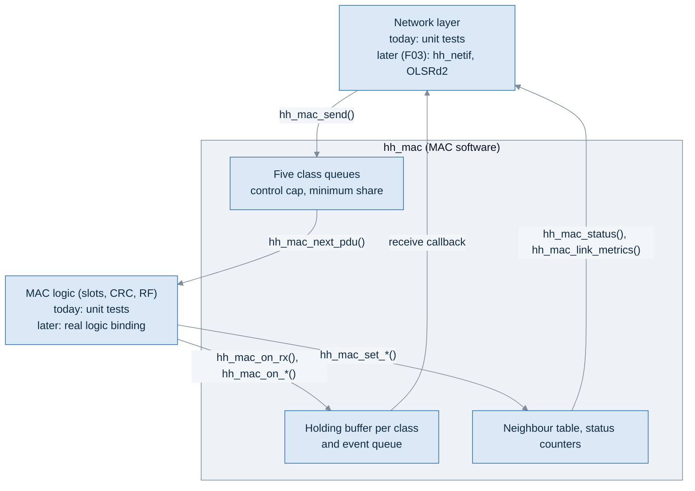
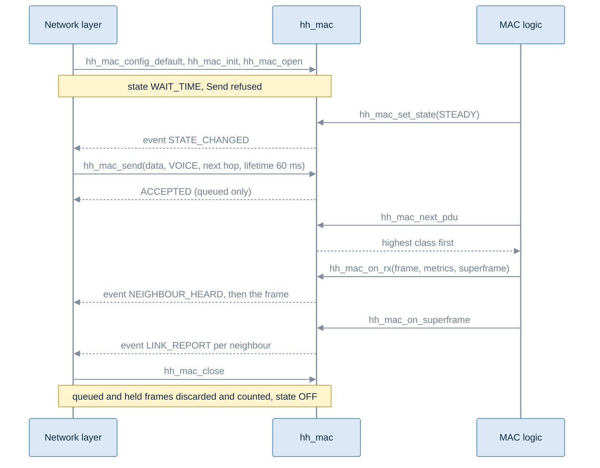
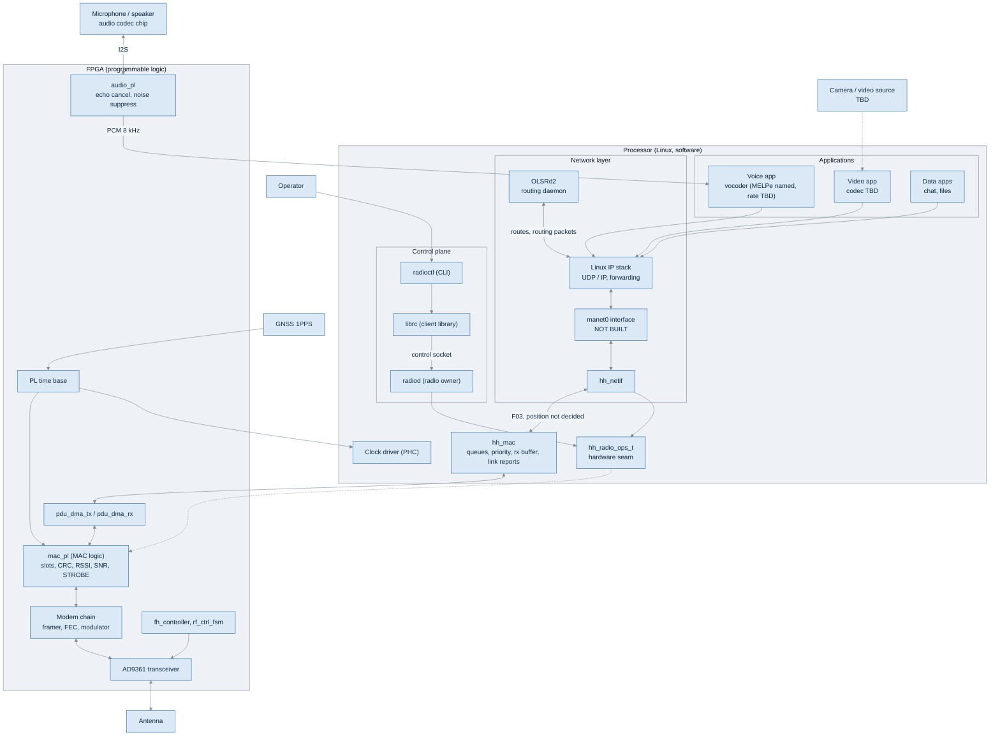
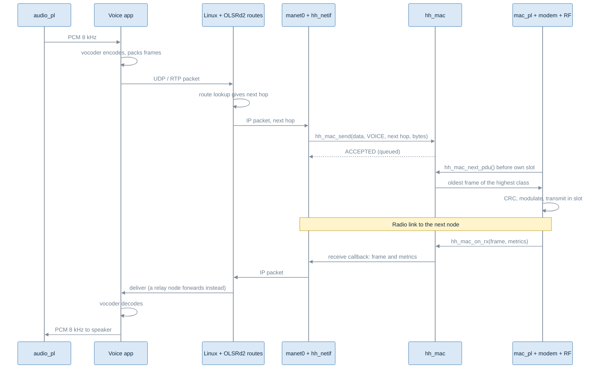

# MAC service (`hh_mac`): what it is and how to use it

| Item | Value |
|---|---|
| Task | F02-AK-2, MAC to network interface code skeleton |
| Implements | MAC to network layer interface specification, version 1.1 (`docs/MAC-NETWORK-INTERFACE.md`) |
| Code | `include/hhsdr/mac/mac.h`, `src/mac/mac.c` |
| Tests | `tests/unit/test_mac.c` (30 cases, run by ctest) |
| Library | `hhsdr_mac` (links `hhsdr_core_base` only) |
| Status | Skeleton. Both sides are callable; neither is joined to real code yet |

## 1. What was done

The interface specification says what the MAC offers the network layer. This
code turns version 1.1 of it into C with unit tests. Version 1.0 of the code
(2026-10-13) had two classes and collected delivery; it was updated to 1.1 on
2026-10-22.

What exists now:

- The operations of specification section 6: Open, Close, Send, Receive
  (pushed), Status, Link metrics, Net preset select.
- Five traffic classes in the order CONTROL > EMERGENCY > VOICE > VIDEO >
  DATA, one bounded first-in, first-out queue each, with the drop policy of
  specification section 9.1: voice and video drop their oldest frame when
  full, the others refuse with `TRY_AGAIN`.
- A lifetime per frame. A frame not sent in time is discarded and counted.
- Transmit inhibit: Send returns `TX_INHIBITED` and nothing goes to logic.
- A control cap (token bucket) and a minimum share for user traffic
  (specification section 10.4). Both are off by default because their values
  are open (DP-10).
- Push delivery of received frames and events through one callback. If the
  network layer cannot take a delivery, the MAC holds it in a holding buffer
  per class that drops the oldest frame when full.
- The address filter: this node, broadcast (0) and any group id.
- Events: neighbour heard, link report, state changed, transmit inhibit on
  and off, break-in on and off, own slots changed, parameters changed, entry
  failed.
- Per-frame metrics (RSSI, SNR, RX gain, arrival offset) and a per-neighbour
  record, each value with a valid bit, in the units of specification section
  8.5.
- Status with the fields of specification section 19 that the MAC can fill
  today, and counters for every refusal and drop.

What does not exist yet:

- The real MAC logic (slots, CRC, RF) and the real network layer. The tests
  stand in for both. Joining `hh_mac` to `hh_netif` and OLSRd2 is planned for
  F03.
- Anything that needs slot ownership (OI-3) or the on-air header (OI-2):
  the neighbour silent event, PER, the CRC fail count per neighbour, per-hop
  retransmission for data, and several frames per slot. Each is a `TODO`.
- Averaged RSSI and SNR. The averaging method is open (DP-6), so these stay
  not valid.

## 2. Where it sits



The network layer calls the operations and gives one receive callback. MAC
logic asks for a frame before each own slot, hands up every CRC-good frame,
and reports what it observes. The MAC pushes frames and events up through the
callback as soon as they occur.

## 3. Files

| File | Content |
|---|---|
| `include/hhsdr/mac/mac.h` | All public types, the configuration, and every function |
| `src/mac/mac.c` | The implementation |
| `tests/unit/test_mac.c` | Unit tests |
| `CMakeLists.txt` | Builds library `hhsdr_mac` |
| `tests/CMakeLists.txt` | Builds and registers `test_mac` |

`mac.h` includes `hhsdr/core/types.h`, `hhsdr/core/clock.h` (the injected
clock used for lifetimes, the control cap and time in holdover) and
`hhsdr/radio/radio.h` (only for `hh_frame_kind_t`).

## 4. Types in `mac.h`

### 4.1 Limits

| Name | Value | Meaning |
|---|---|---|
| `HH_MAC_PAYLOAD_MAX` | 1532 | Largest payload the buffers can hold. The larger target of OI-2. The configured default is 1280, the IPv6 minimum link MTU |
| `HH_MAC_TX_POOL_CAP` | 256 | Frames shared by all transmit queues. The configured depths must add up to no more than this |
| `HH_MAC_RX_POOL_CAP` | 128 | Frames shared by all holding buffers |
| `HH_MAC_EVENT_CAP` | 32 | Events waiting for delivery. When full, the oldest is dropped and counted |
| `HH_MAC_NEIGHBOR_CAP` | 32 | Neighbours tracked |
| `HH_MAC_BROADCAST` | 0 | Broadcast id |
| `HH_MAC_GROUP_FIRST`, `HH_MAC_GROUP_LAST` | 0xF0000000, 0xFFFFFFFE | Group id range |
| `HH_MAC_ID_RESERVED` | 0xFFFFFFFF | Reserved id |

Frames live in two shared pools, so memory is fixed at build time and does
not grow with the number of classes. `hh_mac_t` is about 600 KB. Put it in
static memory or a long-lived object, not on a stack.

### 4.2 Enumerations

| Type | Values | Used for |
|---|---|---|
| `hh_mac_result_t` | `OK`, `ACCEPTED`, `TRY_AGAIN`, `WRONG_STATE`, `TX_INHIBITED`, `TOO_LARGE`, `INVALID_ARGUMENT`, `INVALID_CONFIG`, `NOT_OPEN`, `NOT_FOUND`, `UNSUPPORTED`, `FAULT` | Return values, specification section 16.2. `ACCEPTED` is Send's success; the other calls return `OK` |
| `hh_mac_state_t` | `OFF`, `WAIT_TIME`, `LISTEN`, `ENTRY`, `STEADY`, `HOLDOVER`, `LOST`, `SAFE` | MAC state, specification section 21 |
| `hh_mac_class_t` | `CONTROL`, `EMERGENCY`, `VOICE`, `VIDEO`, `DATA` | Traffic class. Values 0 to 4 as specification section 8.5 |
| `hh_mac_inhibit_t` | `NONE`, `SULK`, `ZEROISE`, `FAULT`, `SYNC_LOSS`, `HOLDOVER_LIMIT` | Transmit inhibit reason |
| `hh_mac_time_source_t` | `GNSS`, `EXTERNAL_GNSS`, `NETWORK`, `HOLDOVER` | Time source in Status |
| `hh_mac_event_kind_t` | the events of specification section 6.8 | Event kind |
| `hh_mac_entry_fail_t` | `RETRIES_EXHAUSTED`, `NOT_AUTHORISED` | Reason in `ENTRY_FAILED` |

### 4.3 Structures

| Type | Who fills it | Content |
|---|---|---|
| `hh_mac_frame_metrics_t` | MAC logic | Flags byte (RSSI, SNR, RX gain and arrival offset valid, RSSI calibrated), RSSI, SNR and RX gain in 0.25 dB steps, arrival offset in ns |
| `hh_mac_tx_frame_t` | `hh_mac`, handed to logic | Kind, class, source (this node), destination, length, payload |
| `hh_mac_rx_pdu_t` | MAC logic | A CRC-good frame, any destination: kind, class, source, destination, superframe, metrics, payload pointer |
| `hh_mac_rx_frame_t` | `hh_mac`, pushed to the network layer | The same fields with a payload copy |
| `hh_mac_link_report_t` | `hh_mac` | Per-neighbour record of specification section 12.2, with a 16-bit valid flags field |
| `hh_mac_event_t` | `hh_mac` | Event kind, node, superframe, 32-bit detail, and the record for `LINK_REPORT` |
| `hh_mac_indication_t` | `hh_mac` | One delivery: a frame or an event |
| `hh_mac_status_t` | `hh_mac` | Status of specification section 19 and all counters |
| `hh_mac_config_t` | Caller, before init | Node id, clock, payload limit, queue and holding depths, report period, control cap, minimum share, receive callback |
| `hh_mac_t` | `hh_mac` | The whole MAC instance. The caller owns the memory and never touches the fields |

## 5. Functions

### 5.1 Setup

| Function | What it does | Results |
|---|---|---|
| `hh_mac_config_default(cfg, node_id, clock)` | Fills `cfg` with the defaults (section 7) | none |
| `hh_mac_init(mac, cfg)` | Clears `mac`, checks the configuration, stores it. State `OFF` | `OK`, `INVALID_CONFIG`, `INVALID_ARGUMENT` |

### 5.2 Network layer side (specification section 6)

| Function | Operation | What it does | Results |
|---|---|---|---|
| `hh_mac_open(mac)` | Open | Enables the MAC. State becomes `WAIT_TIME`. Open when open changes nothing | `OK`, `INVALID_CONFIG` |
| `hh_mac_close(mac)` | Close | Discards and counts queued and held frames, state `OFF`. No delivery after it returns. Safe twice and after a failed init | `OK` |
| `hh_mac_send(mac, kind, cls, dst, lifetime_ms, payload, len)` | Send | Checks, then queues. Never blocks | `ACCEPTED`, `NOT_OPEN`, `WRONG_STATE`, `TX_INHIBITED`, `TOO_LARGE`, `INVALID_ARGUMENT`, `TRY_AGAIN` |
| receive callback in `cfg` | Receive | Called with each frame and event. Must only enqueue and return; returns false if it cannot take it now | |
| `hh_mac_flush(mac)` | | Retries held deliveries after the callback refused one | |
| `hh_mac_status(mac, out)` | Status | Copies status and counters | `OK`, `NOT_OPEN` |
| `hh_mac_link_metrics(mac, neighbor, out)` | Link metrics | The record for one neighbour | `OK`, `NOT_FOUND`, `NOT_OPEN` |
| `hh_mac_net_preset_select(mac, preset)` | Net preset select | Not defined until OI-4 | `UNSUPPORTED`, `NOT_OPEN` |

### 5.3 MAC logic side

| Function | What it does |
|---|---|
| `hh_mac_next_pdu(mac, out)` | Logic asks for the frame for its next own slot. One call, one frame |
| `hh_mac_on_rx(mac, pdu)` | Logic hands up one CRC-good frame. The MAC updates the neighbour record, filters, holds and pushes it |
| `hh_mac_on_crc_fail(mac)`, `hh_mac_on_tx_underrun(mac)`, `hh_mac_on_tx_inhibited_slot(mac)` | Counters only |
| `hh_mac_on_superframe(mac, sf)` | Superframe boundary. Sets the time for events and sends link reports every report period |
| `hh_mac_on_break_in(mac, node, on)` | `BREAK_IN_ON` or `BREAK_IN_OFF` |
| `hh_mac_on_entry_failed(mac, reason)` | `ENTRY_FAILED` |
| `hh_mac_on_reset(mac)` | A MAC reset: restart count up, state `WAIT_TIME` |
| `hh_mac_set_state(mac, state)` | New state, `STATE_CHANGED` |
| `hh_mac_set_tx_inhibit(mac, reason)` | Inhibit on (any reason) or off (`NONE`), with the event |
| `hh_mac_set_own_slots(mac, n)` | Own slots per frame, `OWN_SLOTS_CHANGED` |
| `hh_mac_set_time_source(mac, src)` | Time source for Status |
| `hh_mac_set_max_payload(mac, n)` | New maximum payload, `PARAMETERS_CHANGED` |

Helpers: `hh_mac_result_str`, `hh_mac_state_str`, `hh_mac_class_str` give
names for logs.

## 6. From start to end

### 6.1 The whole life of a MAC instance



### 6.2 The same, as code

```c
#include "hhsdr/mac/mac.h"

static hh_mac_t mac;                          /* large: keep it off the stack */

static bool on_receive(void *ctx, const hh_mac_indication_t *ind)
{
    (void)ctx;
    /* Only enqueue here; process on the network layer's own thread.
     * Return false if the queue is full: the MAC holds the delivery. */
    if (ind->type == HH_MAC_IND_FRAME) { /* copy ind->frame */ }
    else                               { /* copy ind->event */ }
    return true;
}

void example(const hh_clock_t *clock)
{
    hh_mac_config_t cfg;
    hh_mac_tx_frame_t tx;
    const uint8_t voice[] = {0x01, 0x02};

    /* 1. Configure and start. */
    hh_mac_config_default(&cfg, 7, clock);    /* this node is id 7 */
    cfg.receive = on_receive;
    if (hh_mac_init(&mac, &cfg) != HH_MAC_OK) return;
    hh_mac_open(&mac);                        /* state WAIT_TIME */

    /* 2. MAC logic reports it is synchronised. */
    hh_mac_set_state(&mac, HH_MAC_STEADY);

    /* 3. Network layer sends voice to next hop 3, dropped if not sent in 60 ms. */
    switch (hh_mac_send(&mac, HH_FRAME_DATA, HH_MAC_CLASS_VOICE, 3, 60, voice, sizeof voice)) {
    case HH_MAC_ACCEPTED:     break;          /* queued, not yet sent */
    case HH_MAC_TRY_AGAIN:    break;          /* queue full: hold, drop or replace; do not spin */
    case HH_MAC_WRONG_STATE:  break;          /* wait for STATE_CHANGED */
    case HH_MAC_TX_INHIBITED: break;          /* stop offering traffic */
    default:                  break;          /* caller error: do not retry unchanged */
    }

    /* 4. MAC logic takes the frame for its next own slot. */
    if (hh_mac_next_pdu(&mac, &tx)) {
        /* transmit tx.payload, tx.len to tx.dst, class tx.cls */
    }

    /* 5. MAC logic hands up a received frame; it is pushed to on_receive. */
    hh_mac_rx_pdu_t pdu = { .kind = HH_FRAME_DATA, .cls = HH_MAC_CLASS_VOICE,
                            .src = 4, .dst = 7, .superframe = 100,
                            .metrics = { .flags = HH_MAC_M_RSSI_VALID, .rssi_qdb = -240 },
                            .len = 2, .payload = voice };
    hh_mac_on_rx(&mac, &pdu);

    /* 6. Stop. */
    hh_mac_close(&mac);
}
```

### 6.3 Send path in detail

`hh_mac_send()` checks in the order of specification section 7.3 and stops at
the first failure:

| Step | Check | Result if it fails | Counter |
|---|---|---|---|
| 1 | Initialised and open | `NOT_OPEN` | none |
| 2 | State is `STEADY` or `HOLDOVER` | `WRONG_STATE` | `refused_state` |
| 3 | Transmit not inhibited | `TX_INHIBITED` | `refused_inhibited` |
| 4 | `len` within the current maximum payload | `TOO_LARGE` | `refused_too_large` |
| 5 | Kind and class known; data uses a class other than control; payload present when `len > 0` | `INVALID_ARGUMENT` | `refused_invalid` |
| 6 | Class queue has room. Voice and video drop their oldest frame instead | `TRY_AGAIN` | `queue_full[class]`, or `drop_oldest[class]` |
| 7 | Copy in, source set to this node, lifetime start noted | `ACCEPTED` | queue depth + 1 |

Beacon and routing kinds always go in the control class, whatever class the
caller gives. `ACCEPTED` only means queued. Destination ids are not checked;
which ids are invalid is still open (DP-11).

### 6.4 Choosing the next frame (`hh_mac_next_pdu`)

1. If the state is not `STEADY` or `HOLDOVER`, or transmit is inhibited,
   return nothing. Queued frames stay queued.
2. Discard every frame at the head of a queue whose lifetime has passed.
3. Refill the control token bucket for the time since the last call.
4. If the minimum share is on, user traffic is queued, and the last N minus 1
   own slots carried no user frame, take the oldest frame of the highest user
   class.
5. Otherwise, if a control frame is waiting and the token bucket allows it,
   take it.
6. Otherwise take the oldest frame of the highest non-empty user class.
7. Otherwise the slot carries nothing.

User classes are emergency, voice, video and data, in that order.

### 6.5 Receive path in detail

| Step | What happens | Counter if dropped |
|---|---|---|
| 1 | Logic passes up a CRC-good frame, whatever its destination | |
| 2 | The sender's record is updated: receive count, last heard superframe. A new neighbour raises `NEIGHBOUR_HEARD` | `neighbor_table_full` if no free entry |
| 3 | Address filter: kept if the destination is this node, 0 or a group id | `rx_not_addressed` |
| 4 | Kept in `LISTEN`, `ENTRY`, `STEADY`, `HOLDOVER` and `LOST`; not in `OFF`, `WAIT_TIME` or `SAFE` (DP-9 option (a)) | `rx_not_delivered_state` |
| 5 | Put in the holding buffer of its class. If full, the oldest frame of that class is dropped | `hold_overflow[class]` |
| 6 | Frames and events are pushed in the order they happened until the callback refuses one | `delivery_refused`, `frames_rx` counts deliveries |

The network layer keeps group frames only for groups it belongs to. It does
not filter by node id again.

## 7. Configuration

| Field | Default | Allowed | Meaning |
|---|---|---|---|
| `node_id` | given | not 0, not a group id, not 0xFFFFFFFF | Source of every frame sent |
| `clock` | given | not NULL | Injected clock |
| `max_payload` | 1280 | 1 to 1532 | Larger payloads get `TOO_LARGE`. Can change while open |
| `queue_depth[]` | 16, 8, 8, 32, 64 | at least 1, sum at most 256 | Control, emergency, voice, video, data. Specification section 9.1 |
| `hold_depth[]` | 16 each | at least 1, sum at most 128 | Holding buffer per class. Open (DP-5) |
| `report_period_sf` | 1 | 0 or more | Link report every N superframes. 0 = off |
| `ctl_cap_pdus_per_s`, `ctl_burst_pdus` | 0, 0 | burst at least 1 when the rate is set | Control cap in PDUs. Rate 0 = off |
| `ctl_cap_bytes_per_s`, `ctl_burst_bytes` | 0, 0 | burst at least `max_payload` when the rate is set | Control cap in bytes. Rate 0 = off |
| `min_share_n` | 0 | 0 or more | One own slot in N carries a user frame while one is queued. 0 = off |
| `receive`, `receive_ctx` | NULL | | Receive callback. Without it, deliveries wait in the holding buffer |

Values outside the allowed range make `hh_mac_init()` return
`INVALID_CONFIG`.

**Control cap and minimum share.** Strict priority lets control starve user
traffic at a busy relay. The token bucket limits control to C PDUs and B bytes
per second with a burst allowance; control over the cap waits in its queue
while user frames go. The minimum share gives user traffic at least one own
slot in N:

```
min_share_n = 0 (strict):  C C C C C C ...   user waits while control is queued
min_share_n = 3:           C C U C C U ...   user gets at least 1 slot in 3
```

Both are off by default because their values are open (DP-10).

## 8. Link quality

| Where | Fields | Valid today |
|---|---|---|
| Each delivered frame | RSSI, SNR, RX gain, arrival offset | As logic reports them, by their valid bits |
| Per-neighbour record (Link metrics and `LINK_REPORT`) | Averaged RSSI and SNR | Never: averaging method open (DP-6) |
| | PER from and towards the neighbour, CRC fail count | Never: needs slot ownership and MAC control fields (OI-2, OI-3) |
| | Data rates, latency | Never: not measured yet |
| | Last heard superframe, receive count | Always. The count includes frames addressed to others |

Rule for the network layer: when a valid bit is clear, do not use the value.
A missing measurement is not a bad link.

## 9. Building and linking

Build and test:

```bash
cmake -S . -B build -DCMAKE_BUILD_TYPE=Debug
cmake --build build -j8
ctest --test-dir build -R test_mac --output-on-failure
```

Use it from another target:

```cmake
target_link_libraries(my_target PRIVATE hhsdr_mac)
```

Dependency rule: `hhsdr_mac` links `hhsdr_core_base` only. It must not link
`hhsdr_core` (the legacy stack), `hhsdr_netif`, `radiod` or anything under
`tests/`.

## 10. How it will be joined (later work)

| Join | What is needed | When |
|---|---|---|
| Network side | An adapter that maps `hh_netif` (or the `manet0` interface used by OLSRd2) onto `hh_mac_send()` and the receive callback, including DSCP to class (specification section 7.1) | F03 |
| MAC logic side | Code that calls `hh_mac_next_pdu()` before each own slot and the `hh_mac_on_*()` and `hh_mac_set_*()` calls from the logic's events. Depends on the logic interface, which is not defined yet | When the MAC logic interface exists |
| Link metrics to routing | Per-neighbour record to OLSRd2 | With the routing integration |

## 11. Tests (`test_mac`)

| Test | Checks |
|---|---|
| `test_config_defaults_and_limits` | Defaults of section 9.1; invalid config refused; Close safe after a failed init |
| `test_open_and_send_states` | Open to `WAIT_TIME`, idempotent; Send refused outside `STEADY` and `HOLDOVER` |
| `test_enqueue_dequeue_unchanged` | Frame out equals frame in; source and class filled |
| `test_kind_and_class_rules` | Beacon and routing forced to control; data may not use control; unknown values refused |
| `test_class_order` | CONTROL > EMERGENCY > VOICE > VIDEO > DATA |
| `test_fifo_within_class` | Oldest first within a class |
| `test_try_again_classes_drop_nothing` | Control, emergency, data: `TRY_AGAIN`, nothing removed |
| `test_voice_video_drop_oldest` | Voice, video: oldest dropped and counted |
| `test_full_class_does_not_block_others` | One full class does not stop another |
| `test_lifetime` | Expired frames discarded and counted; lifetime 0 never expires |
| `test_tx_inhibit` | `TX_INHIBITED`, nothing to logic, events with reason, receive still delivered |
| `test_max_payload` | 1280 default; change raises `PARAMETERS_CHANGED` |
| `test_control_cap_pdus`, `test_control_cap_bytes` | Token bucket holds control back; user frames go meanwhile |
| `test_strict_priority_when_share_off` | Without a share, control starves user traffic |
| `test_minimum_share` | One slot in N for user traffic, highest user class first |
| `test_receive_filter_and_push` | This node, broadcast and group delivered; others counted |
| `test_received_frame_fields` | Fields and metrics unchanged, payload byte-identical |
| `test_delivery_by_state` | Delivered in `LISTEN`, `ENTRY`, `LOST`; not in `WAIT_TIME`, `SAFE` |
| `test_holding_buffer` | Held when refused, oldest dropped per class, flushed in order |
| `test_neighbour_heard` | Once per neighbour, before its first frame |
| `test_link_report_period` | Every report period, valid bits clear |
| `test_events` | State, break-in, own slots, entry failed |
| `test_status` | Operational by state, time in holdover, restart count, counters |
| `test_link_metrics_results` | `NOT_FOUND`, `NOT_OPEN` |
| `test_close` | Discards counted, safe twice, nothing delivered after |
| `test_net_preset_unsupported` | `UNSUPPORTED` |
| `test_neighbor_table_bounded` | Table full counted, not grown |
| `test_pool_holds_all_queues` | Every queue full at once fits in the pool |
| `test_null_safety` | NULL arguments do not crash |

## 12. Still open

Each of these is a `TODO` in the code and an open item in the specification.

| Open point | What the code does now |
|---|---|
| Neighbour silent, PER, CRC fail count per neighbour (OI-3) | Not raised; valid bits clear |
| Per-hop retransmission for data (DP-1, OI-2) | Not built |
| Several frames per slot (OI-2) | One frame per own slot |
| Averaging method (DP-6) | Averaged values not valid |
| Which destination ids are invalid (DP-11) | None refused |
| Queued frames when leaving `STEADY` or `HOLDOVER`, while inhibited, or on a reset (DP-3) | Kept |
| Operational flag in `WAIT_TIME`, `LISTEN`, `ENTRY`, `LOST` (DP-9) | Marked unknown |
| Holding buffer depth (DP-5) | 16 per class, configurable |
| Control cap and share values (DP-10) | Built, off by default |
| Net preset meaning (OI-4) | `UNSUPPORTED` |
| Sync quality, TX power, range profile, slot and frame length, schedule version, net preset in Status | Not in Status yet |
| Latency units | Field not valid |

## 13. The whole system: where `hh_mac` fits

This section steps back from `hh_mac` and shows the whole node: which parts
exist, which interfaces join them, and where each piece of data comes from.
It is drawn from the target architecture (OSL-628-BD-101), `ARCHITECTURE.md`,
`fpga/README.md`, `docs/TRAFFIC-PROFILE.md`, the interface note and
`unknown.md`. Nothing here is new design; where something is not specified,
the table says so and gives the open item.

### 13.1 One node, all parts



How to read it:

- **Left to right is the user's traffic.** Voice, video and data enter as IP
  packets, go down through the network layer and `hh_mac`, into the FPGA and
  out of the antenna. Received traffic takes the same path upwards.
- **`radioctl`, `librc`, `radiod` are the control plane.** They configure and
  watch the radio. They never carry user packets.
- **The FPGA does the radio work:** slot timing, CRC, modulation, frequency
  hopping and the RF chip. Software reaches it only through DMA for frames and
  through `radiod` for configuration.
- **Dashed lines are not built.** `hh_radio_ops_t` has only a mock radio
  behind it today, and every box under "FPGA" is empty in this
  repository today (`fpga/README.md`).
- **Where `hh_mac` sits against `hh_radio_ops_t` is not decided.** Today
  `hh_netif` talks to `hh_radio_ops_t` directly and `hh_mac` stands alone.
  Joining them is F03 work.

### 13.2 What each layer does

| Layer | Part | Its job | Its job is not |
|---|---|---|---|
| Application | Voice app with vocoder | Turns 8 kHz PCM into small coded frames and back | Routing, timing |
| Application | Video app | Encodes and decodes video | Not defined yet (OI-5 in `docs/TRAFFIC-PROFILE.md`) |
| Network | Linux IP stack | Sends and forwards IP packets using the routing table | Choosing routes |
| Network | OLSRd2 | Finds neighbours, builds the topology, writes routes into Linux | Sending user packets itself |
| Network | `manet0`, `hh_netif` | Turn an IP packet plus next hop into a radio frame, and back | Routing, address filtering |
| MAC software | `hh_mac` | Holds frames per class, picks the next frame, filters and buffers received frames, keeps link reports | Timing, CRC, radio |
| MAC logic | `mac_pl` (FPGA) | Owns the slots, sends in our slot, checks CRC, measures RSSI and SNR, drives the T/R strobe | Queues, priority |
| PHY | Modem chain, AD9361, hopping, RF state machine | Bits to RF and RF to bits, 1000 hops per second | Anything about packets |
| Control | `radioctl`, `librc`, `radiod` | Start, stop, configure and report on the radio | Carrying packets |
| Time | GNSS, PL time base, PHC | Give every node the same frame and slot clock | Anything else |

### 13.3 Interfaces

| Interface | Between | Carries | Status |
|---|---|---|---|
| I2S | Audio codec chip and `audio_pl` | Raw audio | Target design only |
| PCM stream | `audio_pl` and the voice app | Cleaned 8 kHz audio | How it reaches Linux is open (U-13) |
| Sockets (UDP, RTP) | Applications and Linux | Voice, video, data packets | Standard Linux |
| Netlink | OLSRd2 and Linux | Routes | Standard, works in the Docker mesh (F01-AK-2) and on the board (F01-AK-5) |
| `manet0` | Linux and `hh_netif` | IP packets | Not built (U-24) |
| `hh_netif` API | `manet0` binding and the radio side | Bytes, next hop, per-frame metrics | Built, tested |
| `hh_mac` network side | Network layer and `hh_mac` | Send, receive callback, status, link metrics | Built, tested (this task) |
| `hh_mac` logic side | `hh_mac` and MAC logic | Next frame, received frame, state | Built, tested; real binding not defined (U-21) |
| ICD-1 (DMA) | Processor and `mac_pl` | Frames | Not specified (U-06) |
| `hh_radio_ops_t` | Software and the radio | 8 functions: open, close, transmit, receive callback, status, metrics, channel, poll | Built; mock radio only |
| ICD-2 (control socket) | `librc` and `radiod` | Commands and replies | ASCII protocol works; ICD-2 not specified (U-01) |
| OpenCPI ACI | `radiod` and the FPGA workers | Configuration | Works on the development host; not on the board (U-17, U-19) |
| MANET STROBE | `mac_pl` and the RF state machine | Transmit or receive, per slot | Not specified (U-08) |
| ICD-3 (time) | PL time base and clock driver | Frame, slot, hop time | Not specified (U-07) |

### 13.4 Where the data comes from

| Data | Made by | Reaches | Through |
|---|---|---|---|
| Speech | Microphone, audio codec chip | Voice app | I2S, `audio_pl`, PCM stream |
| Coded voice frames | Vocoder in the voice app | Network layer | UDP / RTP socket |
| Video frames | Video source and codec (TBD) | Network layer | Socket |
| User data | Data apps | Network layer | Socket |
| Routing messages (HELLO, TC) | OLSRd2 | Other nodes' OLSRd2 | Linux, `manet0`, MAC control class |
| Routes | OLSRd2 | Linux routing table | Netlink |
| Received frames | `mac_pl` (CRC good) | `hh_mac`, then the network layer | DMA, `hh_mac_on_rx()`, receive callback |
| RSSI, SNR | `mac_pl`, measured per burst | `hh_mac` per-frame metrics and link report | `hh_mac_on_rx()` |
| PER | `hh_mac` (from counts) | Link report | Definition still TODO |
| MAC state | `mac_pl` | `hh_mac`, status | `hh_mac_set_state()` |
| Link quality for routing | `hh_mac_link_metrics()` | OLSRd2 | Not decided (U-24) |
| Radio status, faults | Radio | Operator | `radiod`, `librc`, `radioctl status` |
| Time | GNSS 1PPS | PL time base, clock driver, MAC slots | ICD-3 (U-07) |

### 13.5 A voice call, end to end



The lower half is the receiving node. On a relay node the packet goes up to
Linux, is forwarded with the next route, and comes back down the same stack.
The playback path from the voice app to the speaker is not described in the
target drawing (U-13).

**Priority today.** The given order for user traffic is audio, then video,
then data. `hh_mac` has five classes, control, emergency, voice, video and
data, so voice goes ahead of a file transfer. The mapping from DSCP to class at
the Linux binding (specification section 7.1) is not built yet.

### 13.6 A control command, end to end

Control never touches the user traffic path:

```text
operator -> radioctl set-channel 11
         -> librc (C API) -> control socket -> radiod
         -> hh_radio_ops_t set_channel -> radio (today: mock)
         <- reply line "ok set_channel ..." <- radioctl prints it
```

`radiod` is the only process allowed to configure the FPGA (single-owner
rule). Frame send and per-frame metrics are deliberately not in its protocol.

### 13.7 What exists today

| Part | State |
|---|---|
| `radioctl`, `librc`, `radiod` | Working against the mock radio; OpenCPI backend on the host |
| OLSRd2 | Runs in the Docker mesh (F01-AK-2) and on the Zynq reference board (F01-AK-5) |
| `hh_netif` | Built and tested |
| `hh_mac` | Built and tested (this task); not joined to either side |
| `manet0` binding | Not built (U-24) |
| Voice app, vocoder | Not in this repository; vocoder and rate open (OI-1) |
| Video | Not defined (OI-5) |
| FPGA blocks, DMA, time plane | Not in this repository |
