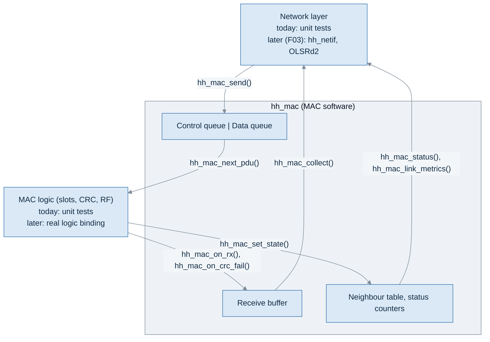
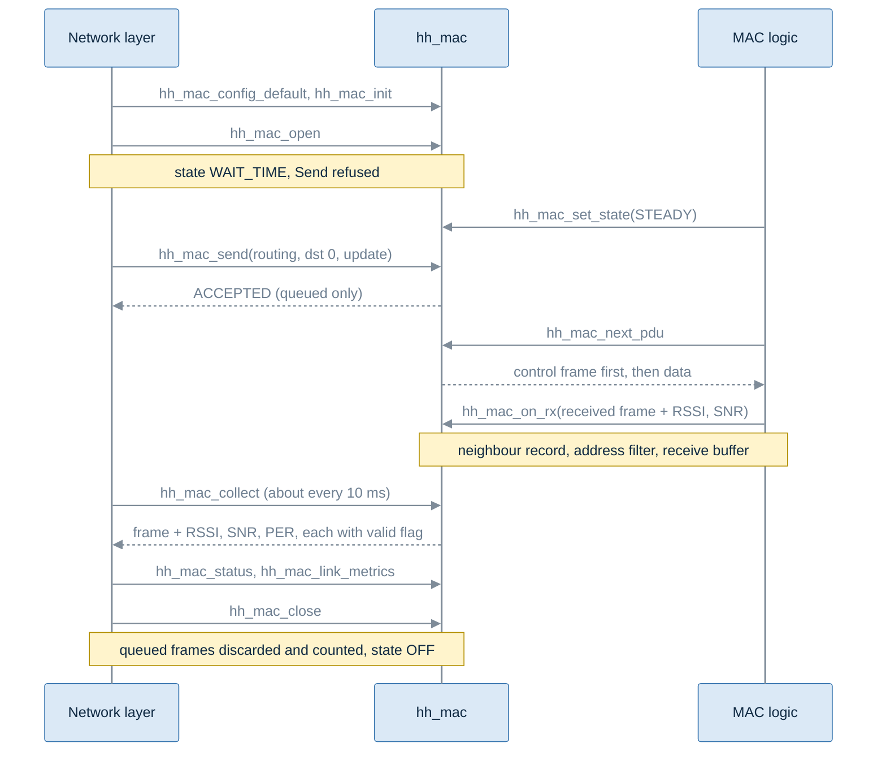
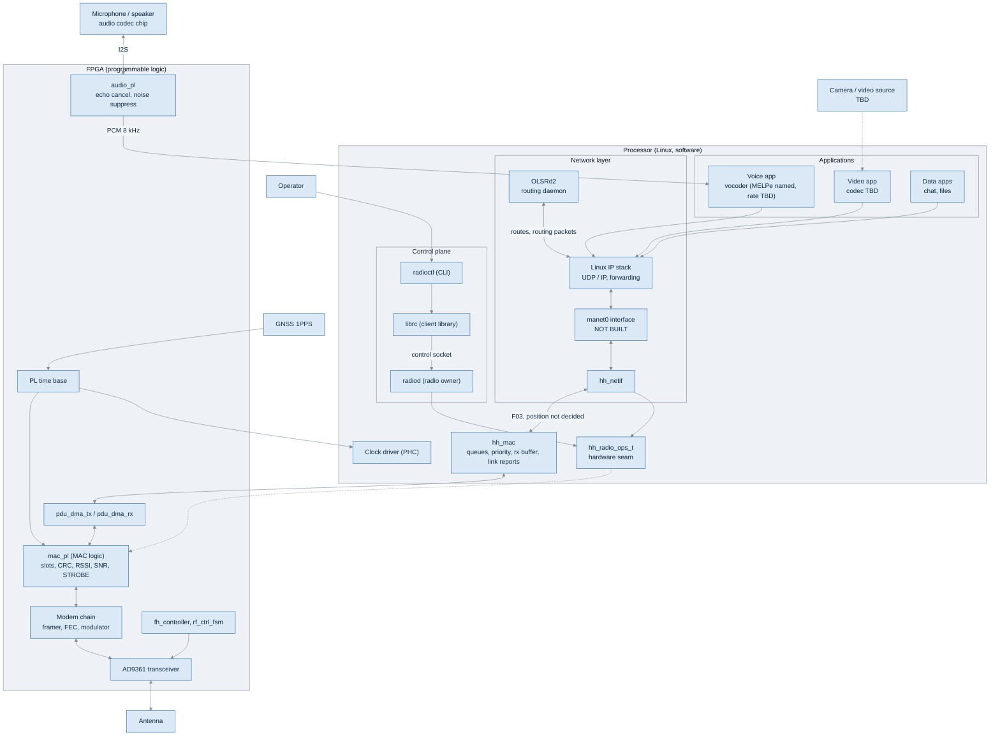
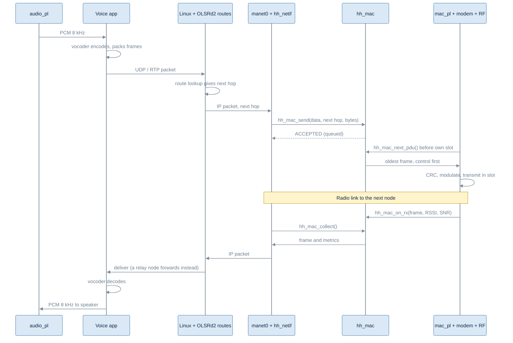

# MAC service (`hh_mac`): what it is and how to use it

| Item | Value |
|---|---|
| Task | F02-AK-2, MAC to network interface code skeleton |
| Implements | MAC to network layer interface note (MAC-NETWORK-INTERFACE, F01-AK-3, version 1.0) |
| Code | `include/hhsdr/mac/mac.h`, `src/mac/mac.c` |
| Tests | `tests/unit/test_mac.c` (19 cases, run by ctest) |
| Library | `hhsdr_mac` (links `hhsdr_core_base` only) |
| Status | Skeleton. Both sides are callable; neither is joined to real code yet |

## 1. What was done

The interface note says what the MAC offers the network layer: seven
operations, two priority classes, queue rules, a receive buffer, status and
link metrics. This task turns that into C code with unit tests.

What exists now:

- The seven operations of the note: Open, Close, Send, Receive (collect),
  Status, Link metrics, Channel select.
- One bounded first-in, first-out queue per class: control (beacon and
  routing frames) and data.
- Priority: control before data, with an optional limit so data is not
  starved.
- A bounded receive buffer, filled from the MAC logic side and emptied only
  when the network layer collects.
- Per-frame metrics (RSSI, SNR, PER) and a per-neighbour link report, every
  value with a valid flag.
- Status with the MAC state and counters for every refusal and drop.
- Unit tests for all of the above.

What does not exist yet:

- The real MAC logic in the programmable logic (slots, CRC, RF). The skeleton
  gives it three entry points; nothing calls them except the tests.
- The real network layer on top. Joining `hh_mac` to `hh_netif` and OLSRd2 is
  planned for F03.
- Link metric averaging, a PER definition, metric units and channel select.
  These are open in the note and marked `TODO` in the code.

## 2. Where it sits



The network layer calls the top seven functions. MAC logic calls the bottom
four. `hh_mac` never calls out to either side: frames go down only when logic
asks for one, and come up only when the network layer collects.

## 3. Files

| File | Content |
|---|---|
| `include/hhsdr/mac/mac.h` | All public types, the configuration, and every function |
| `src/mac/mac.c` | The implementation: queues, priority, receive path, neighbour table, status |
| `tests/unit/test_mac.c` | Unit tests |
| `CMakeLists.txt` | Builds library `hhsdr_mac` |
| `tests/CMakeLists.txt` | Builds and registers `test_mac` |

`mac.h` includes `hhsdr/core/types.h` (node id, basic types) and
`hhsdr/radio/radio.h` (only for `hh_frame_kind_t`, so frame kinds are the same
everywhere in the project).

## 4. Types in `mac.h`

### 4.1 Limits

| Name | Value | Meaning |
|---|---|---|
| `HH_MAC_PAYLOAD_MAX` | 512 | Largest payload, in bytes. The current network limit; it may change |
| `HH_MAC_QUEUE_CAP` | 128 | Most frames one class queue can ever hold |
| `HH_MAC_RXBUF_CAP` | 64 | Most frames the receive buffer can ever hold |
| `HH_MAC_NEIGHBOR_CAP` | 32 | Most neighbours tracked |
| `HH_MAC_BROADCAST` | 0 | Broadcast destination id |

These caps fix the memory size at build time. The configuration sets the
working values below them.

### 4.2 Enumerations

| Type | Values | Used for |
|---|---|---|
| `hh_mac_result_t` | `OK`, `ACCEPTED`, `TRY_AGAIN`, `WRONG_STATE`, `TOO_LARGE`, `INVALID_ARGUMENT`, `INVALID_CONFIG`, `NOT_OPEN`, `NOT_FOUND`, `UNSUPPORTED`, `FAULT` | Return value of every network-side call. Names are the note's logical names. `ACCEPTED` is Send's success; the other calls return `OK` |
| `hh_mac_state_t` | `OFF`, `WAIT_TIME`, `LISTEN`, `ENTRY`, `STEADY`, `HOLDOVER`, `LOST`, `SAFE` | The MAC state of the note. Send is accepted only in `STEADY` and `HOLDOVER` |
| `hh_mac_class_t` | `CONTROL`, `DATA` | Priority class. Derived from the frame kind, never passed by the caller |

### 4.3 Structures

| Type | Who fills it | Content |
|---|---|---|
| `hh_mac_metric_t` | `hh_mac` | One measured value plus `valid`. When `valid` is false the value means nothing and must not be used |
| `hh_mac_frame_metrics_t` | `hh_mac` | Per-frame RSSI, SNR, PER |
| `hh_mac_tx_frame_t` | `hh_mac`, handed to logic | Kind, source (this node), destination (next hop or broadcast), length, payload |
| `hh_mac_rx_pdu_t` | MAC logic | A CRC-good frame as received, any destination: kind, source, destination, payload pointer, RSSI, SNR, superframe number |
| `hh_mac_rx_frame_t` | `hh_mac`, given to the network layer | A received frame for this node or broadcast: kind, source, destination, payload copy, per-frame metrics, receive superframe |
| `hh_mac_link_report_t` | `hh_mac` | One neighbour: averaged RSSI, SNR, PER (not valid yet), last heard superframe, receive count |
| `hh_mac_status_t` | `hh_mac` | Operational flag, state, frame counts, queue depths, and counters for every refusal and drop |
| `hh_mac_config_t` | Caller, before init | Node id, payload limit, queue depths, receive buffer depth, starvation limit, receive-in-all-states switch |
| `hh_mac_t` | `hh_mac` | The whole MAC instance. The caller owns the memory and never touches the fields directly |

`hh_mac_t` is large (about 150 KB with the default caps), because every
queue slot holds a full 512-byte payload. Put it in static memory or a
long-lived object, not on a small stack.

## 5. Functions

### 5.1 Setup

| Function | Caller | What it does | Results |
|---|---|---|---|
| `hh_mac_config_default(cfg, node_id)` | Owner | Fills `cfg` with the defaults (section 7) | none |
| `hh_mac_init(mac, cfg)` | Owner | Checks the configuration against the caps, clears `mac`, stores `cfg`. State becomes `OFF` | `OK`, `INVALID_CONFIG`, `INVALID_ARGUMENT` |

### 5.2 Network layer side (note section 6)

| Function | Note operation | What it does | Results |
|---|---|---|---|
| `hh_mac_open(mac)` | Open | Enables the MAC. State becomes `WAIT_TIME`. It does not mean the node can transmit yet | `OK` |
| `hh_mac_close(mac)` | Close | Discards and counts every queued frame, empties the receive buffer, state becomes `OFF`. Safe to call twice | `OK` |
| `hh_mac_send(mac, kind, dst, payload, len)` | Send | Checks state, size, kind, then room in the class queue, and copies the frame in. Never blocks | `ACCEPTED`, `NOT_OPEN`, `WRONG_STATE`, `TOO_LARGE`, `INVALID_ARGUMENT`, `TRY_AGAIN` |
| `hh_mac_collect(mac, out, &got)` | Receive (collect) | Takes the oldest frame from the receive buffer. `got` is false when nothing is waiting, which is a normal result | `OK`, `NOT_OPEN` |
| `hh_mac_status(mac, out)` | Status | Copies state, operational flag, queue depths and all counters | `OK`, `NOT_OPEN` |
| `hh_mac_link_metrics(mac, neighbor, out)` | Link metrics | Returns the record kept for one neighbour | `OK`, `NOT_FOUND`, `NOT_OPEN` |
| `hh_mac_channel_select(mac, channel)` | Channel select | Not defined yet | `UNSUPPORTED`, `NOT_OPEN` |

### 5.3 MAC logic side

| Function | What it does |
|---|---|
| `hh_mac_next_pdu(mac, out)` | Logic asks for the frame for its next own slot. Returns true and fills `out`, or false when there is nothing to send or the state is not `STEADY` or `HOLDOVER` |
| `hh_mac_on_rx(mac, pdu)` | Logic hands up one CRC-good frame. `hh_mac` updates the neighbour record, applies the address filter, and stores the frame for collection |
| `hh_mac_on_crc_fail(mac)` | Logic reports a frame with a bad CRC. Only a counter goes up |
| `hh_mac_set_state(mac, state)` | Logic or the MAC state machine sets the MAC state. Logged |

### 5.4 Helpers

| Function | What it does |
|---|---|
| `hh_mac_class_of(kind)` | Beacon and routing give `CONTROL`, data gives `DATA` |
| `hh_mac_result_str(r)`, `hh_mac_state_str(s)` | Names for logs |

## 6. From start to end

### 6.1 The whole life of a MAC instance



### 6.2 The same, as code

```c
#include "hhsdr/mac/mac.h"

static hh_mac_t mac;                          /* large: keep it off the stack */

void example(void)
{
    hh_mac_config_t cfg;
    hh_mac_tx_frame_t tx;
    hh_mac_rx_frame_t rx;
    bool got;
    const uint8_t update[] = {0x01, 0x02};

    /* 1. Configure and start. */
    hh_mac_config_default(&cfg, 7);           /* this node is id 7 */
    cfg.data_share_n = 3;                     /* optional starvation limit */
    if (hh_mac_init(&mac, &cfg) != HH_MAC_OK) return;
    hh_mac_open(&mac);                        /* state WAIT_TIME */

    /* 2. MAC logic reports it is synchronised. */
    hh_mac_set_state(&mac, HH_MAC_STEADY);

    /* 3. Network layer sends: next hop 3, or HH_MAC_BROADCAST. */
    switch (hh_mac_send(&mac, HH_FRAME_ROUTING, HH_MAC_BROADCAST, update, sizeof update)) {
    case HH_MAC_ACCEPTED:    break;           /* queued, not yet sent */
    case HH_MAC_TRY_AGAIN:   break;           /* queue full: drop, keep or replace; do not spin */
    case HH_MAC_WRONG_STATE: break;           /* not STEADY or HOLDOVER: read status */
    default:                 break;           /* caller error: do not retry unchanged */
    }

    /* 4. MAC logic takes the frame for its next own slot. */
    if (hh_mac_next_pdu(&mac, &tx)) {
        /* transmit tx.payload, tx.len to tx.dst */
    }

    /* 5. MAC logic hands up a received frame. */
    hh_mac_rx_pdu_t pdu = { .kind = HH_FRAME_DATA, .src = 4, .dst = 7,
                            .len = 2, .payload = update,
                            .rssi = { -60.0f, true }, .snr = { 0.0f, false } };
    hh_mac_on_rx(&mac, &pdu);

    /* 6. Network layer collects, on its own timer. */
    while (hh_mac_collect(&mac, &rx, &got) == HH_MAC_OK && got) {
        if (rx.metrics.rssi.valid) { /* use rx.metrics.rssi.value */ }
    }

    /* 7. Stop. */
    hh_mac_close(&mac);
}
```

### 6.3 Send path in detail

`hh_mac_send()` checks in this order and stops at the first failure:

| Step | Check | Result if it fails | Counter |
|---|---|---|---|
| 1 | Initialised and open | `NOT_OPEN` | none |
| 2 | State is `STEADY` or `HOLDOVER` | `WRONG_STATE` | `refused_state` |
| 3 | `len` within `max_payload` | `TOO_LARGE` | `refused_too_large` |
| 4 | Kind is beacon, routing or data; payload present when `len > 0` | `INVALID_ARGUMENT` | `refused_invalid` |
| 5 | Class queue has room | `TRY_AGAIN` | `queue_full[class]` |
| 6 | Copy into the queue, source set to this node | `ACCEPTED` | queue depth + 1 |

`ACCEPTED` only means queued. Nothing reports whether the frame was later sent
or received. Destination ids are not checked; which ids are invalid is still to
be decided.

### 6.4 Choosing the next frame (`hh_mac_next_pdu`)

1. If the state is not `STEADY` or `HOLDOVER`, return nothing. Queued frames
   stay queued.
2. If the starvation limit is on, `control_run >= data_share_n`, and a data
   frame is waiting: take the oldest data frame.
3. Otherwise, if a control frame is waiting: take the oldest control frame.
4. Otherwise, if a data frame is waiting: take the oldest data frame.
5. Otherwise the slot carries nothing.

`control_run` counts control frames taken in a row. Taking a data frame resets
it.

### 6.5 Receive path in detail (`hh_mac_on_rx` then `hh_mac_collect`)

| Step | What happens | Counter if dropped |
|---|---|---|
| 1 | Logic passes up a CRC-good frame, whatever its destination | |
| 2 | The sender's neighbour record is updated: receive count, last heard superframe | `neighbor_table_full` if no free entry |
| 3 | Address filter: kept only if the destination is this node or 0 | `rx_not_addressed` |
| 4 | Kept only in `STEADY` or `HOLDOVER`, unless `rx_deliver_all_states` is set | `rx_not_delivered_state` |
| 5 | Stored in the receive buffer. If full, this newest frame is dropped | `rx_overflow` |
| 6 | The network layer collects it, oldest first. PER is marked not valid | `frames_rx` counts deliveries |

The network layer must not filter by address again: every frame it collects is
already for this node or broadcast.

## 7. Configuration

| Field | Default | Allowed | Meaning |
|---|---|---|---|
| `node_id` | given | not 0 | This node's id, used as the source of every frame sent |
| `max_payload` | 512 | 1 to 512 | Larger payloads get `TOO_LARGE` |
| `queue_depth[CONTROL]` | 16 | 1 to 128 | Control frames that can wait |
| `queue_depth[DATA]` | 64 | 1 to 128 | Data frames that can wait |
| `rx_buffer_depth` | 16 | 1 to 64 | Received frames held until collected |
| `data_share_n` | 0 | 0 or more | Starvation limit. 0 = strict priority |
| `rx_deliver_all_states` | false | true, false | Deliver received frames outside `STEADY` and `HOLDOVER` |

Values outside the allowed range make `hh_mac_init()` return
`INVALID_CONFIG`.

**Queue depth** is the number of frames a class can hold while waiting for a
slot. A full queue refuses with `TRY_AGAIN` instead of growing, so memory never
runs out. Control traffic is small and regular, so 16 is enough. Data traffic
is bursty, so it gets 64. A deeper queue holds more but makes frames wait
longer: at one own slot per 20 ms frame, 64 data frames take about 1.3 s to
drain.

**Starvation limit.** The note fixes strict priority: control always before
data. If control keeps arriving, data never goes. `data_share_n = N` lets one
waiting data frame through after N control frames in a row:

```
data_share_n = 0 (strict):  C C C C C C C C ...   data waits while control is queued
data_share_n = 3:           C C C D C C C D ...   data gets at least 1 slot in 4
```

When no data is waiting, control is never delayed. The default is 0, so the
default behaviour matches the note.

## 8. Link quality

| Where | Fields | Valid today |
|---|---|---|
| Each collected frame (`rx.metrics`) | RSSI, SNR from logic | As logic reports them |
| | PER | Never: a single frame has no error rate, and PER is not defined yet |
| Link report (`hh_mac_link_metrics`) | Averaged RSSI, SNR, PER | Never: the averaging method is not decided |
| | Last heard superframe | When logic gave a superframe number |
| | Receive count | Always. Counts every CRC-good frame from that neighbour, including frames addressed to others, so it can be higher than what the network layer collected |

Rule for the network layer: when `valid` is false, do not use the value. A
missing measurement is not a bad link.

## 9. Building and linking

Build and test:

```bash
cmake -S . -B build -DCMAKE_BUILD_TYPE=Debug
cmake --build build -j8
ctest --test-dir build -R test_mac --output-on-failure
```

Use it from another target:

```cmake
target_link_libraries(my_target PRIVATE hhsdr_mac)
```

```c
#include "hhsdr/mac/mac.h"
```

Dependency rule: `hhsdr_mac` links `hhsdr_core_base` only. It must not link
`hhsdr_core` (the legacy stack), `hhsdr_netif`, `radiod` or anything under
`tests/`.

## 10. How it will be joined (later work)

| Join | What is needed | When |
|---|---|---|
| Network side | A small adapter that maps `hh_netif` (or the `manet0` interface used by OLSRd2) onto `hh_mac_send()` and `hh_mac_collect()`, and maps results to the caller's error codes | F03 |
| MAC logic side | Code that calls `hh_mac_next_pdu()` before each own slot, and `hh_mac_on_rx()`, `hh_mac_on_crc_fail()`, `hh_mac_set_state()` from the logic's events. Depends on the logic interface, which is not defined yet | When the MAC logic interface exists |
| Link metrics to routing | Per-neighbour values to OLSRd2, for example as a data rate | With the routing integration |

Until then the unit tests stand in for both sides.

## 11. Tests (`test_mac`)

| Test | Checks |
|---|---|
| `test_config_defaults_and_limits` | Defaults; out-of-range config refused |
| `test_enqueue_dequeue_unchanged` | A frame comes out with the same kind, source, destination and payload |
| `test_fifo_within_class` | Oldest first within a class |
| `test_control_before_data` | Control taken before data that was sent earlier |
| `test_overflow_try_again_nothing_evicted` | Full queue gives `TRY_AGAIN`, nothing removed, control still accepted |
| `test_queue_bounded_at_configured_depth` | 1000 sends: exactly 64 data and 16 control accepted |
| `test_strict_priority_starves_data_when_off` | Limit off: data waits behind control |
| `test_starvation_limit_gives_data_a_share` | `data_share_n = 3`: data in every 4th slot |
| `test_starvation_limit_does_not_delay_control_without_data` | Limit on, no data: control every slot |
| `test_refusals_and_counters` | `NOT_OPEN`, `WRONG_STATE`, `TOO_LARGE`, `INVALID_ARGUMENT`, `UNSUPPORTED`, and their counters |
| `test_no_pdu_outside_steady_frames_kept` | Nothing handed to logic outside `STEADY`; frames kept |
| `test_close_discards_and_is_safe_twice` | Close discards and counts; second Close is safe |
| `test_receive_only_on_collect_with_filter` | Collect only; address filter; metrics and valid flags |
| `test_rx_overflow_drops_newest` | Full receive buffer drops the newest frame |
| `test_rx_outside_steady_not_delivered_by_default` | No delivery in `LISTEN` by default |
| `test_link_report_valid_flags` | `NOT_FOUND`; counts include other destinations; averaged values not valid |
| `test_neighbor_table_bounded` | Table full is counted, not grown |
| `test_status_operational` | Operational flag; CRC fail counter |
| `test_null_safety` | NULL arguments do not crash |

## 12. Still open

Each of these is a `TODO` in the code and an open item in the interface note.

| Open point | What the code does now |
|---|---|
| Units of RSSI and SNR | Values passed through as given |
| PER definition | Per-frame PER never valid |
| Link metric averaging | Averaged values never valid |
| Which destination ids are invalid | None refused |
| Queued frames when leaving `STEADY` or `HOLDOVER` | Kept, sent after return |
| Delivery and operational flag in `LISTEN`, `ENTRY`, `LOST`, `WAIT_TIME` | Not delivered by default; operational flag marked unknown |
| Open when already open | Returns `OK`, no change |
| Channel select | Returns `UNSUPPORTED` |
| Queue depth unit and values | Frames; 16 and 64, configurable |
| Starvation limit | Built, off by default |

## 13. The whole system: where `hh_mac` fits

This section steps back from `hh_mac` and shows the whole node: which parts
exist, which interfaces join them, and where each piece of data comes from.
It is drawn from the target architecture (OSL-628-BD-101), `ARCHITECTURE.md`,
`fpga/README.md`, `docs/TRAFFIC-PROFILE.md`, the interface note and
`unknown.md`. Nothing here is new design; where something is not specified,
the table says so and gives the open item.

### 13.1 One node, all parts



How to read it:

- **Left to right is the user's traffic.** Voice, video and data enter as IP
  packets, go down through the network layer and `hh_mac`, into the FPGA and
  out of the antenna. Received traffic takes the same path upwards.
- **`radioctl`, `librc`, `radiod` are the control plane.** They configure and
  watch the radio. They never carry user packets.
- **The FPGA does the radio work:** slot timing, CRC, modulation, frequency
  hopping and the RF chip. Software reaches it only through DMA for frames and
  through `radiod` for configuration.
- **Dashed lines are not built.** `hh_radio_ops_t` has only a mock radio
  behind it today, and every box under "FPGA" is empty in this
  repository today (`fpga/README.md`).
- **Where `hh_mac` sits against `hh_radio_ops_t` is not decided.** Today
  `hh_netif` talks to `hh_radio_ops_t` directly and `hh_mac` stands alone.
  Joining them is F03 work.

### 13.2 What each layer does

| Layer | Part | Its job | Its job is not |
|---|---|---|---|
| Application | Voice app with vocoder | Turns 8 kHz PCM into small coded frames and back | Routing, timing |
| Application | Video app | Encodes and decodes video | Not defined yet (OI-5 in `docs/TRAFFIC-PROFILE.md`) |
| Network | Linux IP stack | Sends and forwards IP packets using the routing table | Choosing routes |
| Network | OLSRd2 | Finds neighbours, builds the topology, writes routes into Linux | Sending user packets itself |
| Network | `manet0`, `hh_netif` | Turn an IP packet plus next hop into a radio frame, and back | Routing, address filtering |
| MAC software | `hh_mac` | Holds frames per class, picks the next frame, filters and buffers received frames, keeps link reports | Timing, CRC, radio |
| MAC logic | `mac_pl` (FPGA) | Owns the slots, sends in our slot, checks CRC, measures RSSI and SNR, drives the T/R strobe | Queues, priority |
| PHY | Modem chain, AD9361, hopping, RF state machine | Bits to RF and RF to bits, 1000 hops per second | Anything about packets |
| Control | `radioctl`, `librc`, `radiod` | Start, stop, configure and report on the radio | Carrying packets |
| Time | GNSS, PL time base, PHC | Give every node the same frame and slot clock | Anything else |

### 13.3 Interfaces

| Interface | Between | Carries | Status |
|---|---|---|---|
| I2S | Audio codec chip and `audio_pl` | Raw audio | Target design only |
| PCM stream | `audio_pl` and the voice app | Cleaned 8 kHz audio | How it reaches Linux is open (U-13) |
| Sockets (UDP, RTP) | Applications and Linux | Voice, video, data packets | Standard Linux |
| Netlink | OLSRd2 and Linux | Routes | Standard, works in the Docker mesh (F01-AK-2) and on the board (F01-AK-5) |
| `manet0` | Linux and `hh_netif` | IP packets | Not built (U-24) |
| `hh_netif` API | `manet0` binding and the radio side | Bytes, next hop, per-frame metrics | Built, tested |
| `hh_mac` network side | Network layer and `hh_mac` | Send, collect, status, link metrics | Built, tested (this task) |
| `hh_mac` logic side | `hh_mac` and MAC logic | Next frame, received frame, state | Built, tested; real binding not defined (U-21) |
| ICD-1 (DMA) | Processor and `mac_pl` | Frames | Not specified (U-06) |
| `hh_radio_ops_t` | Software and the radio | 8 functions: open, close, transmit, receive callback, status, metrics, channel, poll | Built; mock radio only |
| ICD-2 (control socket) | `librc` and `radiod` | Commands and replies | ASCII protocol works; ICD-2 not specified (U-01) |
| OpenCPI ACI | `radiod` and the FPGA workers | Configuration | Works on the development host; not on the board (U-17, U-19) |
| MANET STROBE | `mac_pl` and the RF state machine | Transmit or receive, per slot | Not specified (U-08) |
| ICD-3 (time) | PL time base and clock driver | Frame, slot, hop time | Not specified (U-07) |

### 13.4 Where the data comes from

| Data | Made by | Reaches | Through |
|---|---|---|---|
| Speech | Microphone, audio codec chip | Voice app | I2S, `audio_pl`, PCM stream |
| Coded voice frames | Vocoder in the voice app | Network layer | UDP / RTP socket |
| Video frames | Video source and codec (TBD) | Network layer | Socket |
| User data | Data apps | Network layer | Socket |
| Routing messages (HELLO, TC) | OLSRd2 | Other nodes' OLSRd2 | Linux, `manet0`, MAC control class |
| Routes | OLSRd2 | Linux routing table | Netlink |
| Received frames | `mac_pl` (CRC good) | `hh_mac`, then the network layer | DMA, `hh_mac_on_rx()`, `hh_mac_collect()` |
| RSSI, SNR | `mac_pl`, measured per burst | `hh_mac` per-frame metrics and link report | `hh_mac_on_rx()` |
| PER | `hh_mac` (from counts) | Link report | Definition still TODO |
| MAC state | `mac_pl` | `hh_mac`, status | `hh_mac_set_state()` |
| Link quality for routing | `hh_mac_link_metrics()` | OLSRd2 | Not decided (U-24) |
| Radio status, faults | Radio | Operator | `radiod`, `librc`, `radioctl status` |
| Time | GNSS 1PPS | PL time base, clock driver, MAC slots | ICD-3 (U-07) |

### 13.5 A voice call, end to end



The lower half is the receiving node. On a relay node the packet goes up to
Linux, is forwarded with the next route, and comes back down the same stack.
The playback path from the voice app to the speaker is not described in the
target drawing (U-13).

**Priority today.** The given order for user traffic is audio, then video,
then data. `hh_mac` has two classes: control (beacons, routing) and data. All
user traffic, voice included, goes into the data class, so voice is not ahead
of a file transfer yet. More classes are an open point (OI-10 in
`docs/TRAFFIC-PROFILE.md`).

### 13.6 A control command, end to end

Control never touches the user traffic path:

```text
operator -> radioctl set-channel 11
         -> librc (C API) -> control socket -> radiod
         -> hh_radio_ops_t set_channel -> radio (today: mock)
         <- reply line "ok set_channel ..." <- radioctl prints it
```

`radiod` is the only process allowed to configure the FPGA (single-owner
rule). Frame send and per-frame metrics are deliberately not in its protocol.

### 13.7 What exists today

| Part | State |
|---|---|
| `radioctl`, `librc`, `radiod` | Working against the mock radio; OpenCPI backend on the host |
| OLSRd2 | Runs in the Docker mesh (F01-AK-2) and on the Zynq reference board (F01-AK-5) |
| `hh_netif` | Built and tested |
| `hh_mac` | Built and tested (this task); not joined to either side |
| `manet0` binding | Not built (U-24) |
| Voice app, vocoder | Not in this repository; vocoder and rate open (OI-1) |
| Video | Not defined (OI-5) |
| FPGA blocks, DMA, time plane | Not in this repository |
