# radiod PS-PL Data Path and Buffer Architecture

| Item | Value |
|---|---|
| Version | 1.5 (draft) |
| Date | 2026-11-17 |
| Status | PROPOSED. Nothing in this document is implemented. |
| Scope | How received and transmitted frames move between the PL (FPGA) and the PS (ARM Linux) through buffers owned by radiod, plus a demo variant with encryption inside the PL. |

## Contents

1. Purpose and the proposal in one line
2. Status labels used
3. Diagram 1: whole system
4. Diagram 2: the three planes stay separate
5. Diagram 3: process and ownership boundaries
6. Diagram 4: shared buffer rings in DDR
7. Diagram 5: buffer slot ownership states
8. Diagram 6: start-up and attach sequence
9. Diagram 7: receive path sequence
10. Diagram 8: transmit path sequence
11. Diagram 9: PS-PL hardware ports
12. Diagram 10: baseline security (separate security module)
13. Diagram 11: demo security (encryption inside the PL)
14. Diagram 12: demo frame protection order
15. Diagram 13: demo key lifecycle
16. Rules this design keeps
17. Conflicts with the current baseline
18. Open items
19. Diagram 14: end-to-end traffic flow (voice, video, data)
20. Revision history

## 1. Purpose and the proposal in one line

radiod is the single interface between the PS and the PL. radiod owns two buffer rings in DDR: an RX ring and a TX ring. The PL writes every received frame into the RX ring. The MAC software reads frames from the RX ring, removes MAC framing and passes packets up. For transmit, the MAC builds frames and writes them into the TX ring. The PL takes each frame from the TX ring in its own slot and transmits it.

radiod sets up, maps and supervises the rings. Frames do not travel through the radiod control socket. The MAC reads and writes the rings directly, so there is no per-packet message between processes.

## 2. Status labels used

| Label | Meaning |
|---|---|
| IMPLEMENTED | Exists in code and is tested on the host. |
| VERIFIED DESIGN | Agreed design that this document builds on. |
| PROPOSED | New in this document. Needs a decision. |
| UNKNOWN / OPEN | No contract exists. Listed in section 18. |
| DEMO ONLY | Allowed for the demonstration only. It is a recorded deviation from the baseline. |

## 3. Diagram 1: whole system

```mermaid
flowchart TB
  subgraph PS["PS: ARM Linux (black side)"]
    direction TB
    APP["Applications<br/>data terminal, voice, video"]
    IP["Linux IP stack<br/>+ OLSRd2 routing (external)"]
    NETIF["manet0 network interface<br/>(hh_netif)"]
    MAC["MAC software (mac_ps)<br/>queues, priority, fragmentation,<br/>slot ownership, address filter"]
    RADIOD["radiod<br/>PS-PL owner: bring-up, ring setup,<br/>health, config, OpenCPI ACI"]
    RCTL["radioctl / BIT manager<br/>via librc"]
  end

  subgraph DDR["DDR reserved for DMA (owned by radiod)"]
    RXR["RX ring<br/>descriptors + frame slots"]
    TXR["TX ring<br/>descriptors + frame slots"]
  end

  subgraph PL["PL: FPGA fabric"]
    direction TB
    DMARX["RX DMA<br/>stream to memory"]
    DMATX["TX DMA<br/>memory to stream"]
    SLOT["MAC logic (mac_pl)<br/>slot engine, TX gating, CRC,<br/>per-burst RSSI/SNR, STROBE"]
    MODEM["Modem<br/>framer, FEC, modulate / demodulate"]
    FH["Hop controller"]
    RFFSM["RF control state machine"]
    PTB["PL time base<br/>1PPS counters"]
    REGS["Control registers"]
  end

  RF["RF transceiver + RF front end"]
  GNSS["GNSS 1PPS / external time"]

  APP <--> IP <--> NETIF <--> MAC
  MAC -- "read RX frames" --> RXR
  MAC -- "write TX frames" --> TXR
  RXR <-- "write" --- DMARX
  TXR -- "read" --> DMATX
  DMARX <-- SLOT
  DMATX --> SLOT
  SLOT <--> MODEM <--> RF
  FH --> RF
  RFFSM --> RF
  SLOT --> RFFSM
  GNSS --> PTB --> SLOT
  PTB --> FH

  RCTL -- "control socket" --> RADIOD
  RADIOD -. "allocate, map, start, stop" .-> DDR
  RADIOD -. "configure (AXI-Lite / ACI)" .-> REGS
  REGS -.-> SLOT
  REGS -.-> DMARX
  REGS -.-> DMATX
```

Solid lines carry frames. Dotted lines carry setup and control only.

## 4. Diagram 2: the three planes stay separate

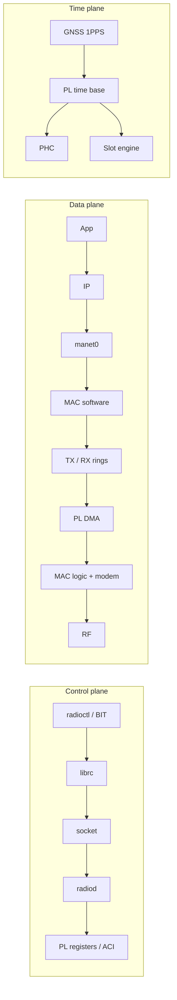

| Plane | Carries | Never carries |
|---|---|---|
| Control | Configuration, start and stop, health, ring setup | Frames, per-frame metrics |
| Data | Frames through the rings | Control requests |
| Time | 1PPS, slot and hop timing | Anything that can queue behind control |

## 5. Diagram 3: process and ownership boundaries

The MAC stays in its own process. radiod never links the MANET stack. The two processes share only the mapped ring memory.

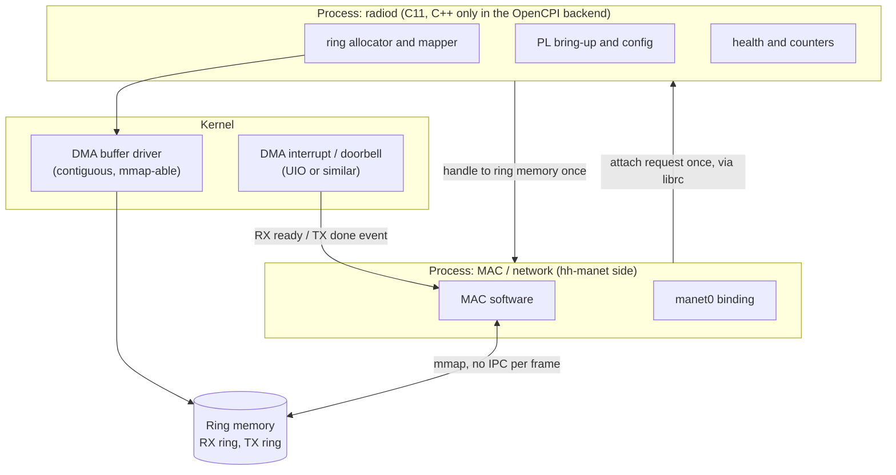

The handoff of the ring handle and the interrupt path are open (section 18, OI-3 and OI-4).

| Building block | Standard or reference | What it gives |
|---|---|---|
| Contiguous, mmap-able DMA buffer | [u-dma-buf driver](https://github.com/ikwzm/udmabuf) | User-space mappable DMA buffer. `sync_for_cpu` invalidates and `sync_for_device` flushes a cache range. `sync-mode` sets cache behaviour when opened with O_SYNC. |
| RX ready / TX done event | [Linux UIO howto](https://www.kernel.org/doc/html/latest/driver-api/uio-howto.html) | A blocking `read()` on /dev/uioX returns on interrupt with a total interrupt count, so missed interrupts are detectable. Fits the single poll loop. |

Alternative: let OpenCPI own the buffers. OpenCPI has its own data plane with buffer and message management ([Platform Development Guide, SDP](https://opencpi.gitlab.io/guides/developer/OpenCPI_Platform_Development_Guide/Enabling_FPGA_Platforms.html)). On Zynq it keeps M_AXI_GP0 for control and uses other PS-PL ports for data. An ACI application can read and write messages through external ports with `getInputBuffer()` and `getOutputBuffer()`, and "all buffering is managed by these objects" ([ACI guide](https://opencpi.gitlab.io/guides/developer/OpenCPI_Application_Development_Guide/API_for_Executing_XML_Based_Applications_in_Cpp_Python_ACI.html)).

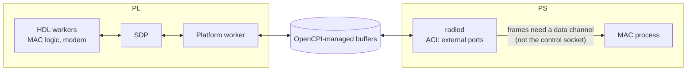

Trade-off: OpenCPI already does buffer ownership and DMA, so radiod writes no descriptor code. But external port buffers belong to the ACI instance inside radiod, and only radiod may open OpenCPI. Frames would then have to leave radiod's process to reach the MAC, which brings back the frames-through-radiod problem. Zero-copy access to the physical buffers is not documented. This alternative is OI-8.

## 6. Diagram 4: shared buffer rings in DDR

Each ring is a single-producer, single-consumer ring. The descriptor table and the frame slots live in the same reserved region. Producer and consumer indices run freely, and wrap is handled with a modulo on the ring size.

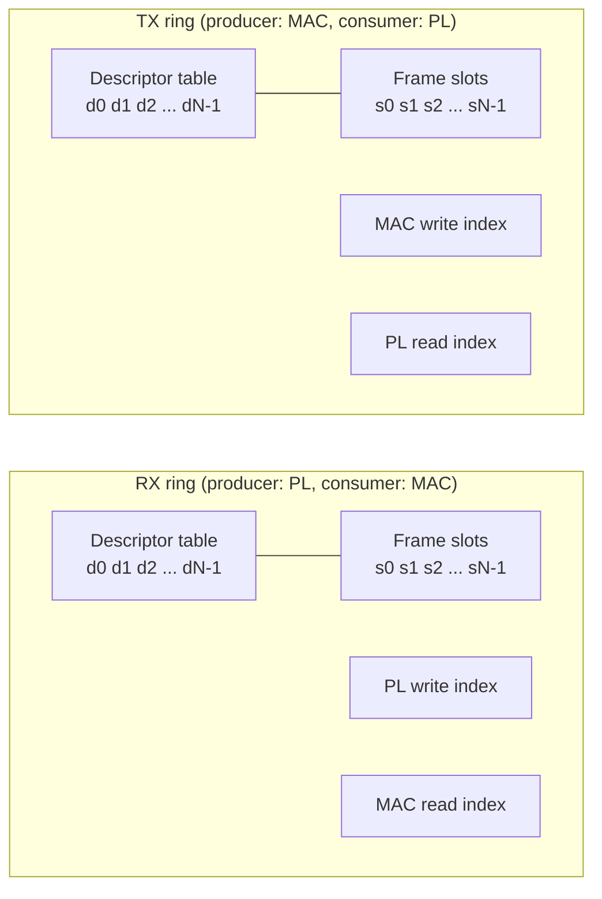

What a descriptor must carry, in content only:

| Direction | Content | Status |
|---|---|---|
| RX | Frame length, CRC result, slot and superframe number, arrival offset, per-burst RSSI / SNR / gain, auth result (demo crypto) | Content VERIFIED DESIGN in the MAC design. Byte layout UNKNOWN / OPEN (OI-1). |
| TX | Frame length, target slot or frame, class | Content PROPOSED. Byte layout UNKNOWN / OPEN (OI-1). |
| Both | Ownership flag (PL or software) | PROPOSED |

One frame is one descriptor. On the PL stream side, the stream end-of-packet flag marks the frame boundary, and the length is written back into the descriptor (VERIFIED DESIGN as content).

Reference DMA engines:

* [AMD AXI DMA, PG021, RX descriptor fields](https://docs.amd.com/r/en-US/pg021_axi_dma/RX-Descriptor-Fields): an S2MM transfer "is terminated with a single assertion of TLAST on the last data beat". Cmp (bit 31) marks a completed descriptor.
* [PG021, S2MM_STATUS](https://docs.amd.com/r/en-US/pg021_axi_dma/S2MM_STATUS-S2MM-Status): the received length is the Transferred Bytes field (bits 25:0) in the descriptor status word, not the programmed buffer length. RXEOF (bit 26) and RXSOF (bit 27) are written by the DMA. A packet longer than one buffer spills into the next descriptor ([PG021, Scatter/Gather Mode](https://docs.amd.com/r/en-US/pg021_axi_dma/Scatter/Gather-Mode)).
* Design rule from this: every frame slot is sized for the largest frame, so a frame never spans two descriptors and RXSOF and RXEOF are always set together. A descriptor with only one of them set is counted as an error and dropped.
* [PG021, S2MM_DMACR](https://docs.amd.com/r/en-US/pg021_axi_dma/S2MM_DMACR-S2MM-DMA-Control-Register-Offset-30h): IRQThreshold (bits 23:16) batches completions and IRQDelay (bits 31:24) bounds the wait, timeout = 125 x IRQDelay x SG clock period. These set the RX event rate in OI-4.
* [ADI AXI DMAC](https://developer.analog.com/docs/hdl/library/axi_dmac/index.html): DMA controller used in the RF transceiver reference designs, between system memory and converters.
* [ADI AXI AD9361 core](https://developer.analog.com/docs/hdl/library/axi_ad9361/index.html): PL interface core for the RF transceiver. It moves IQ samples, not frames, so a frame-level DMA path is a custom design.

## 7. Diagram 5: buffer slot ownership states

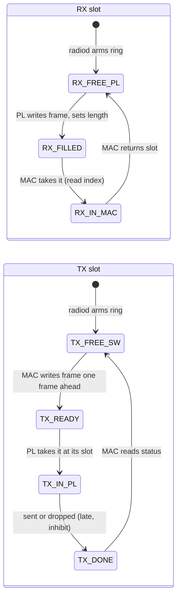

Rules:

* Only the current owner touches a slot.
* RX ring full: the PL drops the frame and counts it. It never overwrites a slot the MAC owns.
* TX ring empty at a slot: the PL sends the control-only frame (VERIFIED DESIGN in the slot engine). Software being late never makes the PL transmit stale data.

## 8. Diagram 6: start-up and attach sequence

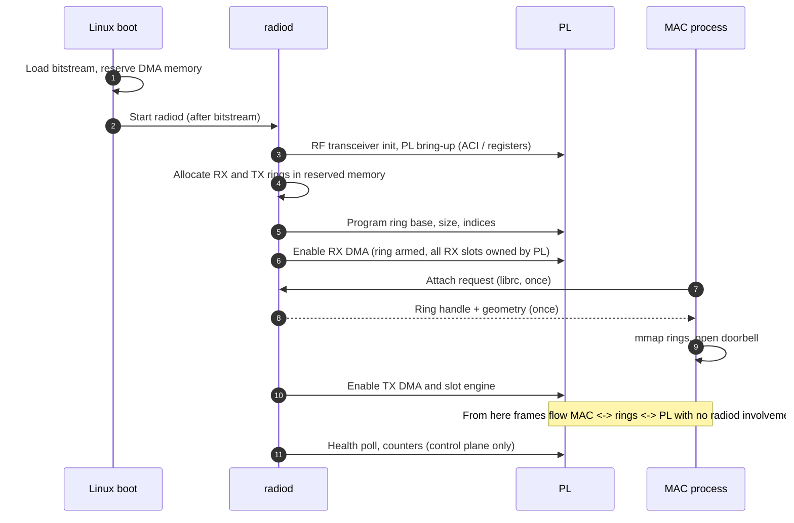

## 9. Diagram 7: receive path sequence

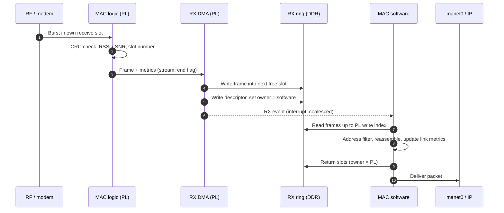

## 10. Diagram 8: transmit path sequence

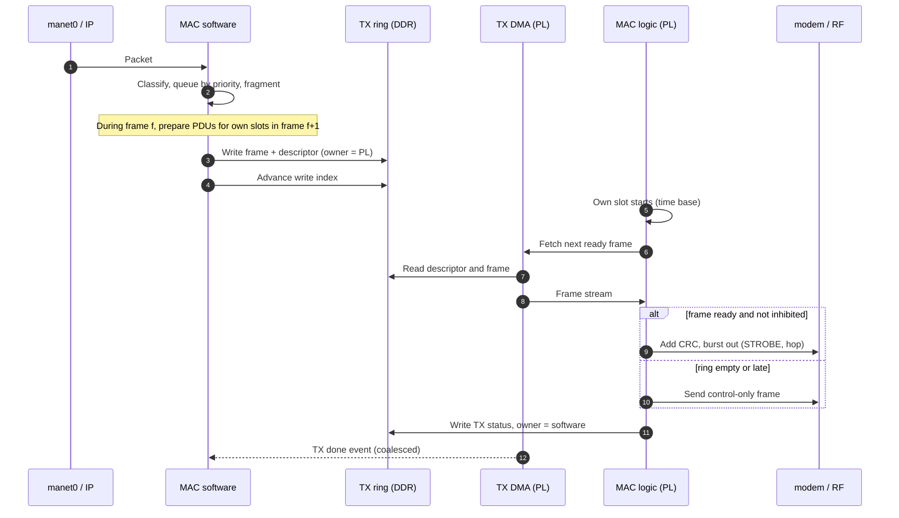

The PL keeps sole authority over when the radio transmits. The MAC only fills the ring ahead of time.

## 11. Diagram 9: PS-PL hardware ports

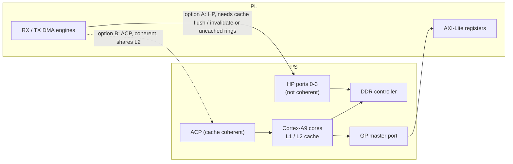

| Item | Fact | Status |
|---|---|---|
| HP port bandwidth | 64-bit, 1,200 MB/s per direction per port, theoretical | [Zynq-7000 TRM UG585, Theoretical Bandwidth](https://docs.amd.com/r/en-US/ug585-zynq-7000-SoC-TRM/Theoretical-Bandwidth) |
| HP pairing | HP0/HP1 share one DDR port, HP2/HP3 the other | [AMD performance checklist](https://xilinx.github.io/Embedded-Design-Tutorials/docs/2020.2/build/html/docs/SPA-UG/docs/A-performance-checklist.html) |
| Coherency, ACP | "provides an asynchronous cache-coherent access point directly from the PL to the Cortex-A9" | [UG585 ACP Interface](https://docs.amd.com/r/en-US/ug585-zynq-7000-SoC-TRM/ACP-Interface) |
| Coherency, HP | HP ports do not snoop the CPU caches. Rings on HP need uncached mapping or explicit flush and invalidate. | [UG585 System Features](https://docs.amd.com/r/en-US/ug585-zynq-7000-SoC-TRM/System-Features) |
| ACP limit | "ACP does not support exclusive access to coherent memory." Ring indices must not rely on exclusive load / store through ACP. | [UG585 System Summary](https://docs.amd.com/r/en-US/ug585-zynq-7000-SoC-TRM/System-Summary) |
| Need | Frame rates here are far below port bandwidth. Latency and coherency decide, not bandwidth. | PROPOSED |

Port choice and cache policy are open (OI-5).

## 12. Diagram 10: baseline security (separate security module)

This is the programme baseline and stays the target for the field radio.

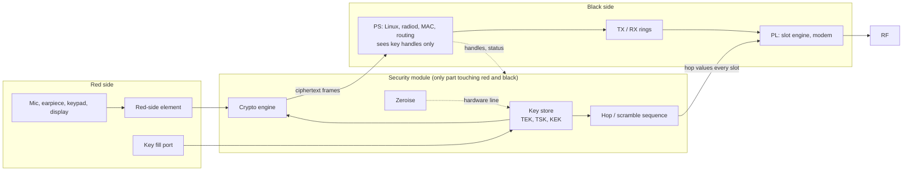

The red/black concept is defined in [CNSSI 4009-2022, via the NIST glossary](https://csrc.nist.gov/glossary/term/red_black_concept): keep equipment that handles plaintext apart from equipment that handles ciphertext. The SDR form with a crypto subsystem as the only boundary is described in [Security issues in software-defined radio: a review (2026)](https://link.springer.com/article/10.1186/s42400-025-00433-x) and [SCA change proposal 295, exposed black side](https://www.wirelessinnovation.org/assets/Proceedings/2006/sdr06-4.6-04-murotake.pdf).

Required by the customer: a hardware security module with no bypass, customer-approved algorithms, crypto-controlled hopping, and emergency erasure. The algorithm is supplied by the customer and is not named here.

## 13. Diagram 11: demo security (encryption inside the PL)

DEMO ONLY. There is no separate security module. Frame encryption, hop sequence and key storage sit in a dedicated PL region. The PS still never holds a plaintext key after loading.

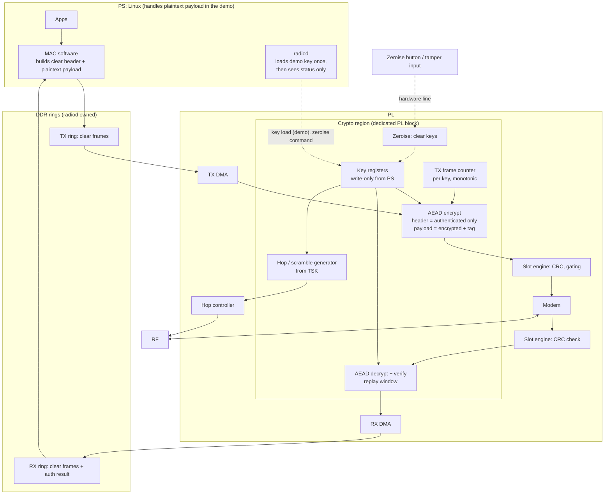

What makes this acceptable only for a demo:

| Issue | Effect |
|---|---|
| Plaintext payload crosses the PS and DDR | Breaks the red/black rule. Recorded demo deviation. |
| Debug access to the PL reaches the key registers | Black-side JTAG can reach red material. Disable or accept for demo. |
| Shared power, clock and ground with the rest of the PL | No physical red/black separation. |
| Boot key (eFUSE / BBRAM) and the hard AES engine serve secure boot only | The engine is AES-256 CBC with HMAC for boot partitions and is not usable for traffic ([XAPP1175 v2.2](https://docs.amd.com/v/u/en-US/xapp1175_zynq_secure_boot), [UG1283 Zynq-7000 partitions](https://docs.amd.com/r/en-US/ug1283-bootgen-user-guide/Encrypting-Zynq-7000-Device-Partitions)). Traffic keys need the runtime load path above and their own AES core in the PL. |
| eFUSE AES key read is enabled by default | Set the PL eFUSE "disable AES key read" control before any field use ([UG643, PL eFUSE parameters](https://docs.amd.com/r/en-US/oslib_rm/Zynq-User-Configurable-PL-eFUSE-Parameters)). |
| No certification claim | Not a validated crypto module. |

## 14. Diagram 12: demo frame protection order

Transmit order: the MAC builds the frame, the PL encrypts, and the slot engine adds the CRC. Receive order is the reverse. The CRC covers the ciphertext, so a corrupted burst is dropped before decryption.

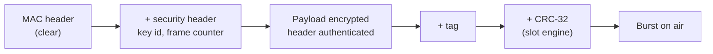

| Item | Demo proposal | Status |
|---|---|---|
| Cipher mode | AEAD. The agreed MAC frame specification test vectors use AES-CCM in the IEEE 802.15.4 style. Use the same for the demo. | PROPOSED, demo only |
| Overhead | 14 bytes once per PDU, from the MAC frame specification. Matches 802.15.4: security control 1 B + frame counter 4 B + key index 1 B (key id mode 1) + MIC-64 8 B. | VERIFIED DESIGN (size). Split from a secondary source, see below |
| Nonce | 13 bytes in 802.15.4 CCM*: sender 8-byte extended address + frame counter 4 B + security level 1 B. Needs a fixed node id to 8-byte address mapping. Never reuse a key and nonce pair. | PROPOSED |
| Nonce alternative | TSCH style: drop the frame counter and build the nonce from the 5-byte absolute slot number. Fits a TDMA MAC and saves 4 bytes, but ties security to network time. | PROPOSED option, needs a decision |
| Core size | A small AES-CCM core is about 400 LUT and 2 BRAM at 873 Mbit/s on Kintex-7 (vendor figure, 128-bit key). Far above handheld frame rates. | Reference only, measure on the target part |
| Frame counter | Kept in the PL, monotonic per key. Rekey before wrap. A reboot needs a new key or a stored high-water mark. | PROPOSED |
| Replay | Receiver keeps a per-sender window and rejects old counters. | PROPOSED |
| Field byte layout | Not defined here | UNKNOWN / OPEN (OI-6) |

Standards behind this table:

| Standard | Use here |
|---|---|
| [FIPS 197, Advanced Encryption Standard (AES)](https://csrc.nist.gov/pubs/fips/197/final) | Block cipher for the demo |
| [NIST SP 800-38C, CCM mode](https://csrc.nist.gov/pubs/sp/800/38/c/upd1/final) | Demo AEAD mode, nonce must never repeat under one key |
| [NIST SP 800-38D, GCM and GMAC](https://csrc.nist.gov/pubs/sp/800/38/d/final) ([PDF](https://nvlpubs.nist.gov/nistpubs/Legacy/SP/nistspecialpublication800-38d.pdf)) | Alternative AEAD mode if line rate needs it. IV construction rules in its section 8 |
| [NIST SP 800-38F, key wrapping](https://csrc.nist.gov/pubs/sp/800/38/f/final) | Wrapped key load into the PL key registers |
| [NIST SP 800-38A, modes of operation](https://csrc.nist.gov/pubs/sp/800/38/a/final) | Counter mode used inside CCM and for hop sequence generation |
| IEEE 802.15.4-2020 (auxiliary security header, CCM*) | Security header, MIC lengths 0/4/8/16 B, nonce. Full text not read. Sizes from [TI AN060](https://e2echina.ti.com/cfs-file/__key/communityserver-discussions-components-files/104/AN060-_2D00_-Security-on-TI-IEEE-802.15.4-Compliant-RF-Devices.pdf) and [RFC 8180, Appendix A.4](https://www.rfc-editor.org/rfc/rfc8180.html) (slot-number nonce). IEEE catalogue link TBD |
| [IEEE 802.1AE-2018 (MACsec)](https://standards.ieee.org/ieee/802.1AE/7154/) | Packet number model: 32-bit PN, 64-bit extended PN with only the low 32 bits sent ([802.1AEbw](https://grouper.ieee.org/groups/802/1/pages/802.1aebw.html)). SecTAG 8 B, or 16 B with SCI ([AMD PG372](https://docs.amd.com/r/en-US/pg372-hsc/MACsec-Mode)). Replay window 0 means strict order. Frames inside a non-zero window are not replay protected ([802.1 SecY YANG](https://grouper.ieee.org/groups/802/1/files/public/docs2019/dk-fedyk-ieee802-dot1ae-yang-0719-v00.pdf)) |
| [NIST SP 800-38D section 8](https://nvlpubs.nist.gov/nistpubs/Legacy/SP/nistspecialpublication800-38d.pdf) | If GCM is used: IV repeat probability at most 2^-32. The 2^32 invocation limit applies to random IVs and non-96-bit IVs, not to deterministic 96-bit IVs |
| [NIST SP 800-108r1](https://csrc.nist.gov/pubs/sp/800/108/r1/upd1/final) | Deriving TEK, TSK and hop seeds from a loaded key |
| [NIST SP 800-90A r1](https://csrc.nist.gov/pubs/sp/800/90/a/r1/final) | Random bit generator for keys and nonces |
| [FIPS 140-3](https://csrc.nist.gov/pubs/fips/140-3/final) | Crypto module requirements. The demo makes no claim against it |
| Production algorithm | Customer supplied | UNKNOWN / OPEN |

## 15. Diagram 13: demo key lifecycle

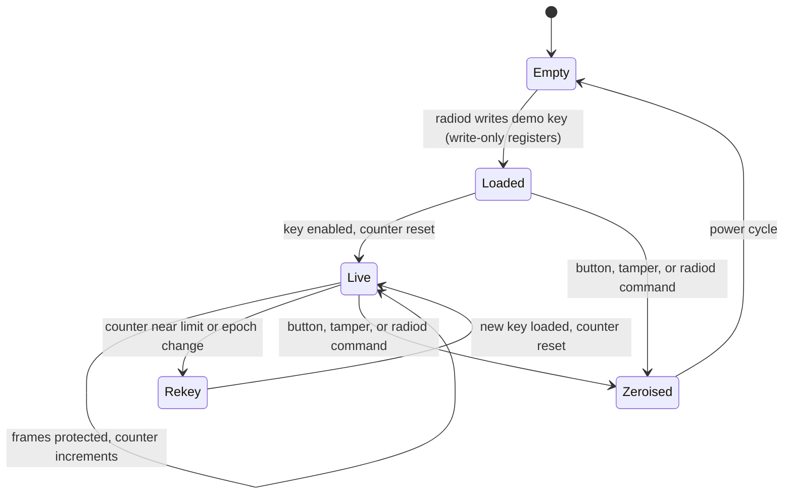

Zeroise is a hardware action in the PL. It must work even when the PS is hung. Target behaviour follows [FIPS 140-3 Implementation Guidance](https://csrc.nist.gov/csrc/media/Projects/cryptographic-module-validation-program/documents/fips%20140-3/FIPS%20140-3%20IG.pdf), AS09.28 and AS09.29: provide a way to zeroise all unprotected keys, and "a zeroised SSP shall not be retrievable or reusable".

## 16. Rules this design keeps

| Rule | How it holds |
|---|---|
| Frames never use the control socket | Frames go through the mapped rings only. |
| Forwarder performs no IPC | MAC reads and writes ring memory directly. |
| Timing never queues behind control | Slot timing is in the PL. radiod is not in the frame path. |
| radiod never links the MANET stack | MAC stays in its own process. |
| Only radiod owns the PL | radiod does bring-up, ring setup and config. The MAC only gets ring memory. |
| Hardware details stay below the radio interface | Ring access sits inside the hardware adapter, not in the MAC policy code. |
| PL decides every transmission | Slot engine pulls from the TX ring at its slot. |
| Single-threaded | MAC waits on the ring event in its existing poll loop. |

## 17. Conflicts with the current baseline

These need a decision before this document can move past PROPOSED.

| Ref | Baseline says | This document proposes |
|---|---|---|
| C-1 | radiod is control plane only and frames never go through it. | radiod owns the frame rings, but frames still do not go through its process. |
| C-2 | The data plane is a kernel network interface with a DMA ring under it. The open choices are a split radio interface, out-of-band ring attach, or a kernel driver. | Out-of-band ring attach with radiod as the owner, used by a userspace MAC. |
| C-3 | The MAC design places the TX and RX buffers inside the PL MAC logic. | Buffers live in DDR. The PL MAC logic pulls from and pushes to them through DMA. |
| C-4 | Hardware security module with no bypass. Only the module touches red and black. | Demo variant with crypto in the PL and plaintext on the PS (DEMO ONLY). |
| C-5 | Single owner of the PL is not enforced today. The network process builds its own radio adapter. | Single owner enforced by radiod. |
| C-6 | No CORBA in the logic or on the processor-logic link. No CORBA call waits on radio timing. The SCA boundary ends at the wrappers. | The PL pulls every TX frame from the TX ring through a CORBA call to a PS-side servant, using an ORB inside the FPGA (section 19.2). Owner decision 2026-11-17. |

## 18. Open items

| Ref | Item | Needed from |
|---|---|---|
| OI-1 | Descriptor byte layout, ring sizes, slot size, addressing | PL and software owners jointly |
| OI-2 | Choice between this design, a split radio interface and a kernel network driver | Architecture decision |
| OI-3 | How radiod hands ring memory to the MAC process (file handle passed once, or a kernel driver both open) | Architecture decision |
| OI-4 | RX and TX event path (UIO interrupt, coalescing count and delay) | PL and Linux owners |
| OI-5 | PS-PL port (HP or ACP) and cache policy for the rings | PL owner, by measurement |
| OI-6 | Security header byte layout and nonce construction | MAC frame specification owner |
| OI-7 | Whether the MAC process and the ring access fit in one single-threaded loop with OpenCPI in radiod | Architecture decision |
| OI-8 | Own rings or OpenCPI external ports (see the alternative in section 5) | OpenCPI integration owner |
| OI-9 | PHY frame size. The existing modem frame is 280 bytes and the network frame is up to 512 bytes. A burst-mode modem is needed. | Waveform owner |
| OI-10 | Demo key load path and zeroise wiring in the PL | Security and PL owners |
| OI-11 | Production algorithm and security module form | Customer and programme |
| OI-12 | Whether each traffic class has its own TX ring, or one TX ring with the class in the descriptor | Architecture decision |
| OI-13 | CORBA pull: FPGA ORB product and PS ORB, GIOP transport over AXI, pull port IDL, pull per slot or per TDMA frame, measured round-trip time on the board, and whether receive also goes through CORBA | Architecture decision, approval of new dependency, measurement |

## 19. Diagram 14: end-to-end traffic flow (voice, video, data)

One picture of the whole path. The upper half is transmit, the lower half is receive. On receive the MAC makes the first decision (is this frame addressed to this node?) and the routing layer makes the second (is this node the final destination, or does it relay?).

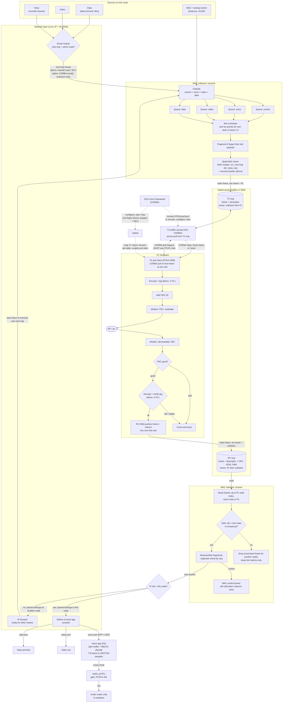

How each step works:

| Step | Owner | What happens | Status |
|---|---|---|---|
| Route lookup | Linux IP + OLSRd2 | Picks the next-hop node for each packet | IMPLEMENTED on host (OLSRd2 external) |
| Classify and queue | MAC software | Four queues, strict priority with a cap on control | VERIFIED DESIGN (classes), PROPOSED (queue count) |
| Schedule and frame | MAC software | During frame f it fills its own slots of frame f+1. Builds MAC header and fragments if needed | VERIFIED DESIGN (timing), header layout UNKNOWN / OPEN |
| Write TX ring | MAC software | Writes frame and descriptor, sets owner to PL. No message to radiod | PROPOSED |
| CORBA pull and send | PL pull client (FPGA ORB) and TX buffer servant (PS) | At its own slot the PL sends a CORBA pull request. The servant takes the next ready frame from the TX ring and returns it in the reply. If the reply is "none" or late, the PL sends a control-only frame. See 19.2 | PROPOSED (conflict C-6) |
| Encrypt | PL crypto region | Demo only. In the baseline this is the security module | DEMO ONLY |
| CRC, decrypt, push RX ring | PL | Bad CRC or failed tag is counted and dropped in the PL. Good frames go to the RX ring with metrics | PROPOSED |
| Address filter | MAC software | Frame for another node is dropped, but its RSSI / SNR still updates link quality | VERIFIED DESIGN |
| Reassemble | MAC software | Joins fragments, drops duplicates by sequence number | VERIFIED DESIGN (fragmentation), layout OPEN |
| Local or relay | Linux IP | Final destination is this node: deliver to the app. Otherwise forward: the packet goes back to the MAC transmit side with a new next hop. Relay never touches radiod or the control socket | IMPLEMENTED on host (Linux forwarding) |

Two notes:

* "Belongs to another node" has two cases. A frame whose MAC destination is another node was only overheard and is dropped in the MAC. A frame addressed to this node whose IP destination is another node is a relay, and goes back to the transmit side.
* Voice has the tightest timing. If one TX ring is shared, a full ring of data can delay voice, so the PL must take frames in the order the MAC queued them and the MAC must not fill the ring far ahead. Separate rings per class is OI-12.

### 19.1 Voice delivery to the local listener

When a packet on the voice port reaches this node, it ends at the earpiece through the voice app and the PL audio block.

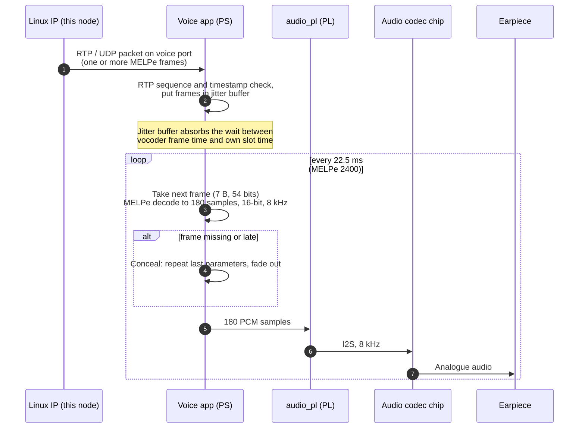

| Item | Value | Status |
|---|---|---|
| Vocoder | MELPe (NATO STANAG 4591, MIL-STD-3005). Frame every 22.5 ms at 2400 bit/s (7 B), 67.5 ms at 1200 bit/s (11 B), 90 ms at 600 bit/s | VERIFIED DESIGN (MELPe named). Rate OPEN (slot engine OI-4) |
| Voice transport | RTP over UDP ([RFC 3550](https://www.rfc-editor.org/rfc/rfc3550)). Sequence number finds loss, timestamp drives playout | VERIFIED DESIGN (UDP / RTP socket) |
| Where MELPe runs | In the voice app on the PS. Moving MELPe into the PL is possible, but no such block is designed | VERIFIED DESIGN (PS). PL option not designed |
| audio_pl | PL block between the codec chip (I2S) and Linux. Echo cancel and noise suppress on the microphone side, gain and I2S out on the earpiece side | PROPOSED (target drawing label) |
| PCM path between audio_pl and Linux | How the 8 kHz PCM reaches the voice app (ALSA device, DMA, or other) | UNKNOWN / OPEN |
| Jitter buffer depth | At least one vocoder frame period. Slot engine section 6.3 gives the wait pattern for a 20 ms TDMA frame | PROPOSED |
| Loss concealment | Repeat last frame parameters, then fade to silence | PROPOSED |

The transmit side is the mirror of this: microphone, codec chip, I2S, audio_pl (echo cancel, noise suppress), PCM, MELPe encode in the voice app, RTP / UDP, then the Route lookup box above.

### 19.2 TX pull through CORBA

PROPOSED, by owner decision on 2026-11-17. The pull between the TX ring and the PL is a CORBA call. It replaces the plain DMA read of the first version. Everything before the TX ring (MAC queues, framing, writing the ring) and everything after the pull (encrypt, CRC, modem) is unchanged.

The PL is the CORBA client. The PS side holds the servant that owns the read side of the TX ring.

| Part | Runs on | Role in the pull |
|---|---|---|
| MAC software | PS | Builds frames for its own slots of frame f+1 and writes them into the TX ring, as before. |
| TX ring | DDR, owned by radiod | Holds ready frames, as before. |
| TX buffer servant | PS, SCA component (C++) | Provides the pull port. On each request it takes the next PL-owned frame from the TX ring, returns its bytes in the reply, and marks the slot sent. Never waits inside the call. |
| TX pull client | PL, FPGA-resident ORB | SCA component in the logic. At the lead time before each own slot it sends a pull request and waits for the reply. Hands the frame bytes to encrypt, CRC and modem. |
| PS-PL transport for CORBA | AXI between PS and PL | Carries the GIOP request and reply messages. Physically still AXI transfers, carrying CORBA messages instead of raw frames. |
| radiod | PS | Still the only PL owner. Loads the logic, maps the TX ring into the servant, programs the slot table and enables the pull client. |
| SCA Core Framework | PS | Starts the servant and the PL component and connects the PL uses port to the servant's provides port. |

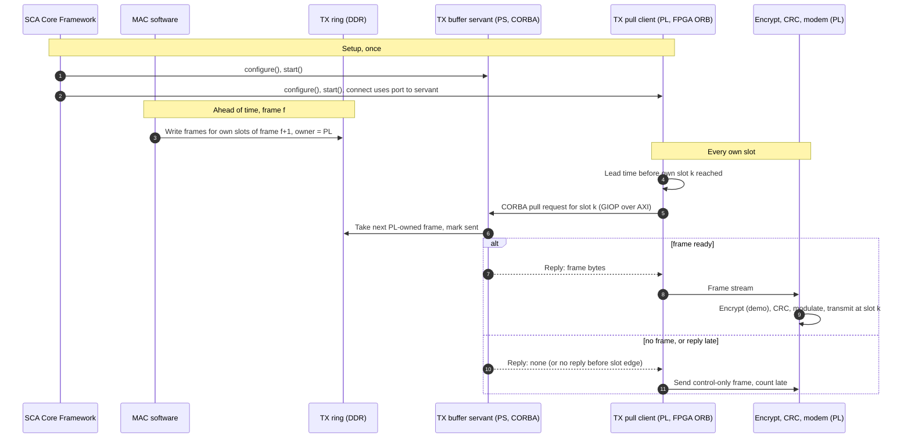

What this needs in hardware and software:

| Item | Why | Status |
|---|---|---|
| ORB inside the FPGA (an FPGA-resident CORBA engine, commercial IP) | The PL must speak GIOP to be a CORBA client. Plain logic cannot. | UNKNOWN / OPEN. Not in the design. New dependency, needs approval. |
| GIOP transport over AXI | The request and reply cross the PS-PL link. A message channel on an AXI port is needed on both sides. | UNKNOWN / OPEN |
| ORB on the PS for the servant | Hosts the TX buffer servant | Needs a CORBA runtime on the board. omniORB 4.3.2 is installed on the bench board at /opt/orb (ARM user space, measurement only, not in a product image or bitstream slot). Measured on the A9 with the radio stopped: null call 94 us mean, 4 KB call 120 us mean, worst calls 1 to 8 ms (IMPLEMENTED for the measurement; the servant is not built; board revision not confirmed as Rev3). |
| Pull port IDL | Operation, arguments and reply for the pull | UNKNOWN / OPEN. Not defined here. |

Timing budget per own slot:

```
lead time before slot k starts
  |-- PL builds GIOP request, sends over AXI
  |-- PS ORB receives, dispatches to servant (ORB thread wake-up)
  |-- servant takes frame from TX ring
  |-- reply with frame bytes over AXI
  |-- PL ORB decodes reply
  v
slot k edge: frame must be in the PL, else control-only frame
```

The PS half of this chain depends on Linux scheduling the ORB thread, so its delay has no fixed upper bound. The lead time has to be set from a measurement on the board. A late reply costs one control-only frame and the radio keeps working.

Ways to give the pull more time while keeping it a CORBA call:

* Pull earlier: request slot k one or more slots before it starts and keep one frame waiting in the PL.
* Pull a whole TDMA frame at once: one request returns the frames for all own slots of the next frame, about 50 calls per second instead of about 1000.

Rules kept and rules changed:

| Rule | Status after this change |
|---|---|
| Only radiod programs the PL | Kept. The servant reads ring memory only. |
| Frames never use the radiod control socket | Kept. |
| PL decides every transmission and covers late software | Kept. The control-only frame still covers a late or empty pull. |
| No CORBA in the logic or on the processor-logic link | Changed. The logic holds an ORB and every TX frame crosses the link as a CORBA reply. Recorded as C-6. |
| No CORBA call waits on radio timing | Changed. The pull is timed by the slot. Recorded as C-6. |
| Single-threaded MANET stack | At risk. The ORB runs the servant on its own thread, which shares the TX ring with the MAC. Ring ownership flags must stay the only shared state. |
| December demo has no CORBA on the data path | Changed if this is used for the demo. |

Receive is not changed by this section. The PL still writes received frames into the RX ring by DMA. Whether receive should also use CORBA (the PL pushing frames to a servant) is OI-13.

## 20. Revision history

| Version | Date | Change |
|---|---|---|
| 1.0 | 2026-11-16 | First issue, draft for review. |
| 1.1 | 2026-11-16 | Added standards links and research results: DMA length and interrupt fields, port coherency, OpenCPI buffer alternative, security header sizes, nonce options, boot key limits, zeroise wording, red/black sources. |
| 1.2 | 2026-11-16 | Added diagram 14, end-to-end traffic flow with local delivery and relay. Added OI-12. |
| 1.3 | 2026-11-17 | Diagram 14: voice delivery through MELPe and audio_pl (19.1), TX pull and the place of CORBA (19.2). |
| 1.4 | 2026-11-17 | TX pull now goes through CORBA through a PS-side PL Device proxy (19.2). Added C-6 and OI-13. |
| 1.5 | 2026-11-17 | Corrected 19.2: the TX ring to PL pull itself is the CORBA call, PL as client through an FPGA ORB, PS servant on the TX ring. Proxy removed. |
