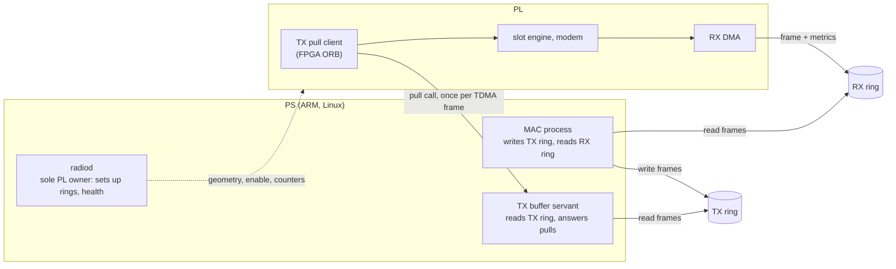

# Ring Interface Contract: radiod, MAC process and PL


## Contents

1. Purpose and what this contract fixes
2. Status labels used
3. Design basis
4. Parties and who owns what
5. Ring memory and ring header
6. Descriptors and frame slots
7. Receive path
8. Transmit path and the TX pull call
9. Link metrics and valid flags
10. Start-up, attach and shutdown
11. Counters and errors
12. Ordering and cache rules
13. Sizes
14. Frame formats and worked examples

## 1. Purpose and what this contract fixes

A MAC frame has to travel between the MAC software and the PL without per-frame messages between processes. This document fixes the interface between them, so the MAC software, radiod, the TX servant and the PL can be built separately and meet.

It fixes:

* the layout of the shared ring memory and its descriptors,
* who may touch a slot and when,
* the call the PL uses to fetch transmit frames,
* what the PL reports with each received frame,
* how the parties attach and start.

It does not fix the MAC frame content (the MAC PDU is defined elsewhere), the modem, the slot engine inside the PL, or the security module.

## 2. Status labels used

| Label | Meaning |
|---|---|
| IMPLEMENTED | Exists in code or was measured. |
| VERIFIED DESIGN | Agreed in an approved design this document builds on. |
| PROPOSED | New here. Needs confirmation. |

Links to outside sources are the ones cited in the PS-PL data path design. They were not re-read for this draft, so each statement they support is as quoted there. Where no outside source is cited, the text says so.

## 3. Design basis

| Design choice |
|---|
| The data path follows the radiod ring design. The MAC stays in its own process and radiod never links the MANET stack. |
| radiod creates the ring memory as a shared file. The MAC process and the radio program open it by path. A descriptor hand-off over a Unix socket can replace the path later. |
| One TX ring. The traffic class is carried in each descriptor. |
| The PL fetches TX frames by a CORBA call once per TDMA frame, from a servant on the ARM. The PL owner picks the FPGA ORB product. |

The descriptor layout and the pull call definition below are proposals. The PL and OpenCPI owners confirm them.

Why own rings and not OpenCPI external ports: OpenCPI can own the buffers, and an application can read and write messages through external ports, with buffering managed by those objects ([Platform Development Guide, SDP](https://opencpi.gitlab.io/guides/developer/OpenCPI_Platform_Development_Guide/Enabling_FPGA_Platforms.html), [ACI guide](https://opencpi.gitlab.io/guides/developer/OpenCPI_Application_Development_Guide/API_for_Executing_XML_Based_Applications_in_Cpp_Python_ACI.html)). But external port buffers belong to the application instance inside radiod, and only radiod may open OpenCPI, so frames would have to leave radiod's process to reach the MAC. That brings back frames through radiod. The PS-PL design found no documentation of zero-copy access to the physical buffers.

Facts found while drafting:

* No packet path over the radio exists today. The radio application carries voice and test patterns only, and radiod's transmit operation returns "not implemented". (IMPLEMENTED, checked in code)
* An ORB runtime (omniORB 4.3.2) is installed on the bench board for measurement. Measured on the Cortex-A9 with the radio stopped: null call 94 us mean, 4 KB call 120 us mean, worst calls 1 to 8 ms. No servant exists. (IMPLEMENTED for the measurement)
* The PL that exists today is continuous and carries 280-byte frames. The burst-mode modem and slot engine this contract assumes are not built. (IMPLEMENTED, checked in the PL project)

## 4. Parties and who owns what



| Party | May do | May not do |
|---|---|---|
| radiod | Allocate and map the rings. Program the PL with ring base, size and indices. Enable and disable DMA and the slot engine. Read counters. | Link the MANET stack. Carry frames. |
| MAC process | Write TX descriptors and frames. Read RX descriptors and frames. Return RX slots. | Open the PL. Write the CRC-32. |
| TX buffer servant | Read the TX ring. Mark slots taken. Reply to pull calls. | Write TX frame content. Wait inside a pull call. |
| PL | Pull TX frames. Append the CRC-32 to every transmitted frame, and check and remove it on every received frame. Write RX frames and descriptors. Decide every transmission. Send a control-only frame when nothing arrives in time. | Transmit stale data. Overwrite an RX slot the MAC holds. |

## 5. Ring memory and ring header

PROPOSED. One region, created by radiod as a shared-memory file and opened by path by the other processes (IMPLEMENTED for access by processors on the PS, in `hhsdr_ring_shm`). When the PL reads or writes a ring by DMA, the region must be physically contiguous and reserved. It holds a header, then the RX ring, then the TX ring. Each ring is a descriptor table followed by its frame slots. The [u-dma-buf driver](https://github.com/ikwzm/udmabuf) is one candidate for providing such a buffer: it gives a contiguous buffer that user space can map, with sync_for_cpu and sync_for_device calls for cache control. Whether to use it is open (OI-7).

All multi-byte fields are little-endian, as in the MAC PDU and as on the Zynq. All sizes are multiples of 32 bytes, the Cortex-A9 cache line, so no descriptor shares a cache line with another.

Region header (64 bytes at offset 0, written by radiod before any attach):

| Offset | Size | Field | Meaning |
|---|---|---|---|
| 0 | 4 | magic | Identifies a valid region. Value TBD (OI-1). |
| 4 | 2 | version | Contract version. 1 for this draft. |
| 6 | 2 | descriptor_size | Bytes per descriptor. 32. |
| 8 | 4 | rx_slots | Number of RX slots. A power of two. |
| 12 | 4 | tx_slots | Number of TX slots. A power of two. |
| 16 | 4 | slot_size | Bytes per frame slot. A multiple of 32. |
| 20 | 4 | rx_desc_offset | Offset of the RX descriptor table. |
| 24 | 4 | rx_slot_offset | Offset of the first RX frame slot. |
| 28 | 4 | tx_desc_offset | Offset of the TX descriptor table. |
| 32 | 4 | tx_slot_offset | Offset of the first TX frame slot. |
| 36 | 28 | reserved | Zero. |

The MAC process reads the geometry from this header and never hard-codes sizes.

Ring indices (each on its own 32-byte line after the header, free-running 32-bit counters, slot number is the index modulo the slot count):

| Index | Written by | Read by |
|---|---|---|
| RX write index | PL | MAC process |
| RX read index | MAC process | PL |
| TX write index | MAC process | servant |
| TX read index | servant | MAC process |

## 6. Descriptors and frame slots

PROPOSED layout. One frame is one descriptor and one slot. A frame never spans two slots. This follows the rule for AMD AXI DMA receive descriptors: a transfer ends with one assertion of TLAST, the received length is the Transferred Bytes field of the descriptor status, not the programmed buffer length ([PG021, RX descriptor fields](https://docs.amd.com/r/en-US/pg021_axi_dma/RX-Descriptor-Fields), [PG021, S2MM_STATUS](https://docs.amd.com/r/en-US/pg021_axi_dma/S2MM_STATUS-S2MM-Status)), and a packet longer than one buffer spills into the next descriptor ([PG021, Scatter/Gather Mode](https://docs.amd.com/r/en-US/pg021_axi_dma/Scatter/Gather-Mode)). Sizing every slot for the largest frame means the start and end flags are always set together, and a descriptor with only one of them set is counted as an error and dropped. The slot size is at least the largest MAC PDU (2047 bytes, the limit of the 11-bit length field in the PDU codec), so the proposed slot size is 2048 bytes.

### 6.1 RX descriptor (32 bytes)

| Offset | Size | Field | Meaning |
|---|---|---|---|
| 0 | 4 | flags | Bit 0 FILLED: set by the PL after the frame and the rest of the descriptor are written. Bit 1 CRC_OK: the PL checked the CRC-32 of the burst and it was good. Bit 2 AUTH_OK (demonstration crypto only, otherwise 0). Others 0. |
| 4 | 2 | length | Bytes of PDU in the slot. The CRC-32 is not in the slot and is not counted. |
| 6 | 2 | slot_in_frame | Receive slot number inside the TDMA frame. |
| 8 | 4 | superframe | Receive time as the superframe number in net time. |
| 12 | 4 | arrival_offset_ns | Signed. Burst arrival against the slot edge. |
| 16 | 2 | rssi | Signed, 0.25 dB steps. |
| 18 | 2 | snr | Signed, 0.25 dB steps. |
| 20 | 2 | rx_gain | Signed, 0.25 dB steps. |
| 22 | 2 | metric_flags | Bit 0 RSSI valid. Bit 1 SNR valid. Bit 2 gain valid. Bit 3 arrival offset valid. Bit 4 RSSI calibrated. Others 0. |
| 24 | 4 | rx_seq | Free-running count of frames the PL has delivered, to detect loss. |
| 28 | 4 | reserved | Zero. |

### 6.2 TX descriptor (32 bytes)

| Offset | Size | Field | Meaning |
|---|---|---|---|
| 0 | 4 | flags | Bit 0 READY: set by the MAC process last, after the frame and the rest of the descriptor are written. Bit 1 TAKEN: set by the servant when it has put the frame in a pull reply. Others 0. |
| 4 | 2 | length | Bytes of PDU in the slot. The CRC-32 is not in the slot and is not counted. |
| 6 | 1 | traffic_class | 0 control, 1 emergency, 2 voice, 3 video, 4 data. |
| 7 | 1 | reserved | Zero. |
| 8 | 4 | target_superframe | Superframe the frame is intended for. |
| 12 | 2 | target_frame | TDMA frame inside the superframe. |
| 14 | 2 | target_slot | Own slot inside that frame. |
| 16 | 16 | reserved | Zero. |

### 6.3 Rules for both

* A reader checks the flags word first and trusts the other fields only after seeing READY or FILLED.
* The writer writes the frame bytes and every other field before it sets the flag. Section 12 gives the ordering.
* Reserved fields are written as zero and ignored on read, so later versions can use them.
* The class values match the class list of the MAC to network interface (control, emergency, voice, video, data).
* The frame in a slot is the PDU without its final CRC-32. The PL appends the CRC-32 (IEEE 802.3, over every PDU byte) after the last PDU byte on transmit, and checks and removes it on receive. The burst header carries the length of the PDU plus the CRC-32, and any padding to a fixed frame size follows the CRC-32. The layout of the burst header and the padding are the PL owner's. (PROPOSED)

## 7. Receive path

1. The PL receives a burst in a slot, checks the CRC-32 and removes it together with any padding, measures RSSI, SNR and gain, and writes the PDU into the next free RX slot by DMA. It then writes the descriptor and sets FILLED. It advances the RX write index. (PROPOSED)
2. The PL raises an RX event. Events are coalesced. The mechanism is open (OI-6). A Linux UIO device suits this: a blocking read on the device returns on each interrupt together with a total interrupt count, so a missed interrupt can be detected ([Linux UIO howto](https://www.kernel.org/doc/html/latest/driver-api/uio-howto.html)). If an AMD AXI DMA is used, its interrupt threshold and delay fields set how completions are batched ([PG021, S2MM_DMACR](https://docs.amd.com/r/en-US/pg021_axi_dma/S2MM_DMACR-S2MM-DMA-Control-Register-Offset-30h)).
3. The MAC process reads every descriptor from its read index to the write index. It discards a frame with CRC_OK clear, but counts it against the neighbour that owned the slot, because the per-neighbour CRC failure count needs it. It filters by address, reassembles fragments, updates the link metrics and delivers the packet.
4. The MAC process clears the descriptor flags and advances the RX read index, which returns the slot to the PL.

If the ring is full, the PL drops the frame and counts it. It never overwrites a slot the MAC process holds.

A frame-level DMA path is a custom PL design. The [ADI AXI AD9361 core](https://developer.analog.com/docs/hdl/library/axi_ad9361/index.html) moves IQ samples, not frames, and the [ADI AXI DMAC](https://developer.analog.com/docs/hdl/library/axi_dmac/index.html) is a reference DMA engine used between memory and converters in RF transceiver designs.

## 8. Transmit path and the TX pull call

### 8.1 Writing

During TDMA frame f the MAC process builds the frames for its own slots in frame f+1. For each it writes the frame bytes into the next TX slot, writes the descriptor with the target frame and slot, sets READY last, and advances the TX write index. (PROPOSED)

### 8.2 The pull call

The PL is the CORBA client. The servant on the ARM is the server. The PL makes one call per TDMA frame and the reply carries the frames for all own slots of that frame.
The call, as an IDL sketch. PROPOSED. The names and types are not final until the OpenCPI owner confirms them.

```
module hhring {
  typedef sequence<octet> FrameBytes;

  struct TxItem {
    unsigned short slot;          // own slot inside the requested frame
    octet          traffic_class;
    FrameBytes     frame;
  };
  typedef sequence<TxItem> TxItemList;

  interface TxBuffer {
    // Frames for the own slots of one TDMA frame. Never waits.
    // An own slot with no frame ready is simply absent from the reply.
    TxItemList pull_frame(in unsigned long superframe,
                          in unsigned short frame);
  };
};
```

Rules for the call:

* The servant returns only frames whose target matches the requested superframe and frame. A frame still in the ring for an earlier target is late. The servant drops it and counts it. The fate of late frames is open (OI-5).
* The servant never waits for the MAC process inside the call. If nothing is ready it returns an empty list.
* For every own slot absent from the reply, or if no reply arrives before the slot edge, the PL sends a control-only frame and counts the late or missing frame.
* The servant sets TAKEN on each frame it returns, then advances the TX read index.
* The PL does not report a per-frame transmit result. Counters only (section 11). A per-frame result is open (OI-8).

No outside standard is cited for the CORBA pull. Its basis is the on-board ORB measurement in section 3. A reference for the call transport (GIOP) is still to be added by the OpenCPI owner (OI-10).

### 8.3 Timing

The pull must leave enough time for the PL to get the reply before the first own slot of the frame. The constraint is:

* The PL asks at a lead time L before the frame starts.
* The MAC process must have all frames for that frame written before L plus the servant's work time.
* With a 20 ms frame, the MAC preparation window is the frame length minus L.

The idle-board measurement gives a worst case of 8 ms for a call with the radio stopped. Under load it will be worse. So L must be above 8 ms plus the transfer time over the PS-PL link, which leaves the MAC process less than 12 ms to prepare. The value of L is set from a measurement under load (OI-3).

### 8.4 TX ring and the servant

The PL does not read the TX ring by DMA in this design. Only processors on the PS touch it, so the TX ring may use normal cacheable memory (section 12).

## 9. Link metrics and valid flags

* Per-frame values (RSSI, SNR, gain, arrival offset) come in the RX descriptor with the valid flags of section 6.1. They are for diagnostics.
* The routing input is the averaged per-neighbour record that the MAC process builds, as defined in the MAC to network interface.
* A metric that the PL cannot measure has its valid flag clear and its value zero. No value is ever made up.
* PER, last heard, receive count and CRC failure count do not need the PL to measure RSSI. The MAC process derives them from slot ownership and the CRC_OK flag, so they can be valid before the RSSI question is closed.

## 10. Start-up, attach and shutdown

PROPOSED sequence.

1. Linux boots, the bitstream loads and the DMA memory is reserved.
2. radiod starts, initialises the radio and the PL, creates the region file at its configured `ring_path`, writes the region header and programs the PL with ring base, size and indices. With no `ring_path` it creates nothing.
3. radiod enables RX DMA with every RX slot owned by the PL.
4. The servant and the PL pull client are started and connected. Who starts them is open (OI-4).
5. The MAC process and the radio program open the file by path. Who may open it is set by the file permissions.
6. Each maps the region and reads the geometry from the header.
7. radiod enables TX and the slot engine.
8. From here frames flow between the MAC process, the rings and the PL with no radiod involvement. radiod only polls health and counters.

Shutdown: radiod disables the slot engine and TX, then RX. The other processes unmap. radiod removes the file last.

If the MAC process restarts, it opens the file again and gets the same region. radiod clears both rings first. A frame in flight is lost and counted. If radiod restarts it creates a new file, and a process that still has the old one open keeps the old memory and has to open the file again. A process cannot yet detect that. UNKNOWN: how it should.

## 11. Counters and errors

Counters are 32-bit and wrap. radiod reads them over the control plane. They are not in the frame path. PROPOSED.

| Counter | Kept by | Meaning |
|---|---|---|
| rx_frames | PL | Frames written to the RX ring. |
| rx_crc_bad | PL | Bursts with a bad CRC. |
| rx_ring_full | PL | Frames dropped because the RX ring was full. |
| rx_descriptor_bad | MAC process | Descriptors with inconsistent flags or length. |
| tx_pulls | PL | Pull calls made. |
| tx_frames_sent | PL | Frames transmitted from a pull reply. |
| tx_control_only | PL | Slots that sent a control-only frame. |
| tx_pull_late | PL | Replies that arrived after the slot edge. |
| tx_stale_dropped | servant | Frames dropped as late. |

## 12. Ordering and cache rules

PROPOSED.

* The TX ring is shared only between CPU processes on the PS, which are cache coherent with each other. Normal cacheable mapping is enough. The writer uses a store barrier (DMB) between writing the frame and descriptor and setting READY. The reader uses a load barrier after reading READY.
* The RX ring is written by the PL through a PS-PL port. The HP ports do not snoop the CPU caches, so rings on them need an uncached mapping or explicit flush and invalidate ([UG585, System Features](https://docs.amd.com/r/en-US/ug585-zynq-7000-SoC-TRM/System-Features)). The MAC process therefore maps the RX ring uncached, or invalidates each descriptor and slot before reading. The first version uses the uncached mapping. The alternative is the ACP, which gives cache-coherent access from the PL to the Cortex-A9 ([UG585, ACP Interface](https://docs.amd.com/r/en-US/ug585-zynq-7000-SoC-TRM/ACP-Interface)). The port and policy are open (OI-7).
* Indices are single-writer. Each side only writes its own index and only reads the other. There are no atomic read-modify-write operations on the rings that the PL touches, because the ACP does not support exclusive access to coherent memory ([UG585, System Summary](https://docs.amd.com/r/en-US/ug585-zynq-7000-SoC-TRM/System-Summary)).
* The servant runs on its own thread. The ring flags and indices are the only state it shares with the MAC process.

## 13. Sizes

Derived, PROPOSED. The geometry is set by radiod and passed in the region header, so these can change without changing the contract.

| Item | Value | Working |
|---|---|---|
| Slot size | 2048 bytes | The largest MAC PDU is 2047 bytes with its CRC-32, so 2043 bytes in a slot. |
| Descriptor size | 32 bytes | One Cortex-A9 cache line. |
| TX slots | 64 | At most 20 own slots in a frame (20 slots per frame in the current design), two frames in flight is 40, rounded up to a power of two. |
| RX slots | 128 | Up to 19 other nodes' slots per frame at 50 frames per second is 950 frames per second at worst, 128 slots hold about 135 ms. |
| TX ring memory | 128 KiB frames plus 2 KiB descriptors | 64 slots. |
| RX ring memory | 256 KiB frames plus 4 KiB descriptors | 128 slots. |

Bandwidth does not decide the port. An HP port is 64 bits wide with a theoretical 1,200 MB/s per direction ([UG585, Theoretical Bandwidth](https://docs.amd.com/r/en-US/ug585-zynq-7000-SoC-TRM/Theoretical-Bandwidth)), HP0 and HP1 share one DDR port and HP2 and HP3 the other ([AMD performance checklist](https://xilinx.github.io/Embedded-Design-Tutorials/docs/2020.2/build/html/docs/SPA-UG/docs/A-performance-checklist.html)), and the frame rates here are far lower. Latency and coherency decide.

## 14. Frame formats and worked examples

This section shows the exact bytes on each side of the ring interface, in both directions. The PL side is the PL and its modem, reached through OpenCPI. The NW side is the MAC process and the network layer above it. All multi-byte fields are little-endian. Hex values are in memory order, lowest address first.

Two things are exchanged for every frame: the frame in a ring slot, and a 32-byte descriptor. The frame is a MAC PDU in the layout of the MAC frame specification v2 without its final CRC-32, which the PL appends on transmit and checks and removes on receive (PROPOSED). The example below is vector A of the codec test with its last four bytes, the CRC-32, taken off. The PDU codec in this repository still appends and requires the CRC-32 (IMPLEMENTED), so a codec form without it is not written yet. The descriptor is the layout of section 6 (PROPOSED). The values in the descriptors are chosen for illustration.

### 14.1 The frame in a slot

| Offset | Size | Field | Meaning |
|---|---|---|---|
| 0 | 2 | frame control | 0xA841: data frame, 2-byte addresses, version 2. The more-data bit is added when set. |
| 2 | 1 | sequence | PDU sequence number. |
| 3 | 2 | net id | Network identifier. |
| 5 | 2 | destination | 0xFFFF, broadcast. The PDU is sent to every node. Each message inside has its own destination. |
| 7 | 2 | source | Transmitting node. |
| 9 | 1 | time quality | Network time quality. |
| 10 | 1 | flags | Bit 0 break-in, bits 1 to 3 break-in hops, bit 4 beacon body present, bit 5 queue report present. |
| 11 | 2 | break-in invoker | Node that invoked break-in, 0 if none. |
| 13 | 1 | counts | Low nibble: Block ACK entries. High nibble: link report entries. |
| 14 | 1 | slot bytes L | Length of the slot bitmaps. |
| 15 | L | slot claims | Bitmap of the slots the source claims. |
| next | 7 each | Block ACK list | Neighbour 2, start sequence 1, bitmap 4. |
| next | 4 each | link report list | Neighbour 2, error rate 1, SNR 1. |
| next | variable | beacon body, queue report | Only when the flags say so. |
| next | variable | messages | Per message: protocol 1, destination 2, length and flags 2 (bits 0 to 10 length, bits 11 to 13 class, bit 14 fragment, bit 15 acknowledgement requested), link sequence 1 if acknowledgement requested, fragment header 5 if fragment (datagram size 2, tag 2, offset 1 in units of 8 bytes), then the data. |

The length of the frame is the descriptor length. There is no end marker and no CRC-32 inside the frame bytes. On the air the PL adds a 4-byte CRC-32 (IEEE 802.3) over every PDU byte after the last one.

### 14.2 Receive: PL side to NW side

Example: node 2 receives a frame in which node 1 sends the test text HELLO to node 2.

Frame bytes in the RX slot, 29 bytes:

```
41 A8 21 10 00 FF FF 01 00 10 00 00 00 00 03 20
00 00 F0 02 00 05 A0 07 48 45 4C 4C 4F
```

| Offset | Bytes | Field | Value |
|---|---|---|---|
| 0 | 41 A8 | frame control | 0xA841 |
| 2 | 21 | sequence | 0x21 |
| 3 | 10 00 | net id | 0x0010 |
| 5 | FF FF | destination | broadcast |
| 7 | 01 00 | source | node 1 |
| 9 | 10 | time quality | 0x10 |
| 10 | 00 | flags | none set |
| 11 | 00 00 | break-in invoker | none |
| 13 | 00 | counts | no Block ACK, no link report |
| 14 | 03 | slot bytes | 3 |
| 15 | 20 00 00 | slot claims | bitmap 0x20 0x00 0x00 |
| 18 | F0 | message protocol | test protocol |
| 19 | 02 00 | message destination | node 2 |
| 21 | 05 A0 | length and flags | 0xA005: length 5, class 4, acknowledgement requested |
| 23 | 07 | link sequence | 7 |
| 24 | 48 45 4C 4C 4F | data | the text HELLO |

The 0xFFFF at offset 5 is the broadcast destination of the whole PDU. It is not payload data.

On the air the PL received the CRC-32 0x46D61A5F (bytes 5F 1A D6 46) after these 29 bytes. It checked it and removed it, so it is not in the slot.

RX descriptor next to it, 32 bytes:

```
03 00 00 00 1D 00 05 00 34 12 00 00 78 00 00 00
C0 FE 50 00 78 00 0F 00 E8 03 00 00 00 00 00 00
```

| Offset | Bytes | Field | Value |
|---|---|---|---|
| 0 | 03 00 00 00 | flags | FILLED and CRC_OK |
| 4 | 1D 00 | length | 29 |
| 6 | 05 00 | slot in frame | 5 |
| 8 | 34 12 00 00 | superframe | 0x1234 |
| 12 | 78 00 00 00 | arrival offset | +120 ns |
| 16 | C0 FE | RSSI | -320 steps of 0.25 dB, -80.00 dBm |
| 18 | 50 00 | SNR | 80 steps, 20.00 dB |
| 20 | 78 00 | RX gain | 120 steps, 30.00 dB |
| 22 | 0F 00 | metric flags | RSSI, SNR, gain and arrival offset valid. RSSI not calibrated. |
| 24 | E8 03 00 00 | receive count | 1000 |
| 28 | 00 00 00 00 | reserved | zero |

Data flow, in order:

1. The PL receives the burst in slot 5, removes the burst header and modem framing, checks the CRC-32 (0x46D61A5F, good) and removes it. The layout of the burst header is the PL owner's and is not part of this contract.
2. The PL writes the 29 PDU bytes into the next free RX slot, then writes the descriptor with FILLED set last, and advances the RX write index.
3. The PL raises the RX event.
4. The MAC process reads the flags word first. FILLED is set, so it trusts the rest. CRC_OK is set, so it takes the frame. A frame with CRC_OK clear is counted against the neighbour that owned the slot and dropped.
5. The MAC process copies or reads in place the first 29 bytes, as given by the length field.
6. The PDU codec checks every length, then decodes the header, the slot claims and the message: protocol 0xF0, destination node 2, class 4, acknowledgement requested with link sequence 7, data HELLO.
7. The decoded result goes to the MAC receive entry together with the metrics and the superframe from the descriptor. The metric flags say which values may be used.
8. The MAC process clears the descriptor flags and advances the RX read index. The slot goes back to the PL.

### 14.3 Transmit: NW side to PL side

Example: node 1 sends the same frame. The bytes are the PDU without its CRC-32, so the frame bytes in the TX slot are identical to the 29 bytes in section 14.2.

TX descriptor, 32 bytes:

```
01 00 00 00 1D 00 04 00 35 12 00 00 07 00 05 00
00 00 00 00 00 00 00 00 00 00 00 00 00 00 00 00
```

| Offset | Bytes | Field | Value |
|---|---|---|---|
| 0 | 01 00 00 00 | flags | READY |
| 4 | 1D 00 | length | 29 |
| 6 | 04 | traffic class | 4, data |
| 7 | 00 | reserved | zero |
| 8 | 35 12 00 00 | target superframe | 0x1235 |
| 12 | 07 00 | target frame | 7 |
| 14 | 05 00 | target slot | 5 |
| 16 | 16 bytes of 00 | reserved | zero |

The pull call for this frame:

| Direction | Content |
|---|---|
| Request, PL to servant | pull_frame with superframe 0x1235 and frame 7 |
| Reply, servant to PL | a list of one item: slot 5, traffic class 4, frame bytes: the same 29 bytes as in section 14.2 |

Data flow, in order:

1. During frame 6 of superframe 0x1235 (the frame before), the MAC process builds the PDU and writes its 29 bytes, without a CRC-32, into the next TX slot.
2. It writes the descriptor with the target superframe, frame and slot and the class, then sets READY last and advances the TX write index.
3. At its lead time before frame 7, the PL sends the pull request for superframe 0x1235 and frame 7.
4. The servant reads the descriptors from the TX read index. A descriptor with READY set and a matching target is used. The servant copies the descriptor class and the frame bytes into the reply. It sets TAKEN and advances the TX read index.
5. A descriptor for an earlier target is late. The servant drops it and counts it. A slot with no matching frame is absent from the reply.
6. The PL receives the reply. For slot 5 it takes the frame bytes unchanged, appends the CRC-32 0x46D61A5F, adds the burst header carrying the length 33 (the PDU plus the CRC-32) and the modem framing, and transmits at the start of slot 5.
7. If the reply is empty, or arrives after the slot edge, the PL sends a control-only frame in that slot and counts it.

How the header is handled on this path: the PL never reads the descriptor. The servant is the only reader. It uses the target fields to choose which frames to return, and the class to fill the reply item. The frame bytes reach the PL unchanged, so the PDU header and the messages are exactly what the MAC process wrote. The CRC-32 is added by the PL.

