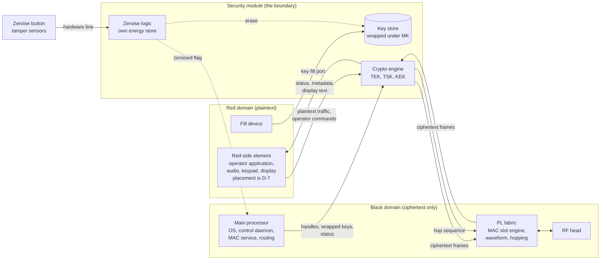
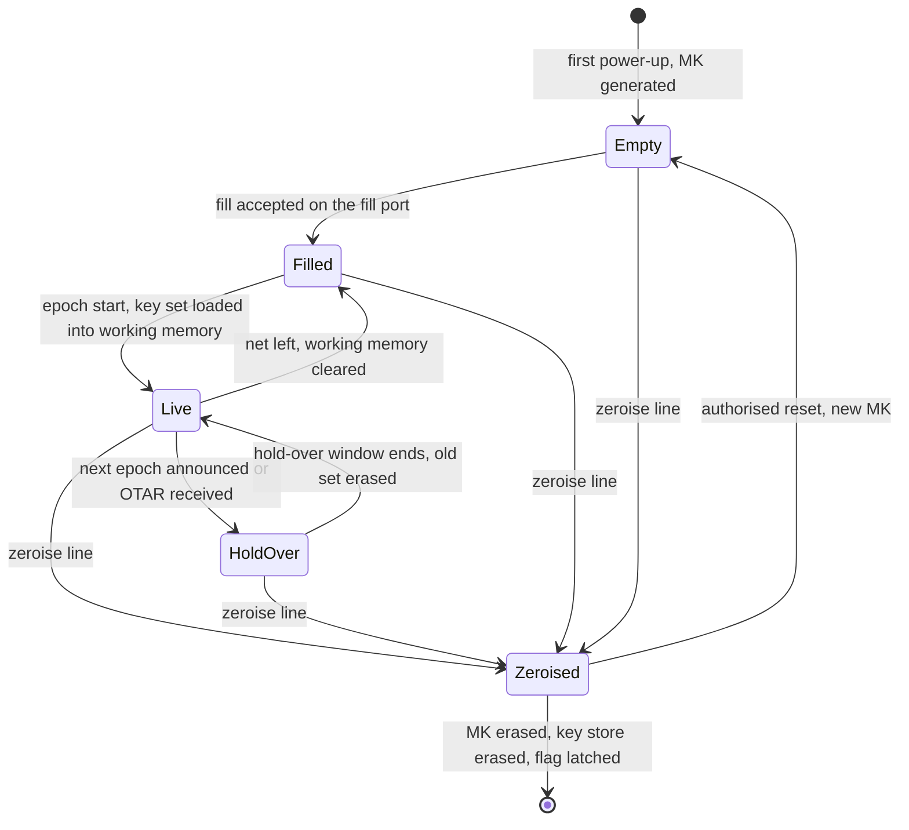
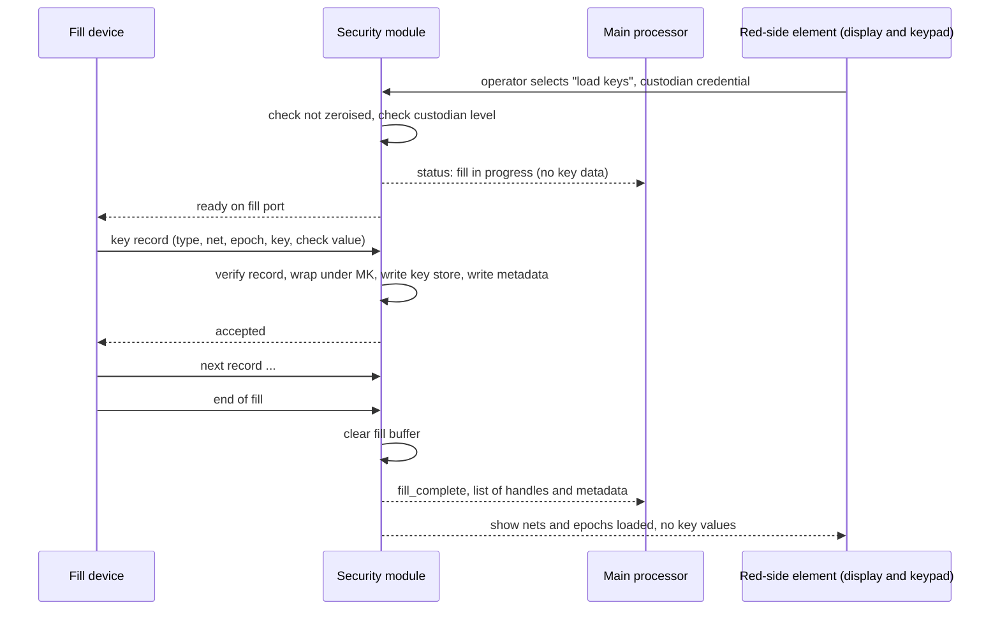
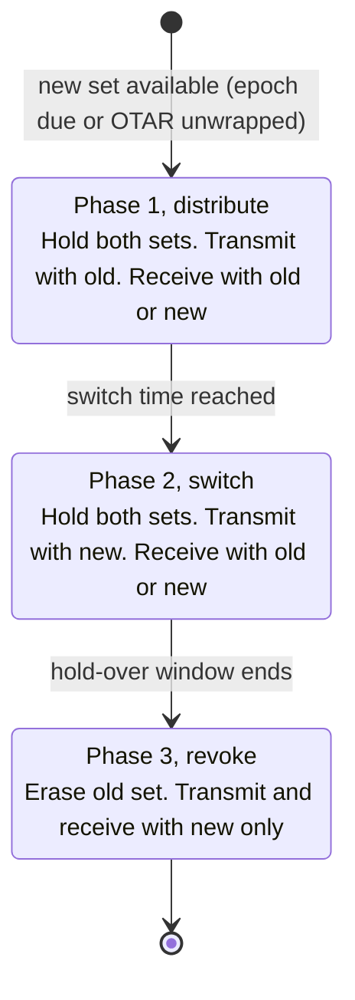
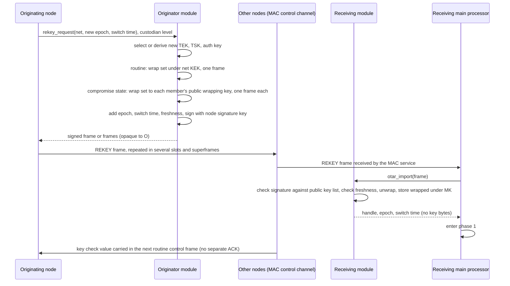
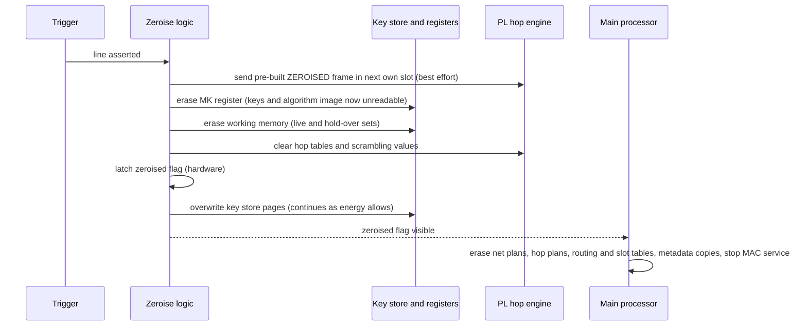
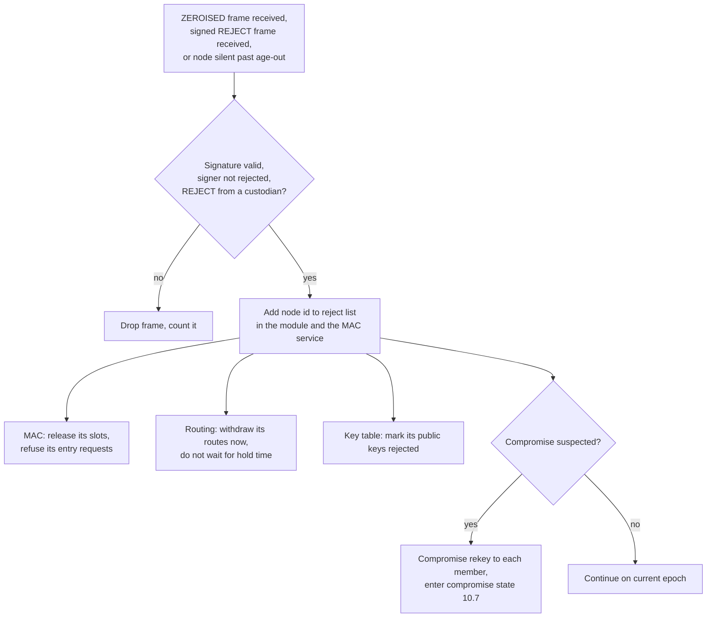

# HH-SDR Security Architecture: Red and Black Separation, Module Boundary, Key Handling

| Item | Value |
|---|---|
| Version | 1.4 |
| Date | 2026-10-20 |
| Status | Proposed. Issued for review by the programme lead, the logic owner and the software owner |
| Plan | F02-AK-6, backbone work package V-130 |
| Author | Akhil |
| Reviewer and approver | Niyam Patel |

## Revision history

| Version | Date | Change |
|---|---|---|
| 1.0 | 2026-10-20 | First issue for internal review |
| 1.1 | 2026-10-20 | Internal review applied. Per-node signature key (D-8) and per-node wrapping key pair (D-9) replace the shared-key assumptions. Compromise state after a capture (10.7). Net classification rule, physical separation and red-side software placement (5.1 to 5.3, D-7). Algorithm loading, two-level authentication, module self-test. Separate power budgets for ride-through and zeroise. Remote zeroise authority. Unpowered tamper detection. Two RF heads. Sulk and acknowledgement rules. Requirements R-11 to R-13, threats T-13 to T-18, checks V-8 and V-9, open items OI-10 and OI-11 |
| 1.2 | 2026-10-20 | Second internal review applied. Signed REJECT frame (11.4). Hello frames carry the compromise state and the epoch, and a pre-filled epoch is used only after a normal-state hello is heard (10.5, 10.6, 10.7). A rejected node never wins a rekey clash (10.4, D-3). Refill round transition rule (10.7). Stored plans live in the module store (6.4, 11.2, V-3). Hello fields added to the MAC reservation (10.3.1, V-1). Tamper reserve needs a cell (6.4, OI-6) |
| 1.3 | 2026-10-20 | Third internal review applied. Net state record signed by a custodian, carried with hellos and every KEY_UPDATE, the only source of the net's state for a late node (10.8, 10.5, T-20). Custodian and zeroise authority role flags in the public key list, checked by receivers (7, 9.2, 11.4). Compromise state entered only on a custodian-signed frame, the hello flag only blocks pre-filled epochs on the hearer (10.7, T-22). Revision history put in order |
| 1.4 | 2026-10-20 | Fourth internal review applied. Net state record expiry is a short interval, not an epoch, and custodians reissue on that interval (10.8, T-20, OI-5). Rule 10.6 aligned with 10.5: a pre-filled epoch needs a valid record, never a hello |

## Contents

- [1. Purpose and scope](#1-purpose-and-scope)
- [2. Terms](#2-terms)
- [3. Requirements this design meets](#3-requirements-this-design-meets)
- [4. Design rules](#4-design-rules)
- [5. Domains and the module boundary](#5-domains-and-the-module-boundary)
- [6. The security module](#6-the-security-module)
- [7. Key types](#7-key-types)
- [8. Key lifecycle per node](#8-key-lifecycle-per-node)
- [9. Key distribution: fill](#9-key-distribution-fill)
- [10. Key change](#10-key-change)
- [11. Zeroise as a network event](#11-zeroise-as-a-network-event)
- [12. Threat review](#12-threat-review)
- [13. Open-source base and what we build on it](#13-open-source-base-and-what-we-build-on-it)
- [14. Verification](#14-verification)
- [15. Decisions](#15-decisions)
- [16. Assumptions](#16-assumptions)
- [17. Open items](#17-open-items)

## 1. Purpose and scope

This note says how traffic and hopping keys reach each radio, where they are kept, how they are changed while the network is running, and what zeroise does to the node and to the rest of the network. It fixes the boundary between the red (plaintext) and black (ciphertext) domains so that the MAC and the network layer can be frozen without a later security change breaking them.

In scope: the key lifecycle on one node, the over-the-air key change across the mobile ad hoc network (MANET), the zeroise flow, the threat review of the fill and over-the-air paths, and the open-source base that the implementation builds on.

Out of scope: the cryptographic algorithms themselves (they are supplied and approved by the customer's authority), the fill device, the physical design of the security module, and the anti-tamper sensors. Each is named where the design depends on it and is carried as an open item.

The note stands alone. Each statement carries one marker:

- **Fixed**: traced to a customer requirement or an approved programme decision.
- **Proposed**: this note's design choice, open to review.
- **TBD**: not decidable yet. Listed in section 17 with an OI-n number.

## 2. Terms

| Term | Meaning |
|---|---|
| Red domain | Everything that may hold plaintext user traffic or a plaintext key |
| Black domain | Everything that only ever holds ciphertext, wrapped keys or key handles |
| Security module | The hardware unit that holds the keys and does the traffic cryptography. One per RF head. No bypass |
| Main processor | The processor that runs the operating system (Linux or a real-time OS, a programme decision still open), the control daemon, the MAC service and routing. It is black. Today it also runs the operator application, which this note places on the red side, pending D-7 |
| Red-side element | The processing element that runs the operator application and drives the audio, keypad and display. Its form is D-7 |
| PL | The programmable logic fabric that carries the waveform, the MAC slot engine and the data path |
| Fill | Loading a key from a fill device into the security module |
| TEK | Traffic encryption key. Protects user traffic for one net |
| TSK | Transmission security key. Drives the frequency hopping pattern and the slot scrambling |
| KEK | Key encryption key. Wraps other keys for transport over the air or over a bus |
| Node wrapping key pair | A public and private key pair unique to one node. Other members wrap a key set to the public key, only that node's module can unwrap it |
| Compromise state | The net's mode after a member is suspected captured: only per-member key updates are used until every member is refilled |
| Custodian | A node whose fill record marks it as allowed to sign REKEY, REJECT, REFILL_COMPLETE and the net state record. The flag is in the public key list every member holds, so receivers can check it |
| Net state record (NSR) | A short record signed by a custodian: epoch number, compromise flag, reject list version, and a short expiry, a fraction of an epoch. A late node trusts the net's state only from a valid NSR |
| MK | Module key. Unique to one module, never leaves it, wraps everything the module stores |
| Key handle | A small integer that names a key inside the module. Carries no key material |
| Epoch | A numbered period of network time with one active TEK and TSK set |
| Rekey | Changing the active TEK and TSK set, scheduled or over the air |
| OTAR | Over-the-air rekeying. A wrapped key sent over the radio link |
| Zeroise | Erasing every key in the module so the radio can no longer decrypt or hop |
| Reject list | The set of node identities the rest of the network no longer trusts |

## 3. Requirements this design meets

| Id | Requirement | Source | Marker |
|---|---|---|---|
| R-1 | A hardware security module with no bypass | Vehicular RFI, security clause (OCR reading, wording to confirm on the scan, OI-9) | Fixed |
| R-2 | Customer-approved, user-specific cryptographic algorithms and key management | Vehicular RFI, security clause. Handheld RFI, security clause | Fixed |
| R-3 | Frequency hopping with the hop pattern under cryptographic control | Vehicular RFI and handheld RFI, ECCM clause (hopping required, rate left to the vendor). "Crypto-controlled" is an OCR reading of the security clause, to confirm (OI-9) | Fixed |
| R-4 | In-built emergency erasure. "With tamper response" is an OCR reading, to confirm on the scan (OI-9). The downstream task text asks for erasure of keys and algorithm, including when unpowered | Handheld RFI and vehicular RFI, erasure clause. V-130 downstream task text | Fixed (erasure). Proposed (tamper response and unpowered erasure, until confirmed) |
| R-5 | Key entry by fill gun on the front panel. Parameters kept across a battery change | Handheld RFI, controls clause | Fixed |
| R-6 | Zeroise complete in under 50 ms | Programme target stated by the lead. Not a customer clause | Proposed |
| R-7 | Zeroise works with the main processor hung or main power lost | Task text for this work package | Fixed |
| R-8 | A key change must not split the network. A node that misses the change must have a way back | Task text for this work package | Fixed |
| R-9 | No plaintext key in Linux userspace, in a log or in a core dump | Task text for this work package | Fixed |
| R-10 | Sulk and break-in modes, and network entry, keep working with the security module in place | Handheld RFI, modes clause (sulk). Vehicular RFI, modes clause (sulk and break-in). Base MAC design | Fixed |
| R-11 | No break in communication on vehicle mains failure, no reboot when the engine is cranked | Vehicular RFI, power clause | Fixed |
| R-12 | Traffic in unicast, multicast and broadcast | Handheld RFI and vehicular RFI, data capabilities clause | Fixed |
| R-13 | Diagnostics start only after an authentication password | Handheld RFI and vehicular RFI, diagnostics clause | Fixed |

## 4. Design rules

1. **Plaintext keys exist in one place.** Inside the security module, in volatile memory or in memory wrapped under the module key. Nowhere else, at any time, including during fill, rekey and zeroise. (Proposed)
2. **The main processor only sees handles and wrapped keys.** Every call from software names a key by its handle. The module refuses any command that would return key bytes. (Proposed)
3. **The traffic path never passes through the main processor in plaintext.** Red user data enters the module from the red side and leaves as ciphertext to the PL. The main processor moves only ciphertext, headers and wrapped keys. (Proposed)
4. **Zeroise is a hardware action.** It is started by a dedicated line, completed by logic inside the module and powered by the module's own energy store. Software may request it. Software cannot block it or be needed for it. (Fixed, from R-4 and R-7)
5. **Every key has an owner epoch and a hold-over window.** Two key sets can be live at once for a bounded time so that no node is cut off by a single missed message. (Proposed, from R-8)
6. **Nothing unspecified is invented.** Algorithm names, fill protocol details, module part numbers and register maps are TBD until the customer or the module supplier gives them. The design works with any of them because it treats them as plug-ins behind fixed interfaces. (Fixed, programme rule)
7. **Open-source core, our own implementation on top.** Each mechanism in this note is built on an open-source project with a usable licence, listed in section 13. The customer-specific algorithm and the user-specific parts are ours, placed behind the open interfaces. (Fixed, project owner instruction of 2026-10-20)

## 5. Domains and the module boundary

The node has two data domains and one control path. The security module is the only component that touches both data domains.

Rules at the boundary (all Proposed unless stated):

| Crossing | What may cross | What may never cross |
|---|---|---|
| Red side to module | Plaintext traffic, fill data on the fill port, operator commands (the module passes a command on to the main processor as a command by handle, never with content) | Nothing from the red side reaches the main processor except through the module |
| Module to red side | Status, key metadata, display text, received plaintext traffic | Nothing that was not produced or checked by the module |
| Module to PL | Ciphertext frames, the hop sequence for the next slots, slot scrambling values | Any key, any plaintext |
| Module to main processor | Key handles, key metadata (epoch, type, fill time), wrapped keys for OTAR, status and alarms, the zeroised flag | Any plaintext key, any plaintext traffic |
| Main processor to module | Commands by handle, wrapped keys received over the air, the epoch schedule, a zeroise request | Any key material in the clear |
| Hardware zeroise line to module | A level or pulse | Nothing else. It is one wire |

### 5.1 Net classification rule

Proposed, for acceptance by the schematic owners (this acceptance is the proof item of work package V-130):

- **Red** is every net that can carry plaintext user traffic, a plaintext key or a plaintext algorithm image: the microphone and earpiece path, the keypad, the display, the red-side element and its memory, the fill port, the operator authentication input, and the red-side logic of the security module. The keypad and display are red in all states, not only while they show traffic, because a net cannot change colour at run time. They are driven by the red-side element, never by the main processor. Status text from the black side reaches the display through the module (boundary table row "module to red side").
- **Black** is every other net: the main processor and its memory, the PL, the RF head, the control link, the black traffic link, the hop link, main power and the chassis.
- A net that is neither is not allowed. Every net on the drawing carries one of the two labels.
- Red and black nets never share a connector, a cable bundle or a board layer region without a labelled crossing, and every crossing is one of the rows in the boundary table above.

### 5.2 Physical separation

Proposed, to be checked on the schematic and layout:

- **Power.** The module has its own regulator fed from main power through a filter, and its own energy store. No red-side supply rail is shared with a black-side load.
- **Ground.** Red-side returns join the black ground at one point inside the module. No red signal return runs through the chassis.
- **Clocks.** The module runs on its own oscillator. No red-side clock is distributed to the black side and no black clock is distributed to red logic. The hop link is driven by the module clock and resynchronised in the PL.
- **Debug.** No JTAG, serial console or test header reaches red logic in a production unit. The module's own debug access is a life-cycle state that cannot be entered while keys are loaded (the OpenTitan pattern). Black-side debug ports may stay only when the module is a separate device that is not on the main processor's JTAG chain (D-5 options (a) and (b)). If the module is a region of the PL (D-5 option (c)), the processor's JTAG reaches that region, so the production unit must lock the processor JTAG permanently (the device's secure lockdown or fuse) or option (c) is excluded. The schematic owners decide which with D-5.

### 5.3 Where the red-side software runs

The design above needs a red-side processing element for the operator application: it handles plaintext voice and text before they enter the module and drives the audio, keypad and display. Today the data terminal and the user IP stack run on the main processor, which this note labels black. That is a contradiction for the production radio and a decision is needed (D-7). Every place in this note that mentions the operator application assumes it runs on the red-side element, and is marked pending D-7 where the current software differs. The options are a small red-side controller inside or beside the module, a red region of the main processor separated by hardware (TrustZone or a second core with its own memory, which weakens rule 1), or accepting plaintext on the main processor for the December demonstration only, marked as a known deviation. This note does not choose.

Where routing sits is a programme decision still open (D-1). This note's design works on either answer. The default drawn above puts routing on the black side, because the routing daemon and the MAC service already run on the main processor and the MANET control messages are protected by the TSK and an authentication tag, not by the TEK.

## 6. The security module

### 6.1 What it is

A separate processing core with its own memory, its own non-volatile key store and its own energy store, placed between the red operator interface and the black PL. One module per RF head, so the vehicular radio with two heads has two modules, each with its own node identity (Fixed, from the programme decision on two RF heads).

The module hardware is not chosen yet (OI-1). Two open designs set the pattern:

- **CrypTech Alpha**, an open hardware security module: a microcontroller with a flash key store and a separate memory for the key encryption key, next to an FPGA that runs the cryptography, with tamper detection. Its board files, FPGA sources and firmware are open.
- **OpenTitan**, an open silicon root of trust. Its key manager is driven by a life-cycle controller in hardware. When the controller deactivates it, the key manager wipes every key with entropy and enters a terminal state that software cannot leave. This is the zeroise pattern used in section 11.

The HH-SDR module may be a small board inside the handheld, or a mezzanine on the vehicular card, or a dedicated region of the PL with its own power and memory. The interfaces below do not change with that choice.

### 6.2 Software inside the module

The module runs a key server. The open-source base is **wolfHSM**: a server that runs on the secure core and a client library that runs on the main processor. The client names every key by a numeric handle. The key bytes stay on the server. All sensitive operations are remote calls over a transport we provide (shared memory, a serial link or a bus). wolfHSM uses **wolfCrypt** for its algorithms and allows a custom algorithm to be registered behind the same call interface, which is where the customer-approved traffic algorithm goes (OI-2).

What we implement on top (Proposed):

- The HH-SDR key types and metadata of section 7.
- The epoch and hold-over logic of section 10 in the server, so that the choice of live key never depends on software on the main processor.
- The zeroise hooks of section 11.
- The fill port handler of section 9.
- The client side on the main processor, exposed to the rest of the software in the shape the programme's software architecture uses (SCA 2.2.2 resource and device ports are the RFI requirement), so that the MAC service reaches the module through one port and no other path. The operator application does not use this client. It sits on the red side and talks to the module over the red traffic link (pending D-7).
- A second, red-side client for the red-side element: operator commands in, status and display text out, plaintext traffic both ways. Same wolfHSM request format, separate transport, so the module can tell the two sides apart by the physical link and never by a field in the message.
- The link to the PL for the hop sequence and for frame encryption at line rate. For the handheld data rates a software engine in the module core may be enough. For the vehicular rates the engine may need to be in logic. This is a measurement item (OI-3).

### 6.3 Interfaces of the module

| Interface | Direction | Carries | Marker |
|---|---|---|---|
| Fill port | In | Key material and key metadata from the fill device, using the fill protocol | TBD protocol (OI-4), Fixed existence (R-5) |
| Control link | Both | wolfHSM request and response messages: commands by handle, wrapped keys, status | Proposed |
| Traffic link, red | In and out | Plaintext voice and data, operator commands, status and display text, from and to the red-side element | Proposed |
| Inter-module link, red (vehicular only) | In and out | Plaintext traffic relayed between the two heads when they serve different nets, see 6.5 | Proposed |
| Traffic link, black | In and out | Ciphertext frames to and from the PL | Proposed |
| Hop link | Out | Hop frequencies and scrambling values for the next N slots, pushed ahead of time. Must keep up with the programme hop rate, 1000 hops per second achieved and 1500 the target, so a value every 0.67 ms | Proposed |
| Zeroise line | In | Hardware trigger | Fixed (R-4, R-7) |
| Zeroised flag | Out | A latched hardware output read by the main processor and by the PL | Proposed |
| Self-test | Out, on the control link | Module built-in test results: key store integrity, algorithm image integrity, energy store charge, tamper loop continuity. Reported by handle, so the radio's card-level fault reporting can show the module as a card | Proposed |
| Power | In | Main power plus a charge path for the module's two energy stores (6.4) | Fixed (R-7, R-11) |

### 6.4 Storage

| Store | Holds | Form | Survives |
|---|---|---|---|
| Module key register | MK | Plaintext, generated inside the module at first power-up, never exported. How the register is held (battery-backed, fused or derived from a physical unclonable function) is OI-10 | Battery change (R-5). Lost on zeroise |
| Key store (non-volatile) | TEK, TSK and authentication key sets per epoch, the net KEK, the node signature key, the node wrapping private key, the public key list of the net members, with metadata | Wrapped under MK with an integrity tag | Power loss. Erased on zeroise |
| Algorithm store (non-volatile) | The loaded algorithm image | Wrapped under MK with an integrity tag | Power loss. Erased on zeroise (the erasure clause covers keys and algorithm) |
| Working memory (volatile) | The live TEK and TSK, and the next set during hold-over | Plaintext, inside the module | A mains dip, on the ride-through store. Cleared on a longer power loss and on zeroise |
| Metadata table | Handle, type, epoch, net id, fill time, origin (fill or OTAR) | Plaintext metadata, no key bytes | Readable by the main processor through the control link |
| Plan store (non-volatile) | Net plans, hop plans, the public key list, the reject list, the compromise state flag | Wrapped under MK with an integrity tag. Delivered to the main processor on request by handle, since a plan carries no key | Power loss and battery change (R-5). Erased on zeroise. The main processor's own non-volatile storage holds software and the node identity only, never a plan |

The module has two energy stores with separate budgets (Proposed):

- **Ride-through store.** Keeps the module, its working memory and the hop link running through a vehicle mains dip or an engine crank (R-11), so there is no break in communication and nothing is reloaded. Its size follows the dip length the vehicle specification names (OI-1). When it is exhausted the working memory is lost, and on return of power the module reloads the live set from the key store on its own, within one superframe, with no fill and no operator action.
- **Zeroise reserve.** Powers the zeroise sequence of section 11 and the tamper detection loop while the radio is unpowered. It is never drawn on for ride-through, so a mains dip cannot leave the radio unable to zeroise. A capacitor bank is enough for the zeroise sequence itself but cannot keep the tamper loop alive through weeks of storage, so this reserve is most likely a small cell, sized to the storage time of OI-6.

Erasing MK alone makes the whole key store unreadable. This is what makes zeroise fast enough for R-6: the module erases MK first, then the working memory, then overwrites the key store as time allows.

### 6.5 Two RF heads on the vehicular radio

Each head has its own module and node identity (section 6.1). Three rules follow (Proposed):

- **One zeroise line serves both modules.** The button, the tamper sensors and the command output are wired to both. Both modules erase at once and each sends its own ZEROISED frame. There is no partial zeroise of one head.
- **Traffic relayed between the heads crosses on the red side.** When the two heads serve different nets with different keys, a frame received on head A is decrypted in module A, passed in plaintext over the red inter-module link to module B and encrypted there. The link is a red net under section 5.1 and never touches the main processor. When both heads serve the same net the relay stays black: the ciphertext frame is forwarded in the PL with no decryption.
- **Each module is filled on its own** through the front panel selector (section 9.3). A fill into head A gives head B nothing.

## 7. Key types

| Key | Scope | Used by | Changed by | Marker |
|---|---|---|---|---|
| TEK | One net, one epoch | Traffic encryption in the module. One TEK covers unicast, multicast and broadcast inside the net (R-12). Whether a multicast group needs its own key is D-6 | Scheduled epoch change or OTAR | Proposed |
| TSK | One net, one epoch | Hop sequence and slot scrambling, computed in the module and pushed to the PL | Same epoch as the TEK | Proposed |
| KEK, net | One net | Wrapping TEK and TSK for a routine OTAR rekey, one frame for everyone. Also derives the entry slot hop sequence (10.5) | Fill only | Proposed |
| Node wrapping key pair | One node | A key set for one node is wrapped to that node's public key. Only its module holds the private key. Every member holds the public keys of all members from fill. Used for KEY_UPDATE to a late node and for every update in compromise state (D-9) | Fill only | Proposed |
| Authentication key | One net, one epoch | Authentication tag on routine MAC control frames: entry, grant, slot moves | Same epoch as the TEK | Proposed |
| Node signature key | One node | Signature on frames that name the sender and change the state of others: ZEROISED, REKEY, KEY_UPDATE, REJECT, REFILL_COMPLETE, the net state record, leave, ZEROISE_CMD. The matching public keys of all net members come from fill, each with its role flags (member, custodian, zeroise authority), so a member cannot forge another member's frame and a receiver can check that a custodian frame really comes from a custodian (D-8) | Fill only | Proposed |
| MK | One module | Wrapping the key store | Never. Erased on zeroise, regenerated at next first power-up | Proposed |

Every key carries metadata: handle, type, net id, epoch number, valid-from network time, fill or OTAR origin, and a short key check value that lets two nodes confirm they hold the same key without exposing it.

## 8. Key lifecycle per node

Each step, with the domain that carries the key and its form (all Proposed):

| Step | Where the key is | Form | Who can see it | Main processor involvement |
|---|---|---|---|---|
| Fill | Fill device, fill cable, fill port, module | Plaintext inside the fill device and the module. On the cable: as the fill protocol defines (TBD, OI-4) | Fill device and module only | None. The main processor sees a "fill complete" status and the new metadata |
| Storage | Module key store | Wrapped under MK | Module only | Reads metadata by handle |
| Use | Module working memory | Plaintext | Module only | Sends traffic to the red traffic link, receives ciphertext on the black link, by handle |
| Change, scheduled | Module working memory, both sets | Plaintext | Module only | Sends the epoch schedule, which is public |
| Change, OTAR | Radio link, PL, main processor, module | Wrapped under the net KEK (routine) or to the recipient's public wrapping key (late node, compromise state), with an integrity tag, until it reaches the module | Only the module can unwrap | Moves the wrapped blob from the MAC service to the module. Cannot read it |
| Zeroise | Module | Erased | Nobody | None required. Receives the flag afterwards |

The statement this table proves: a plaintext key is only ever present inside the fill device and inside the module. The main processor software, Linux and the PL never hold one.

## 9. Key distribution: fill

### 9.1 Flow

The red-side element in this diagram is the placement of D-7. With the current software the display is driven by the main processor, which section 5.1 does not allow for a production unit.

### 9.2 Rules

- The fill port is wired to the module only. There is no path from the fill port to the main processor. (Proposed)
- The module accepts fill only when the operator is authenticated on the red side and the module is not zeroised. (Proposed, consistent with the base MAC design's entry preconditions)
- A fill record is checked for type, net, epoch and integrity before it is stored. A bad record is rejected and the whole fill is reported, not silently skipped. (Proposed)
- The fill device identity and protocol are the customer's choice (OI-4). The open-source reference is **KFDtool**, an open P25 key fill device that implements the manual rekeying standard over a three-wire interface and over UDP, including key load and key erase. We use it as the pattern for the record format and the port handler, and replace the wire protocol when the customer's fill device is known.
- Fill has two levels of authentication (the V-130 task asks for two-level authentication). The operator level unlocks normal use. The custodian level is needed for fill, for originating a rekey, for a zeroise reset and for loading an algorithm. The method is OI-7.
- The algorithm image is loaded by the same fill path as a key record of its own type. The module checks its integrity and its approval tag, stores it wrapped under MK, and reports a positive confirmation (the image check value) to the display. An image without a valid tag is refused. (Proposed, from the V-130 task text)
- Fill is per node. There is no "fill one, spread to the net" path. The first key set on every node always comes from a fill device. OTAR can only replace a key set on a node that already holds the net KEK and its wrapping key pair from a fill. (Proposed)
- A fill also carries the public key list of the net: each member's identity, signature public key, wrapping public key and role flags (member, custodian, zeroise authority). The custodian level of the operator login (above) lets a person issue a command on a node, and the custodian flag in the list lets the other nodes accept it. Both are needed: a custodian login on a node without the flag produces frames the net drops. A member not on the list cannot enter, cannot be answered and cannot be rekeyed. Adding a member means filling the new member and refilling the list on the others, or sending the list update as a signed control frame from a custodian-level node (same authority as D-3). (Proposed)

### 9.3 Vehicular radio with two RF heads

Each head has its own module and its own node identity. Both modules are filled from the one front panel fill port through a selector that connects the port to one module at a time. The selector is a hardware switch, not software. (Proposed)

## 10. Key change

### 10.1 Why two mechanisms

A scheduled change needs no messages and cannot be jammed, but it cannot react to a compromise. An over-the-air change can react, but a node that misses it is cut off. The design uses both (D-2, proposed choice): scheduled epochs for routine change, OTAR for an unplanned change, and one recovery path that serves both.

### 10.2 Epochs

A key set is bound to an epoch number. The fill device loads several epochs at once (for example a week of daily epochs). Network time, which the base MAC design already distributes, says which epoch is current. At the epoch boundary every module switches on its own. No message is needed. (Proposed)

The pattern comes from **OpenThread**: a network key with a key sequence number, a rotation timer and a guard time that stops a node from switching back and forth when it hears both the old and the new sequence.

### 10.3 Three-phase change

Every change, scheduled or OTAR, runs in three phases. The pattern is the key refresh procedure of **Bluetooth Mesh**, as implemented in **Zephyr**.

| Phase | Starts | Transmit with | Receive with | Length |
|---|---|---|---|---|
| 1, distribute | Epoch boundary minus the lead time, or OTAR received | Old set | Old or new | Lead time, a parameter, default one superframe period (OI-5) |
| 2, switch | Epoch boundary, or OTAR switch time | New set | Old or new | Hold-over window, a parameter, default several superframes (OI-5) |
| 3, revoke | End of hold-over | New set | New only | Until the next change |

The hop sequence follows the same phases. During hold-over the PL is given both hop sequences and the receiver searches both. The MAC slot engine must therefore accept two hop tables for a bounded time.

### 10.3.1 What the MAC must reserve before it is frozen

Four things, all Proposed and gathered under V-1:

1. Two hop tables live at once during hold-over, as above. The same facility serves the refill round (10.7), where the entry slots are listened to on two sequences.
2. Entry slots that hop under a KEK-derived sequence, not the epoch TSK (section 10.5).
3. Three fields in the hello frame of the base MAC design: the current epoch number, the key check value of that epoch, and the compromise state flag. Members read them to confirm a key change (10.6). They carry only the shared authentication tag, so a late node does not trust them for the net's state. For that the net state record (NSR, section 10.8) is carried in full, with its custodian signature, in every n-th hello of each member or in a NETSTATE control frame once per superframe (which of the two is OI-5, the signature size decides). The hello's three fields tell a late node which NSR to expect.
4. Space in every frame for the security fields. The exact sizes depend on the approved algorithms (OI-2), so the MAC frame design reserves fields rather than bytes: a key identifier (epoch and net, about one byte), a freshness value (about four bytes), an authentication tag on control frames (8 to 16 bytes in common suites), and on the identity-bearing control frames a signature, whose size can be large for post-quantum suites and may force those frames to span several slots. The traffic frames carry only the key identifier and the tag.

### 10.4 Over-the-air rekey

Rules (Proposed):

- The REKEY frame is a MAC control frame signed with the originator's node signature key and carrying a freshness value, so it cannot be replayed and no other member can forge it (D-8). The wrapped set inside it can only be opened by a module holding the net KEK (routine) or the recipient's private wrapping key (compromise state).
- Acknowledgement rides on existing traffic. A member that has imported the new set puts the key check value of the new epoch in a field of its next routine control frame (its hello or slot frame of the base MAC design). There is no separate REKEY_ACK frame, so a large net adds no frames. A node in sulk sends nothing, and is not expected to acknowledge.
- The frame is repeated: in several slots of one superframe and in several successive superframes, so that one lost frame does not matter. A receiving node that already holds the set ignores repeats.
- The switch time is far enough ahead for the frame to reach every node over the longest route in the net, including nodes in sulk mode that transmit nothing but still receive.
- Who may originate is a decision (D-3). The master-less rule of the base MAC design excludes a fixed key manager. The proposed choice: any node whose operator is authenticated at the custodian level may originate. A REKEY frame signed by a node on the reject list is dropped before any other check, so it can never win anything. Between two valid REKEY frames for the same epoch, a compromise rekey (per-member, 10.7) beats a routine one, and otherwise the lower originating node identity wins and the clash is reported. This is the same tie rule the base MAC design uses for merge, with the reject list applied first.
- The new key set is either the next pre-filled epoch pulled early (the normal case, nothing new goes over the air except the instruction to switch) or a set the originating module derives from the current set and a random value (the compromise case). Which derivation is permitted depends on the approved algorithm suite (OI-2).
- **Routine and compromise rekeys are wrapped differently.** A routine rekey is wrapped under the net KEK, one frame for everyone. A compromise rekey must not reach a captured radio, which still holds the net KEK and the public key list. It is therefore sent as one KEY_UPDATE per remaining member, each wrapped to that member's public wrapping key, with the reject list left out. Only the member's own module holds the private key, so a captured radio, which holds every public key but only its own private key, opens none of them (D-9). This is the Bluetooth Mesh model, where the key refresh goes to each node under a key only that node has. The cost is one frame per member, which for a net of 32 nodes (an OSL design assumption, A-6, not a customer figure) is a few superframes.
- Break-in frames (the emergency class of the base MAC design) carry the same authentication tag as every other control frame and need nothing more.

### 10.5 Late node recovery

A node misses the change if it was off, out of range, or in sulk for longer than the hold-over window. R-8 requires a way back. Three steps, tried in order (Proposed):

1. **Pre-filled epoch.** If the change was a scheduled epoch and the node holds the epoch set from fill, it loads the current epoch once it has received a valid net state record (10.8): signed by a node that the late node's own public key list marks as custodian, not expired, showing normal state and the current epoch. The hello fields alone are not enough, because a captured radio holding the pre-filled epochs can send a hello that looks right. An NSR showing compromise state, an expired NSR, or no NSR at all sends the node to step 2. The late node transmits nothing until then.
2. **Key update request.** The node transmits an entry request in the entry slots of the base MAC design. For this to work after the net has revoked the old set, the entry slots must not hop under the epoch TSK. They hop under a sequence derived from the net KEK, which comes from fill and does not change with the epoch, so a late node can always find them and members always listen on them (this is the second requirement on the MAC, V-1). The request is signed with the node signature key. A neighbour checks the signature against the public key list from fill, confirms the node is not on the reject list, and replies with a KEY_UPDATE frame carrying the current set wrapped to that node's public wrapping key, which only the late node's module can open, together with the current net state record. The late node first checks the NSR: custodian signature, not expired. Then it applies the NSR's reject list version, which may include the very node that answered, and only then checks the KEY_UPDATE's own signature against the updated list. A KEY_UPDATE without a valid NSR, or signed by a node the NSR rejects, is dropped. This is what stops a captured radio from answering a late node whose reject list is out of date. The late node then imports the set exactly as an OTAR blob. A history window still applies, default one epoch (OI-5): after it the neighbours stop answering requests from that epoch and step 3 applies.
3. **Refill.** After the history window, or when no valid NSR has been received within a bound (OI-5), the node has fallen off the net and needs a fill. The operator display says so plainly.

Step 1 needs an internal time source on the node, which the base MAC design requires anyway (the customer asks for both an internal timing source and GNSS time). Without it only step 2 remains.

The pattern for steps 1 and 2 is the Thread network's rule that a node which misses one key rotation can rejoin on its own and one that misses two needs manual action. The exact window lengths are open (OI-5).

### 10.6 The rule that keeps the net together

A node never transmits with a key set that it has not confirmed at least one neighbour also holds, except in phase 2 of a change that network time itself triggered. Confirmation is a key check value for the new epoch heard in any neighbour's hello, or any frame received correctly under the new set. The epoch's presence in the fill metadata is never confirmation on its own, and a hello does not make it one: a node that wants to switch to a pre-filled epoch without having heard that epoch in use needs a valid net state record showing normal state and that epoch, exactly as in 10.5 step 1. In compromise state the pre-filled table is what must not be used. A node in sulk transmits nothing, so the rule does not bind it. It still receives, so it leaves sulk already confirmed if it has heard the new set. This stops a lone node from switching early and losing everyone.

### 10.7 Compromise state

A compromise rekey alone is not enough. The captured radio still holds every pre-filled future epoch, the net KEK and the public key list. The next scheduled epoch boundary or the next routine rekey would move the net back onto keys it knows. So a compromise rekey puts the net into compromise state (Proposed):

- The pre-filled epoch table is marked unusable in every member's module. Epoch boundaries no longer switch keys on their own.
- Routine rekeys under the net KEK are refused by every module. Every key change is a per-member KEY_UPDATE under the public wrapping keys, originated as in 10.4.
- The entry slot hop sequence, derived from the net KEK, stays as it is. The captured radio can find the entry slots, but its entry requests are signed with a key on the reject list and are dropped (T-18 covers the jamming it can still do).
- A member enters compromise state only on a custodian-signed frame: the compromise rekey itself, a REJECT, or a net state record with the flag set (10.8). The compromise flag in a hello (10.3.1) carries only the shared tag, so any member could set it. On its own it does one thing to the node that hears it: it stops that node from using a pre-filled epoch until it has a valid NSR. It never puts the net into compromise state, so one insider cannot force a net-wide refill round.
- The net leaves compromise state only when every member has been refilled with a new net KEK and a new epoch table. The display on every member shows the state until then.

A compromise state costs one frame per member per key change and loses the message-free scheduled change. It lasts until the next fill round, which is why the fill plan should treat a reported capture as a refill trigger for the whole net.

**The refill round.** Members are refilled one at a time, so for a while some hold the new net KEK and some the old. Without a rule the entry slots split, because the two groups derive different entry sequences. The rule (Proposed): the refill loads the new net KEK and keeps the old one, marked receive-only. A refilled member listens to the entry slots on both sequences (the two-table facility of 10.3.1) and transmits entry requests on the new one. It keeps answering KEY_UPDATE requests from members not yet refilled, under the current compromise-state key set, so the net stays whole. When the custodian has refilled the last member, the custodian sends a signed REFILL_COMPLETE frame. On receiving it, or when a refill window has run out (a parameter, OI-5), every member erases the old net KEK, stops listening on the old entry sequence, clears the compromise state flag and returns to normal operation on the new epoch table. A member still not refilled at that point has fallen off the net and needs a fill (10.5 step 3).

### 10.8 The net state record

The net state record (NSR) is how a node that has been away learns the state of the net from someone it can trust. Proposed:

- **Content.** Net identity, current epoch number, compromise state flag, reject list version (a counter raised by every REJECT) together with the identities rejected since the previous version, issue time, and an expiry. The expiry is short, a small fraction of an epoch (the NSR interval, OI-5, with a few superframes as the starting point). It is not tied to the epoch length, because a captured radio holds every record issued before its capture, and each one is a valid normal-state record until it expires. A short expiry bounds the time a late node can be misled by a replay to the NSR interval, instead of up to a whole epoch.
- **Who issues it.** Any custodian. A custodian's module reissues the NSR on the NSR interval, and at once after every REJECT, REKEY and REFILL_COMPLETE it originates or receives, so there is always an unexpired one in the net. Two valid NSRs are reconciled by the later epoch, then the higher reject list version, then the later issue time, then the lower custodian identity.
- **How it travels.** Every member repeats the latest NSR it holds, in every n-th hello or in a NETSTATE control frame once per superframe (10.3.1, OI-5). Every KEY_UPDATE carries it. A member replaces its copy when it receives one with a later epoch or a higher reject list version, after checking the signature against a custodian-flagged key in its list.
- **How it is used.** A member in the net uses it to keep its reject list current. A late node uses it as the only source of the net's state: pre-filled epoch allowed or not (10.5 step 1), whom to trust for a KEY_UPDATE (10.5 step 2), and whether to go to refill.
- **Expiry.** An expired NSR is not trusted for anything. A late node that hears only expired records, which is what a captured radio can replay once the interval has passed, treats them as no record and goes to step 2, then refill. The bound on a replay is therefore the NSR interval. The remaining risk is the one T-21 already accepts: a captured custodian, until another custodian rejects it.
- **Cost.** One signature per NSR interval per custodian, plus one after each custodian frame, repeated by members as a copy. The repeat is a copy, not a new signature, so members need no signing for it. A shorter interval costs more custodian signatures and more control channel bytes, a longer one widens the replay window. OI-5 sets it against the signature size from OI-2.
- **A node needs a custodian in reach.** When no custodian is within the net for longer than the interval, no fresh NSR exists, and late nodes cannot recover until one returns. Members already in the net are not affected, because they use the NSR only to keep their reject list current. The fill plan should give every net at least two custodians.

## 11. Zeroise as a network event

### 11.1 Triggers

| Trigger | Path | Needs the main processor | Marker |
|---|---|---|---|
| Zeroise button on the front panel | Direct wire to the zeroise line | No | Fixed (R-4) |
| Tamper sensor (enclosure open, and others TBD) | Direct wire to the zeroise line. The sensor loop and the zeroise logic run from the zeroise reserve, so a tamper event is detected and acted on while the radio is unpowered | No | Fixed (R-4, erasure). Proposed (unpowered detection, from the downstream task text). Sensor set TBD (OI-6) |
| Operator command on the keypad | The red-side element sends the command to the module, which asserts the zeroise line itself | No | Proposed |
| Remote zeroise over the air | A ZEROISE_CMD control frame with a per-node target, signed by a node whose role flags in the public key list (9.2) include zeroise authority. The module checks the signature and the flag, then asserts the line. A frame signed by any other member, including a custodian who is not a zeroise authority, is dropped and counted | Yes, to move the frame from the MAC service to the module | Proposed. Whether remote zeroise is wanted is D-4 |

All four paths end at the same wire. Everything after that wire is hardware and module logic. On the vehicular radio the wire reaches both modules (6.5).

### 11.2 What is erased, in what order

The main processor holds no key, but it does hold working copies of planning data: net plans, hop plans, the metadata table, routing and slot tables. On the zeroised flag the software erases them and the operating system drops its caches. This runs on main power and is best effort, outside the 50 ms budget. It is not part of the security claim, because none of it lets anyone decrypt or hop, but it is part of the erasure the customer asks for and is checked in V-6. If main power is gone the working copies in volatile memory are lost anyway. The stored plans themselves live in the module's plan store (6.4), which survives a reboot and a battery change (R-5) and is erased with the keys. The main processor's non-volatile storage holds software and the node identity only. V-3 checks it for plan data as well as for key bytes.

Time budget against R-6 (Proposed, to be measured, V-6):

| Step | Budget |
|---|---|
| Line to start of erase | under 1 ms |
| MK register erase | under 1 ms |
| Working memory erase | under 5 ms |
| Hop table clear | under 1 ms |
| Flag latched | under 10 ms in total. After this instant the radio can neither decrypt nor hop. This is the point that R-6 measures |
| Key store and algorithm store overwrite | up to the energy store's capacity, several seconds. Not needed for security because MK is gone, done for depth |

The zeroise reserve (6.4) powers the steps above. The budget must hold with main power removed at the instant of the trigger (R-7). The ZEROISED frame is sent first, while the module still holds the authentication key, and only if a slot of this node is due within a bound (default two slot periods, OI-5). If not, it is skipped. Erase is never delayed for it.

### 11.3 What the node sends before it goes silent

The ZEROISED frame is a MAC control frame built in advance, at every epoch change, and kept in the module next to the hop table. It carries the node identity, the net, the epoch, a freshness value and a signature under the node signature key, so no other member can produce it. The module hands it to the PL as the zeroise sequence begins. It is sent at most once. Nothing follows it. (Proposed)

### 11.4 What the other nodes do

- **The REJECT frame.** A radio that is suspected captured but still transmitting never sends ZEROISED and never ages out. Without a message it would stay a member, enter through 10.5 step 2 and receive the new keys under its own public key. So a custodian-level node sends a signed REJECT frame naming the node identities to add to the reject list, with a freshness value, repeated like a REKEY frame. Every member applies it at once: slots released, routes withdrawn, the node's public keys marked rejected, and the entry in the plan store so it survives a reboot. A compromise rekey (10.4) is always preceded by the REJECT frame for the node it is meant to exclude, and the originating module refuses a per-member update to a node that was not rejected first if the operator has marked it captured. Only a node with the custodian flag in the receiver's public key list may sign REJECT, REKEY, REFILL_COMPLETE and the net state record. The receiver checks the flag in its own list, never the sender's claim. A REJECT signed by a rejected node is dropped. Each REJECT raises the reject list version and a fresh NSR follows it (10.8). (Proposed)
- **Routing.** The routing daemon on each node learns of the loss through its own hello and topology timers. These are long by default (tens of seconds for a neighbour, minutes for a far route). The MAC service shortens this: on a ZEROISED frame or on the reject list update it marks the link down on the network interface, which makes the routing daemon drop the neighbour at once and advertise the change. No change to the routing daemon is needed. (Proposed)
- **Slot table.** The base MAC design's leave and age-out handling applies. A ZEROISED frame is treated as an authenticated leave. (Proposed)
- **Key tables.** The public keys of the zeroised node are marked rejected so that no KEY_UPDATE will ever be sent to that identity and nothing it signs is accepted. The net keys are not changed by a zeroise alone, because a zeroised radio holds nothing. If the operator suspects the radio was captured before it was zeroised, the operator originates a compromise rekey, which goes to each remaining member wrapped to its public wrapping key (section 10.4), and the net enters compromise state (10.7). This is the Bluetooth Mesh node removal pattern: block the node, then refresh the keys of everyone else. (Proposed)
- **Silent loss.** A node that disappears without a ZEROISED frame is handled by age-out, exactly as the base MAC design describes, and then by the same reject list and optional rekey, started by the operator.

### 11.5 Recovery of a zeroised radio

The radio stays usable as hardware. The zeroised flag is cleared only by an authorised reset on the red side, after which the module generates a new MK and reports Empty. A fill is then required. There is no over-the-air path back from Zeroised, by design. (Proposed)

## 12. Threat review

| Id | Threat | Path | Control in this design | Residual and marker |
|---|---|---|---|---|
| T-1 | Plaintext key read from Linux userspace, a log or a core dump | Main processor | Keys never enter the main processor (rule 2). The client library carries handles. Build-time check that no key type crosses the control link (V-2) | Metadata and wrapped blobs can appear in logs. They carry no key. Proposed |
| T-2 | Debug interface on the module reads keys | Module | Debug ports disabled in production builds. OpenTitan pattern: debug access is a life-cycle state the module cannot enter while keys are loaded | Depends on the module hardware (OI-1). TBD |
| T-3 | Fill cable tapped | Fill path | Depends on the fill protocol (OI-4). The module accepts only records with a valid integrity tag and a matching check value | Open until the protocol is known. TBD |
| T-4 | Fill into a captured radio | Fill path | Operator authentication on the red side before fill is accepted | Authentication method TBD (OI-7) |
| T-5 | Forged REKEY frame | Over the air | Signed with the originator's node signature key, freshness value, only one originator per epoch accepted | Only the holder of that node's signature key can forge, which means that node is captured. Handled by reject list and compromise rekey. Proposed |
| T-6 | Replayed REKEY frame | Over the air | Freshness value bound to network time and epoch. Repeats of a known set are ignored | None. Proposed |
| T-7 | Wrapped key set opened by an outsider | Over the air | Net KEK and wrapping key pairs from fill only, never over the air | Strength depends on the approved algorithm (OI-2) |
| T-8 | Net split by a rekey | Over the air | Three phases with hold-over, repeated frames, switch time beyond the longest route, late node recovery, rule 10.6 | Window lengths to be set by simulation (OI-5, V-4) |
| T-9 | Forged ZEROISED frame to push a node off the net | Over the air | Signed with the node signature key of the node it names. A frame signed by any other key is dropped and counted | A member cannot evict another member. Only a captured node can evict itself, which is harmless. Proposed |
| T-10 | Zeroise blocked by a hung processor or a cut power | Node | Hardware line, module logic, own energy store, flag latched in hardware | Measured in V-6 |
| T-11 | Zeroise too slow, keys read out during erase | Node | MK erased first, under 1 ms, which makes the store unreadable before the overwrite | Measured in V-6 |
| T-12 | Captured radio still holding keys | Node | Tamper sensors to the zeroise line, powered while unpowered. Remote zeroise if D-4 is accepted. Reject list, compromise rekey to public wrapping keys, compromise state until refill | Sensor set TBD (OI-6). Until the refill round the captured radio knows the entry slot sequence (T-18) |
| T-13 | Network time pushed forward or back to force an epoch change or a replay window | Over the air | Time messages are authenticated control frames. The module accepts an epoch change from time only within a bounded step per superframe and never backwards. A larger jump needs a REKEY frame | Bound to be set with the time design (OI-5). Proposed |
| T-14 | Red signal coupled onto a black net through a shared supply, ground or clock | Node | Section 5.2 separation rules, checked on the schematic and layout, measured on the board | Measurement method TBD (V-8) |
| T-15 | Red-side debug port or console forms a bypass | Node | Section 5.2: no debug access to red logic in production, module debug gated by life cycle | Depends on the module hardware (OI-1) |
| T-16 | A member forges another member's control frame with the shared net authentication key | Over the air | Identity-bearing frames carry a per-node signature (D-8). Routine frames carry the shared tag and can only move slots, which the base MAC design already arbitrates | A member can still disturb slot allocation. Accepted, as it is detectable and the member is on the net anyway. Proposed |
| T-17 | A member zeroises another member with ZEROISE_CMD | Over the air | Only a node marked as zeroise authority at fill may sign ZEROISE_CMD. The module checks the flag against the public key list, not the sender's word | A captured zeroise authority can zeroise the net. The fill plan limits the authorities to few nodes. Only if D-4 is accepted. Proposed |
| T-19 | A captured radio keeps transmitting and is never rejected, then re-enters and receives new keys | Over the air | The signed REJECT frame (11.4) puts it on every member's reject list before the compromise rekey. Its entry requests and REKEY frames are then dropped by signature | Depends on the operator noticing the capture. Proposed |
| T-20 | A late node falls back to a pre-filled epoch the captured radio holds, or accepts a KEY_UPDATE from the captured radio because its reject list is out of date | Over the air | A late node takes the net's state only from a custodian-signed, unexpired net state record (10.8). Hellos alone are not trusted. The KEY_UPDATE carries the NSR and its reject list version, applied before the KEY_UPDATE signature is checked (10.5 step 2). A captured radio has no custodian key and any NSR it replays expires within the NSR interval, a small fraction of an epoch | A late node can be misled for at most one NSR interval after a capture, and a late node that receives no valid NSR stays silent and goes to refill, which is the safe failure. A captured custodian is T-21. Proposed |
| T-22 | An insider forces a net-wide refill round by setting the compromise flag in its hello | Over the air | The hello flag only stops the hearer from using pre-filled epochs until it has a valid NSR. Compromise state is entered only on a custodian-signed frame (10.7) | The insider can delay late nodes' recovery by a hello interval. Accepted. Proposed |
| T-21 | A captured custodian node sends REJECT, REKEY or REFILL_COMPLETE frames to disrupt the net | Over the air | The frames are valid until that node is itself rejected, by another custodian. The fill plan keeps custodians few | A captured custodian can evict members until noticed. Accepted and reported on the display. Proposed |
| T-18 | A captured radio in compromise state jams or floods the entry slots, whose hop sequence it still knows | Over the air | Its requests are dropped by signature. The entry slots are a small share of the superframe, so traffic continues. Compromise state ends at the refill round, which changes the net KEK and with it the entry sequence | Entry of new or late members is degraded until refill. Accepted. Proposed |

## 13. Open-source base and what we build on it

The project owner's instruction (2026-10-20) is that every core mechanism is open source so that the HH-SDR-specific parts are our own implementation on top of a base we can read and change.

| Mechanism | Open-source base | What it gives | What we build | Licence to confirm (OI-8) |
|---|---|---|---|---|
| Key server inside the module, handles on the main processor | wolfHSM with wolfCrypt | Server and client, key store with handles, wrapped keys, remote crypto calls, custom algorithm hook | Key types and metadata of section 7, epoch logic, zeroise hooks, fill handler, PL links, the customer algorithm plug-in | GPLv2 or commercial |
| Module hardware pattern | CrypTech Alpha | Open board, FPGA cores, firmware, tamper handling, key store split from the host | Our own module to the HH-SDR form factor, or a PL region following the same split | BSD three-clause (hardware and software) |
| Hardware zeroise and terminal state | OpenTitan key manager and life-cycle controller | A hardware-driven wipe that software cannot block, a terminal state, debug access gated by life cycle | Our zeroise logic in the module, following the same state machine. Direct use of the OpenTitan RTL is possible in a PL region and is an option under OI-1 | Apache 2.0 |
| Scheduled epochs, guard time | OpenThread key manager | Key sequence number, rotation timer, switch guard | Epoch table bound to the base MAC design's network time | BSD three-clause |
| Three-phase rekey, node removal | Bluetooth Mesh key refresh and node removal as implemented in Zephyr | Phase model, reject list, "block then refresh" removal under a per-node key | REKEY, KEY_UPDATE, REJECT, REFILL_COMPLETE, ZEROISED and ZEROISE_CMD control frames in the MAC control channel, compromise state and the refill round | Apache 2.0 |
| Signatures and public-key wrapping | wolfCrypt asymmetric primitives, or the customer's suite behind the same hook | Sign and verify, wrap to a public key | Node signature key and wrapping key pair handling (D-8, D-9), public key list from fill | GPLv2 or commercial, with wolfHSM |
| Fill record format and port handler | KFDtool | Open fill device and record handling for the P25 manual rekeying standard | Fill handler in the module. Replace the wire protocol with the customer's fill device protocol | MIT |
| Routing drop on loss | The routing daemon's own link-down handling | Immediate neighbour withdrawal when the interface reports the link down | The MAC service marks the link down on the reject list update. No change to the routing daemon | Already the project's routing base |

What is not open and never will be, and where it plugs in:

| Item | Supplied by | Plugs in at |
|---|---|---|
| Traffic and hopping algorithms | The customer's approval authority | wolfCrypt custom algorithm hook inside the module (OI-2) |
| Fill device and fill wire protocol | The customer | Fill port handler (OI-4) |
| Tamper sensor set | Mechanical and hardware design | Zeroise line (OI-6) |
| Operator authentication method | Programme decision | Fill precondition and command level (OI-7) |

## 14. Verification

Each claim closes on a measured or demonstrated result, uploaded.

| Id | Claim | Method | Where |
|---|---|---|---|
| V-1 | The MAC reserves what section 10.3.1 lists: two hop tables during hold-over and the refill round, KEK-hopped entry slots, the three hello fields (epoch, key check value, compromise flag), security fields in the frame | Review of the MAC frame and slot design before it is frozen, then a test with two tables, a late entry and a compromise flag propagation on the emulated medium | Design review, then simulation |
| V-2 | No key type crosses the control link | A build-time check on the client library interface: every message type is listed, none carries key bytes. A runtime capture of the control link during fill, rekey and zeroise shows handles and wrapped blobs only | Host build, then board |
| V-3 | No plaintext key in a log or a core dump, and no plan on the main processor's non-volatile storage | Fill a known test key and a known test plan, then search every log, the core dump of a forced crash of each process, the swap area and the main processor's non-volatile storage for the key bytes, for any 16-byte window of them, and for the plan content | Host, then board |
| V-4 | A rekey does not split the net | Simulation with the base MAC design's slot model: N nodes, one node off during the change, one node in sulk, one node two hops away with a lossy link. All nodes on the new set within the hold-over window, late node back by step 1 or 2 | Simulation |
| V-5 | A zeroised node is dropped by the others | Emulation: node zeroises, the others show the route withdrawn and the slots released within one superframe, no KEY_UPDATE is ever sent to it | Emulation on the host |
| V-6 | Zeroise completes under budget with the processor hung and with main power removed, and after a mains dip has drained the ride-through store | Oscilloscope on the zeroise line and the zeroised flag. Four runs each: normal, main processor held in reset, main power cut at trigger, trigger after a dip of the specified length. Then a read-out attempt of the key store and of the main processor's planning data | Board with the module candidate |
| V-6a | A tamper event while the radio is unpowered is detected and erases the keys | Radio powered down for the specified storage time, enclosure opened, then powered up: module reports Zeroised, key store unreadable | Board with the module candidate |
| V-7 | Fill never reaches the main processor | Logic analyser on the fill port and the control link during a fill. Fill port traffic appears nowhere on the control link | Board |
| V-8 | No red signal on a black net | Schematic and layout check against section 5.1 and 5.2 by the schematic owners, then a conducted and radiated measurement on the board with a known red test tone | Design review, then board |
| V-9 | A compromise rekey excludes the rejected node, and the exclusion holds across later changes and a refill round | Emulation: a custodian sends REJECT for a node that keeps transmitting, then the compromise rekey. The rejected node keeps its old set, the net KEK, the full public key list and every pre-filled epoch. It decodes nothing after phase 3, nothing after the next epoch boundary, nothing after a second per-member update, its entry requests and REKEY frames are dropped, and it opens no KEY_UPDATE with any key it holds. A late node that was off during all this receives the NSR and does not use its pre-filled epoch. A second late node returns within the same epoch and in reach of the rejected node only: the rejected node replays the last normal-state NSR it holds, which has expired, and the late node goes to step 2 and then to refill without transmitting. The rejected node then sends a forged normal-state hello on a pre-filled epoch's sequence and answers the late node's entry request with its own KEY_UPDATE: the late node ignores both. A plain member sets the compromise flag in its hello: no node enters compromise state. The members are then refilled one by one and the net stays whole until REFILL_COMPLETE | Emulation on the host |

## 15. Decisions

Open decisions with the proposed choice. None is taken in this note.

| Id | Question | Options | Proposed | Owner |
|---|---|---|---|---|
| D-1 | Which side of the security module does routing sit on | (a) Black: routing and MAC control protected by TSK and authentication key only. (b) Red: routing messages encrypted under the TEK, the module sees every control frame | (a). Routing already runs on the main processor, the control frames are authenticated, and the module stays off the control path | Programme lead |
| D-2 | Key change method | (a) Scheduled epochs only. (b) OTAR only. (c) Both, with one recovery path | (c) | Programme lead |
| D-3 | Who may originate an OTAR rekey, a REJECT and a REFILL_COMPLETE | (a) Any custodian-level operator. A rejected node never wins, a compromise rekey beats a routine one, then the lower node id wins a clash. (b) Operators of nominated nodes only. (c) A fill-time list of permitted originators | (a), as it keeps the master-less rule and needs no extra configuration. The reject list applied first removes the captured low-identity node from the tie | Programme lead with the network owner |
| D-4 | Remote zeroise over the air | (a) Not provided. (b) Provided, signed by a fill-time zeroise authority, per-node target | Not proposed either way. (b) adds the ability to disable a lost radio, and adds threat T-17: a captured zeroise authority can zeroise the net | Programme lead with the customer |
| D-5 | Module hardware form | (a) Separate module board. (b) Mezzanine on the vehicular card. (c) PL region with own power and memory, OpenTitan-style | Open. Depends on candidate data (OI-1) | Logic owner with the hardware owner |
| D-6 | Keys for multicast groups | (a) One TEK per net, groups separated by addressing only. (b) A group TEK per multicast group, distributed by the same OTAR path | (a) for the December demonstration. (b) if the customer's key management asks for group separation | Programme lead with the customer |
| D-7 | Where the red-side software runs | (a) A red controller inside or beside the module. (b) A hardware-separated red region of the main processor. (c) Plaintext on the main processor for the December demonstration only, recorded as a deviation | Not proposed. (a) is the only option that keeps rule 1 as written. (c) is what the current software does | Programme lead with the logic and software owners |
| D-8 | Authentication of identity-bearing control frames | (a) Shared net authentication key only, insider forgery accepted. (b) Per-node signature key with public keys from fill, shared tag for routine frames | (b). It is what makes ZEROISED, REKEY and KEY_UPDATE trustworthy against a member. Signature size against the slot length is the cost (10.3.1) | Programme lead with the customer's approval authority |
| D-9 | How a key set for one node is wrapped | (a) Public-key wrapping: each node has a wrapping key pair, members hold all public keys. One list per net, one frame per recipient. (b) Pairwise symmetric keys: every pair of nodes shares a key from fill. No asymmetric algorithm needed, but the fill grows with the square of the net size and a captured radio holds a key with every member. (c) A single per-node symmetric key held by all members, which a captured radio can also open. Not acceptable | (a). It also matches the signature key pair of D-8, so one asymmetric suite serves both. If the customer's suite has no asymmetric algorithm, (b) is the fallback | Programme lead with the customer's approval authority |

## 16. Assumptions

| Id | Assumption | If wrong |
|---|---|---|
| A-1 | Network time is available on every member as the base MAC design describes | Scheduled epochs need a message, and OTAR becomes the only method. On the current reference board no real-time clock, GNSS or 1PPS net has been confirmed on the drawing, so the first demonstration may run on OTAR only |
| A-2 | The base MAC design's control channel can carry a REKEY frame of a few hundred bytes within one superframe | The wrapped set is split across frames with a sequence field |
| A-3 | The module can push hop values to the PL ahead of time at the hop rate | A hop engine in the PL is fed a seed per superframe instead, and the seed path becomes part of the module boundary |
| A-4 | The handheld and the vehicular use the same key types and epoch scheme | Two tables of section 7 and two fill record sets |
| A-5 | The routing daemon withdraws a neighbour when the interface reports link down | A route hold time of up to the daemon's default applies after a zeroise |
| A-6 | The largest net is 32 nodes. This is an OSL design assumption, neither RFI states a net size | The per-member update count in compromise state and the public key list size grow with the net |
| A-7 | The customer's approved suite includes a signature algorithm and a public-key wrapping algorithm | D-9 falls back to pairwise symmetric keys, and D-8 to a shared authentication key with insider forgery accepted |

## 17. Open items

| Id | Item | Needed from | Needed by |
|---|---|---|---|
| OI-1 | Security module candidate data: core, memory, energy store, tamper inputs, debug lockout | Hardware owner | Before D-5 |
| OI-2 | The approved algorithm suite: traffic, hopping, wrapping, authentication, and whether key derivation for the compromise case is permitted. Also whether the programme's post-quantum (CNSA 2.0) compliance line applies to the wrapping and authentication keys | Customer's approval authority, programme lead | Before implementation of the module server |
| OI-3 | Measurement: traffic rate the module core can encrypt in software against the handheld and vehicular link rates | Software owner | Before D-5 |
| OI-4 | Fill device and fill wire protocol | Customer | Before the fill handler is written |
| OI-5 | Parameters: lead time, hold-over window, history window, refill window, REKEY and REJECT repeat count, ZEROISED slot bound, NSR carriage (every n-th hello or a NETSTATE frame per superframe), the NSR interval and expiry (a few superframes as the starting point, traded against custodian signature cost), and the bound on waiting for a valid NSR | Simulation (V-4), signature size from OI-2 | Before the MAC is frozen |
| OI-6 | Tamper sensor set, their wiring to the zeroise line, and the storage time the zeroise reserve must keep the sensor loop alive while the radio is unpowered. For months of storage this reserve is almost certainly a cell, not a capacitor bank, which brings a replacement interval and a low-charge alarm through the module self-test | Mechanical and hardware owners | Before the enclosure design is frozen |
| OI-7 | Operator authentication method on the red side. The RFIs already require an authentication password before diagnostics (R-13), so one method should serve fill, command level and diagnostics | Programme lead | Before fill and command levels are implemented |
| OI-8 | Licence confirmation for each open-source base, against the programme's delivery terms | Programme lead | Before any base is pulled into the build |
| OI-9 | The RFI security and erasure clause scans, to confirm the wording of R-1, R-3 and R-4 | Programme lead | Before this note is issued beyond review |
| OI-10 | How the module key register is held: battery-backed, fused, or derived from a physical unclonable function. Decides whether R-5 (parameters kept across a battery change) holds without a battery in the module | Hardware owner with OI-1 | Before D-5 |
| OI-11 | The form in which the customer's authority delivers the algorithm: source, object for the module core, logic netlist, or a sealed device. Decides the algorithm store format and the loading path of section 9.2 | Programme lead | Before the module server is designed |
