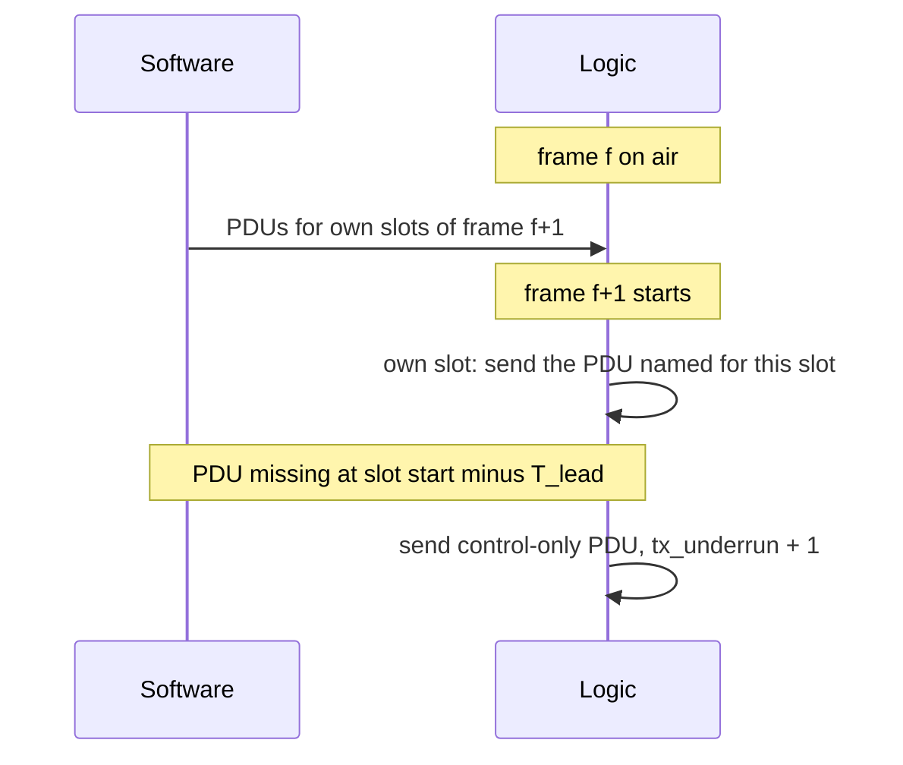

# HH-SDR Slot Engine Specification

| Item | Value |
|---|---|
| Version | 0.5 |
| Date | 2026-10-27 |
| Status | Draft. Sections 5 to 8 written. Sections 1 to 4 and 9 to follow |
| Task | AC2O-T1734 (T1734-A logic, T1734-B network) |
| Sections 1 to 4 and 9 | Logic owner (Nirav). Leads the task and merges |
| Sections 5 to 8 | Network owner (Akhil) |
| Applies to | Handheld and vehicular radios |

Nobody edits the other owner's sections.

## Revision history

| Version | Date | Change |
|---|---|---|
| 0.1 | 2026-10-22 | Section 5, slot types, first draft |
| 0.2 | 2026-10-23 | Section 5: control-only PDU when software is late, pre-emption slot on both radios. Sections 6, 7 and 8 written. Section 6 gives options, decision open |
| 0.3 | 2026-10-23 | Net size 4 (demonstration) and 32 (field). Section 6 tables for L up to 50. Break-in collision and end rules. Entry method open. Owners and state in section 10. Security overhead once per PDU. Options written out for OI-13 and OI-15 |
| 0.4 | 2026-10-26 | Values taken from MAC frame specification v2: control block size (OI-8), message header (OI-9), entry request as a whole PDU (OI-10), MAC fragmentation (OI-15). Overhead formulas include the control block lists. OI-13 notes the security limit. Break-in rule "first heard wins" confirmed |
| 0.5 | 2026-10-27 | Data terminal message is CoAP (RFC 7252) over UDP. Section 7.6 example uses the largest data terminal message. New 7.7 (CoAP sizes), 7.8 (CoAP ACK timeout against the mesh round trip, OI-18) and 7.9 (MAC format version, OI-19) |

## Contents

1. Guard time (logic owner)
2. Payload time (logic owner)
3. Timing reference and resync (logic owner)
4. Signals to hop control and modem (logic owner)
5. Slot types
6. Frame and superframe
7. Slot capacity
8. Software timing
9. Decisions, open assumptions and review record (logic owner)
10. Open items for sections 5 to 8

## 1. Guard time

Logic owner.

## 2. Payload time

Logic owner.

## 3. Timing reference and resync

Logic owner.

## 4. Signals to hop control and modem

Logic owner.

## 5. Slot types

This section says what each slot in a TDMA frame is used for, who may
transmit in it and what it carries. How many slots of each type a frame has
is set in section 6. How many bytes a slot carries is set in section 7.

### 5.1 Slot map types

The slot map gives every slot of the TDMA frame one type. Logic acts on the
type at each slot boundary. Software writes the map, and a new map takes
effect at a superframe boundary.

| Type | Who transmits | Who receives | Content |
|---|---|---|---|
| Own TX | This node only | Every node in range | One PDU from this node (5.2) |
| RX | One other node, the owner of the slot | This node | One PDU from that node |
| Idle | Nobody known | This node listens | Nothing expected. A burst heard here is still received and reported |
| Shared entry | Only nodes in network entry | Every member | One entry request (5.4) |
| Pre-emption | Only a node with an active break-in | Every node in range | One break-in PDU (5.5) |

The type encoding in the slot map register is set with the logic owner in
section 4.


The diagram is an example of one node's map for a 20-slot frame. Slot
positions and counts are set in section 6.

### 5.2 One PDU per own slot

- Every own slot carries exactly one PDU. A node never leaves an own slot
  empty, except when transmit is inhibited.
- The PDU is also the keep-alive. Neighbours detect a silent node from
  missing PDUs in its own slots, so silence is never confused with an idle
  slot.
- When no traffic is waiting, the PDU carries only the MAC header, the
  control block and the CRC. This is the control-only PDU.
- When software misses the handover time for an own slot, logic sends the
  control-only PDU instead of leaving the slot silent (section 8.3).
- One PDU may carry several messages, each with its own message header.
  Section 7 gives the sizes.

### 5.3 How an own slot is used

Voice, data and control are not separate slot types. They are traffic
classes that share the node's own slots. Software fills each own slot in
class order:

```text
CONTROL > EMERGENCY > VOICE > VIDEO > DATA
```

| Use | How it reaches an own slot |
|---|---|
| Control | MAC control block in every PDU (time quality, slot claims, acknowledgements, break-in flag). Routing messages are added in the control class, limited by a rate cap so they cannot starve user traffic |
| Voice | A node in a call needs own slots often enough to carry every vocoder frame. Section 6 covers how the vocoder frame and the TDMA frame line up. Own slots per call: TBD (OI-1) |
| Video | Filled after voice |
| Data | Filled with whatever space is left. A minimum share keeps data from being starved by control |

The order holds in every own slot. A node that relays voice uses its own
slots for the relayed voice as well.

### 5.4 Shared entry slot

How a joining node gets its first slot is open (OI-2): through a shared
entry slot as below, by claiming a slot it heard idle, or both. If the
shared entry slot is not used, this type is left out of the slot map.

- Only a node in network entry may transmit in a shared entry slot. Members
  never transmit in it and always receive it.
- A joining node sends one entry request PDU, after a random back-off
  counted in shared entry slots.
- The entry request is 35 bytes, or 49 bytes when secured. Section 7.5
  checks that it fits one shared entry slot.
- Positions of the shared entry slots are a configuration value, so a
  joining node knows them before it hears any member.
- Number of shared entry slots per frame, S_e: TBD (OI-2). Each one takes
  capacity from own slots.
- No entry requests are sent during break-in or in sulk.

### 5.5 Pre-emption slot for break-in

- One slot in every TDMA frame is a pre-emption slot, on both the vehicular
  and the handheld radio. Both radios use the same frame, so they can work
  in one net. It costs one slot per frame, 5 % of a 20-slot frame.
- With no break-in active, nobody transmits in it and every node listens.
- A node that invokes break-in sends its first break-in PDU in the next
  pre-emption slot. It does not wait for an own slot.
- The break-in flag then spreads in the MAC control block of every PDU.
  While it is set, every node sends only emergency-class messages and the
  control block in its own slots, so relays can forward break-in traffic.
- If two nodes invoke break-in in the same pre-emption slot, their bursts
  collide. Each retries in a later pre-emption slot after a random
  back-off. The first break-in heard wins, and the other node waits until
  that break-in ends.
- Break-in ends when the invoking node sends "break-in off" in its control
  block, which spreads like the "on" flag. As a safety net, the flag also
  expires unless the invoking node refreshes it, so the net recovers if
  that node is lost. The back-off window and the expiry period are TBD
  (OI-3).
- The pre-emption slot is never used for entry.

### 5.6 What logic does per slot type

| Type | Logic at slot start |
|---|---|
| Own TX | Transmit the PDU handed over for this slot. If none, transmit the control-only PDU. If transmit is inhibited, send nothing and count it |
| RX | Receive, check CRC, pass every CRC-good PDU to software with metrics and slot number |
| Idle | Receive as for RX |
| Shared entry | Transmit only if this node is in entry and its back-off ends in this slot. Otherwise receive |
| Pre-emption | Transmit only if a break-in PDU is waiting. Otherwise receive |

Every slot type uses the same guard, preamble and header, so all slots have
the same length and the same payload time (sections 1 and 2).

## 6. Frame and superframe

This section gives the options for slots per TDMA frame, frames per
superframe and superframe length, and the net size each supports. The
choice is open (OI-6).

### 6.1 Inputs

| Input | Value | Status |
|---|---|---|
| Slot length | 1 ms at 1000 hops/s. 0.667 ms (2/3 ms) at 1500 hops/s | 1000 hops/s achieved, 1500 hops/s target |
| Vocoder | MELPe. One frame every 22.5 ms at 2400 bit/s, 67.5 ms at 1200 bit/s, 90 ms at 600 bit/s | Rate TBD, and whether it can change during a call (OI-4) |
| Net size | Demonstration: at most 4 nodes. Field: at most 32 nodes | Decided |
| Slots that are not own slots | Shared entry slots S_e per frame, if the entry method uses them (OI-2), and one pre-emption slot | Section 5 |

Frame length F is the number of slots per frame L times the slot length.
L is loaded from a register, so the demonstration may run with a smaller L
than the field.

| L | F at 1 ms slot | F at 0.667 ms slot |
|---|---|---|
| 20 | 20 ms | 13.33 ms |
| 36 | 36 ms | 24 ms |
| 40 | 40 ms | 26.67 ms |
| 45 | 45 ms | 30 ms |
| 50 | 50 ms | 33.33 ms |

### 6.2 Slots per frame and net size

With one own slot per node, a frame of L slots holds at most
N = L − 1 − S_e nodes. The bitmap in the control block has L bits.

| Net | N | Smallest L |
|---|---|---|
| Demonstration | 4 | 5 + S_e |
| Field | 32 | 33 + S_e |

A 20-slot frame is enough for the demonstration but not for the field. A
node that needs more than one own slot per frame lowers N further. Each
slot bitmap takes L_b = ceil(L / 8) bytes, so the control block grows with
L (section 7.1).

### 6.3 Vocoder frame against TDMA frame

A node can send once per own slot, so at most once per TDMA frame with one
own slot. The vocoder makes a frame at its own fixed interval. If the two
intervals do not divide each other, the wait from "vocoder frame ready" to
"next own slot" changes from frame to frame.

Example with F = 20 ms and MELPe 2400:

| Vocoder frame ready | Next own slot | Wait |
|---|---|---|
| 0 ms | 0 ms | 0 ms |
| 22.5 ms | 40 ms | 17.5 ms |
| 45 ms | 60 ms | 15 ms |
| 67.5 ms | 80 ms | 12.5 ms |
| 90 ms | 100 ms | 10 ms |

The pattern repeats every 180 ms, in which 9 own slots carry 8 vocoder
frames. The effects are:

- the wait varies by up to one frame at every hop, which the receiver's
  voice buffer must absorb
- if the superframe is not a whole multiple of the repeat period, the
  pattern starts at a different point in every superframe and voice
  buffers drift.

All three MELPe intervals are whole multiples of 22.5 ms, and 270 ms is the
smallest period that holds a whole number of each (12, 4 and 3 frames).

With a frame longer than 22.5 ms, one own slot per frame must carry more
than one MELPe 2400 frame:

| F | Most MELPe 2400 frames ready in one TDMA frame | MELPe 1200 | MELPe 600 |
|---|---|---|---|
| Up to 22.5 ms | 1 | 1 | 1 |
| Over 22.5 ms, up to 45 ms | 2 | 1 | 1 |
| Over 45 ms, up to 67.5 ms | 3 | 1 | 1 |

### 6.4 Option 1: superframe aligned with the vocoder

The superframe length S is the smallest whole multiple of both F and 270 ms.
Voice timing then repeats exactly in every superframe, for any of the three
rates.

| L | Slot | F | S | Frames per superframe |
|---|---|---|---|---|
| 20 | 1 ms | 20 ms | 540 ms | 27 |
| 36 | 1 ms | 36 ms | 540 ms | 15 |
| 40 | 1 ms | 40 ms | 1080 ms | 27 |
| 45 | 1 ms | 45 ms | 270 ms | 6 |
| 50 | 1 ms | 50 ms | 1350 ms | 27 |
| 20 | 0.667 ms | 13.33 ms | 1080 ms | 81 |
| 36 | 0.667 ms | 24 ms | 1080 ms | 45 |
| 40 | 0.667 ms | 26.67 ms | 2160 ms | 81 |
| 45 | 0.667 ms | 30 ms | 270 ms | 9 |
| 50 | 0.667 ms | 33.33 ms | 2700 ms | 81 |

L = 45 gives a 270 ms superframe at both slot lengths, and holds the field
net with S_e up to 12.

Consequences:

- The superframe is no longer 1 s. Its edges meet the 1PPS edge every 27 s,
  or every 54 s for S = 2160 ms. How the superframe start is tied to net
  time is set in section 3.
- Any rule written as "per superframe" no longer means "per second". Rates
  and periods stated per superframe must be restated.
- Voice wait still varies inside the repeat period, by up to one frame, but
  the pattern is the same every superframe, so buffers do not drift.

### 6.5 Option 2: 1 s superframe, voice slot sized for the worst case

The superframe stays 1 s on the 1PPS edge. F must divide 1000 ms:

| L | Slot | F | Frames per superframe | Holds the field net |
|---|---|---|---|---|
| 20 | 1 ms | 20 ms | 50 | No |
| 40 | 1 ms | 40 ms | 25 | Yes, S_e up to 6 |
| 50 | 1 ms | 50 ms | 20 | Yes, S_e up to 16 |
| 20 | 0.667 ms | 13.33 ms | 75 | No |
| 50 | 0.667 ms | 33.33 ms | 30 | Yes, S_e up to 16 |

Each own slot used for voice carries as many vocoder frames as can be ready
within one TDMA frame (table in 6.3).

Consequences:

- Simple timing. The superframe stays aligned with the 1PPS edge.
- The voice wait varies by up to one frame per hop, as in 6.3, and the
  pattern starts at a different point in every superframe. The receiver
  must use a voice buffer large enough for this drift.
- This option does not meet the rule that the superframe lines up with the
  vocoder frame.

### 6.6 Comparison

| | Option 1 | Option 2 |
|---|---|---|
| Superframe | 270 to 2700 ms, by L and slot | 1 s |
| Superframe edge on 1PPS | Every 27 s or 54 s | Every second |
| Voice buffer drift | None | Yes |
| Wait variation per hop | Up to one frame, repeating | Up to one frame, not repeating |
| Works for all three MELPe rates | Yes | Yes, with drift |
| Change to "per superframe" rules | Yes | No |
| L values that hold 32 nodes | 36, 40, 45, 50 | 40, 50 at 1 ms. 50 at 0.667 ms |

### 6.7 Decision

TBD at the joint session (OI-6). The decision records L, F, frames per
superframe, S, and the net sizes of 4 for the demonstration and 32 for the
field.

## 7. Slot capacity

This section gives the largest PDU, and the largest message payload, that
one slot carries at each slot length and burst rate. Capacity is worked
from the payload time, after guard, preamble and PHY header, never from the
raw burst rate over the whole slot.

### 7.1 Inputs

| Symbol | Meaning | Value | Source |
|---|---|---|---|
| T_p | Payload time per slot, for 1 ms and 0.667 ms | TBD | Section 2 |
| R_b | Burst rate, one value per modulation mode | TBD (OI-7) | Modulation owner |
| r | FEC code rate at each burst rate | TBD (OI-7) | Modulation owner |
| H | MAC header | 9 B | Frame specification |
| L_b | Bytes in one slot bitmap | ceil(L / 8): 3 at L = 20, 5 at L = 36 or 40, 6 at L = 45, 7 at L = 50 | Frame specification |
| C | Control block, no lists | 6 + L_b: 9 B at L = 20, 11 B at L = 36 or 40, 12 B at L = 45, 13 B at L = 50 | Frame specification |
| C_list | Control block lists | 7 B per Block ACK entry and 4 B per link report entry, up to 15 of each. Beacon body of 13 + L_b B in the first own PDU of every superframe. Queue report 5 B when messages are still queued | Frame specification |
| K | CRC | 4 B | Frame specification |
| m | Message header, per message | 5 B. 6 B when ACK is requested, which is only for unicast data (class 4). A fragment adds a 5 B fragment header | Frame specification |
| s | Security overhead, once per PDU when secured | 14 B | Frame specification |

Security is counted once per PDU. One secured PDU covers every message in
it, which needs a key that every receiver of the PDU holds.

### 7.2 Formulas

Bytes one slot carries:

```text
B_slot = floor(T_p × R_b × r / 8)
```

Fixed overhead of every PDU:

```text
O = H + C + K = 9 + (6 + L_b) + 4 = 19 + L_b     (22 B at L = 20)
```

Largest single message payload:

```text
P_max       = B_slot − O − C_list − m          (m = 5 or 6 B)
P_max, sec  = B_slot − O − C_list − m − 14
```

A PDU with k messages of payload p_1 to p_k fits when:

```text
O + C_list + s + sum over i of (m_i + p_i) ≤ B_slot      s = 14 if secured, else 0
```

The control-only PDU with no lists is O bytes (22 B at L = 20), so every
slot must carry at least O bytes. C_list is not small: with 15 Block ACK
entries and 15 link report entries it is 165 B, and the beacon body adds
13 + L_b B once per superframe.

### 7.3 Capacity table

Filled when T_p (section 2) and the modem numbers (OI-7) are known. The
P_max columns are for L = 20 with no control block lists; subtract C_list
for a real PDU.

| Slot | Burst rate | T_p | B_slot | P_max | P_max, secured |
|---|---|---|---|---|---|
| 1 ms | R_b1 | TBD | TBD | B_slot − 27 to 28 | B_slot − 41 to 42 |
| 1 ms | R_b2 | TBD | TBD | as above | as above |
| 1 ms | R_b3 | TBD | TBD | as above | as above |
| 0.667 ms | R_b1 | TBD | TBD | as above | as above |
| 0.667 ms | R_b2 | TBD | TBD | as above | as above |
| 0.667 ms | R_b3 | TBD | TBD | as above | as above |

Rows are added for each burst rate the modulation owner gives.

### 7.4 Voice in one slot

One MELPe frame is 7 B at 2400 bit/s (54 bits), 11 B at 1200 bit/s (81
bits) and 7 B at 600 bit/s (54 bits). The smallest PDU that carries one
vocoder frame as one message is:

Voice is class 2 and never asks for an ACK, so m = 5 B. At L = 20 with no
control block lists:

| Rate | Message | PDU, plain | PDU, secured |
|---|---|---|---|
| 2400 | 7 B + 5 B | 34 B | 48 B |
| 1200 | 11 B + 5 B | 38 B | 52 B |
| 600 | 7 B + 5 B | 34 B | 48 B |

Every slot length and burst rate in 7.3 must carry at least the secured
2400 figure plus the other messages the slot is expected to hold.

### 7.5 Entry request in the shared entry slot

The entry request is a whole PDU (OI-10, closed). A joining node owns no
slot, so its control block has a zero-length bitmap. The PDU is:

| Part | Size |
|---|---|
| MAC header | 9 B |
| Control block, L_b = 0 | 6 B |
| Message header | 5 B |
| Entry request command, with the free slots heard | 8 + L_b B |
| CRC | 4 B |
| Total | 32 + L_b B: 35 B at L = 20, 38 B at L = 45 |
| Total, secured | 46 + L_b B: 49 B at L = 20, 52 B at L = 45 |

The shared entry slot must carry this PDU.

### 7.6 Packets larger than one slot

The link carries packets of at least 1280 B, the IPv6 minimum, and up to
1532 B when a layer-2 mesh is carried. The MAC splits a larger packet into
fragments sent in several own slots and rebuilds it at the next hop (OI-15,
closed). The scheme follows RFC 4944:

- Each fragment carries a 5 B fragment header: datagram size (2 B),
  datagram tag (2 B) and offset in 8-byte units (1 B).
- Only the last message in a PDU may be a fragment. Every fragment except
  the last carries a multiple of 8 bytes.
- Each fragment of a unicast data packet is acknowledged on its own.
- An incomplete packet is dropped 2 superframes after its first fragment
  arrived.

Example: the largest data terminal message (section 7.7), an IPv4 packet of
1274 B, to one neighbour, over slots that leave 300 B for the message. Each
fragment costs 6 + 5 = 11 B of headers, so a fragment carries up to 288 B of
packet. The packet takes 5 fragments (4 × 288 B and 122 B) and 5 × 11 = 55 B
of headers.

### 7.7 Data terminal message

The data terminal sends each text message as one CoAP (RFC 7252) POST over
UDP and IPv4. CoAP acknowledges it end to end with a separate ACK packet. No
IP header compression is assumed.

| Part | Message | CoAP ACK |
|---|---|---|
| IPv4 and UDP headers | 28 B | 28 B |
| CoAP header and token | 8 B | 8 B |
| CoAP options and payload marker | 6 B | none |
| Text | 1 to 1232 B | none |
| IP packet | 42 B + text, at most 1274 B | 36 B |
| In a PDU, unicast data with MAC ACK (m = 6 B) | 48 B + text, fragmented above one slot (7.6) | 42 B |

The text limit of 1232 B keeps every packet within 1280 B. Example: "HELLO"
is a 47 B packet and takes 53 B of a PDU. Its CoAP ACK takes 42 B in a PDU
of the receiver.

Both layers acknowledge. The MAC acknowledges each fragment on each hop. CoAP
acknowledges the whole message from the far end, and retransmits only when
that ACK does not arrive in time (7.8).

### 7.8 CoAP ACK timeout against the round trip

CoAP waits ACK_TIMEOUT (2 s by default; libcoap accepts no less than 1 s) plus up to 50 % at
random before it sends a message again. If the round trip over the mesh is
longer, the sender sends a copy of a message that is still on its way. The
receiver drops the copy, but the slots are used twice.

With one own slot per node per frame, a packet of n fragments over h hops
takes, without MAC retries and without queued traffic:

```text
T_rt ≤ h × (n + 1) × F
```

n frames forward on each hop, and one frame back for the CoAP ACK. MAC
retries and queued traffic add to it.

Example: the largest message (n = 5) over 4 hops at F = 50 ms gives
T_rt ≤ 1.2 s. The 2 s default leaves 0.8 s for MAC retries and queues, and
a 1 s timeout is too short. The ACK timeout for the field net is TBD when F
(OI-6), the hop count and the MAC retry limit are known (OI-18).

### 7.9 MAC format version

The CoAP version and options version the message. The MAC frame itself has
no format version yet beyond the 2-bit Frame Version of the header. Where a
MAC format version is carried is open (OI-19). The options and their cost
in this section:

| Option | Where | Cost |
|---|---|---|
| A | One byte in the control block | C and O grow by 1 B in every PDU |
| B | Lowest and highest version in the beacon body | Once per superframe, size TBD |
| C | A vendor header element | Header element size in each PDU that carries it |
| D | Switch to the new version at an announced superframe k | Nothing per PDU. Needs the superframe count known to every node |

## 8. Software timing

This section says when software hands a PDU to logic, the latest time it
may do so, and what logic sends when it is late.

### 8.1 One frame ahead

Software writes the PDUs for every own slot of frame f+1 during frame f.
Each PDU names the superframe, frame and slot it is for, so logic never
sends an old PDU in a new slot. How the PDU is named in the transmit buffer
is set with the logic owner in section 4 (OI-14).



### 8.2 Latest handover time

```text
latest handover for an own slot = start of that slot − T_lead
```

T_lead is the time logic needs before the slot start to read the PDU,
encode it and start the burst. It is set by the logic owner in section 4
(OI-12). Software aims to have all PDUs of frame f+1 written before frame
f+1 starts, which leaves the whole of the deadline margin for delays.

### 8.3 Control-only fallback

At start of slot minus T_lead, logic checks the transmit buffer for the
PDU named for this slot:

| Condition | Logic sends | Counted as |
|---|---|---|
| PDU present and named for this slot | That PDU | Frame sent |
| No PDU for this slot, transmit allowed | Control-only PDU: header, current control block, CRC | tx_underrun |
| Transmit inhibited | Nothing | tx_inhibit |

The control-only PDU must carry the current control block, not an old
copy. Who keeps it current is TBD with the logic owner (OI-13):

| Option | How | Effect if software stalls |
|---|---|---|
| A | Software writes a full control-only PDU every frame, next to the normal PDUs | Fallback PDU goes stale |
| B | Software writes the control block every frame, logic adds header and CRC | Control block goes stale |
| C | Logic builds the control block. Logic owns time quality and the break-in flag. Software writes slot claims, the bitmap and acknowledgements into logic registers whenever they change | Fallback stays current for the fields logic owns |

With security on, a PDU is final once it is handed over: the
authentication tag covers the control block, and logic only appends the
CRC. Options B and C have logic write into the PDU, so they work only with
security off. In option A with security on, a fallback PDU sent twice
before software rebuilds it repeats its frame counter, and the receiver's
replay check drops the second copy.

### 8.4 Other slot types

| Type | Handover | If late |
|---|---|---|
| Shared entry | Entry request handed one frame ahead, named for its target shared entry slot | Not sent. Counted. The entry procedure decides the next attempt |
| Pre-emption | Break-in PDU handed as soon as break-in is invoked, named for the next pre-emption slot | TBD (OI-16) |

### 8.5 Receive side

Logic passes every CRC-good PDU to software at the end of its slot, with
the slot number, superframe number and burst metrics. How long software
may take before the receive buffer overflows, and the buffer depth, are
set with the logic owner in section 4 (OI-17).

## 9. Decisions, open assumptions and review record

Logic owner.

## 10. Open items for sections 5 to 8

| Id | Item | Section | Owner | State |
|---|---|---|---|---|
| OI-1 | Own slots per voice call | 5.3, 6 | Network owner | Open until OI-4 and OI-6 |
| OI-2 | Entry method (shared entry slot, claim of an idle slot, or both) and S_e | 5.4, 6.2 | Network owner with the entry design owner | Open |
| OI-3 | Break-in back-off window and flag expiry period. Rules decided in 5.5: first break-in heard wins | 5.5 | Network owner | Values open |
| OI-4 | Vocoder rate, and whether it can change during a call | 6.1 | Programme lead | Open |
| OI-5 | Net size | 6.1 | | Closed: 4 demonstration, 32 field |
| OI-6 | Frame and superframe option, and L | 6.7 | Network and logic owners | Open |
| OI-7 | Burst rates and FEC code rates | 7.1 | Modulation owner | Open |
| OI-8 | Control block size for L other than 20 | 6.2, 7.1 | | Closed: 6 + ceil(L / 8) B plus lists |
| OI-9 | When the message header is 5 B and when 6 B | 7.1 | | Closed: 6 B only when ACK is requested |
| OI-10 | Entry request 35 B: whole PDU or one message | 7.5 | | Closed: whole PDU, 32 + ceil(L / 8) B |
| OI-11 | Security overhead per message or per PDU | 7.1 | | Closed: once per PDU |
| OI-12 | Logic lead time T_lead | 8.2 | Logic owner | Open |
| OI-13 | Who keeps the control-only PDU's control block current | 8.3 | Logic and network owners | Open. With security on only option A works |
| OI-14 | How a PDU is named for its slot in the transmit buffer | 8.1 | Logic owner | Open |
| OI-15 | Splitting packets larger than one slot | 7.6 | | Closed: MAC fragments, RFC 4944 scheme |
| OI-16 | Break-in PDU that misses its pre-emption slot | 8.4 | Network owner | Open |
| OI-17 | Receive buffer depth and how long software may take to read it | 8.5 | Logic owner | Open |
| OI-18 | CoAP ACK timeout for the field net, against hop count, F and MAC retry limit | 7.8 | Network owner | Open until OI-6 |
| OI-19 | Where the MAC format version is carried (options A to D) | 7.9 | Network owner with the logic owner | Open |
