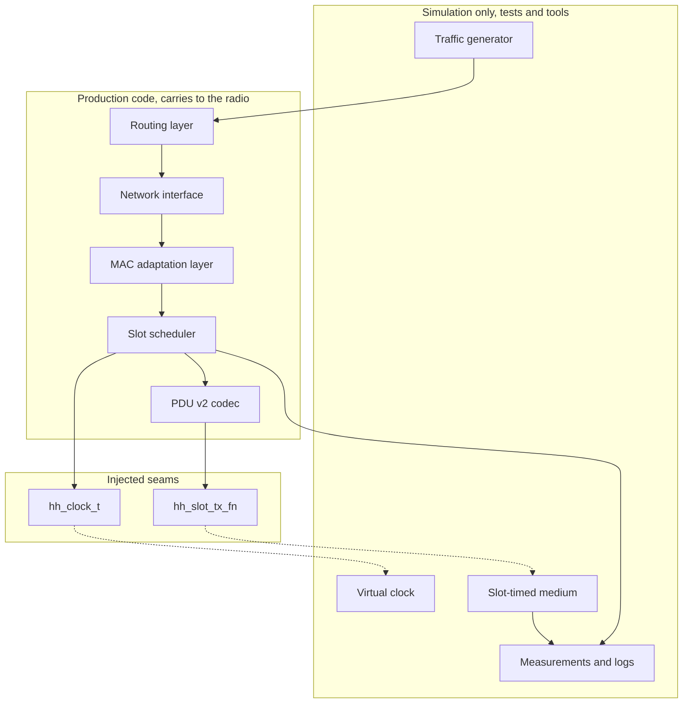
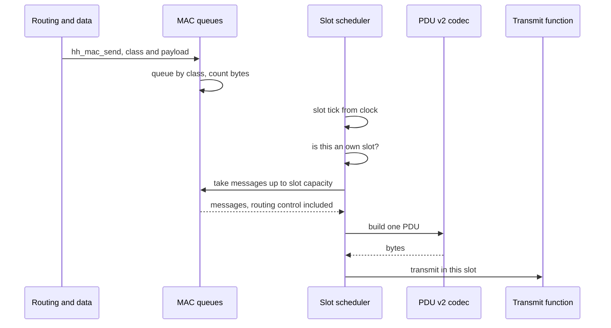

# Slot-Based Network Simulation: Design and Plan

| Item | Value |
|---|---|
| Version | 0.1 |
| Date | 2026-11-06 |
| Status | Draft. Scheduler, codec and stage 1 harness written; tool, dissector and stage 2 not yet |
| Owner | Network owner |
| Inputs | `docs/SLOT-ENGINE-SPEC.md` v0.5, MAC frame specification v2, `docs/MAC-NETWORK-INTERFACE.md` v1.1, `docs/MAC-03_Contention_Access_and_Network_Entry.md` |

Claims in this document are labelled `IMPLEMENTED`, `VERIFIED DESIGN`, `PROPOSED`, or `UNKNOWN / OPEN`.

## 1. Purpose

Prove the network stack on a PC before it runs on radios. Routing packets pass through the MAC adaptation layer and are sent only in the sending node's own TDMA slots. Traffic between simulated nodes is measured for throughput, delay, and loss. Slot use and routing table changes are logged.

The result is evidence that routing, MAC queueing, and the slot frame work together. It does not prove radio timing accuracy (section 12).

## 2. Scope

In scope:

- A slot and frame model that follows the slot engine specification.
- A slot scheduler inside the MAC, so packets leave only in own slots.
- A PDU v2 encoder and decoder, checked against the frame specification test vectors A to E.
- A simulated air medium, virtual clock, traffic generator, and measurements.
- Routing control traffic counted against slot capacity.
- A Wireshark dissector for PDU v2, and the measured share of own slots used by routing control.

Out of scope:

- Radio, FPGA, drivers, and the time synchronization plane.
- New timing, PHY, or radio-control contracts.
- Changes to the hardware ownership rules.
- Modifying OLSRd2. It stays an external, unmodified process.

## 3. What exists today

| Item | Status | Where |
|---|---|---|
| MAC service skeleton with send, status, link metrics, own-slot count | `IMPLEMENTED` | `src/mac/mac.c`, `include/hhsdr/mac/mac.h` |
| Virtual-link simulator with per-link loss and delay, no slots | `IMPLEMENTED` | `tests/sim/netsim.c` |
| Emulated medium and mock radio | `IMPLEMENTED` | `tests/sim/emu_medium.c`, `tests/sim/mock_radio.c` |
| Network interface over an emulated medium, fixed next hops | `IMPLEMENTED` | `src/netif/netif.c`, `tests/integration/test_netif_emulation.c` |
| OLSRd2 mesh in Docker containers | `IMPLEMENTED` | `tools/olsrd2-mesh-emulation/` |
| Dissector for the beacon and routing-update payloads | `IMPLEMENTED` | `tools/atp/wireshark/hh_manet.lua` |
| Slot engine specification | `VERIFIED DESIGN` in draft v0.5, frame option still open | `docs/SLOT-ENGINE-SPEC.md` |
| MAC frame specification v2 | `VERIFIED DESIGN`, held outside the repository until copied in | Frame spec v2 file |
| Slot scheduler (`src/mac/slot.c`) and PDU v2 codec (`src/mac/pdu.c`), with unit tests | `IMPLEMENTED`, host only | `test_slot`, `test_pdu` |
| Slot-timed medium, multi-node harness (`tests/sim/slot_net.c`), traffic generator, loss categories, delay percentiles, slot and route-change log lines, with stand-in routing | `IMPLEMENTED`, test infrastructure | `test_slot_net` |
| Command line run tool, evidence folder, PDU v2 dissector | Not present | To build |

## 4. Architecture

The slot and MAC logic is production code. Only the air, the clock, and the traffic are simulated. The same MAC code is meant to run on the radio later.

Rules kept from the project architecture:

- The slot scheduler reads time only from the injected `hh_clock_t`. It never calls `clock_gettime()` or `time()`.
- The scheduler hands each PDU to a transmit function (`hh_slot_tx_fn`) and takes received PDUs through `hh_slot_receive`. This is the seam to the air. `hh_radio_ops_t` carries whole frames, not PDUs, so it is not the right seam for slot PDUs. How a PDU is named for its slot in the logic's transmit buffer is not defined yet, so the hardware binding of this seam is `UNKNOWN / OPEN`.
- Production targets do not depend on simulation or test code.
- Single-threaded. No new threads, mutexes, or dynamic allocation in control paths.
- Control, data, and time planes stay separate. Forwarding does not use the control socket.

## 5. Slot model

`PROPOSED`. The frame is configurable. Defaults follow the candidate in `docs/MAC-ARCHITECTURE.md` and the slot engine specification.

| Parameter | Default | Source and note |
|---|---|---|
| Slot length | 1 ms | Fixed by the 1000 hop/s rate |
| Slots per frame | 20 | Candidate frame of 20 ms. The final frame and superframe option is still open in the slot engine specification |
| Frames per superframe | 50 | Gives a 1 s superframe |
| Net size | 4 | Configurable. 32 is the field size |
| Own slots per node | Round robin by default | Taken from a slot map given to the scheduler |
| Guard time | Parameter | Value comes from the slot engine specification section 1 |
| Slot capacity in bytes | Parameter | Depends on the burst rate and coding, which the specification leaves open. A placeholder value is used and marked as such in every output until the real value is chosen |

Slot types follow section 5 of the slot engine specification: own slot, shared entry slot, and pre-emption slot. The first version uses own slots plus a slot map. Entry and pre-emption slots are modelled as reserved and carry no traffic until their rules are needed.

Timing: the slot index is computed from the injected clock as an integer count of slot times since the superframe start, so there is no floating-point drift. All durations are stored as integers.

## 6. MAC integration

`PROPOSED`.

Behaviour:

- `hh_mac_send` places the packet in a per-class queue. It never transmits directly.
- On each slot tick the scheduler asks whether the slot is an own slot. If not, nothing is sent.
- In an own slot, exactly one PDU is built, as frame specification v2 requires, and filled up to slot capacity. A PDU with no messages is still sent if the control block must go out.
- Routing control messages use the same queues and the same slot bytes as data. They are tagged so the scheduler can count the bytes they use per slot. This addresses the common error of not charging routing traffic against slot capacity.
- A frame that does not fit the room left waits for the next own slot and keeps its place in its queue. The scheduler limits the MAC's maximum payload to what one PDU can carry, so a larger packet is refused at `hh_mac_send` with TOO_LARGE. Fragmentation is not implemented, by decision: see section 6.1.
- A full queue returns an explicit capacity error. It is counted as a drop, not as a loss on the air.
- Priority order follows the traffic classes of the interface specification.

### 6.1 Fragmentation

The slot engine specification (section 7.6, item closed) and frame specification v2 (section 4.4 and transmit rule 8) require the MAC to fragment a packet larger than the room of an empty PDU. The format is the project's own: a 5-byte fragment header (datagram size, datagram tag, offset in 8-byte units), only the last message of a PDU may be a fragment, and an incomplete packet is dropped 2 superframes after its first fragment. The specifications say this follows the RFC 4944 scheme. RFC 4944 itself defines IPv6-over-802.15.4 adaptation headers, which are not used. The frame specification's header is the one to implement.

Three things are kept apart:

- IP fragmentation at the network layer. Not done by the MAC. The network layer should keep packets within the maximum payload the MAC reports.
- MAC fragmentation of one packet into pieces of different PDUs, with reassembly at the receiver. This is the required feature and is not implemented yet.
- Sending the pieces in successive own slots. This follows from the scheduler: each fragment is the last message of its PDU.

Decision (user, 2026-11-06): this simulation carries only packets that fit one PDU. There is no MAC fragmentation and no reassembly. This differs from the slot engine specification and frame specification v2, which require fragmentation, so the evidence must say that fragmentation is excluded.

Effect:

- The scheduler limits the MAC's maximum payload to what one PDU can carry. A larger packet is refused at `hh_mac_send` with TOO_LARGE and is counted as a scheduler rejection (section 10.4).
- Routing control messages are small and fit. Traffic tests use packet sizes within the limit, and the run summary prints that limit.
- Throughput and delay figures are valid only for packets up to that size. They say nothing about bulk transfers that need fragmentation.
- The network layer must keep its packets within the maximum payload the MAC reports. IP packets of 1280 bytes or more cannot be carried until fragmentation exists.
- Fragmentation stays a separate future piece of work with its own tests. The frame specification's 5-byte fragment header and the 2 superframe reassembly timeout are the starting point.

Open design points are in section 14.

## 7. PDU v2 codec

`VERIFIED DESIGN` for the layout, `PROPOSED` for the code.

Layout, from frame specification v2: Frame Control, PDU sequence, Net ID, PDU destination, Source, optional security header and extension elements, control block, messages, optional authentication tag, and CRC-32. All multi-byte MAC fields are little-endian. A PDU never exceeds one slot's capacity and never exceeds 2047 bytes.

The codec lives in `src/mac/`. It returns `hh_status_t` errors, uses bounded buffers, and has no allocation. Unit tests check the encoder and decoder byte for byte against vectors A to E from the frame specification. Vector S (security on) is out of scope until the security design is settled.

## 8. Simulation harness

`PROPOSED`. Lives under `tests/sim/` and `tools/sim/`, not in production targets.

- **Virtual clock.** A manually advanced clock injected as `hh_clock_t`. No sleeps, so tests are fast and deterministic.
- **Slot-timed medium.** Delivers a PDU sent in slot N to every node in range, in the same slot, with a configurable per-link loss. Link loss and delay reuse what `netsim` already provides where they fit.
- **Collision model.** A collision is decided per receiver, not per slot. A receiver loses a PDU when two or more transmitters it can hear send in the same slot on the same channel. A transmitter that a receiver cannot hear does not interfere there, so spatial reuse is allowed when the slot map permits it. Collision rules apply only to transmissions that overlap in the same slot on the same channel. One channel is modelled at first.
- **Traffic generator.** Creates data flows between node pairs at a set rate and packet size. Part of the test tools only.
- **Topology.** A line, a triangle, and a full mesh of the configured net size, so multi-hop routing is exercised.

Two collision tests are kept separate:

- Exclusive ownership. Every slot has one owner. Expected result: no collisions, in any topology. A collision here means a slot map or scheduler fault.
- Shared slot. Several nodes transmit in a shared slot, such as the entry slot. Expected result: a receiver loses the PDUs only when it hears two or more of them. The entry slot behaviour of the slot engine specification is checked this way once entry is modelled.

## 9. Routing and real OLSRd2 traffic

`UNKNOWN / OPEN`. The Linux interface binding for the OLSRv2 path is unresolved (`unknown.md` U-24), so the way OLSRd2 packets reach the MAC is a decision still to be made.

OLSRd2 is an external Linux process implementing OLSRv2 (RFC 7181) and NHDP (RFC 6130). Its MANET packets may use IP protocol number 138 or UDP port 269, with link-local multicast. The slot code is a C library. Something must carry the packets between them, and a bridge must support the transport mode actually selected and preserve:

- multicast delivery, so one transmission reaches every neighbour,
- interface identity, since OLSRv2 and NHDP work per interface,
- source addressing, since NHDP identifies neighbours by source address,
- packet reception on the interface, and neighbour discovery behaviour as seen by OLSRd2.

Which transport mode the existing Docker mesh uses is `UNKNOWN / OPEN`. Its configuration file (`tools/olsrd2-mesh-emulation/olsrd2.conf`) does not set it, so it follows the OONF default, which has not been checked here. It is established by capturing on a running node, with a command the user runs, before any bridge is designed. A bridge that captured only UDP would miss protocol 138 packets.

| Option | What it is | Gain | Cost |
|---|---|---|---|
| A. Bridge process | A small program reads OLSRd2 packets from a Linux interface per node, hands them to the MAC, and writes received packets back. OLSRd2 runs as a real process in network namespaces or in the existing Docker containers | Real OLSRd2 traffic, real route changes | New Linux interface binding that U-24 leaves open. Docker steps are run by the user |
| B. Routing stand-in | The harness generates hello and topology-control messages of OLSRv2 size and rate, with fixed next hops, as the existing netif test does | Simple and fully deterministic | Not real OLSRd2 traffic |
| C. B first, then A | Prove the slot model with B, then add A | Slot work is not blocked by the binding | Two stages |

Recommendation: C. Steps 1 to 3 of section 13 do not depend on the choice.

The two stages prove different things and their evidence is labelled accordingly:

| Stage | Routing | What it proves | What it does not prove |
|---|---|---|---|
| 1 | Deterministic stand-in with fixed next hops | MAC packet transport, slot accounting, routing-sized traffic on the slots | Neighbour discovery, topology change handling, route convergence, OLSRv2 flooding |
| 2 | Real OLSRd2, unmodified, reusing the Docker mesh | Neighbour discovery, routing, route repair through the slot model | Radio timing |

The share of own slots used by routing control is the same measurement in every option. With B it uses the message size and rate of OLSRv2 defaults, so the result must be labelled as modelled, not measured from OLSRd2.

## 10. Measurements and logs

Measured at the simulated net size, per flow and in total. Every result prints the slot capacity used and whether it is a placeholder.

### 10.1 Run phases

1. Traffic generation for a set time.
2. Traffic shutdown: no new application packets.
3. Drain: queued packets keep transmitting and packets in flight arrive, up to a fixed deadline.

Counting starts after a warm-up period so route formation is not mixed into steady-state figures. A packet still undelivered at the deadline is counted as a deadline loss, never as a lost packet of another kind.

### 10.2 Slot accounting

A PDU holds shared bytes (header, control block, CRC) and messages. The shared bytes are reported on their own and are not silently assigned to any traffic type. Attribution inside a PDU is by message bytes, sub-headers included.

| Measure | Definition |
|---|---|
| Routing payload share | Routing message bytes divided by own-slot capacity bytes, over the run |
| Routing transmitted share | Routing message bytes divided by transmitted PDU bytes |
| Routing slot occupancy | Number of own slots whose PDU carries at least one routing message, divided by own slots, as a count and a percentage |
| Control payload share | The first measure for all class 0 messages: routing, beacons and MAC commands |
| Shared overhead | Header, control block and CRC bytes divided by own-slot capacity bytes |
| Unused capacity | Capacity bytes minus PDU bytes, divided by capacity bytes |

The share asked for by the task is reported as the routing payload share together with the routing slot occupancy, per node and in total. The scheduler already counts routing bytes, class 0 bytes, shared overhead, and slots carrying each, in `hh_slot_stats_t`.

### 10.3 Throughput and delay

Throughput is application bytes delivered per second of virtual time, per flow and in total.

Two delays are reported, each as minimum, median, 95th percentile, and maximum, with the hop count of the flow:

| Delay | Definition |
|---|---|
| MAC queue and delivery delay | Destination MAC delivery time minus source MAC enqueue time. Shows slot waiting |
| Application end-to-end delay | Destination application receive time minus source application generate time. Includes routing and forwarding at every hop |

Averages alone are not used. The traffic generator stamps each packet with its generation time, so the application figure needs no change to production code. The definitions follow the one-way delay and loss ideas of RFC 7679 and RFC 7680 (wire time versus host time, a loss threshold). Whether the details match is `UNKNOWN / OPEN` until those RFCs are re-read.

### 10.4 Loss categories

Loss is never one number. Each lost packet gets exactly one category:

| Category | Meaning | Where it is counted |
|---|---|---|
| Queue drop | Packet rejected because a queue is full | MAC status, queue full counters |
| Scheduler rejection | Packet refused by the scheduler rules: too large, unaddressable, lifetime expired | MAC TOO_LARGE results, scheduler dropped messages, MAC lifetime counters |
| Collision loss | Lost to a simulated collision at a receiver | Medium |
| Channel loss | Lost to the configured link loss | Medium |
| Corruption | Received but failed the CRC or length check | Scheduler bad-receive counter |
| Deadline loss | Not delivered by the end of the drain period | Harness |

The harness checks that the categories add up to packets sent minus packets delivered, so no packet is unexplained.

### 10.5 Logs

Structured `key=value` lines:

- One line per own slot: time, slot index, node, bytes used, bytes of routing control, queue depth.
- One line per routing table change: time, node, destination, old next hop, new next hop.
- A summary file per run with the parameters, so a run can be repeated.

## 11. Dissector

`PROPOSED`. A new Lua dissector for PDU v2, separate from the existing beacon and routing-update dissector. It decodes the fields in section 7 and the test vectors A to E, and reports a status field the way the current dissector does (`ok`, `malformed`, `unsupported_version`).

A check script compares the dissector against the encoder on every `ctest` run, the way `tools/atp/wireshark/check-dissector.sh` does now, so drift fails the build.

The simulation writes a capture file of every PDU. The link type for it is `UNKNOWN / OPEN`:

- The PDU follows the IEEE 802.15.4-2015 general frame header with 2-byte addresses, but uses a CRC-32 and a custom payload, so it is not a plain 802.15.4 frame. Wireshark's built-in 802.15.4 dissector would not decode it correctly.
- The private-use link types (DLT_USER0 to DLT_USER15, values 147 to 162) are the safe choice for a custom format. The existing tooling already uses two of them.
- A new link type value must not be invented. The registry rule is to ask the tcpdump-workers list for one.

The proposed choice is a private-use link type for the capture, as the current tooling does.

## 12. What carries to the radio, and what does not

| Carries over | Replaced on hardware | Not proven by this work |
|---|---|---|
| Slot scheduler, queues, PDU codec, routing integration | Virtual clock becomes the hardware time source. Slot-timed medium becomes the radio | Timing accuracy and guard time on air |
| | Traffic generator and measurements stay test-only | Hardware time synchronization |
| | | Real propagation, interference, and hop timing |

The hardware slot engine, the time synchronization plane, and the radio interface for slots depend on contracts that are still open (`unknown.md` U-21). This work proves the logic, not the timing.

## 13. Build plan

| Step | Work | Proof |
|---|---|---|
| 1 | Slot scheduler in `src/mac/` with configurable frame, driven by a fake clock | Unit tests: sends only in own slots, correct slot index across frame and superframe boundaries |
| 2 | PDU v2 encoder and decoder | Unit tests against vectors A to E |
| 3 | Slot-timed medium and multi-node harness, 4 nodes, data traffic and a routing stand-in (stage 1) | Integration test: traffic crosses two hops, every PDU sent in an own slot, no collisions under exclusive ownership, collisions only at receivers that hear two senders in a shared slot, loss categories add up |
| 4 | Real OLSRd2 traffic through the slots (stage 2), after the transport mode is captured and the decision in section 9 | Run log showing OLSRd2 route formation and repair through the slot model |
| 5 | Measurements, logs, summary files, PDU v2 dissector, check script | Evidence folder with the run log, throughput, delay, loss, routing control share, and the dissector |
| 6 | Tasklist entry, documentation update, `ctest`, sanitizer build | Both builds pass |

Tests stay fast and deterministic and never depend on real sleeps. Each test registers through `hh_add_test()` in the owning component.

## 14. Risks and open decisions

Common mistakes to guard against:

- Slot model timing that differs from the specification. Tests check slot indices against the specification's frame numbers.
- Routing control traffic not charged against slot capacity. A test asserts that control bytes and data bytes share one capacity limit.
- Placeholder slot capacity mistaken for a real figure. Every result prints the capacity used and whether it is a placeholder.

Open decisions:

1. How real OLSRd2 packets enter the MAC, and which transport mode (protocol 138 or UDP 269) the Docker mesh uses (section 9).
2. The final frame and superframe option, which changes defaults but not the design.
3. Slot capacity in bytes, which needs the burst rate and coding.
4. Link type for captures (section 11).
5. How a PDU is named for its slot in the transmit buffer, and the lead time before a slot, from the slot engine specification section 8.
6. Fragmentation is excluded from this work by decision (section 6.1). When it is added later, the packet size limit in the evidence is lifted.

## 15. Standards review

Checked on 2026-11-06. This is a summary of what applies, not a claim of compliance.

| Standard | Use here | Status |
|---|---|---|
| IEEE 802.15.4-2015 general MAC frame format | PDU v2 header fields. TSCH and other 802.15.4 behaviour are not adopted | Already used by frame specification v2 |
| RFC 7181 OLSRv2, with RFC 6130 NHDP and RFC 5444 packet format | Routing protocol of the OLSRv2 path. Determines the routing control message size and rate | Used through OLSRd2 |
| RFC 4944 | The specifications say the MAC fragment scheme follows it. Not used in this work, since fragmentation is excluded | See section 6.1 |
| RFC 2501 | Guidance on evaluating MANET routing protocols. Matches the choice of delivery ratio, delay, and routing overhead as measures | Followed for the measurement list |
| RFC 7679 and RFC 7680 | Definitions of one-way delay and one-way loss for packet networks. Believed to fit the delay and loss measures, not yet re-read | `UNKNOWN / OPEN`, confirm before quoting |
| RFC 8175 DLEP | A standard way for a radio to report link quality to a router. Could feed link metrics to OLSRv2 later | Not needed for this work, noted for the radio phase |
| pcap link types | Private-use types 147 to 162 for custom captures. New values must be requested, not invented | See section 11 |
| Wireshark Lua dissector mechanism | Loaded with the `-X lua_script` option or the plugins directory | Already used by the current dissector |

No open-source TDMA MANET module was found that matches this slot model. The OMNeT++ project omnet-tdma uses a central scheduler and a different simulator, so it is a design comparison only. The ns-3 OLSR model is OLSRv1, not OLSRv2. Neither is adopted.

Not checked: 6TiSCH and 802.15.4 TSCH simulators, ns-3 contrib modules, and military data link standards. They are not needed for the plan above.
